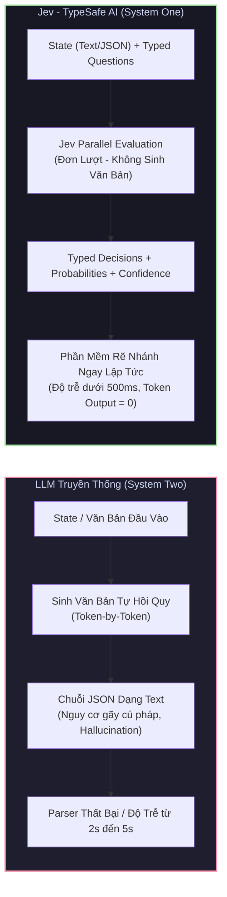

# Tài Liệu Kỹ Thuật Toàn Diện: TypeSafe AI & Mô Hình Quyết Định Jev (System One)

Chào mừng bạn đến với bộ tài liệu kỹ thuật tiếng Việt đầy đủ, chuẩn xác và chi tiết nhất về **TypeSafe AI** và mô hình quyết định hàng đầu **Jev (System One Model)** — được tổng hợp và đối chiếu trực tiếp từ nguồn tài liệu chính thức:
* **Introduction:** [https://docs.typesafe.ai/introduction](https://docs.typesafe.ai/introduction)
* **Cookbooks & Design Patterns:** [https://docs.typesafe.ai/cookbooks](https://docs.typesafe.ai/cookbooks)
* **Models & Specifications:** [https://docs.typesafe.ai/models](https://docs.typesafe.ai/models)

---

## 🌟 Tổng Quan: Bước Chuyển Dịch Sang Kỷ Nguyên "System One AI"

Trong nhiều năm qua, các mô hình ngôn ngữ lớn (LLM như GPT-4, Claude, Gemini) chủ yếu hoạt động theo cơ chế **System Two (Suy Luận Chậm & Sinh Văn Bản Tự Hồi Quy - Autoregressive Text Generation)**: sinh văn bản dạng chuỗi từ (token-by-token), tốn nhiều tài nguyên, độ trễ cao (hàng giây) và thường xuyên gặp lỗi hallucination (bịa đặt) hoặc sai lệch cấu trúc JSON khi tích hợp vào hệ thống phần mềm.

**TypeSafe AI** và mô hình **Jev** ra đời để giải quyết triệt để bài toán này bằng cách mở ra phân loại mô hình hoàn toàn mới: **Mô Hình System One (Hệ Thống Phản Xạ 1)**.



### Điểm Khác Biệt Mang Tính Cách Mạng Của Jev

| Tiêu Chí | LLM Sinh Văn Bản Truyền Thống (GPT-4o, Claude) | TypeSafe AI - Model Jev (System One) |
| :--- | :--- | :--- |
| **Bản Chất Hoạt Động** | Sinh từng token văn bản tự hồi quy (Autoregressive) | Đánh giá trạng thái song song một lượt (Single-pass parallel) |
| **Đầu Ra (Output Modality)** | Văn bản tự do (Prose, Chat, Streaming text) | Quyết định có kiểu (`Choice`, `Score`, `Noul`, `Box`), phân phối xác suất và độ tin cậy |
| **Nguy Cơ Hallucination** | Có, do mô hình cố gắng hoàn thành câu từ | **Bằng 0**, mô hình chỉ đánh giá phân phối xác suất trên rubric định sẵn |
| **Độ Trễ (Latency)** | 1.500ms – 6.000ms+ (phụ thuộc độ dài sinh ra) | **< 300ms – 500ms** (cố định, độc lập với số câu hỏi) |
| **Token Đầu Ra (Output Tokens)** | Bị tính tiền theo số token sinh ra ($5 – $15 / 1M tokens) | **0 token đầu ra (Hoàn toàn MIỄN PHÍ)** |
| **Chi Phí Đầu Vào (Input Tokens)** | $0.15 – $5.00 / 1M input tokens | **$0.042 / 1M input tokens** ($42 trên 1 tỷ tokens) |
| **Cơ Chế Huấn Luyện** | RLHF (Ưu tiên giọng điệu, sự hài lòng con người) | **RLCD (Reinforcement Learning for Calibrated Decisions)** |
| **Tích Hợp Vào Mã Nguồn** | Phải viết parser JSON, try/catch, fallback | Dữ liệu kiểu mạnh (Typed), rẽ nhánh `if/else` trực tiếp |

---

## 📌 Cấu Trúc Bộ Tài Liệu Kỹ Thuật (`JEV/`)

Bộ tài liệu này được cấu trúc thành các chuyên đề độc lập nhưng gắn kết chặt chẽ, từ lý thuyết nền tảng đến thực chiến triển khai (bấm vào từng liên kết để mở file):

| STT | Chuyên Đề | Đường Dẫn Tài Liệu | Nội Dung Cốt Lõi |
| :---: | :--- | :--- | :--- |
| **01** | **Tổng Quan & System One** | [**`docs/01_introduction_system_one.md`**](docs/01_introduction_system_one.md) | Triết lý System One, nguyên lý RLCD, cơ chế đánh giá song song, loại bỏ Hallucination |
| **02** | **Nguyên Thủy Cốt Lõi** | [**`docs/02_core_primitives.md`**](docs/02_core_primitives.md) | Chi tiết 4 Primitive: `Noul`, `Choice`, `Score`, `Box`, ma trận phân phối xác suất & Calibration |
| **03** | **Models & Specifications** | [**`docs/03_models_and_specifications.md`**](docs/03_models_and_specifications.md) | Thông số `jev-1.14.0`, `jev-1.13.0`, bảng giá ($42/tỷ token input, output $0), Danger Zone Headers |
| **04** | **Đặc Tả Kỹ Thuật API** | [**`docs/04_api_reference.md`**](docs/04_api_reference.md) | Toàn bộ Request/Response schema `POST /v1/systemone`, Python & TypeScript SDKs, mã lỗi |
| **05** | **Tuyển Tập Cookbooks** | [**`docs/05_cookbooks_and_patterns.md`**](docs/05_cookbooks_and_patterns.md) | 7 mô hình thực chiến: LLM Guardrails, Intent Routing, RAG Reranking, Fact-checking, Hybrid Agent |
| **06** | **Cẩm Nang Nâng Cao** | [**`docs/06_advanced_guides_and_best_practices.md`**](docs/06_advanced_guides_and_best_practices.md) | Tinh chỉnh Criteria, kỹ thuật ngưỡng 3 vùng (Threshold Tuning), nén State, Evals & Telemetry |

### 💻 Thư Mục Mã Nguồn Mẫu Chạy Ngay (`examples/`)

* [**`examples/01_guardrails_demo.py`**](examples/01_guardrails_demo.py): Tường lửa bảo vệ LLM & chặn Prompt Injection (<150ms).
* [**`examples/02_ticket_routing.py`**](examples/02_ticket_routing.py): Phân luồng vé hỗ trợ khách hàng với Confidence Gating.
* [**`examples/03_rag_reranker.py`**](examples/03_rag_reranker.py): Chấm điểm và lọc các đoạn văn bản (chunks) RAG trước khi gửi tới LLM.
* [**`examples/04_ts_system_one_quickstart.ts`**](examples/04_ts_system_one_quickstart.ts): Mã nguồn mẫu TypeScript hoàn chỉnh sử dụng `@typesafe-ai/sdk`.

---

## 🚀 Quick Start: 30 Giây Với Jev

### 1. Gọi Trực Tiếp Qua cURL (HTTP API)

Bạn có thể gửi một đoạn tin nhắn hoặc JSON bất kỳ làm `state`, cùng tập các câu hỏi có kiểu (Questions) tới endpoint chuẩn `POST https://api.typesafe.ai/v1/systemone`:

```bash
curl -X POST https://api.typesafe.ai/v1/systemone \
  -H "Authorization: Bearer $TYPESAFE_API_KEY" \
  -H "Content-Type: application/json" \
  -d '{
    "model": "jev-latest",
    "state": "Tôi muốn hủy gói gia hạn hàng năm và yêu cầu hoàn lại 120$ ngay lập tức vì tài khoản bị lỗi 3 ngày nay.",
    "questions": {
      "is_urgent": {
        "type": "noul",
        "instructions": "Tin nhắn có thể hiện sự khẩn cấp hoặc đe dọa rời bỏ dịch vụ không?"
      },
      "intent": {
        "type": "choice",
        "instructions": "Xác định mục đích chính của khách hàng.",
        "criteria": {
          "refund": "Yêu cầu hoàn tiền hoặc bồi thường tài chính",
          "bug_report": "Báo cáo lỗi kỹ thuật nhưng không đòi tiền",
          "cancellation": "Yêu cầu hủy tài khoản đơn thuần"
        }
      },
      "sentiment_severity": {
        "type": "score",
        "instructions": "Đánh giá mức độ bất mãn của khách hàng theo thang bậc tăng dần.",
        "criteria": [
          "Bình tĩnh: Phản hồi khách quan không có cảm xúc tiêu cực",
          "Khó chịu: Bày tỏ sự không hài lòng ở mức độ vừa phải",
          "Rất tức giận: Đe dọa hủy dịch vụ hoặc đòi tiền ngay lập tức"
        ]
      }
    }
  }'
```

#### Phản Hồi Trả Về (JSON Chuẩn Xác Suốt & Độ Tin Cậy):
```json
{
  "id": "sys_98fbc21a4e1",
  "model": "jev-1.14.0",
  "answers": {
    "is_urgent": {
      "type": "noul",
      "noul": 0.985
    },
    "intent": {
      "type": "choice",
      "choice": "refund",
      "probabilities": {
        "refund": 0.942,
        "bug_report": 0.041,
        "cancellation": 0.017
      },
      "confidence": 0.925
    },
    "sentiment_severity": {
      "type": "score",
      "score": 2.89,
      "confidence": 0.891
    }
  },
  "usage": {
    "input_tokens": 128,
    "output_tokens": 0
  }
}
```

---

### 2. Sử Dụng Python SDK (`typesafe-sdk`)

Cài đặt SDK chính thức:
```bash
pip install typesafe-sdk
```

Triển khai mã nguồn:
```python
from typesafe_sdk import TypeSafeClient, Noul, Choice, Score

# Tự động lấy biến môi trường TYPESAFE_API_KEY
client = TypeSafeClient()

response = client.system_one(
    model="jev-latest",
    state="Lương nhân viên tháng 10 bị tính thiếu 2 ngày công thực tế.",
    questions={
        "is_payroll_issue": Noul(instructions="Vấn đề có liên quan đến tính toán lương hoặc bảng công không?"),
        "department": Choice(
            instructions="Phòng ban nào chịu trách nhiệm xử lý?",
            criteria={
                "hr_payroll": "Bộ phận nhân sự & tính lương",
                "it_support": "Bộ phận kỹ thuật phần mềm chấm công",
                "finance": "Bộ phận kế toán chi ngân sách"
            }
        ),
        "priority": Score(
            instructions="Mức độ ưu tiên xử lý.",
            criteria=[
                "Thấp: Thắc mắc thông thường",
                "Trung bình: Sai sót cần đối soát trong kỳ",
                "Khẩn cấp: Sai sót ảnh hưởng đến chi trả ngay"
            ]
        )
    }
)

# Rẽ nhánh logic phần mềm an toàn 100%
if response.nouls["is_payroll_issue"].noul > 0.8:
    dept = response.choices["department"].choice
    conf = response.choices["department"].confidence
    print(f"Phân luồng tới: {dept} (Độ tin cậy: {conf:.2f})")
```

---

### 3. Sử Dụng TypeScript / Node.js SDK (`@typesafe-ai/sdk`)

Cài đặt package npm:
```bash
npm install @typesafe-ai/sdk
```

Triển khai mã nguồn:
```typescript
import { TypeSafeClient, noul, choice, score } from '@typesafe-ai/sdk';

const client = new TypeSafeClient({
  apiKey: process.env.TYPESAFE_API_KEY!
});

async function run() {
  const result = await client.systemOne({
    model: 'jev-latest',
    state: 'Query: Sạc pin xe điện VinFast VF8 ở đâu gần Landmark 81?',
    questions: {
      isNavigation: noul('Người dùng đang tìm kiếm vị trí hoặc điểm sạc gần họ?'),
      carBrand: choice('Thương hiệu xe được đề cập:', {
        vinfast: 'VinFast',
        tesla: 'Tesla',
        hyundai: 'Hyundai',
        other: 'Khác hoặc không đề cập'
      })
    }
  });

  if (result.answers.isNavigation.noul > 0.9) {
    console.log('Kích hoạt bản đồ định vị trạm sạc cho hãng:', result.answers.carBrand.choice);
  }
}

run();
```

---

## 📊 Bảng Tra Cứu Thông Số Kỹ Thuật Nhanh (Specifications Cheat Sheet)

| Thuộc Tính | Chi Tiết Kỹ Thuật | Ghi Chú |
| :--- | :--- | :--- |
| **Flagship Model** | `jev-1.14.0` (phát hành tháng 10/2026) | Hỗ trợ hình ảnh, định vị vật thể Box và Long Context |
| **Stable Model** | `jev-1.13.0` | Khuyên dùng cố định (pinning) cho các hệ thống đã calibrate |
| **Aliases** | `jev-latest`, `jev-preview` | Tự động trỏ tới bản phát hành mới nhất hoặc bản thử nghiệm |
| **Base URL** | `https://api.typesafe.ai` | Endpoint duy nhất: `POST /v1/systemone` |
| **Giá Cả (Pricing)** | **$42 / 1 tỷ input tokens** ($0.042 / 1M input tokens) | **Output tokens: 0$ (Hoàn toàn miễn phí)** |
| **Context Window Chuẩn** | **64,000 tokens** / request; **32,000 tokens** / câu hỏi | Đủ chứa cả một chương sách, hợp đồng hoặc 100 log items |
| **Context Window Mở Rộng** | **262,000 tokens** | Kích hoạt qua header: `TypeSafe-Danger-Zone-Long-Context: true` |
| **Hỗ Trợ Hình Ảnh (Vision)** | Nhận ảnh qua trường `assets` và primitive `box` | Kích hoạt qua header: `TypeSafe-Danger-Zone-Images: true` |
| **Độ Trễ Trung Bình** | **150ms – 400ms** | Không sinh từ (Non-autoregressive), tính toán song song tức thì |
| **Số Lượng Câu Hỏi / Call** | Hỗ trợ từ 1 đến 50+ câu hỏi song song | Mọi câu hỏi chạy song song, không tăng thời gian xử lý |

---

## 🎯 Các Mô Hình Kiến Trúc & Use Case Điển Hình

1. **LLM Guardrails & Bảo Vệ Chatbot:**
   * Thay thế các framework guardrail cồng kềnh bằng 1 lệnh gọi Jev <150ms.
   * Kiểm tra jailbreak, prompt injection, ngôn từ thù ghét, rò rỉ dữ liệu nhạy cảm (PII).
2. **Hệ Thống Phân Luồng Yêu Cầu Tốc Độ Cao (Intent Routing):**
   * Phân loại email, ticket khách hàng, hoặc tin nhắn chatbot tới đúng microservice hoặc phòng ban với độ tin cậy được hiệu chuẩn.
3. **Chấm Điểm & Tái Sắp Xếp RAG (RAG Passage Re-ranking):**
   * Đánh giá mức độ khớp ngữ nghĩa của 20-50 đoạn văn bản (chunks) từ Vector Database trước khi đưa vào LLM Context Window, loại bỏ dữ liệu rác và tiết kiệm chi phí.
4. **Kiểm Tra Trích Dẫn & Chống Hallucination (Grounding Verification):**
   * Kiểm tra xem câu trả lời của AI có thực sự được rút ra từ tài liệu gốc hay không với primitive `noul`.
5. **Mô Hình Kết Hợp Phản Xạ Nhanh + Suy Luận Chậm (System 1 + System 2 Hybrid):**
   * Jev xử lý 80-90% các tác vụ tức thì (chi phí gần bằng 0). Khi Jev phát hiện `confidence < 0.75` (không chắc chắn), hệ thống mới kích hoạt các LLM khổng lồ (GPT-4o, Claude 3.5 Sonnet) hoặc chuyển cho con người xử lý.

---

## 🧭 Hướng Dẫn Đọc Bộ Tài Liệu

* Nếu bạn muốn hiểu bản chất kiến trúc và sự đột phá của System One: Hãy bắt đầu với [**`docs/01_introduction_system_one.md`**](docs/01_introduction_system_one.md).
* Nếu bạn cần nắm chắc 4 kiểu câu hỏi nguyên thủy (`Noul`, `Choice`, `Score`, `Box`): Đọc ngay [**`docs/02_core_primitives.md`**](docs/02_core_primitives.md).
* Nếu bạn quan tâm đến thông số model, token limits và bảng giá: Xem [**`docs/03_models_and_specifications.md`**](docs/03_models_and_specifications.md).
* Nếu bạn là lập trình viên cần tích hợp API và tra cứu Request/Response: Xem [**`docs/04_api_reference.md`**](docs/04_api_reference.md).
* Nếu bạn muốn copy các bài toán thực tế (Guardrail, RAG, Routing): Khám phá [**`docs/05_cookbooks_and_patterns.md`**](docs/05_cookbooks_and_patterns.md).
* Nếu bạn muốn tối ưu hiệu năng production, tinh chỉnh Thresholds và Evals: Đọc [**`docs/06_advanced_guides_and_best_practices.md`**](docs/06_advanced_guides_and_best_practices.md).

