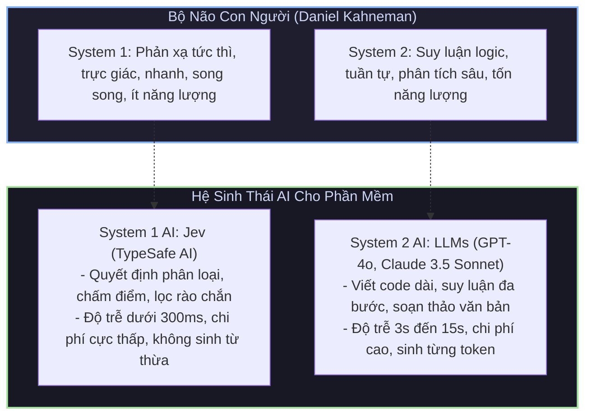
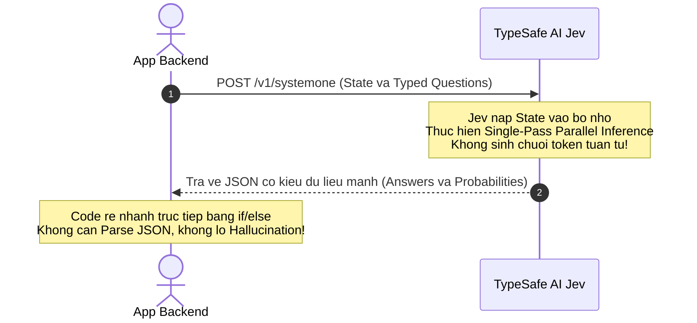

# Chương 1: Giới Thiệu Tổng Quan & Triết Lý "System One AI"

[← Quay lại README](../README.md) | [Chương 2: Các Nguyên Thủy Cốt Lõi →](02_core_primitives.md)

> **Tài liệu tham chiếu chính thức:** [https://docs.typesafe.ai/introduction](https://docs.typesafe.ai/introduction)

---

## 1.1. Bối Cảnh Ra Đời Của TypeSafe AI & Jev

Vào tháng 9 năm 2026, **TypeSafe AI** (công ty khởi nghiệp về hạ tầng trí tuệ nhân tạo có trụ sở tại San Francisco) công bố vòng gọi vốn hạt giống (Seed Round) trị giá **40 triệu USD** do quỹ đầu tư công nghệ danh tiếng **DCVC (Data Collective)** dẫn đầu. Cùng thời điểm đó, TypeSafe AI chính thức ra mắt mô hình chủ lực mang tên **Jev**.

Khác biệt hoàn toàn với trào lưu chạy đua xây dựng các mô hình tạo sinh văn bản đàm thoại (Chatbot LLMs) như OpenAI GPT, Anthropic Claude hay Google Gemini, TypeSafe AI định vị Jev là **mô hình System One đầu tiên trên thế giới** — một động cơ trí tuệ chuyên trách đưa ra các quyết định có cấu trúc, có kiểu dữ liệu mạnh (Strongly-typed) và phân phối xác suất được hiệu chuẩn chuẩn xác (Calibrated Probabilities) trực tiếp cho mã nguồn phần mềm.

---

## 1.2. Thuyết Hai Hệ Thống Tư Duy & Sự Bất Cập Của LLM Hiện Nay

Lý thuyết tâm lý học nhận thức nổi tiếng của nhà kinh tế học đoạt giải Nobel **Daniel Kahneman** (*Thinking, Fast and Slow*) chỉ ra rằng não bộ con người vận hành bởi hai hệ thống tư duy:

* **Hệ Thống 1 (System 1 - Fast & Intuitive):** Hoạt động tự động, tức thì, bản năng, tiêu tốn rất ít năng lượng và xử lý song song các tín hiệu giác quan để đưa ra quyết định chớp nhoáng (ví dụ: nhận ra sự tức giận trong giọng nói, né một vật thể đang bay tới, đọc biển báo giao thông).
* **Hệ Thống 2 (System 2 - Slow & Deliberative):** Hoạt động có chủ ý, chậm rãi, tuần tự, suy luận logic từng bước (Chain-of-thought) và tiêu tốn nhiều năng lượng (ví dụ: giải bài toán phức tạp, viết một bài luận, lập chiến lược kinh doanh).



### Nghịch Lý Của Kỹ Nghệ Phần Mềm Hiện Đại

Trong giai đoạn 2023–2025, ngành công nghiệp phần mềm đã phạm phải một sai lầm kiến trúc phổ biến: **Dùng công cụ System Two (LLM sinh văn bản) để giải quyết các bài toán System One (phân loại và quyết định)**.

Khi một lập trình viên chỉ cần biết:
* "Email này của khách hàng có giận dữ hay không?"
* "Tin nhắn này nên chuyển tới phòng Kỹ Thuật, Kế Toán hay Kinh Doanh?"
* "Đoạn mã này có chứa mã độc SQL Injection không?"
* "Đoạn văn này có trả lời đúng câu hỏi của người dùng trong hệ thống RAG không?"

Họ buộc phải:
1. Gửi prompt dài dòng yêu cầu LLM: *"Hãy trả về kết quả dưới định dạng JSON với schema sau, không được giải thích thêm..."*
2. Chờ LLM sinh văn bản theo cơ chế tự hồi quy (Autoregressive - sinh từng từ một) mất từ 1.500ms đến 4.000ms.
3. Chịu rủi ro LLM tự ý sinh thêm lời chào, dấu markdown thừa (` ```json `), hoặc sinh sai schema.
4. Viết code phòng thủ `try / catch` phức tạp để bóc tách (parse) chuỗi text thành JSON.
5. Chi trả chi phí đắt đỏ cho hàng trăm token đầu ra (Output tokens) chỉ để nhận lại một chữ `"billing"`.

---

## 1.3. Mô Hình System One Của Jev Hoạt Động Như Thế Nào?

Jev loại bỏ hoàn toàn cơ chế sinh văn bản tự hồi quy (Autoregressive text generation). Thay vào đó, Jev hoạt động dựa trên cơ chế **Đánh giá trạng thái song song (Parallel State Evaluation)**.



### Các Đặc Tính Kỹ Thuật Cốt Lõi:

1. **State-Centric Architecture (Kiến Trúc Trọng Tâm Trạng Thái):**
   * Bạn chỉ cần cung cấp trạng thái hiện tại (`state`). Trạng thái này có thể là một chuỗi văn bản, một đối tượng JSON phức tạp, một danh sách bản ghi, hoặc thậm chí là hình ảnh (từ Jev 1.14).
2. **Parallel Typed Questions (Câu Hỏi Có Kiểu Độc Lập):**
   * Bạn gửi kèm một danh mục các câu hỏi được định nghĩa theo các primitive chuẩn: `noul` (Đúng/Sai), `choice` (Lựa chọn từ danh sách hữu hạn), `score` (Đánh giá theo rubric thứ tự), `box` (Tọa độ vật thể).
   * Jev đánh giá tất cả các câu hỏi này **đồng thời, song song và độc lập hoàn toàn** trong một lượt quét duy nhất. Số lượng câu hỏi tăng lên hầu như không làm tăng độ trễ của API!
3. **Zero Prose, Zero Streaming (Không Văn Bản, Không Streaming):**
   * Jev không "nói chuyện", không giải thích lý do, không sinh câu văn. Kết quả trả về là cấu trúc dữ liệu thuần túy mà máy tính đọc được ngay.
4. **Zero Hallucination (Loại Bỏ Hoàn Toàn Ảo Giác):**
   * Ảo giác (Hallucination) là đặc trưng cố hữu của các mô hình sinh từ khi cố gắng hoàn tất chuỗi xác suất từ vựng tiếp theo. Vì Jev không sinh từ, hiện tượng bịa đặt dữ liệu hoàn toàn bị triệt tiêu.

---

## 1.4. Đột Phá Huấn Luyện: RLCD (Reinforcement Learning for Calibrated Decisions)

Điểm cốt lõi tạo nên sự vượt trội về độ tin cậy của Jev so với các mô hình khác chính là phương pháp huấn luyện:

* **RLHF (Reinforcement Learning from Human Feedback):** Dùng cho ChatGPT, Claude để tối ưu hóa độ trôi chảy, phong cách lịch sự, làm hài lòng con người trong giao tiếp.
* **RLVR (Reinforcement Learning with Verifiable Rewards):** Dùng cho các mô hình suy luận sâu (như OpenAI o1) để tối ưu chuỗi bước giải toán hoặc viết mã.
* **RLCD (Reinforcement Learning for Calibrated Decisions):** Phương pháp độc quyền của TypeSafe AI, tối ưu hóa mô hình để **phản ánh chính xác độ không chắc chắn (Uncertainty) của thế giới thực**.

### Khái Niệm Hiệu Chuẩn Xác Suất (Calibration) Là Gì?

Một mô hình được gọi là **hiệu chuẩn hoàn hảo (Well-calibrated)** khi xác suất mà nó tuyên bố khớp chính xác với tần suất xuất hiện trong thực tế:
* Nếu Jev trả về một `noul` với xác suất `0.80` cho 100 sự kiện khác nhau, thì trên thực tế có đúng khoảng 80 sự kiện là đúng và 20 sự kiện là sai.
* Nếu Jev trả về một `choice` với confidence `0.95`, thì trong 100 lần dự đoán, mô hình sẽ chính xác 95 lần.

```
Độ Hiệu Chuẩn Lý Tưởng (Calibration Curve):
Xác Suất Dự Báo (Predicted Probability): 0.20  --->  Tần Suất Thực Tế (Empirical Frequency): 20%
Xác Suất Dự Báo (Predicted Probability): 0.50  --->  Tần Suất Thực Tế (Empirical Frequency): 50%
Xác Suất Dự Báo (Predicted Probability): 0.85  --->  Tần Suất Thực Tế (Empirical Frequency): 85%
Xác Suất Dự Báo (Predicted Probability): 0.99  --->  Tần Suất Thực Tế (Empirical Frequency): 99%
```

Nhờ có sự hiệu chuẩn này, các kỹ sư phần mềm có thể tự tin viết các điều kiện rẽ nhánh tự động an toàn (Automated Decision Thresholding):
```python
# Tự động thực thi hành động nếu độ tin cậy cao, 
# chuyển con người kiểm duyệt nếu độ tin cậy rơi vào vùng không chắc chắn
if response.answers["is_refund_approved"].noul >= 0.95:
    auto_execute_refund(order_id)
elif response.answers["is_refund_approved"].noul <= 0.20:
    auto_reject_refund(order_id)
else:
    # Vùng phân vân (0.20 < p < 0.95): chuyển giao nhân viên hỗ trợ
    escalate_to_human_agent(order_id, reason="Low confidence decision")
```

---

## 1.5. So Sánh Chi Tiết: Jev vs LLM Truyền Thống

| Hạng Mục | Mô Hình LLM Sinh Văn Bản (GPT-4o / Claude 3.5) | Mô Hình Quyết Định Jev (TypeSafe AI) |
| :--- | :--- | :--- |
| **Mục đích thiết kế** | Trò chuyện, sinh văn bản, viết code, giải thích | Quyết định có cấu trúc, phân loại, định tuyến, bảo vệ rào chắn |
| **Giao thức phản hồi** | Server-Sent Events (SSE) streaming hoặc chuỗi JSON dài | JSON payload tinh gọn chứa trực tiếp phân phối xác suất |
| **Chi phí Output Token** | Đắt ($5.00 - $15.00 / 1 triệu tokens) | **$0.00 (Hoàn toàn MIỄN PHÍ, output_tokens = 0)** |
| **Chi phí Input Token** | $0.15 - $3.00 / 1 triệu tokens | **$0.042 / 1 triệu tokens ($42 / 1 tỷ tokens)** |
| **Thời gian phản hồi (TTFT & Total)**| 1.000ms - 5.000ms+ | **150ms - 400ms** |
| **Rủi ro cú pháp JSON** | Vẫn có tỷ lệ gãy ngoặc nhọn hoặc sai schema | **Không thể xảy ra**, trả về schema tĩnh cố định |
| **Độ đo tin cậy** | Không có (hoặc phải dùng mẹo hỏi LLM "bạn tự tin bao nhiêu %") | Tích hợp sẵn `confidence` và `probabilities` chuẩn hóa |
| **Khả năng mở rộng (Scale)** | Bị chặn bởi quota TPM/RPM của output text | Tốc độ cực cao, tải hàng ngàn request mỗi giây dễ dàng |

---

## 1.6. Tóm Tắt Giá Trị Cốt Lõi Cho Doanh Nghiệp & Kỹ Sư

1. **Tiết kiệm đến 95% - 99% chi phí API AI:** Do không phải trả tiền cho token đầu ra và giá token đầu vào rẻ hơn 10-50 lần so với các mô hình tương đương.
2. **Loại bỏ hoàn toàn code xử lý ngoại lệ JSON:** Không bao giờ còn hiện tượng backend sập vì LLM trả về văn bản thừa trước dấu `{`.
3. **Tăng tốc trải nghiệm người dùng:** Giảm độ trễ từ vài giây xuống dưới 300ms, giúp giao diện người dùng (UI) phản hồi tức thì.
4. **An toàn pháp lý và hệ thống:** Không lo AI phát ngôn bừa bãi, không lo rò rỉ dữ liệu qua văn bản tự do, mọi quyết định đều có căn cứ xác suất rõ ràng.

---

### ⏭️ Điều Hướng Tài Liệu
* **Trang trước:** [🏠 Quay lại README Tổng Quan](../README.md)
* **Trang tiếp theo:** [Chương 2: Các Nguyên Thủy Cốt Lõi (Core Primitives) →](02_core_primitives.md)

