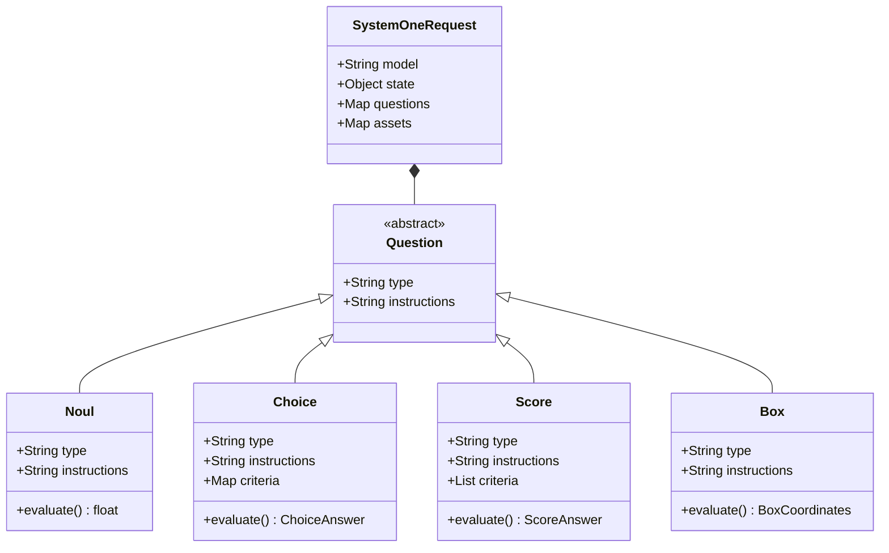

# Chương 2: Các Nguyên Thủy Cốt Lõi (Core Primitives)

[← Chương 1: Giới Thiệu System One](01_introduction_system_one.md) | [Mục Lục](../README.md) | [Chương 3: Models & Specifications →](03_models_and_specifications.md)

> **Tài liệu tham chiếu chính thức:** [https://docs.typesafe.ai/introduction](https://docs.typesafe.ai/introduction)

---

## 2.1. Khái Niệm Về AI Primitives Trong TypeSafe AI

Trong ngôn ngữ lập trình, chúng ta có các kiểu dữ liệu nguyên thủy (Primitive Types) như `boolean`, `enum`, `float`, `object` làm nền tảng xây dựng toàn bộ logic ứng dụng. 

TypeSafe AI đưa tư duy này vào trí tuệ nhân tạo: Thay vì để AI trả về văn bản tự do rồi dùng regex hoặc JSON schema để cố ép kiểu, Jev định nghĩa **4 Primitive AI có cấu trúc chuẩn hóa**:



---

## 2.2. Chi Tiết Primitive 1: `Noul` (Xác Suất Đúng/Sai)

### 1. Bản Chất Kỹ Thuật
`Noul` là nguyên thủy đại diện cho mệnh đề logic nhị phân (Yes/No, True/False). Thay vì chỉ trả về giá trị cứng `true` hoặc `false`, Noul trả về **xác suất toán học đã được hiệu chuẩn từ 0.0 đến 1.0**:
* `1.0`: Tuyệt đối đúng (Absolute Yes)
* `0.0`: Tuyệt đối sai (Absolute No)
* `0.5`: Hoàn toàn phân vân / không đủ dữ liệu kết luận

> [!NOTE]
> **Vì sao Noul không có trường `confidence` riêng biệt?**
> Bởi vì chính giá trị xác suất của Noul đã phản ánh độ tin cậy. Một câu trả lời có xác suất `0.999` hoặc `0.001` đều có độ tin cậy cực cao (cực kỳ tự tin là Đúng hoặc cực kỳ tự tin là Sai). Ngược lại, xác suất tiến gần `0.5` chính là chỉ dấu mô hình đang không chắc chắn.

### 2. Cấu Trúc Request & Response

#### Request Schema:
```json
{
  "questions": {
    "is_toxic": {
      "type": "noul",
      "instructions": "Văn bản này có chứa ngôn từ xúc phạm, đe dọa hoặc độc hại không?"
    }
  }
}
```
*(Tùy chọn: Bạn có thể thêm trường `criteria` để định nghĩa chi tiết điều kiện Đúng / Sai nếu câu hỏi phức tạp).*

#### Response Schema:
```json
{
  "answers": {
    "is_toxic": {
      "type": "noul",
      "noul": 0.012
    }
  }
}
```

### 3. Ví Dụ Mã Nguồn Đa Ngôn Ngữ

#### Python SDK:
```python
from typesafe_sdk import TypeSafeClient, Noul

client = TypeSafeClient()
res = client.system_one(
    state="Cảm ơn bạn rất nhiều vì đã hỗ trợ nhiệt tình!",
    questions={
        "is_happy": Noul(instructions="Khách hàng có đang bày tỏ sự hài lòng không?")
    }
)

prob = res.nouls["is_happy"].noul
print(f"Xác suất hài lòng: {prob:.4f}")
if prob > 0.85:
    print("Tự động gửi lời cảm ơn!")
```

#### TypeScript SDK:
```typescript
import { TypeSafeClient, noul } from '@typesafe-ai/sdk';

const client = new TypeSafeClient();
const res = await client.systemOne({
  state: "Cảm ơn bạn rất nhiều vì đã hỗ trợ nhiệt tình!",
  questions: {
    isHappy: noul("Khách hàng có đang bày tỏ sự hài lòng không?")
  }
});

console.log("Xác suất hài lòng:", res.answers.isHappy.noul);
```

---

## 2.3. Chi Tiết Primitive 2: `Choice` (Phân Loại Danh Mục)

### 1. Bản Chất Kỹ Thuật
`Choice` dùng khi bạn cần phân loại trạng thái vào **một nhãn duy nhất trong tập hợp từ 2 đến 255 nhãn rời rạc** (tương đương với kiểu `Enum` trong lập trình).

Không chỉ trả về nhãn thắng cuộc (`choice`), Jev còn cung cấp:
1. **`probabilities`**: Phân phối xác suất đầy đủ của toàn bộ các nhãn trong danh sách (tổng luôn bằng `1.0`).
2. **`confidence`**: Độ tin cậy thống kê chuẩn xác của nhãn được chọn (tính từ khoảng cách giữa nhãn cao nhất và các nhãn còn lại).

### 2. Sự Khác Biệt Giữa "Xác Suất Cao Nhất" và "Độ Tin Cậy" (Confidence)

Hãy quan sát 2 kịch bản phân loại sau:

```
Kịch Bản A (Tự tin tuyệt đối):
- Nhãn A (Billing): 0.94
- Nhãn B (Tech):    0.04
- Nhãn C (Sales):   0.02
==> Nhãn thắng: "Billing" | Confidence: 0.92 (Cực cao, tự động định tuyến an toàn)

Kịch Bản B (Phân vân, giằng co):
- Nhãn A (Billing): 0.51
- Nhãn B (Tech):    0.47
- Nhãn C (Sales):   0.02
==> Nhãn thắng: "Billing" | Confidence: 0.28 (Rất thấp, mô hình phân vân giữa A và B)
```
Nếu chỉ lấy nhãn có xác suất cao nhất, hệ thống sẽ tự động chọn "Billing" ở kịch bản B và có nguy cơ sai 50%. Nhờ có trường `confidence`, mã nguồn có thể phát hiện ngay sự giằng co để chuyển sang nhân viên con người!

### 3. Cấu Trúc Request & Response

#### Request Schema:
```json
{
  "questions": {
    "department": {
      "type": "choice",
      "instructions": "Xác định phòng ban phù hợp nhất để xử lý yêu cầu này.",
      "criteria": {
        "billing": "Các vấn đề về hóa đơn, trừ tiền sai, yêu cầu hoàn tiền, thẻ tín dụng",
        "tech_support": "Lỗi phần mềm, không đăng nhập được, crash ứng dụng, kết nối mạng",
        "sales": "Khách hàng muốn mua thêm gói doanh nghiệp, báo giá số lượng lớn",
        "general": "Thắc mắc chung không thuộc các mục trên"
      }
    }
  }
}
```

#### Response Schema:
```json
{
  "answers": {
    "department": {
      "type": "choice",
      "choice": "billing",
      "probabilities": {
        "billing": 0.912,
        "tech_support": 0.053,
        "sales": 0.021,
        "general": 0.014
      },
      "confidence": 0.887
    }
  }
}
```

---

## 2.4. Chi Tiết Primitive 3: `Score` (Chấm Điểm Theo Thang Đo Có Thứ Tự)

### 1. Bản Chất Kỹ Thuật
Khi một đối tượng cần được đánh giá theo thang đo liên tục hoặc thứ tự tăng dần (ví dụ: mức độ nghiêm trọng của lỗi từ 1 đến 4, độ thỏa mãn của khách hàng, mức độ liên quan của tài liệu), việc ép về nhãn rời rạc (`Choice`) sẽ làm mất đi tính tương quan thứ tự.

`Score` đánh giá trạng thái dựa trên một **Rubric gồm từ 2 đến 10 cấp bậc có thứ tự** do lập trình viên định nghĩa. Điểm số trả về là một **số thực liên tục (Continuous Expected Score)** dựa trên phân phối xác suất có trọng số của các bậc, kèm theo độ tin cậy (`confidence`).

### 2. Cấu Trúc Request & Response

#### Request Schema:
Bạn truyền vào mảng `criteria` với thứ tự từ thấp nhất (bậc 0 hoặc 1) đến cao nhất:
```json
{
  "questions": {
    "issue_severity": {
      "type": "score",
      "instructions": "Đánh giá mức độ nghiêm trọng và tác động tiêu cực của lỗi hệ thống này.",
      "criteria": [
        "Mức 1 (Thấp): Lỗi giao diện nhỏ, không ảnh hưởng đến luồng sử dụng của người dùng.",
        "Mức 2 (Vừa): Lỗi tính năng phụ, có cách khắc phục tạm thời (workaround).",
        "Mức 3 (Nghiêm trọng): Tính năng chính bị hỏng, ảnh hưởng đến nhiều người dùng.",
        "Mức 4 (Thảm họa): Hệ thống ngừng hoạt động hoàn toàn, rò rỉ dữ liệu hoặc tổn thất tài chính."
      ]
    }
  }
}
```

#### Response Schema:
```json
{
  "answers": {
    "issue_severity": {
      "type": "score",
      "score": 3.42,
      "confidence": 0.895
    }
  }
}
```
*Điểm số `3.42` cho biết lỗi này nằm giữa mức 3 (Nghiêm trọng) và mức 4 (Thảm họa), nghiêng nhiều về mức 3 nhưng có các yếu tố tiệm cận mức 4.*

---

## 2.5. Chi Tiết Primitive 4: `Box` (Định Vị Không Gian Trên Ảnh)

> [!IMPORTANT]
> `Box` là tính năng thử nghiệm cao cấp xuất hiện từ **Jev 1.14**, yêu cầu gửi header bắt buộc:
> `TypeSafe-Danger-Zone-Images: true`

### 1. Bản Chất Kỹ Thuật
Thay vì sinh mô tả văn bản về bức ảnh, `Box` nhận diện và định vị chính xác vị trí của một chủ thể hoặc khiếm khuyết trong ảnh, trả về tọa độ **Bounding Box chuẩn hóa 4 cạnh**: `top`, `bottom`, `left`, `right` (tính theo tỷ lệ phần trăm từ 0.0 đến 1.0 bắt đầu từ góc trên bên trái).

### 2. Cấu Trúc Request & Response

```bash
curl -X POST https://api.typesafe.ai/v1/systemone \
  -H "Authorization: Bearer $TYPESAFE_API_KEY" \
  -H "TypeSafe-Danger-Zone-Images: true" \
  -H "Content-Type: application/json" \
  -d '{
    "model": "jev-1.14.0",
    "assets": {
      "pcb_photo": "data:image/jpeg;base64,/9j/4AAQSkZJRg..."
    },
    "state": "Kiểm tra chất lượng bảng mạch PCB công nghiệp mã #8841.",
    "questions": {
      "defect_location": {
        "type": "box",
        "instructions": "Tìm vết nứt hoặc mối hàn bị lỗi trên bảng mạch pcb_photo."
      }
    }
  }'
```

#### Response Schema:
```json
{
  "answers": {
    "defect_location": {
      "type": "box",
      "box": {
        "top": 0.245,
        "bottom": 0.382,
        "left": 0.512,
        "right": 0.698
      }
    }
  }
}
```

---

## 2.6. Bảng Ma Trận So Sánh & Hướng Dẫn Chọn Primitive Phù Hợp

| Tình Huống Bài Toán | Primitive Nên Chọn | Ví Dụ Điển Hình |
| :--- | :--- | :--- |
| Kiểm tra điều kiện Đúng / Sai, Bộ lọc nhị phân, Kiểm duyệt an toàn | **`Noul`** | `is_spam`, `has_pii`, `is_sql_injection`, `is_satisfied` |
| Phân loại vào 1 trong các nhóm rời rạc (Mutually Exclusive Categories) | **`Choice`** | `ticket_category`, `lead_intent`, `language_detected` |
| Đo lường cấp độ, đánh giá mức độ, chấm điểm độ liên quan hoặc rủi ro | **`Score`** | `urgency_level`, `sentiment_rating`, `rag_chunk_relevance` |
| Định vị tọa độ của vật thể, chữ ký, lỗi hư hỏng trên ảnh/tài liệu | **`Box`** | `signature_box`, `damaged_area`, `license_plate_box` |

---

## 2.7. Sức Mạnh Của Việc Kết Hợp Song Song (Parallel Fan-out)

Một trong những ưu điểm vượt bậc của Jev là cho phép **kết hợp tất cả các primitives này trong một yêu cầu duy nhất**. Mô hình xử lý đồng thời chỉ trong 1 lượt tính toán:

```json
{
  "model": "jev-latest",
  "state": "Hợp đồng thuê văn phòng thời hạn 3 năm, tiền cọc 3 tháng, điều khoản phạt vi phạm 50% tiền cọc.",
  "questions": {
    "is_compliant": {
      "type": "noul",
      "instructions": "Hợp đồng có tuân thủ đúng quy định tiền cọc tối đa 3 tháng không?"
    },
    "contract_type": {
      "type": "choice",
      "instructions": "Loại hợp đồng pháp lý.",
      "criteria": {
        "commercial_lease": "Thuê mặt bằng kinh doanh / văn phòng",
        "residential_lease": "Thuê nhà ở dân sinh",
        "procurement": "Mua sắm trang thiết bị"
      }
    },
    "risk_score": {
      "type": "score",
      "instructions": "Đánh giá mức độ rủi ro pháp lý đối với bên thuê.",
      "criteria": [
        "Thấp: Điều khoản tiêu chuẩn",
        "Trung bình: Có điều khoản bất lợi nhỏ",
        "Cao: Mức phạt vi phạm quá nặng hoặc điều khoản đơn phương chấm dứt bất bình đẳng"
      ]
    }
  }
}
```
Cả 3 câu hỏi trên được Jev trả lời cùng lúc với chi phí token đầu vào chỉ tính 1 lần duy nhất cho toàn bộ `state`!

---

### ⏭️ Điều Hướng Tài Liệu
* **Trang trước:** [← Chương 1: Giới Thiệu Tổng Quan & Triết Lý System One](01_introduction_system_one.md)
* **Mục lục:** [🏠 Quay lại README](../README.md)
* **Trang tiếp theo:** [Chương 3: Danh Mục Models & Thông Số Kỹ Thuật →](03_models_and_specifications.md)

