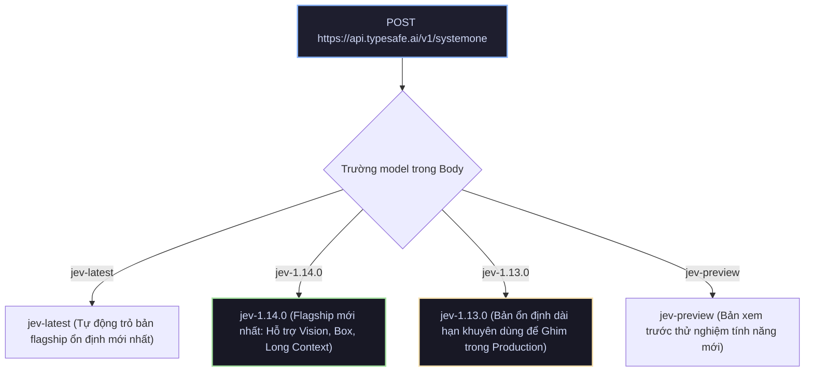
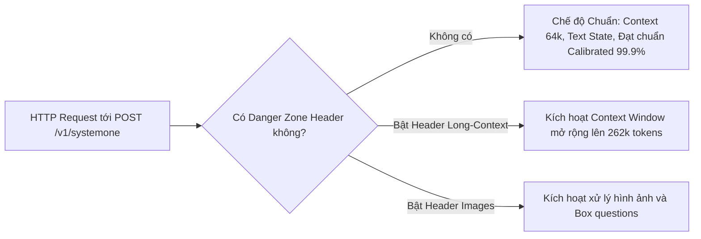

# Chương 3: Danh Mục Models & Thông Số Kỹ Thuật (Specifications)

[← Chương 2: Các Nguyên Thủy Cốt Lõi](02_core_primitives.md) | [Mục Lục](../README.md) | [Chương 4: Đặc Tả Kỹ Thuật API →](04_api_reference.md)

> **Tài liệu tham chiếu chính thức:** [https://docs.typesafe.ai/models](https://docs.typesafe.ai/models)

---

## 3.1. Danh Mục Các Phiên Bản Mô Hình Jev

Tất cả các mô hình trong hệ sinh thái TypeSafe AI đều được phục vụ thông qua một endpoint duy nhất là `POST /v1/systemone`. Trường `"model"` trong request payload sẽ quyết định chính xác phiên bản mô hình xử lý yêu cầu.

### 1. `jev-1.14.0` (Flagship Release)
* **Ngày phát hành:** 14 tháng 10 năm 2026.
* **Định vị:** Mô hình chủ lực thông minh nhất, tiên tiến nhất của TypeSafe AI.
* **Khả năng mới nổi bật:**
  * Hỗ trợ đầu vào hình ảnh (Vision) thông qua bảng tài nguyên `assets`.
  * Hỗ trợ nguyên thủy `box` (định vị không gian bounding box trên ảnh).
  * Hỗ trợ mở rộng ngữ cảnh lên đến **262k tokens** thông qua Danger Zone header.

### 2. `jev-1.13.0` (Long-Term Stable Release)
* **Định vị:** Phiên bản ổn định dài hạn đã được kiểm thử và hiệu chuẩn trên hàng triệu mẫu dữ liệu doanh nghiệp.
* **Khuyến nghị kiến trúc (Model Pinning Best Practice):**
  > [!IMPORTANT]
  > Sau khi bạn đã tinh chỉnh các ngưỡng xác suất (Thresholds) và kiểm thử chất lượng hệ thống (Calibration benchmark), **bạn nên ghim (pin) cứng phiên bản mô hình là `jev-1.13.0` trong môi trường Production**. Điều này ngăn ngừa hiện tượng trôi dạt phân phối xác suất (Probability Distribution Drift) khi các bản cập nhật mới được triển khai.

### 3. Các Bí Danh (Model Aliases)
* **`jev-latest`:** Luôn trỏ tới phiên bản ổn định mới nhất (hiện tại trỏ tới `jev-1.14.0`). Thích hợp cho giai đoạn phát triển ban đầu hoặc các tác vụ không quá khắt khe về ngưỡng vi phân.
* **`jev-preview`:** Trỏ tới bản dựng thử nghiệm mới nhất để trải nghiệm các tính năng beta trước khi phát hành chính thức.

---

## 3.2. Bảng Thông Số Kỹ Thuật Chi Tiết (Technical Specifications)

| Thuộc Tính Kỹ Thuật | Giá Trị Chuẩn | Ghi Chú Chi Tiết |
| :--- | :--- | :--- |
| **Kiểu Đầu Vào (Input Modality)** | Văn bản (UTF-8), JSON, Arrays, Images | Âm thanh/Video cần được chuyển thành transcript trước khi đưa vào `state` |
| **Kiểu Đầu Ra (Output Modality)** | Quyết định có kiểu, Phân phối xác suất, Độ tin cậy | Không sinh văn bản tự do (Zero prose), Output tokens = 0 |
| **Độ Dài Ngữ Cảnh Chuẩn (Context Window)** | **64,000 tokens** / request | Giới hạn tối đa 32,000 tokens cho mỗi câu hỏi đơn lẻ |
| **Độ Dài Ngữ Cảnh Mở Rộng (Long Context)** | **262,144 tokens** | Kích hoạt bằng header: `TypeSafe-Danger-Zone-Long-Context: true` |
| **Số Lượng Câu Hỏi Song Song / Request** | Không giới hạn cứng (Khuyên dùng 1 - 50 câu) | Toàn bộ câu hỏi được tính toán song song chỉ trong một lượt quét |
| **Độ Trễ Trung Bình (Average Latency)** | **150ms – 350ms** | Hoạt động theo cơ chế Non-autoregressive (không sinh từ tuần tự) |
| **Độ Trễ Phân Vị P99 (P99 Latency)** | **< 500ms** | Rất ổn định kể cả khi `state` chứa lượng dữ liệu lớn |
| **Giao Thức Mạng (Protocol)** | HTTPS / HTTP2 / JSON | Tương thích cURL, REST API client và OpenAPI 3.1 |

---

## 3.3. Phân Tích Mô Hình Giá (Pricing Breakdown)

TypeSafe AI áp dụng mô hình định giá mang tính đột phá trên thị trường AI thế giới:

$$\text{Chi Phí Input} = 42\text{ USD trên } 1\text{ Tỷ Tokens} \quad (\approx 0.042\text{ USD / 1 Triệu Tokens})$$
$$\text{Chi Phí Output} = 0.00\text{ USD (Hoàn toàn MIỄN PHÍ)}$$

### So Sánh Chi Phí Thực Tế Trên 1 Triệu Yêu Cầu Phân Loại & Quyết Định
Giả định một hệ thống chăm sóc khách hàng tiếp nhận **1.000.000 tickets** mỗi tháng. Mỗi ticket trung bình có 500 input tokens.
* Đối với LLM truyền thống: Cần sinh chuỗi JSON khoảng 100 output tokens.
* Đối với Jev: Output tokens = 0.

| Mô Hình AI | Đơn Giá Input / 1M | Đơn Giá Output / 1M | Chi Phí Input (500M tokens) | Chi Phí Output (100M tokens) | **Tổng Chi Phí Hàng Tháng** |
| :--- | :--- | :--- | :--- | :--- | :--- |
| **OpenAI GPT-4o** | $2.50 | $10.00 | $1,250 | $1,000 | **$2,250 USD** |
| **Claude 3.5 Sonnet** | $3.00 | $15.00 | $1,500 | $1,500 | **$3,000 USD** |
| **GPT-4o-mini** | $0.15 | $0.60 | $75 | $60 | **$135 USD** |
| **TypeSafe Jev** | **$0.042** | **$0.00 (Free)** | **$21** | **$0** | **$21 USD** |

> [!TIP]
> **Mức tiết kiệm chi phí:** Jev giúp doanh nghiệp tiết kiệm **hơn 99% chi phí** so với GPT-4o/Claude 3.5 và rẻ hơn **hơn 6 lần** so với mô hình rẻ nhất của OpenAI (GPT-4o-mini), đồng thời cung cấp độ trễ nhanh hơn gấp 5 đến 10 lần.

---

## 3.4. Các Header Vùng Nguy Hiểm ("Danger Zone" Headers)

Trong triết lý phát triển của TypeSafe AI, các tính năng đạt chuẩn Production bắt buộc phải đạt độ tin cậy và độ hiệu chuẩn (calibration) tối thiểu 99.9%. 

Các tính năng mới nổi hoặc có thể làm thay đổi đặc tính phân phối xác suất được xếp vào **"Danger Zone"**. Lập trình viên bắt buộc phải chủ động đính kèm header HTTP để kích hoạt:

### 1. `TypeSafe-Danger-Zone-Long-Context: true`
* **Mục đích:** Mở rộng Context Window từ 64k tokens lên tối đa **262k tokens**.
* **Khi nào nên dùng:** Khi bạn cần đánh giá toàn bộ một cuốn sách tài liệu kỹ thuật, toàn bộ bản ghi log server trong 24 giờ, hoặc một tập hồ sơ pháp lý khổng lồ mà không muốn cắt nhỏ (chunking).
* **Lưu ý:** Độ trễ có thể tăng từ ~200ms lên ~800ms đối với các payload trên 100k tokens.

### 2. `TypeSafe-Danger-Zone-Images: true`
* **Mục đích:** Cho phép nạp hình ảnh vào trường `assets` và sử dụng câu hỏi loại `box`.
* **Khi nào nên dùng:** Kiểm tra lỗi bảng mạch điện tử, soi tài liệu hóa đơn bị rách, định vị con dấu hoặc chữ ký trên hợp đồng scan.

---

## 3.5. Hệ Thống Tokenizer & Giới Hạn Quota (Rate Limits)

### Tokenizer Tương Thích
Jev sử dụng bộ mã hóa Byte-Pair Encoding (BPE) tiêu chuẩn ngành, tương thích chặt chẽ với định dạng mã hóa của Llama và Claude. Khoảng 1 token tương đương với:
* ~4 ký tự tiếng Anh thông dụng.
* ~0.8 đến 1.5 từ tiếng Việt có dấu.
* ~1 khóa hoặc dấu phân cách cấu trúc JSON.

### Hạn Mức Tần Suất Mặc Định (Default Rate Limits)

| Cấp Độ Tài Khoản (Tier) | Yêu Cầu Mỗi Phút (RPM) | Tokens Mỗi Phút (TPM) | Hỗ Trợ Đột Biến (Burst) |
| :--- | :--- | :--- | :--- |
| **Tier 1 (Free / Starter)** | 500 RPM | 5,000,000 TPM | Tối đa 20 concurrent requests |
| **Tier 2 (Growth)** | 2,500 RPM | 25,000,000 TPM | Tối đa 100 concurrent requests |
| **Tier 3 (Enterprise)** | 10,000+ RPM | 100,000,000+ TPM | Không giới hạn, hỗ trợ Dedicated VPC |

---

### ⏭️ Điều Hướng Tài Liệu
* **Trang trước:** [← Chương 2: Các Nguyên Thủy Cốt Lõi](02_core_primitives.md)
* **Mục lục:** [🏠 Quay lại README](../README.md)
* **Trang tiếp theo:** [Chương 4: Đặc Tả Kỹ Thuật API (API Reference) →](04_api_reference.md)

