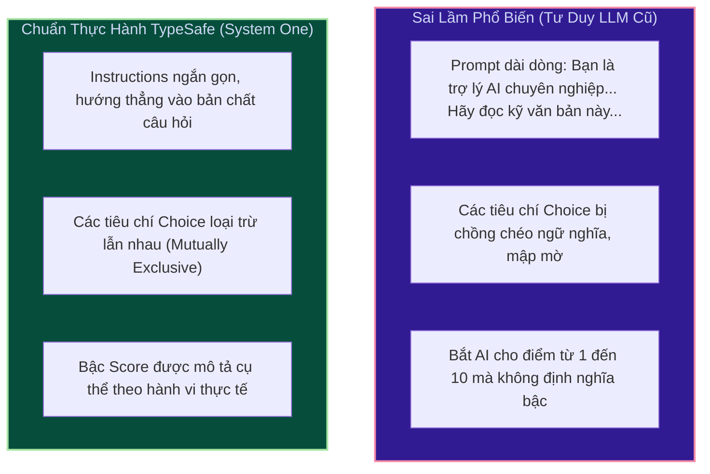
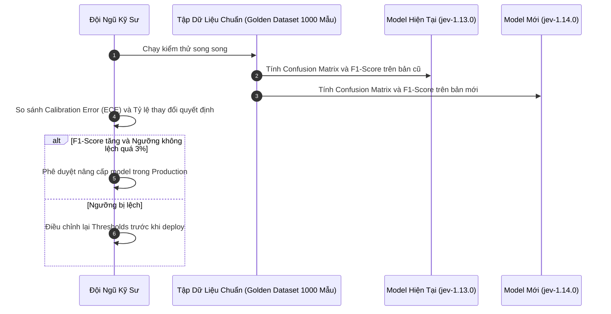

# Chương 6: Cẩm Nang Chuyên Sâu & Thực Tiễn Tốt Nhất (Best Practices)

[← Chương 5: Tuyển Tập Cookbooks](05_cookbooks_and_patterns.md) | [Mục Lục](../README.md)

> **Tài liệu tham chiếu chính thức:** [https://docs.typesafe.ai/cookbooks](https://docs.typesafe.ai/cookbooks) & [https://docs.typesafe.ai/models](https://docs.typesafe.ai/models)

---

## 6.1. Nghệ Thuật Thiết Kế Câu Lệnh: Instructions & Criteria Cho Jev

Khi làm việc với các mô hình sinh văn bản (LLM như GPT-4 hay Claude), lập trình viên thường dùng các kỹ thuật Prompt Engineering phức tạp như: *"Bạn là một chuyên gia hàng đầu...", "Hãy suy nghĩ từng bước (Chain-of-Thought)...", "Trả về định dạng JSON và không nói gì thêm..."*.

Với Jev, mô hình không "suy nghĩ bằng lời", do đó các kỹ thuật trên **hoàn toàn vô nghĩa và chỉ làm tốn thêm token đầu vào**. Thay vào đó, hãy tuân theo các nguyên tắc kỹ thuật sau:



### Nguyên Tắc 1: Tiêu Chí Trong `Choice` Phải Loại Trừ Lẫn Nhau (Mutually Exclusive)
Nếu bạn định nghĩa các nhãn có sự giao thoa về ngữ nghĩa, Jev sẽ buộc phải phân bổ đều xác suất giữa các nhãn đó, dẫn đến trường `confidence` bị kéo tụt xuống.

* ❌ **Không Tốt (Chồng chéo ngữ nghĩa):**
  ```json
  "criteria": {
    "pricing": "Câu hỏi về giá cả",
    "subscription": "Câu hỏi về gói đăng ký",
    "payment": "Câu hỏi về thanh toán"
  }
  ```
  *(Khi khách hỏi "Giá gói đăng ký tháng này bao nhiêu tiền và thanh toán qua đâu?", mô hình sẽ giằng co giữa cả 3 nhãn, confidence chỉ đạt ~0.35).*

* ✅ **Rất Tốt (Ranh giới ngữ nghĩa rõ ràng):**
  ```json
  "criteria": {
    "pre_sales_pricing": "Khách hàng mới tìm hiểu bảng giá trước khi mua",
    "billing_invoices": "Khách hàng cũ thắc mắc về hóa đơn, trừ tiền thẻ hoặc gia hạn",
    "account_tier_upgrade": "Khách hàng muốn nâng cấp hoặc hạ cấp gói tài khoản hiện có"
  }
  ```

---

### Nguyên Tắc 2: Các Bậc Trong `Score` Phải Tăng Dần Đơn Điệu (Monotonic Progression)
Mô hình `Score` hoạt động dựa trên giả định các cấp bậc trong mảng `criteria` được xếp theo một trục giá trị duy nhất (độ nghiêm trọng tăng dần, mức độ hài lòng tăng dần, hoặc rủi ro tăng dần).

* ❌ **Không Tốt (Lẫn lộn các trục đo lường):**
  ```json
  "criteria": [
    "Khách hàng ở Việt Nam",
    "Khách hàng mua hàng trên 10 triệu",
    "Khách hàng rất giận dữ"
  ]
  ```
* ✅ **Rất Tốt (Chuẩn Rubric đo lường đơn trục):**
  ```json
  "criteria": [
    "Cấp 1: Hài lòng hoặc phản hồi tích cực",
    "Cấp 2: Trung lập, phản ánh thông tin khách quan không mang cảm xúc",
    "Cấp 3: Thất vọng nhẹ, yêu cầu giải thích",
    "Cấp 4: Cực kỳ bức xúc, đe dọa tẩy chay hoặc kiện tụng"
  ]
  ```

---

## 6.2. Kỹ Thuật Tinh Chỉnh Ngưỡng Xác Suất (Threshold Tuning)

Trong hệ thống Production, việc lựa chọn ngưỡng xác suất $p$ (đối với `Noul`) hoặc ngưỡng tin cậy $c$ (đối với `Choice` và `Score`) là quyết định kiến trúc then chốt ảnh hưởng đến tỷ lệ **Precision (Độ chính xác)** và **Recall (Độ bao phủ)**.

### Vùng Không Chắc Chắn (The Uncertainty Band): Mô Hình 3 Vùng Quyết Định

Đừng chỉ dùng một ngưỡng $0.5$ để rẽ nhánh nhị phân cứng nhắc. Hãy triển khai **Mô hình 3 vùng (Three-Zone Model)**:

```
[0.00 ------------------- p_low] ------- (VÙNG PHÂN VÂN) ------- [p_high ------------------- 1.00]
      TỰ ĐỘNG BÁC BỎ                       CHUYỂN DUYỆT                 TỰ ĐỘNG PHÊ DUYỆT
      (Auto-Reject)                        (Human-in-the-Loop)          (Auto-Approve)
```

```python
def process_loan_application(decision_prob: float):
    P_HIGH = 0.90   # Ngưỡng tự động duyệt
    P_LOW = 0.20    # Ngưỡng tự động từ chối

    if decision_prob >= P_HIGH:
        # Tự tin rất cao là hồ sơ tốt -> Phê duyệt tự động
        return "AUTO_APPROVED"
    elif decision_prob <= P_LOW:
        # Tự tin rất cao là hồ sơ rủi ro cao -> Từ chối tự động
        return "AUTO_REJECTED"
    else:
        # Nằm trong vùng phân vân [0.20, 0.90] -> Chuyển chuyên viên thẩm định hồ sơ
        return "ESCALATE_TO_CREDIT_OFFICER"
```

### Bảng Gợi Ý Ngưỡng Theo Từng Nghiệp Vụ Thực Tế

| Nghiệp Vụ Hệ Thống | Ngưỡng Tự Động Duyệt ($p_{high}$) | Ngưỡng Tự Động Hủy ($p_{low}$) | Chiến Lược Đề Xuất |
| :--- | :--- | :--- | :--- |
| **Bảo mật / Chặn Prompt Injection** | `0.80` | `0.10` | Thà chặn nhầm còn hơn bỏ sót kẻ tấn công (Ưu tiên Recall cao) |
| **Tự Động Hoàn Tiền Tài Khoản** | `0.95` | `0.15` | Đòi hỏi độ chắc chắn gần như tuyệt đối để tránh thất thoát tiền |
| **Phân Luồng Ticket Hỗ Trợ** | `Confidence >= 0.85` | `Confidence < 0.60` | Nếu phân vân, chuyển sang queue "Chờ tiếp nhận chung" |
| **Lọc Dữ Liệu RAG Chunks** | `Score >= 2.0` | `Score < 1.2` | Loại bỏ ngay lập tức các đoạn trích không liên quan |

---

## 6.3. Tối Ưu Hóa Chi Phí Token & Kỹ Thuật Nén Dữ Liệu (State Minification)

Dù chi phí của Jev đã cực rẻ ($0.042 / 1 triệu token), nhưng trong các hệ thống quy mô lớn xử lý hàng chục triệu yêu cầu mỗi ngày, việc nén `state` có thể giúp tiết kiệm thêm hàng nghìn USD mỗi tháng.

### 1. Loại Bỏ Khóa Rác Khỏi State JSON
Trước khi đưa đối tượng JSON vào `state`, hãy dùng serializer để lược bỏ các trường không mang giá trị ngữ nghĩa:
* ❌ Tránh đưa: `created_at`, `updated_at`, `mongo_id`, `css_class`, `null_fields`, `trace_id`.
* ✅ Chỉ giữ lại: Các trường nội dung, trạng thái, danh mục và chỉ số kinh doanh quan trọng.

```python
# Hàm rút gọn Payload trước khi gọi Jev
def sanitize_state_for_jev(order_data: dict) -> dict:
    allowed_keys = {"order_id", "items", "total_amount", "customer_complaint", "status"}
    return {k: v for k, v in order_data.items() if k in allowed_keys}
```

### 2. Tận Dụng Tối Đa Cơ Chế Single-Pass Fan-out
Nếu bạn có 5 nghiệp vụ cần đánh giá trên cùng một đoạn văn bản hoặc người dùng:
* ❌ **Không nên:** Gọi Jev 5 lần riêng biệt (tốn $5 \times \text{tokens của state}$).
* ✅ **Nên:** Gom 5 câu hỏi đó vào cùng một request duy nhất trong trường `questions` (chỉ tốn $1 \times \text{tokens của state}$).

---

## 6.4. Xây Dựng Bộ Kiểm Thử Độ Lệch Phân Phối (Regression & Evals)

Khi TypeSafe AI phát hành phiên bản mô hình mới (ví dụ: từ `jev-1.13.0` lên `jev-1.14.0`), dù độ thông minh tổng quát tăng lên, nhưng các ngưỡng xác suất (Calibration Thresholds) của bạn có thể có sự xê dịch nhẹ.

### Quy Trình Đánh Giá Chuẩn Trước Khi Nâng Cấp Model:



### Kịch Bản Kiểm Thử Bằng Python:
```python
def evaluate_model_version(dataset: list[dict], model_name: str):
    correct_count = 0
    total = len(dataset)
    
    for item in dataset:
        res = client.system_one(
            model=model_name,
            state=item["text"],
            questions={"intent": Choice(instructions="...", criteria=item["criteria"])}
        )
        if res.choices["intent"].choice == item["expected_label"]:
            correct_count += 1
            
    accuracy = correct_count / total
    print(f"Model: {model_name} | Độ chính xác: {accuracy * 100:.2f}%")
```

---

## 6.5. Giám Sát Vận Hành (Telemetry & Observability)

Trong hệ thống vận hành thực tế, hãy theo dõi 4 chỉ số vàng (Golden Metrics) trên Datadog hoặc Grafana:

1. **Inference Latency P50 / P95 / P99:** Trung bình phải duy trì dưới 300ms. Nếu P99 vượt quá 600ms, kiểm tra xem có đang gửi payload state quá dài (>50k tokens) hay không.
2. **Confidence Distribution Histogram:** Biểu đồ phân bổ độ tin cậy. Nếu phát hiện một câu hỏi `Choice` có tỷ lệ `confidence < 0.5` chiếm trên 20% lưu lượng, điều đó báo hiệu các lựa chọn trong `criteria` đang bị mơ hồ và cần được định nghĩa lại.
3. **Escalation Rate (% Chuyển Người Thật):** Tỷ lệ các yêu cầu rơi vào vùng không chắc chắn. Tỷ lệ tối ưu thường nằm trong khoảng **5% đến 15%**.
4. **Error Rate (4xx / 5xx):** Theo dõi đột biến mã lỗi `429 (Rate Limit)` hoặc `403 (Thiếu Danger Zone Header)` để kịp thời điều chỉnh cấu hình hệ thống.

---

### ⏭️ Điều Hướng Tài Liệu
* **Trang trước:** [← Chương 5: Tuyển Tập Thực Chiến Cookbooks & Kiến Trúc Mẫu](05_cookbooks_and_patterns.md)
* **Mục lục:** [🏠 Quay lại README Tổng Quan](../README.md)

