# Tài Liệu Kiến Trúc Hệ Thống Data, Workflow & AI Agent Toàn Công Ty

> **Phạm vi áp dụng:** Hệ thống vận hành Thương mại Điện tử & Tiếp thị Đa kênh (TikTok Business, TikTok Shop, Shopee, Facebook) cho doanh nghiệp sản phẩm công nghệ.  
> **Mục tiêu tài liệu:** Định hình bộ khung kiến trúc tổng thể 4 Lớp, quy chuẩn luồng dữ liệu tập trung, cơ chế phân quyền qua MCP/n8n và các mô hình ứng dụng AI Agent (dựng sẵn & nhân sự tự phát triển) phục vụ thảo luận và thống nhất giữa các phòng ban.

---

## Mục Lục Tài Liệu

1. [Phần 1: Tổng Quan & Sơ Đồ Kiến Trúc Khung 4 Lớp](#phan-1)
   - [1.1. Sơ Đồ Kiến Trúc Tổng Thể (Master Architecture)](#phan-1-1)
   - [1.2. Triết Lý Thiết Kế Cốt Lõi](#phan-1-2)
2. [Phần 2: Lớp 1 & Lớp 2 — Đầu API Đa Kênh & Trung Gian Điều Phối (`n8n`)](#phan-2)
   - [2.1. Lớp 1: 4 Đầu API Nền Tảng](#phan-2-1)
   - [2.2. Lớp 2: Trung Gian `n8n`](#phan-2-2)
3. [Phần 3: Lớp 3 — Hệ Thống `Data`, `MCP qua n8n` & `MCP`](#phan-3)
   - [3.1. Khối `Data` (Google Sheets song song PostgreSQL)](#phan-3-1)
   - [3.2. Thiết Kế Tương Đối 10 Nhóm Bảng Dữ Liệu Cốt Lõi](#phan-3-2)
   - [3.3. Khối `MCP qua n8n` (Cổng Xuất & Truy Vấn Dữ Liệu)](#phan-3-3)
   - [3.4. Khối `MCP` (Cổng Phân Quyền & Thực Thi Tác Vụ API)](#phan-3-4)
4. [Phần 4: Lớp 4 (`Use Resources`) — Chi Tiết Các Khối & Ví Dụ Tác Vụ Điển Hình](#phan-4)
   - [4.1. Khối 1: Báo Cáo Theo Dõi](#phan-4-1)
   - [4.2. Khối 2: Phân Tích Data](#phan-4-2)
   - [4.3. Khối 3: Agent / Workflow Tự Động Chung](#phan-4-3)
   - [4.4. Khối 4: Agent Của Nhân Sự Tự Build](#phan-4-4)
5. [Phần 5 (Phụ Lục): Giới Thiệu Chi Tiết Các Bộ Công Cụ & Nền Tảng Cốt Lõi](#phan-5)
   - [5.1. TikTok Business API (`tiktok-business-api`)](#phan-5-1)
   - [5.2. TikTok Shop Partner API (`tiktok-shop-api`)](#phan-5-2)
   - [5.3. Shopee Open Platform API (`shoppe-api`)](#phan-5-3)
   - [5.4. Facebook Graph & Marketing API (`facebook-ads-api`)](#phan-5-4)
   - [5.5. Mô Hình Quyết Định Nhanh JEV — TypeSafe AI (`JEV`)](#phan-5-5)
   - [5.6. Nền Tảng Điều Phối & Cổng Trung Gian `n8n`](#phan-5-6)

---

<a id="phan-1"></a>
## Phần 1: Tổng Quan & Sơ Đồ Kiến Trúc Khung 4 Lớp

<a id="phan-1-1"></a>
### 1.1. Sơ Đồ Kiến Trúc Tổng Thể (Master Architecture)

Hệ thống được chia làm **4 Lớp tách biệt từ trái sang phải**, ngăn cách rõ ràng trách nhiệm giữa **Nguồn kết nối (Lớp 1)** $\rightarrow$ **Điều phối trung tâm (Lớp 2)** $\rightarrow$ **Lưu trữ & Cổng phân quyền MCP (Lớp 3)** $\rightarrow$ **Khai thác sử dụng (Lớp 4)**:


---

<a id="phan-1-2"></a>
### 1.2. Triết Lý Thiết Kế Cốt Lõi

1. **Tập trung hóa Data và Công cụ (Centralized Data & Tool Hub):**
   - Toàn bộ dữ liệu từ các sàn thương mại điện tử và các kênh quảng cáo được gom về một đầu mối duy nhất thông qua `n8n`.
   - Công ty chỉ cần xây dựng và duy trì một bộ bảng dữ liệu chuẩn kèm một số luồng/agent cốt lõi; nhân sự các phòng ban sẽ tận dụng hạ tầng sẵn có này để tự lắp ghép các Agent phục vụ công việc riêng.
2. **Không truy cập trực tiếp (Zero Direct Access):**
   - **Với API các sàn/kênh quảng cáo:** Không một AI Agent hay nhân sự nào gọi trực tiếp vào API gốc của TikTok, Shopee, Facebook. Mọi tác vụ đều phải đi qua **`MCP`** trên `n8n` để kiểm soát phân quyền và giới hạn an toàn.
   - **Với Kho dữ liệu (`Data`):** Các luồng ở Lớp 4 cũng không chọc trực tiếp làm xáo trộn file Google Sheets gốc hay Database, mà truy xuất thông qua cổng **`MCP qua n8n`** (API Export / Data MCP).
3. **Tách biệt rõ nhánh Chỉ Đọc (`Báo cáo theo dõi`) và nhánh Kết Hợp (`Phân tích`, `Agent chung`, `Agent nhân sự`):**
   - Khối **`1. Báo cáo theo dõi`** chỉ nhận dữ liệu một chiều từ nhánh `Data` $\rightarrow$ `MCP qua n8n`, đảm bảo an toàn tuyệt đối.
   - Ba khối **`2. Phân tích Data`**, **`3. Agent / Workflow tự động chung`**, và **`4. Agent của nhân sự tự build`** được kết nối đồng thời vào cả nhánh dữ liệu (`MCP qua n8n`) và nhánh công cụ thực thi (`MCP`).
4. **Kết hợp Mô hình Quyết định Nhanh [`JEV`](./JEV/README.md) (System One) và Mô hình Ngôn ngữ Lớn `LLM` (System Two):**
   - Dùng **JEV** cho các bài toán phân loại, khớp kịch bản video, chấm điểm chất lượng nội dung, lọc KOC và xét điều kiện bật/tắt Ads (độ trễ `< 300ms`, `0` output token, không bịa đặt dữ liệu).
   - Dùng **LLM (Claude, GPT)** cho các bài toán viết báo cáo tổng hợp, hỏi đáp ngôn ngữ tự nhiên, viết kịch bản và soạn tin nhắn giao tiếp KOC.

---

<a id="phan-2"></a>
## Phần 2: Lớp 1 & Lớp 2 — Đầu API Đa Kênh & Trung Gian Điều Phối (`n8n`)

<a id="phan-2-1"></a>
### 2.1. Lớp 1: 4 Đầu API Nền Tảng

Toàn bộ tài liệu kỹ thuật và cURL thực thi của 4 đầu API đã được chuẩn hóa sẵn trong kho tài liệu của công ty:

| Đầu API (Lớp 1) | Tài Liệu Kỹ Thuật Nội Bộ | Nhóm Dữ Liệu & Tác Vụ Chính Cung Cấp Cho Hệ Thống |
| :--- | :--- | :--- |
| **1. TikTok Business API** | [`tiktok-business-api/README.md`](./tiktok-business-api/README.md) | • Quản lý chiến dịch quảng cáo (`Campaign`, `AdGroup`, `Ad`), chiến dịch `GMV Max` (Video & Livestream).<br/>• Báo cáo chỉ số hiệu suất quảng cáo & sáng tạo chuyên sâu: `Cost`, `Impressions`, `Clicks`, `VE%`, `IE%`, `PE%`, điểm chất lượng `CQS`, `New Consideration`, tỷ lệ giữ chân người xem từng giây.<br/>• Quản lý danh tính `Spark Ads` (ủy quyền video KOC/Creator chạy quảng cáo) và `TikTok One API` (tìm kiếm, phân tích Creator). |
| **2. TikTok Shop API** | [`tiktok-shop-api/README.md`](./tiktok-shop-api/README.md) | • Quản lý Sản phẩm, Biến thể SKU, Giá bán, Tồn kho khả dụng và tải ảnh CDN.<br/>• Quản lý Đơn hàng, Đóng gói vận chuyển (`Fulfillment`), Hủy đơn - Trả hàng - Hoàn tiền (`Reverse`).<br/>• Quyết toán tài chính (`Finance Statements`), bóc tách phí sàn, phí vận chuyển, hoa hồng.<br/>• Quản lý Tiếp thị liên kết (`Affiliate Seller/Creator/TAP`): kế hoạch hoa hồng mở, kế hoạch mục tiêu KOC VIP, duyệt gửi hàng mẫu (`Sample Applications`), và Chat CSKH (`IM`). |
| **3. Shopee API** | [`shoppe-api/README.md`](./shoppe-api/README.md) | • Đồng bộ Đơn hàng, Sản phẩm, Biến thể `model_sku` và Tồn kho.<br/>• Đối soát doanh thu thực nhận (`Escrow`), phí hoa hồng, phí dịch vụ, phí thanh toán.<br/>• Quản lý Khiếu nại trả hàng, Đánh giá sản phẩm 1–5 sao (`Reviews/Comments`), Tin nhắn `Seller Chat`, Khuyến mãi Voucher/Flash Sale, Shopee Ads và Sức khỏe gian hàng (`Account Health`). |
| **4. Facebook Graph API** | [`facebook-ads-api/README.md`](./facebook-ads-api/README.md) | • Khởi tạo và quản lý chiến dịch 3 tầng chuẩn ODAX (`Campaign` $\rightarrow$ `Ad Set` $\rightarrow$ `Ad Creative` $\rightarrow$ `Ad`).<br/>• Trích xuất báo cáo `Insights API` (ROAS, CPA, CPC, CTR, phân rã nhân khẩu học).<br/>• Đồng bộ danh mục sản phẩm (`Catalog API`), đo lường chuyển đổi máy chủ (`Conversions API - CAPI`), rút trích khách hàng tiềm năng (`Lead Ads`) và quy tắc tự động (`Automated Rules`). |

---

<a id="phan-2-2"></a>
### 2.2. Lớp 2: Trung Gian `n8n`

`n8n` đóng vai trò là **"Trái tim điều phối" (Central Middleware)** đứng chắn giữa 4 Đầu API bên ngoài và toàn bộ hệ thống nội bộ bên trong:
- **Quản lý Xác thực & Vòng đời Token tự động:** Tự động làm mới `access_token` và `refresh_token` theo chu kỳ của từng sàn (4 giờ với Shopee, 7 ngày với TikTok Shop, 60 ngày hoặc System User Token với Meta), tự động ký số `HMAC-SHA256` chuẩn xác cho mọi request.
- **Luồng Thu thập Dữ liệu (ETL & Webhook Listener):**
  - Chạy lịch định kỳ (Cron) kéo số liệu báo cáo Ads, Creative, Đối soát tài chính về `Data`.
  - Lắng nghe sự kiện thời gian thực (Webhook Push) khi có đơn hàng mới, biến động tồn kho, yêu cầu trả hàng hoặc tin nhắn khách hàng.
- **Điều phối Công cụ (MCP Host & API Router):** Cung cấp các đầu nối chuẩn hóa cho Lớp 3 (`MCP qua n8n` để xuất dữ liệu từ kho `Data` và `MCP` để thực thi lệnh gọi ngược lên 4 đầu API).

---

<a id="phan-3"></a>
## Phần 3: Lớp 3 — Hệ Thống `Data`, `MCP qua n8n` & `MCP`

Ở Lớp 3, hệ thống tách làm **2 nhánh song song** rõ rệt:
1. **Nhánh Dữ liệu (Phía trên):** `Data` $\rightarrow$ `MCP qua n8n`
2. **Nhánh Tác vụ API (Phía dưới):** `MCP`

<a id="phan-3-1"></a>
### 3.1. Khối `Data` (Google Sheets song song PostgreSQL)

Dữ liệu sau khi được `n8n` thu thập và làm sạch từ 4 đầu API sẽ được lưu trữ đồng thời vào 2 nơi nằm chung trong khối `Data`:
- **Google Sheets (Tầng hiển thị & vận hành hàng ngày):** Lưu dữ liệu theo các bảng chuẩn hóa (cửa sổ dữ liệu gần nhất hoặc bảng tổng hợp) để nhân sự các bộ phận quen thuộc thao tác, kiểm tra trực quan.
- **PostgreSQL (Tầng Backup & Data Warehouse cho DA):** Lưu trữ bản sao toàn diện và lịch sử dài hạn (hàng triệu bản ghi đơn hàng, lịch sử biến động chỉ số quảng cáo theo ngày/giờ) phục vụ đội ngũ Data Analytics (DA) phân tích chuyên sâu mà không lo giới hạn dòng của Google Sheets.

<a id="phan-3-2"></a>
### 3.2. Thiết Kế Tương Đối 10 Nhóm Bảng Dữ Liệu Cốt Lõi

Để phục vụ đầy đủ hoạt động của công ty bán sản phẩm công nghệ trên sàn TMĐT, khối `Data` được quy hoạch gồm **10 nhóm bảng liên kết với nhau** (thiết kế khung tương đối để thảo luận cùng các phòng ban):

| STT | Nhóm Bảng Dữ Liệu | Các Trường Thông Tin Đại Diện (Thiết Kế Tương Đối) | Mục Đích Phục Vụ Phòng Ban |
| :---: | :--- | :--- | :--- |
| **1** | **Master Sản Phẩm & Tồn Kho SKU Đa Sàn** | • Mã nội bộ gốc (`S24`, `S25`, `G1`...)<br/>• Ánh xạ `item_id` / `sku_id` trên TikTok Shop, Shopee, Facebook Catalog<br/>• Giá niêm yết, giá vốn (COGS), tồn kho khả dụng từng kho | Làm "cầu nối" gom số liệu đơn hàng, chi phí Ads và hiệu quả Content của cùng 1 sản phẩm trên mọi kênh về chung một mối; cảnh báo đứt hàng. |
| **2** | **Quản Lý Đơn Hàng Đa Sàn (Orders)** | • Mã đơn hàng (`order_sn` / `order_id`), Sàn, Thị trường (VN, TH...)<br/>• Danh sách SKU mua, số lượng, tổng tiền khách trả<br/>• Trạng thái đơn thống nhất (`Chờ giao`, `Đang giao`, `Hoàn thành`, `Đã hủy`, `Hoàn trả`) | Theo dõi sản lượng bán ra theo thời gian thực, đồng bộ đóng gói vận đơn. |
| **3** | **Quản Lý Ads Đa Kênh** | • Kênh chạy (`TikTok`, `Facebook`, `Shopee Ads`), Tài khoản Ads<br/>• Cấu trúc `Campaign` $\rightarrow$ `AdGroup/AdSet` $\rightarrow$ `Ad`, Mục tiêu (`GMV`, `C-ads`, `Conversion`)<br/>• Chỉ số theo ngày: `Cost`, `Impressions`, `Clicks`, `CPM`, `CPC`, `CTR`, `Orders`, `GMV`, `ROAS` | Quản lý ngân sách, đo lường hiệu quả chuyển đổi và tối ưu hóa chiến dịch quảng cáo. |
| **4** | **Data Content & Creative Performance** | • **Bảng Kho Kịch Bản:** Mã kịch bản, Sản phẩm (`S24`, `S25`, `G1`), **Hướng thử nghiệm** (`S24-1000 chất lượng 10000`, `Sự tiện lợi`, `Before/After`...), Tên kịch bản, Hook 3s, Nhân sự (`Kha`, `Giang`...).<br/>• **Bảng Video & Chỉ số Sáng tạo:** `Link Video`, `ID Video`, Ngày air, Transcript, Kịch bản đã khớp (do JEV nhận định), cùng bộ chỉ số: **`VE%`**, **`IE%`**, **`PE%`**, **`CQS (consideration)`**, `Cost`, `Impressions`, `New consideration size/rate`, `Cost per consideration`, `Clicks`, `GMV`. | Giải quyết triệt để bài toán khớp hướng thử nghiệm với video đã đăng và theo dõi chất lượng/số lượng nội dung của cả team In-house lẫn KOC theo ngày. |
| **5** | **Quản Lý Affiliate & Thuê KOL/KOC (Spark Ads)** | • Hồ sơ KOC/KOL (`Handle`, lượng Follow, view trung bình, phân hạng Tier S/A/B/C, độ hợp ngành công nghệ).<br/>• Trạng thái gửi hàng mẫu (`Sample`), chi phí booking cố định, % hoa hồng Affiliate.<br/>• Link video KOC trả bài, **Mã ủy quyền `Spark Ads Code`** và hiệu quả khi mang video KOC đi vít Ads. | Quản lý trọn vòng đời từ săn tìm KOC $\rightarrow$ gửi mẫu $\rightarrow$ nghiệm thu video $\rightarrow$ lấy mã Spark Ads chạy quảng cáo và tính ROI thuê KOC. |
| **6** | **Chi Phí & Đối Soát Tài Chính (Finance & PnL)** | • Doanh thu gộp (GMV), Tiền thực nhận về ví (`Escrow / Settlement`).<br/>• Bóc tách chi tiết: Phí hoa hồng sàn, phí thanh toán, phí Freeship/Voucher, phí vận chuyển chênh lệch, hoa hồng Affiliate.<br/>• Tổng hợp Chi phí Ads + Chi phí Booking KOC + Giá vốn hàng bán. | Tính toán chính xác Lãi/Lỗ ròng (Net Profit) theo từng ngày, từng mã sản phẩm và từng sàn. |
| **7** | **Chăm Sóc Khách Hàng (CSKH)** | • Lịch sử hội thoại khách hàng từ TikTok Shop IM, Shopee Chat, Fanpage.<br/>• Phân loại chủ đề khách hỏi (tư vấn mua hàng, hỏi cách kết nối mic, bảo hành), tốc độ phản hồi (SLA). | Đảm bảo tỷ lệ phản hồi nhanh trên 95%, cung cấp ngữ cảnh cho Agent hỗ trợ CSKH. |
| **8** | **Đổi Trả, Bảo Hành & Đánh Giá 1–5 Sao** | • Danh sách đơn yêu cầu Trả hàng / Hoàn tiền, hạn xử lý (48h).<br/>• Nội dung bình luận đánh giá 1–5 sao kèm phân loại nguyên nhân bằng AI: *Lỗi kỹ thuật phần cứng* hay *Khách chưa biết cách sử dụng/kết nối*. | Đặc thù sống còn của công ty bán đồ công nghệ: giúp cải tiến sản phẩm và làm video hướng dẫn sử dụng giảm tỷ lệ hoàn. |
| **9** | **Hiệu Suất Livestream** | • Thông tin phiên Live (`room_id`, khung giờ, Host live, sản phẩm ghim).<br/>• Mắt xem trực tiếp (CCU), lượt click giỏ hàng, chi phí chạy `Live GMV Max`, số đơn và doanh thu nổ trong ca live. | Đánh giá hiệu quả đội ngũ Host Livestream và tối ưu bơm ngân sách quảng cáo vào phiên Live. |
| **10** | **Khuyến Mãi Sàn & Sức Khỏe Gian Hàng** | • Lịch chiến dịch Mega Sale (ngày đôi, Brand Day), hiệu quả từng mã Voucher/Flash Sale.<br/>• Chỉ số sức khỏe Shop (`Account Health`): tỷ lệ giao trễ, tỷ lệ hủy đơn, điểm phạt sàn. | Bảo vệ nhãn Mall/Shop uy tín và đánh giá tác động của khuyến mãi lên doanh số. |

---

<a id="phan-3-3"></a>
### 3.3. Khối `MCP qua n8n` (Cổng Xuất & Truy Vấn Dữ Liệu)

Thay vì để các công cụ hoặc AI Agent ở Lớp 4 đọc/ghi trực tiếp vào file Google Sheets (dễ gây lỗi xóa nhầm cột, hỏng công thức mảng hoặc lộ dữ liệu nhạy cảm giữa các bộ phận), mọi truy vấn dữ liệu từ `Data` đi sang Lớp 4 đều đi qua **`MCP qua n8n`**:
- **Đóng gói thành các Data Tools / API Export chuẩn:** Ví dụ `get_daily_sales_summary`, `get_content_performance_by_product`, `get_ad_campaigns_metrics`, `get_koc_list`.
- **Lọc và nén dữ liệu trước khi đưa vào AI:** Chỉ trả về đúng các dòng/cột cần thiết giúp giảm 70–80% lượng token tiêu thụ khi nối vào Claude hoặc các Agent.
- **Phân quyền xem dữ liệu:** Nhân sự bộ phận nào chỉ truy xuất được các bảng dữ liệu thuộc phạm vi của bộ phận đó.

---

<a id="phan-3-4"></a>
### 3.4. Khối `MCP` (Cổng Phân Quyền & Thực Thi Tác Vụ API)

Ở nhánh dưới của Lớp 3, khối **`MCP`** là cổng duy nhất cho phép Lớp 4 tương tác ngược lại với 4 Đầu API (Lớp 1):
- **Tách nhóm công cụ theo nghiệp vụ:**
  - `MCP Ads`: Bật/tắt chiến dịch, điều chỉnh ngân sách, tạo nhóm quảng cáo mới, gắn mã video Spark Ads.
  - `MCP Shop`: Tạo sản phẩm mới, cập nhật tồn kho đa sàn, thay đổi ảnh bìa sản phẩm, duyệt yêu cầu hoàn trả.
  - `MCP Content & KOC`: Tải thông tin/video về xử lý, tạo lời mời hợp tác KOC (`Targeted Collaboration`), duyệt đơn xin hàng mẫu (`Sample Approve`).
  - `MCP CSKH`: Gửi tin nhắn phản hồi khách hàng, trả lời đánh giá sản phẩm.
- **Kiểm soát an toàn (Governance & Guardrails):** Mọi lệnh gọi vào `MCP` đều được kiểm tra quyền hạn của Agent/nhân sự gọi lệnh, kiểm tra ngưỡng an toàn (ví dụ: không tự ý tăng ngân sách vượt trần quy định) và ghi lại nhật ký thao tác (Audit Log).

---

<a id="phan-4"></a>
## Phần 4: Lớp 4 (`Use Resources`) — Chi Tiết Các Khối & Ví Dụ Tác Vụ Điển Hình

Ở Lớp 4, tài nguyên dữ liệu (`MCP qua n8n`) và công cụ (`MCP`) được khai thác qua **4 hộp chức năng lớn**. Dưới đây là thiết kế chi tiết cho từng hộp kèm các ví dụ thực tế (không đưa vào sơ đồ tổng để giữ sơ đồ gọn gàng, mà trình bày chi tiết tại đây để thảo luận với các phòng ban).

---

<a id="phan-4-1"></a>
### 4.1. Khối 1: Báo Cáo Theo Dõi

> **Luồng kết nối trên sơ đồ:** Chỉ nhận dữ liệu từ nhánh **`Data` $\rightarrow$ `MCP qua n8n`** (Chế độ Read-Only, an toàn tuyệt đối).  
> **Mục tiêu cốt lõi:** Tự động hóa hoàn toàn việc tổng hợp số liệu hàng ngày theo đúng biểu mẫu của công ty, giúp ban giám đốc và các phòng ban nắm bắt ngay tình hình số lượng & chất lượng công việc mà giảm tải tối đa thời gian họp hành thủ công.

Trong hộp **`1. Báo cáo theo dõi`**, hệ thống triển khai **3 mô hình ứng dụng chính**:

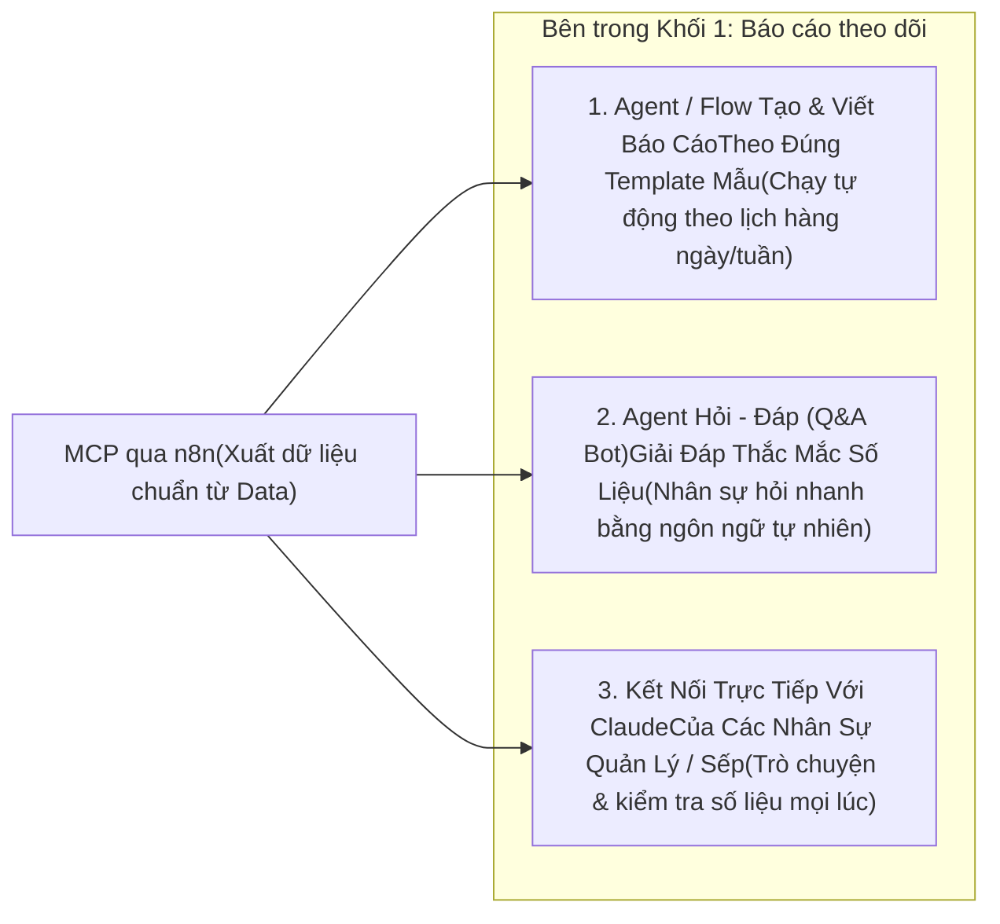

#### Mô hình 1.1: Các Agent / Workflow chuyên tạo bảng và viết báo cáo theo đúng Template mẫu
- **Cơ chế hoạt động:**
  - Theo lịch cố định (ví dụ: 06:00 sáng hàng ngày, hoặc đầu giờ chiều), Workflow/Agent gọi qua `MCP qua n8n` lấy số liệu đã cập nhật từ `Data`.
  - Tự động điền số liệu vào đúng **Template mẫu cố định** của từng phòng ban (trên Google Sheets báo cáo, Notion, hoặc xuất PDF/tin nhắn).
  - Sau khi điền bảng, **Agent Chuyên Viết Báo Cáo** đọc qua bảng số liệu vừa tạo để viết một bản **Tóm tắt nhận định (Executive Summary)** theo đúng văn phong và cấu trúc mẫu mà sếp/trưởng bộ phận yêu cầu (chỉ rõ: *Hôm qua đạt bao nhiêu % KPI, chỉ số nào tăng/giảm bất thường, sản phẩm/video nào đang dẫn đầu*), rồi gửi tự động vào nhóm chat của phòng ban.
- **Một vài Template báo cáo tiêu biểu:**
  1. **Template Báo cáo Content Performance (Theo dõi Số lượng & Chất lượng Nội dung):**
     - Tự động tổng hợp danh sách video đã đăng theo bộ lọc `Ngày bắt đầu - Ngày kết thúc` và `Sản phẩm` (`S24`, `S25`, `G1`...).
     - Hiển thị đầy đủ: `Link Video`, `ID`, `Mục tiêu` (`GMV`, `C-ads`), `Nhân sự` (`Kha`, `Giang`...), `Ngày air`, `Hướng thử nghiệm` (`S24-1000 chất lượng 10000`, `Sự tiện lợi`...), kèm các chỉ số chất lượng sáng tạo: **`VE%`**, **`IE%`**, **`PE%`**, **`consideration (CQS)`**, **`Cost`**, **`Impressions`**, **`New consideration size/rate`**, **`Cost per consideration`**, **`Clicks`**, và **`GMV`**.
     - Theo dõi định mức sản lượng video/ngày của từng nhân sự Content và hiệu quả của từng hướng thử nghiệm.
  2. **Template Báo cáo Doanh thu - Chi phí Ads - Lãi/Lỗ (Daily Omni-channel PnL):**
     - Tổng hợp doanh số GMV, doanh thu thực nhận sau phí sàn (TikTok Shop + Shopee), đối chiếu với tổng chi phí Ads các kênh theo từng mã sản phẩm.
  3. **Template Báo cáo Tiến độ KOC & Sức khỏe Gian hàng:**
     - Tổng hợp số lượng KOC đã gửi mẫu, số video KOC đã trả bài trong ngày, doanh số từ Affiliate và cảnh báo các mã hàng sắp chạm đáy tồn kho hoặc có tỷ lệ hoàn cao.
  4. **Template Báo cáo Hiệu suất Ca Livestream & Chi phí Live Ads (Live Shift PnL):**
     - Do đặc thù tại công ty **Host tự vận hành phiên Live và tự ấp giỏ hàng**, Host kết thúc ca không cần phải tự ngồi cộng sổ. Hệ thống tự động ghép dữ liệu phiên Live của từng Host (từ TikTok Shop `/analytics/202510/shop_lives/{live_id}/performance_per_minutes`, `/products_performance` và Shopee Live `/api/v2/livestream/get_session_metric`) với chi phí quảng cáo `Live GMV Max` (`/gmv_max/report/get/`) trong đúng khung giờ ca đó để xuất báo cáo: *Doanh thu ca Live, Số đơn hàng, Tỷ lệ nhấp giỏ hàng, Chi phí Ads của ca, ROI thực tế và Top mã sản phẩm bán chạy nhất trong phiên*.

#### Mô hình 1.2: Agent Hỏi - Đáp (Q&A Bot) giải đáp thắc mắc về số liệu tức thì
- **Bối cảnh:** Trong quá trình làm việc, nhân sự các phòng ban thường phát sinh các câu hỏi đột xuất (ví dụ: *"Tuần này hướng thử nghiệm nào của mã S24 đang có VE% cao nhất?"*, *"Chi phí chạy C-ads cho các video của Giang từ đầu tháng đến giờ hết bao nhiêu?"*, *"Mã G1 hôm qua có bao nhiêu đơn hoàn và lý do chính là gì?"*).
- **Cơ chế hoạt động:**
  - Thay vì phải tự vào từng file Sheet lọc tìm hoặc nhắn tin hỏi bộ phận khác, nhân sự chỉ cần gõ câu hỏi vào **Agent Hỏi - Đáp**.
  - Agent tự động dịch câu hỏi thành lệnh truy vấn gọi qua `MCP qua n8n`, lấy số liệu chính xác từ `Data` và trả lời ngay lập tức kèm bảng trích xuất ngắn gọn.

#### Mô hình 1.3: Kết nối trực tiếp vào tài khoản Claude của các Nhân sự Quản lý / Sếp
- **Bối cảnh:** Ban giám đốc và các cấp quản lý (Manager / Leader các bộ phận) thường sử dụng trực tiếp **Claude (Claude Desktop / Claude Web)** để làm việc và ra quyết định chiến lược.
- **Cơ chế hoạt động:**
  - Đầu nối **`MCP qua n8n`** (chế độ Read-Only) được cấu hình cắm trực tiếp làm MCP Connector trong tài khoản Claude của các nhân sự quản lý.
  - Bất kỳ lúc nào (trước buổi họp hoặc khi đang di chuyển), người quản lý chỉ cần mở Claude của mình và hỏi trực tiếp: *"Tóm tắt cho anh tình hình chạy thử nghiệm các góc content của sản phẩm S24 trong 7 ngày qua và so sánh với tuần trước"*. Claude sẽ tự động gọi `MCP qua n8n` đọc dữ liệu mới nhất của công ty để trả lời và lập bảng so sánh ngay trên màn hình của sếp.

---

#### 🛠️ Thiết Kế Chi Tiết Một Số Agent / Workflow Cụ Thể Trong Khối 1 (Ưu Tiên Claude Agent + Phương Án n8n Workflow)

Dưới đây là thiết kế cụ thể cho **3 bài toán báo cáo điển hình** trong Khối 1, cung cấp cả **2 phương án triển khai** (Phương án A: Ưu tiên dùng **Claude Agent** qua `MCP qua n8n`; Phương án B: Chạy tự động theo lịch bằng **n8n Workflow**), kèm sơ đồ luồng, danh sách MCP Tools và các Node trong `n8n`.

---

##### Ví dụ 1.A: Agent Lập & Viết Báo Cáo Content Performance Theo Template (`S24`, `S25`, `G1` & Hướng Thử Nghiệm)

**1. Sơ đồ luồng hoạt động (Hỗ trợ cả Claude Agent & n8n Workflow):**

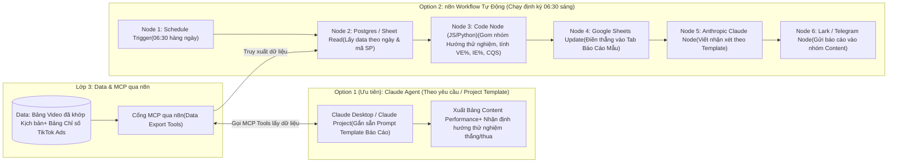

**2. Chi tiết công cụ sử dụng trong 2 phương án:**

| Phương Án | Các MCP Tools (Cho Claude) / Các Node Cụ Thể (Trong n8n) | Kết Quả Đầu Ra |
| :--- | :--- | :--- |
| **Option 1 (Ưu tiên): Dùng Claude Agent**<br/>*(Trưởng nhóm Content / Quản lý dùng Claude Project gắn sẵn Template)* | **Các MCP Tools trên `MCP qua n8n` mà Claude gọi:**<br/>• `get_content_performance_table(product_code, start_date, end_date)`: Trả về bảng chuẩn gồm `Link Video`, `ID`, `Mục tiêu (GMV/C-ads)`, `Nhân sự (Kha/Giang)`, `Ngày air`, `Hướng thử nghiệm`, `VE%`, `IE%`, `PE%`, `CQS`, `Cost`, `Impressions`, `New consideration size/rate`, `Cost per consideration`, `Clicks`, `GMV`.<br/>• `get_testing_angle_summary(product_code, date_range)`: Gom nhóm và so sánh hiệu quả giữa các hướng thử nghiệm (ví dụ: *`S24-1000 chất lượng 10000`* so với *`Sự tiện lợi`*).<br/>• `get_staff_kpi_progress(staff_name, date_range)`: Kiểm tra sản lượng video đã air và tỷ lệ video đạt chuẩn của từng nhân sự. | Claude tự động dựng bảng báo cáo đúng 100% cấu trúc mẫu ngay trên khung chat (Artifact) kèm phần nhận xét chi tiết hướng thử nghiệm nào nên nhân rộng tuần tới. |
| **Option 2: Dùng n8n Workflow + Claude Node**<br/>*(Chạy ngầm tự động mỗi sáng không cần người bấm)* | **Chuỗi 6 Node trên `n8n`:**<br/>1. `Schedule Trigger`: Hẹn giờ chạy `06:30` sáng mỗi ngày.<br/>2. `Postgres / Google Sheets (Get Rows)`: Đọc dữ liệu video và chỉ số quảng cáo đã đồng bộ.<br/>3. `Code Node`: Tính trung bình trọng số các chỉ số `VE%`, `IE%`, `PE%`, `Cost per consideration` theo từng mã sản phẩm (`S24`, `S25`, `G1`).<br/>4. `Google Sheets (Update)`: Ghi đè bảng kết quả đã tính sẵn vào tab Báo cáo (giúp bỏ hoàn toàn hàm `ARRAYFORMULA` gây đơ Sheet).<br/>5. `AI Agent / Anthropic Chat Model`: Đưa bảng tóm tắt qua Claude API để viết 5 gạch đầu dòng điểm tin sáng.<br/>6. `Telegram / Lark`: Bắn tin nhắn báo cáo kèm link Sheet vào nhóm làm việc. | Bảng Google Sheets luôn có sẵn số liệu mới nhất lúc 6h30 sáng + Tin nhắn tóm tắt tự động gửi vào nhóm phòng ban. |

---

##### Ví dụ 1.B: Agent Báo Cáo Doanh Số, Chi Phí Ads & Lãi/Lỗ Đa Sàn Hàng Ngày (Daily Omni-Channel PnL)

**1. Sơ đồ luồng hoạt động:**

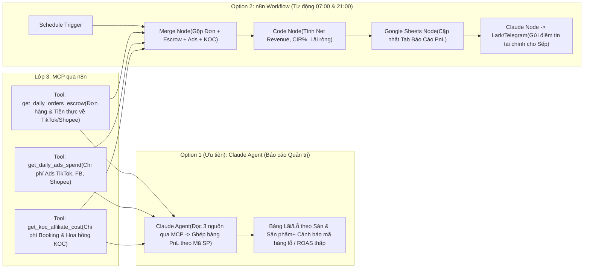

**2. Chi tiết công cụ sử dụng trong 2 phương án:**

| Phương Án | Các MCP Tools (Cho Claude) / Các Node Cụ Thể (Trong n8n) | Kết Quả Đầu Ra |
| :--- | :--- | :--- |
| **Option 1 (Ưu tiên): Dùng Claude Agent** | **Các MCP Tools trên `MCP qua n8n` mà Claude gọi:**<br/>• `get_daily_orders_escrow(date_range, platform, product_code)`: Lấy tổng đơn thành công, đơn hoàn, GMV, tổng phí sàn khấu trừ và tiền thực nhận về ví (`Escrow / Settlement`).<br/>• `get_daily_ads_spend(date_range, channel, product_code)`: Lấy tổng chi phí quảng cáo (`Cost`) và `ROAS` của từng kênh (TikTok, Facebook, Shopee).<br/>• `get_koc_affiliate_cost(date_range, product_code)`: Lấy chi phí hoa hồng Affiliate và phí booking phân bổ. | Báo cáo tài chính tổng hợp theo từng mã sản phẩm (`S24`, `S25`, `G1`), chỉ rõ biên lợi nhuận ròng sau khi trừ giá vốn, phí sàn và chi phí Ads. |
| **Option 2: Dùng n8n Workflow** | **Chuỗi Node trên `n8n`:**<br/>`Schedule Trigger` $\rightarrow$ `Postgres Query / Merge Node` (gộp 3 bảng Đơn hàng, Đối soát và Ads theo mã sản phẩm) $\rightarrow$ `Code Node` (tính tỷ lệ `% Ads/Doanh thu`, `% Phí sàn/Doanh thu`, `Lợi nhuận ròng`) $\rightarrow$ `Google Sheets (Update)` $\rightarrow$ `Anthropic Claude Node` $\rightarrow$ `Telegram/Lark Notification`. | Tự động cập nhật bảng theo dõi tài chính hàng ngày và gửi báo cáo sáng/tối cho Ban Giám đốc. |

---

##### Ví dụ 1.C: Agent Hỏi - Đáp Số Liệu Tức Thì (Data Q&A) & Kết Nối Trực Tiếp Với Claude Của Quản Lý

**1. Sơ đồ luồng hoạt động:**

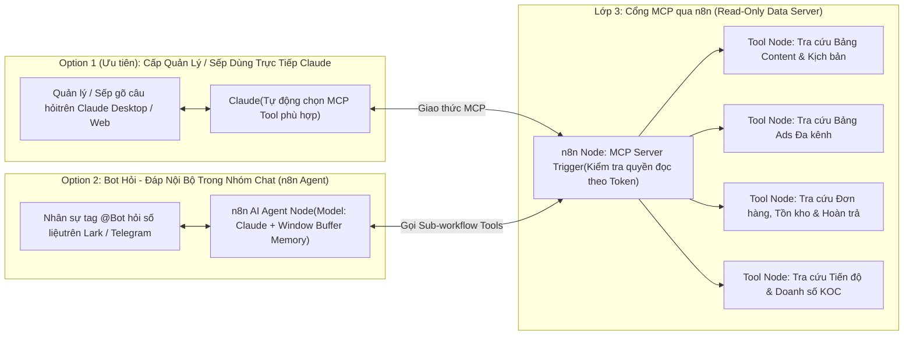

**2. Chi tiết cấu hình MCP Tools & Node trong `n8n`:**
- **Phía `n8n` (Đóng vai trò `MCP qua n8n`):**
  - Đặt 1 node **`MCP Server Trigger`** ở đầu luồng, nối với 4–5 **`Custom Tool Nodes`** (mỗi Tool là một truy vấn đọc dữ liệu có tham số lọc an toàn từ `Google Sheets` hoặc `Postgres` như: lọc theo tên nhân sự, mã sản phẩm, ngày tháng, kênh chạy).
- **Phía Quản lý / Sếp (Option 1):**
  - Chỉ cần dán đường dẫn URL của `MCP Server Trigger` vào phần cài đặt **MCP Connectors** trên Claude của mình.
  - Từ đó, sếp có thể hỏi bất kỳ câu nào bằng tiếng Việt (ví dụ: *"Cho anh xem 5 video của Kha và Giang tuần này có Cost per consideration thấp nhất"*, *"Tồn kho hiện tại của mã S24 bên Thái Lan và Việt Nam còn đủ bán mấy ngày với tốc độ đơn tuần này?"*), Claude sẽ tự gọi đúng Tool trên `n8n` để lấy số thật trả lời ngay lập tức.
- **Phía Nhân sự các phòng ban (Option 2):**
  - Dùng `Webhook / Chat Trigger` trên `n8n` nối vào `AI Agent Node` (dùng model Claude kèm `Window Buffer Memory` để nhớ mạch hội thoại) và cắm chung vào các Tool đọc dữ liệu ở trên để giải đáp thắc mắc ngay trong nhóm chat.

---

<a id="phan-4-2"></a>
### 4.2. Khối 2: Phân Tích Data

> **Luồng kết nối trên sơ đồ:** Nhận dữ liệu từ **`MCP qua n8n`** (đọc `Data` có sẵn) kết hợp với **`MCP`** (để chủ động gọi API trích xuất thêm dữ liệu chuyên sâu khi cần đào sâu nguyên nhân).  
> **Mục tiêu cốt lõi:** Khác với Khối 1 (chỉ tổng hợp số liệu có sẵn theo mẫu hàng ngày), Khối 2 giải quyết các bài toán **đào sâu tìm nguyên nhân gốc rễ (Deep-Dive & Root-Cause Analysis)**, chấm điểm chất lượng hàng loạt bằng **[`JEV`](./JEV/README.md)** (System One) rồi đúc kết thành báo cáo phân tích chuyên sâu và đề xuất hành động thông qua **Claude** (System Two).

Trong hộp **`2. Phân tích Data`**, hệ thống triển khai **3 mô hình phân tích trọng tâm**:

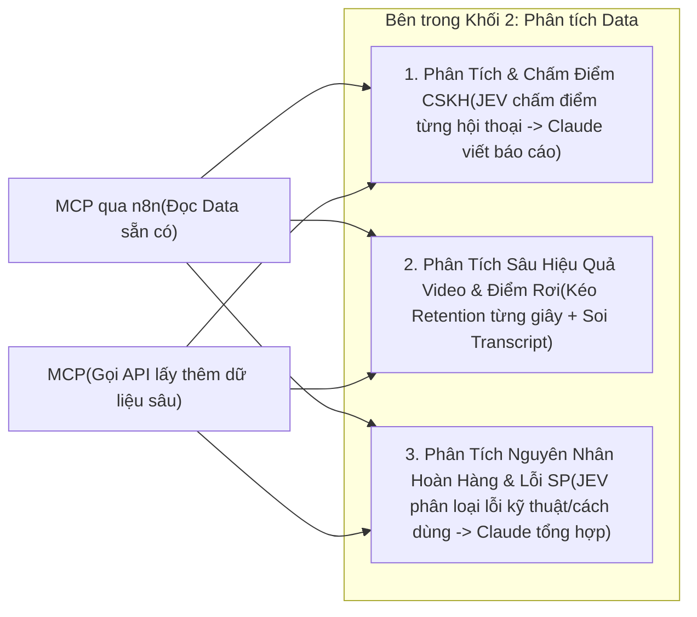

#### Mô hình 2.1: Tạo bảng chấm điểm Chăm sóc Khách hàng (CSKH) qua JEV & Viết báo cáo phân tích qua Claude
- **Bối cảnh:** Mỗi ngày gian hàng TikTok Shop, Shopee và Fanpage phát sinh hàng trăm cuộc hội thoại tư vấn mua hàng, hướng dẫn kết nối mic và xử lý bảo hành. Nếu dùng người đọc lại hoặc dùng LLM lớn (Claude/GPT) chấm từng cuộc chat sẽ rất tốn thời gian và tốn chi phí token.
- **Cơ chế kết hợp `JEV` + `Claude`:**
  1. Hệ thống lấy danh sách phiên chat từ `MCP qua n8n` và gọi `MCP` kéo nội dung tin nhắn chi tiết (`Seller Chat API` / `Customer Service IM API`) của các cuộc hội thoại cần kiểm tra.
  2. Đẩy từng cuộc hội thoại qua **[`JEV`](./JEV/README.md)** (`POST /v1/systemone`, tốn `$0` output token, `< 300ms`/cuộc) để chấm điểm tự động theo bộ tiêu chí chuẩn (Rubric): *Thái độ phục vụ*, *Độ chuẩn xác khi tư vấn kỹ thuật sản phẩm*, *Kỹ năng chốt đơn/giữ đơn*, và *Có vi phạm SLA phản hồi chậm không* $\rightarrow$ Tạo ra **Bảng Chấm Điểm CSKH** lưu vào `Data`.
  3. **Claude Agent** đọc Bảng Chấm Điểm CSKH vừa tạo cùng một số mẫu hội thoại điểm thấp để viết **Báo cáo Phân tích Chất lượng CSKH**: chỉ rõ điểm mạnh/yếu của từng nhân sự, các câu hỏi kỹ thuật mà khách hay thắc mắc nhất nhưng nhân viên trả lời còn lúng túng, và đề xuất bộ câu trả lời mẫu mới.

#### Mô hình 2.2: Phân tích sâu hiệu quả Video Content & Điểm rơi giữ chân người xem từng giây
- **Bối cảnh:** Khi nhìn bảng Content Performance ở Khối 1, team thấy một lô video thuộc hướng thử nghiệm mới có `Impressions` cao nhưng `VE%` thấp hoặc không ra đơn, cần mổ xẻ xem video bị gãy ở đoạn nào.
- **Cơ chế hoạt động:**
  - Kết hợp đọc `Transcript` + chỉ số tổng từ `MCP qua n8n` và gọi `MCP` chọc vào endpoint [`/report/video_performance/get/`](./tiktok-business-api/README.md) của TikTok Business API để rút trích **biểu đồ giữ chân người xem từng giây (second-by-second retention & drop-off)**.
  - Đối chiếu giây bị tụt người xem mạnh nhất với câu thoại tương ứng trong `Transcript` để tìm ra nguyên nhân (Hook 3s đầu chưa trúng nỗi đau, phần giới thiệu tính năng quá dài dòng, hay thiếu lời kêu gọi bấm giỏ hàng).

#### Mô hình 2.3: Phân tích nguyên nhân Hoàn hàng, Lỗi kỹ thuật sản phẩm & Đánh giá 1–3 sao
- **Bối cảnh:** Đặc thù bán sản phẩm công nghệ (mic thu âm `S24`, `S25`, `G1`...) cần phân biệt rõ khách trả hàng/đánh giá thấp là do **lỗi phần cứng thực sự** hay do **khách không biết cách cắm/kết nối điện thoại**.
- **Cơ chế hoạt động:**
  - Đọc danh sách đơn hoàn từ `MCP qua n8n` và gọi `MCP` lấy chi tiết lý do hoàn (`get_return_detail`), bình luận đánh giá (`get_comment`) kèm lịch sử chat của đơn đó.
  - Dùng **JEV** phân loại hàng loạt từng trường hợp theo nhóm nguyên nhân, sau đó dùng **Claude** tổng hợp thành báo cáo gửi bộ phận Sản phẩm (cải tiến phần cứng) và bộ phận Content (làm thêm video hướng dẫn sử dụng).

---

#### 🛠️ Thiết Kế Chi Tiết Một Số Agent / Workflow Cụ Thể Trong Khối 2 (Ưu Tiên Claude Agent + Phương Án n8n Workflow)

---

##### Ví dụ 2.A: Tạo Bảng Chấm Điểm Chăm Sóc Khách Hàng (CSKH) Qua JEV & Viết Báo Cáo Phân Tích Qua Claude

**1. Sơ đồ luồng hoạt động (Kết hợp JEV chấm điểm & Claude viết báo cáo):**

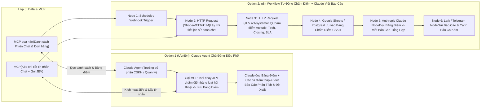

**2. Cấu trúc câu hỏi JEV chấm điểm CSKH & Chi tiết công cụ trong 2 phương án:**

- **Bộ tiêu chí (Questions) truyền vào node `JEV (/v1/systemone)` cho mỗi cuộc hội thoại:**
  - `issue_topic` (`choice`): Phân loại vấn đề khách hỏi (*Tư vấn chọn mua*, *Hướng dẫn kết nối/sử dụng mic*, *Khiếu nại lỗi âm thanh/kết nối*, *Yêu cầu đổi trả/hoàn tiền*).
  - `attitude_score` (`score` thang 1–4): Thái độ phản hồi của nhân viên (1: Cộc lốc/Thiếu nhiệt tình $\rightarrow$ 4: Lễ phép, chủ động hỗ trợ).
  - `tech_knowledge_score` (`score` thang 1–4): Độ chính xác khi giải thích tính năng và cách khắc phục lỗi kỹ thuật sản phẩm.
  - `persuasion_score` (`score` thang 1–4): Kỹ năng chốt đơn hoặc thuyết phục khách giữ lại sản phẩm khi khách định hủy/hoàn.
  - `needs_manager_review` (`noul` `0.0 -> 1.0`): Cuộc chat này có nguy cơ dẫn tới đánh giá 1 sao hoặc khiếu nại lên sàn cần Quản lý can thiệp ngay không?

| Phương Án | Các MCP Tools (Cho Claude) / Các Node Cụ Thể (Trong n8n) | Kết Quả Đầu Ra |
| :--- | :--- | :--- |
| **Option 1 (Ưu tiên): Dùng Claude Agent**<br/>*(Quản lý CSKH mở Claude yêu cầu chấm điểm & phân tích theo ca/tuần)* | **Các MCP Tools mà Claude gọi:**<br/>• `mcp_cs_fetch_and_score_chats(date_range, shop_id, staff_name)`: Gọi luồng `MCP` tự động kéo các đoạn chat chưa chấm từ Shopee/TikTok Shop, đẩy qua **JEV** chấm 5 chỉ số trên và ghi vào **Bảng Chấm Điểm CSKH**.<br/>• `mcp_data_get_cskh_scorecard(date_range, staff_name)`: Đọc bảng tổng hợp điểm trung bình của từng nhân viên từ `MCP qua n8n`.<br/>• `mcp_cs_get_low_score_transcripts(max_score=2.0)`: Lấy toàn văn vài đoạn chat bị JEV chấm điểm thấp nhất để Claude đọc làm dẫn chứng. | 1. **Bảng Chấm Điểm CSKH** chi tiết từng phiên chat trên Google Sheets / Postgres.<br/>2. **Báo cáo phân tích toàn diện trên Claude** (xếp hạng nhân viên, các lỗi tư vấn phổ biến và mẫu câu khắc phục). |
| **Option 2: Dùng n8n Workflow + JEV + Claude Node**<br/>*(Chạy tự động cuối mỗi ca trực hoặc cuối ngày)* | **Chuỗi 6 Node trên `n8n`:**<br/>1. `Schedule Trigger` (Cuối ca sáng `12:00` & cuối ca tối `22:00`).<br/>2. `HTTP Request Node (Shopee SellerChat / TikTok IM)`: Kéo nội dung các hội thoại phát sinh trong ca.<br/>3. `HTTP Request Node (POST api.typesafe.ai/v1/systemone)`: Gửi `state` (lịch sử chat) + `questions` cho **JEV** chấm điểm song song.<br/>4. `Google Sheets / Postgres Node`: Lưu điểm từng cuộc chat vào `Bảng Chấm Điểm CSKH`.<br/>5. `Anthropic Claude Node`: Đọc thống kê điểm cả ca và các đoạn chat có `needs_manager_review > 0.80` để viết báo cáo tổng kết ca.<br/>6. `Lark / Telegram Node`: Gửi báo cáo chất lượng ca trực cho Trưởng phòng CSKH. | Tự động hóa 100% khâu kiểm soát chất lượng (QA) hàng trăm cuộc chat mỗi ngày với chi phí token JEV gần như bằng `0`. |

---

##### Ví dụ 2.B: Agent Phân Tích Sâu Hiệu Quả Video Content & Điểm Rơi Giữ Chân Từng Giây (Creative Deep-Dive)

**1. Sơ đồ luồng hoạt động:**

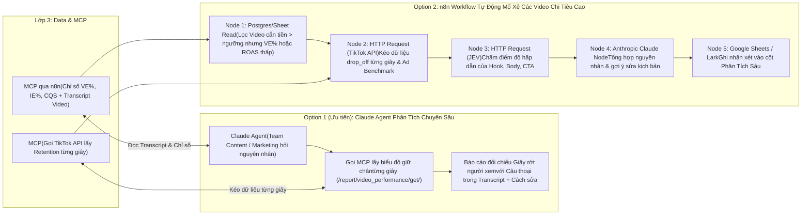

**2. Chi tiết công cụ sử dụng trong 2 phương án:**

| Phương Án | Các MCP Tools (Cho Claude) / Các Node Cụ Thể (Trong n8n) | Kết Quả Đầu Ra |
| :--- | :--- | :--- |
| **Option 1 (Ưu tiên): Dùng Claude Agent** | **Các MCP Tools mà Claude gọi:**<br/>• `mcp_data_get_video_transcript_and_metrics(video_id / testing_angle)`: Lấy toàn văn lời thoại (`Transcript`), `Hướng thử nghiệm` và bộ chỉ số `VE%`, `IE%`, `PE%`, `CQS` từ `Data`.<br/>• `mcp_tiktok_get_second_by_second_retention(ad_id / item_id)`: Gọi qua `MCP` lên TikTok Business API (`/report/video_performance/get/`) lấy mảng tỷ lệ giữ chân ở giây thứ 1, 2, 3... đến hết video.<br/>• `mcp_tiktok_get_industry_benchmark(ad_id)`: Lấy điểm chuẩn trung bình ngành từ `/report/ad_benchmark/get/`. | Claude chỉ ra chính xác: *"Video rớt 45% người xem ở giây thứ 3–5 khi nhân vật đang nói câu X, cao hơn mức rớt trung bình ngành 18%"* và viết lại 3 phương án sửa câu Hook. |
| **Option 2: Dùng n8n Workflow + JEV + Claude** | **Chuỗi 5 Node trên `n8n`:**<br/>`Postgres/Sheet Filter` (lọc các video tiêu tiền nhiều nhưng hiệu quả kém) $\rightarrow$ `HTTP Request (TikTok Video Performance API)` $\rightarrow$ `JEV Node` (chấm điểm từng phần của kịch bản) $\rightarrow$ `Anthropic Claude Node` (viết chẩn đoán chi tiết) $\rightarrow$ `Google Sheets Update` (điền thẳng vào cột *Ghi chú phân tích* trên Sheet của team Content). | Tự động chẩn đoán nguyên nhân thất bại cho các video thử nghiệm mà không cần nhân sự tự mò từng biểu đồ trên trình quản lý quảng cáo. |

---

##### Ví dụ 2.C: Agent Phân Tích Nguyên Nhân Hoàn Hàng, Lỗi Kỹ Thuật Sản Phẩm & Đánh Giá 1–3 Sao

**1. Sơ đồ luồng hoạt động:**

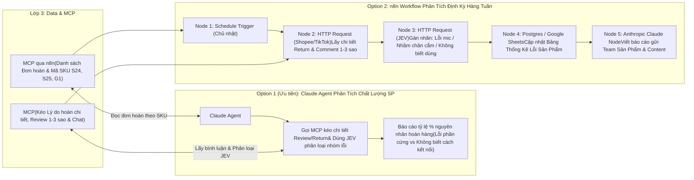

**2. Chi tiết công cụ sử dụng trong 2 phương án:**

| Phương Án | Các MCP Tools (Cho Claude) / Các Node Cụ Thể (Trong n8n) | Kết Quả Đầu Ra |
| :--- | :--- | :--- |
| **Option 1 (Ưu tiên): Dùng Claude Agent** | **Các MCP Tools mà Claude gọi:**<br/>• `mcp_shop_fetch_returns_and_negative_reviews(product_code, date_range)`: Gọi `MCP` lấy toàn bộ văn bản khiếu nại hoàn tiền và đánh giá 1–3 sao từ Shopee (`get_return_detail`, `get_comment`) và TikTok Shop.<br/>• `mcp_jev_classify_product_issues(items_list)`: Dùng **JEV** phân loại từng ca vào các nhóm: *(1) Lỗi phần cứng (hỏng thu âm, chai pin)*, *(2) Khách mua nhầm chân cắm (Type-C / Lightning)*, *(3) Khách không biết cách kết nối/bật khử ồn*, *(4) Lỗi vận chuyển/đóng gói*. | Báo cáo định lượng chính xác tỷ lệ từng nguyên nhân hoàn hàng của mã `S24`, `S25`, `G1`, giúp team Content biết cần làm ngay video hướng dẫn gì và team Shop biết cần sửa ảnh phân loại hàng ra sao. |
| **Option 2: Dùng n8n Workflow + JEV + Claude** | **Chuỗi 5 Node trên `n8n`:**<br/>`Schedule Trigger` $\rightarrow$ `HTTP Request (Shopee & TikTok Return/Comment API)` $\rightarrow$ `JEV Node (Choice & Score)` $\rightarrow$ `Postgres/Sheets Update` $\rightarrow$ `Claude Node -> Lark/Telegram`. | Báo cáo chất lượng sản phẩm tự động hàng tuần cho bộ phận R&D/Sản phẩm, CSKH và Content. |

---

<a id="phan-4-3"></a>
### 4.3. Khối 3: Agent / Workflow Tự Động Chung

> **Luồng kết nối trên sơ đồ:** Kết nối đồng thời vào **`MCP qua n8n`** (để đọc dữ liệu đầu vào và cập nhật trạng thái vào bảng `Data`) và **`MCP`** (để thực thi các lệnh Write / Action có phân quyền lên hệ thống API).  
> **Mục tiêu cốt lõi:** Tự động hóa các quy trình vận hành xương sống chạy chung cho toàn công ty (**Content, Marketing Ads, Vận hành Sàn, Livestream Ads**). Mọi tác vụ thực thi đều bắt buộc đi qua **`MCP`** trên `n8n` (Agent không bao giờ gọi trực tiếp vào API gốc của sàn/ads) và tận dụng **[`JEV`](./JEV/README.md)** để ra quyết định nhanh, chính xác trước khi thực thi.

Trong hộp **`3. Agent / Workflow tự động chung`**, hệ thống triển khai **4 luồng tự động hóa chủ lực**:

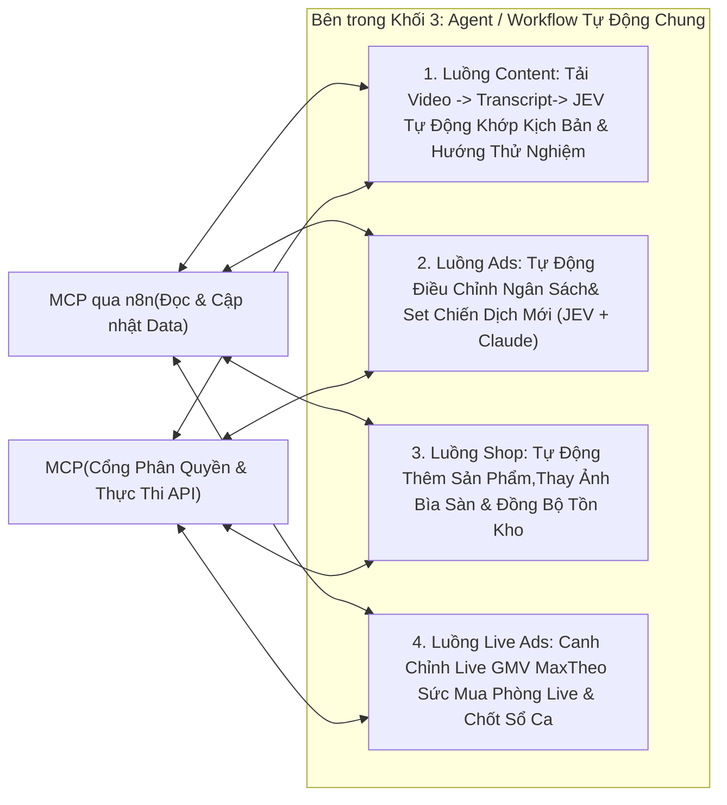

#### Mô hình 3.1: Tự động tải Video $\rightarrow$ Transcript $\rightarrow$ JEV khớp Kịch bản / Hướng thử nghiệm vào bảng Data
- **Bối cảnh:** Giải quyết trực diện điểm nghẽn hiện tại của team Content (đang phải gán tay từng `Link Video` và `ID` với `Hướng thử nghiệm` và `Tên kịch bản` trên Google Sheets rồi dùng `ARRAYFORMULA` kéo chỉ số).
- **Cơ chế hoạt động:**
  1. Phát hiện video mới đăng trên kênh TikTok / chiến dịch Ads hoặc video do KOC gửi trả bài.
  2. Gọi qua `MCP` tải luồng âm thanh/video vào thư mục tạm (`/tmp` trên máy chủ `n8n`) $\rightarrow$ Chuyển đổi giọng nói thành văn bản (**Transcript**) $\rightarrow$ **Xóa ngay lập tức file video tạm** để không tốn dung lượng ổ cứng máy chủ.
  3. Gửi `Transcript` cùng danh sách các kịch bản đang thử nghiệm (đọc từ `MCP qua n8n`) vào **[`JEV`](./JEV/README.md)** để nhận định xem video này thuộc **Kịch bản nào** và **Hướng thử nghiệm nào** (`S24-1000 chất lượng 10000`, `Sự tiện lợi`, `G1 - Before/After`...).
  4. Tự động ghi mã kịch bản, hướng thử nghiệm và tên nhân sự ngược lại vào bảng `Data` để khớp sẵn với bộ chỉ số `VE%`, `IE%`, `PE%`, `CQS`, `Cost`, `GMV`.

#### Mô hình 3.2: Tự động điều chỉnh ngân sách & Set chiến dịch Ads mới (Smart Ads Automation)
- **Bối cảnh:** Đội ngũ chạy Ads phải canh hàng trăm nhóm quảng cáo trên TikTok, Facebook, Shopee và liên tục lấy video mới (hoặc mã `Spark Ads` từ KOC) để lên camp thử nghiệm.
- **Cơ chế hoạt động:**
  - **Tự động điều chỉnh Ads:** Đọc chỉ số hiệu suất từ `MCP qua n8n` $\rightarrow$ Dùng **JEV** hoặc **Claude Agent** đánh giá sức khỏe từng nhóm quảng cáo theo bộ quy tắc (ROAS, CPA, CQS, VE%, tốc độ cắn tiền) $\rightarrow$ Gọi `MCP Ads` để tự động tắt nhóm lỗ, tăng ngân sách nhóm đang thắng.
  - **Tự động Set Ads:** Khi có video mới đạt điểm chất lượng cao hoặc có mã `Spark Ads Code` của KOC trong bảng `Data`, Agent gọi `MCP Ads` tự động ủy quyền video và khởi tạo chiến dịch/nhóm quảng cáo theo cấu hình chuẩn.

#### Mô hình 3.3: Tự động thêm sản phẩm mới, thay ảnh bìa sàn & đồng bộ tồn kho đa sàn
- **Bối cảnh:** Khi ra mắt mã sản phẩm mới hoặc khi muốn thử nghiệm thay ảnh đại diện (Thumbnail) trên Shopee/TikTok Shop để cải thiện tỷ lệ nhấp (CTR), thao tác chỉnh tay trên nhiều gian hàng rất mất thời gian và dễ lệch tồn kho.
- **Cơ chế hoạt động:** Đọc thông tin sản phẩm gốc và kho ảnh từ `MCP qua n8n`, sau đó gọi `MCP Shop` để tự động tải ảnh lên CDN các sàn, đăng/cập nhật thông tin sản phẩm đồng loạt và đồng bộ tồn kho SKU theo thời gian thực.

#### Mô hình 3.4: Tự động canh chỉnh Quảng cáo Livestream (`Live GMV Max`) theo sức mua phòng Live & Chốt sổ ca Live
- **Bối cảnh:** Tại công ty, khi lên sóng Livestream, **Host tự vận hành phiên Live và tự ấp/ghim giỏ hàng**, không có nhân sự vận hành ngồi kèm liên tục để canh chỉnh tiền quảng cáo `Live Ads` hay ngồi cộng sổ sau mỗi ca. Nếu phòng Live đang vắng hoặc tỷ lệ chốt thấp mà `Live GMV Max` vẫn cắn ngân sách lớn sẽ gây lỗ nặng; ngược lại khi Host đang giữ chân tốt và nổ đơn liên tục nhưng không kịp bơm thêm ngân sách Ads sẽ bỏ lỡ đỉnh sóng.
- **Cơ chế hoạt động:**
  1. **Trong khi đang Live (mỗi 10–15 phút):** Hệ thống gọi qua `MCP` kiểm tra trạng thái phòng Live (`/open_api/v1.3/identity/live/get/`), kết hợp kéo chỉ số sức mua theo từng phút của phòng Live (`/analytics/202510/shop_lives/{live_id}/performance_per_minutes`: `concurrent_users`, `product_clicks`, `order_count`, `gmv`) đối chiếu với tốc độ tiêu tiền và ROI của chiến dịch `LIVE_GMV_MAX` (`/gmv_max/report/get/`).
  2. **Ra quyết định bơm/hãm ngân sách Live Ads:** Đưa bộ chỉ số 15 phút vừa qua vào **JEV** hoặc **Claude Agent** để đánh giá sức nóng của phòng Live $\rightarrow$ Tự động gọi `MCP Ads` tăng ngân sách/nới mục tiêu ROI khi phòng Live đang chuyển đổi tốt, hoặc giảm ngân sách/tạm dừng bơm tiền khi phòng Live "lạnh" (nhiều mắt xem ảo nhưng không có lượt bấm giỏ hàng).
  3. **Khi Host tắt Live (`live_status = ENDED`):** Tự động khóa ngân sách chiến dịch Live Ads để tránh cắn tiền thừa, đồng thời tổng hợp ngay **Báo cáo chốt sổ ca Live (Doanh thu - Chi phí Ads - Số đơn - ROI từng ca)** lưu vào bảng `Data` và bắn về nhóm chat cho quản lý & Host.

---

#### 🛠️ Thiết Kế Chi Tiết Một Số Agent / Workflow Cụ Thể Trong Khối 3 (Ưu Tiên Claude Agent + Phương Án n8n Workflow)

---

##### Ví dụ 3.A: Luồng Khớp Video Đã Đăng Với Kịch Bản / Hướng Thử Nghiệm & Rà Soát Video Content (Transcript + JEV)

**1. Sơ đồ luồng hoạt động:**

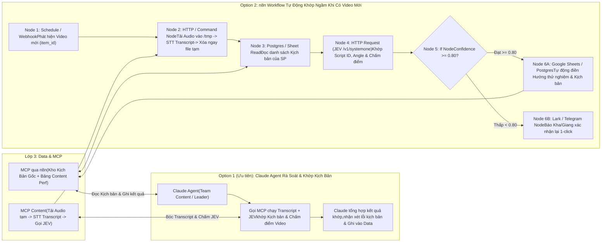

**2. Cấu trúc câu hỏi JEV khớp kịch bản & Chi tiết công cụ trong 2 phương án:**

- **Bộ câu hỏi truyền vào node `JEV (/v1/systemone)`:**
  - `matched_script_id` (`choice` kèm `confidence`): Chọn chính xác mã kịch bản trong kho kịch bản đang chạy của sản phẩm (`S24`, `S25`, `G1`) khớp với nội dung `Transcript`.
  - `testing_angle` (`choice`): Xác định video thuộc **Hướng thử nghiệm** nào (`S24-1000 chất lượng 10000`, `Nâng hạng content`, `Sự tiện lợi`, `G1 - Before/After`...).
  - `script_compliance_score` (`score` thang 1–4): Chấm điểm mức độ video thực tế tuân thủ đúng Hook 3s đầu và các luận điểm bán hàng (USP) trong kịch bản gốc.
  - `has_policy_violation` (`noul` `0.0 -> 1.0`): Phát hiện từ ngữ cam kết quá đà dễ bị TikTok Shop quét vi phạm.

| Phương Án | Các MCP Tools (Cho Claude) / Các Node Cụ Thể (Trong n8n) | Kết Quả Đầu Ra |
| :--- | :--- | :--- |
| **Option 1 (Ưu tiên): Dùng Claude Agent**<br/>*(Team Content dùng Claude để rà soát kịch bản, nghiệm thu video In-house/KOC và khớp bảng)* | **Các MCP Tools mà Claude gọi:**<br/>• `mcp_data_get_script_library(product_code, stage)`: Lấy danh sách kịch bản gốc và các hướng thử nghiệm theo giai đoạn chiến lược.<br/>• `mcp_content_transcribe_and_evaluate_video(video_url / item_id)`: Gọi `MCP` tải âm thanh tạm thời, chuyển thành `Transcript`, xóa file tạm và chạy **JEV** trả về kịch bản khớp nhất kèm điểm số.<br/>• `mcp_data_confirm_video_script_match(item_id, script_id, testing_angle)`: Ghi kết quả đã khớp vào bảng `Data` để nối tự động với các chỉ số `VE%`, `IE%`, `PE%`, `CQS`. | 1. Tự động điền cột `Hướng thử nghiệm`, `Kịch bản`, `Nhân sự` trên bảng Content Performance.<br/>2. Claude đưa ra nhận xét chi tiết cho từng video In-house / KOC (đạt hay cần sửa lại đoạn nào). |
| **Option 2: Dùng n8n Workflow + STT + JEV**<br/>*(Chạy tự động 100% mỗi khi có video mới lên kênh hoặc lên camp)* | **Chuỗi 7 Node trên `n8n`:**<br/>1. `Schedule / Webhook Trigger`: Quét danh sách video mới từ `/identity/video/get/` hoặc `/report/integrated/get/`.<br/>2. `Execute Command / HTTP Node (Ephemeral STT)`: Tải audio vào `/tmp` $\rightarrow$ Chạy Speech-to-Text lấy `Transcript` $\rightarrow$ Xóa ngay file trong `/tmp`.<br/>3. `Postgres / Google Sheets Read`: Lấy danh sách kịch bản đang active.<br/>4. `HTTP Request (JEV /v1/systemone)`: Đối chiếu `Transcript` với kho kịch bản.<br/>5. `If Node`: Kiểm tra `confidence >= 0.80`.<br/>6. `Google Sheets / Postgres Update`: Nếu `>= 0.80`, tự động điền luôn vào bảng.<br/>7. `Lark / Telegram Node`: Nếu `< 0.80` (video biến tấu nhiều), gửi tin nhắn kèm dự đoán của JEV để nhân sự (`Kha`, `Giang`) bấm xác nhận. | Giải phóng 100% công sức ngồi nghe lại từng video và gán tay trên Google Sheets; không tốn dung lượng ổ cứng lưu video. |

---

##### Ví dụ 3.B: Agent Tự Động Điều Chỉnh Ngân Sách & Set Chiến Dịch Ads Mới (Smart Ads Controller)

**1. Sơ đồ luồng hoạt động:**

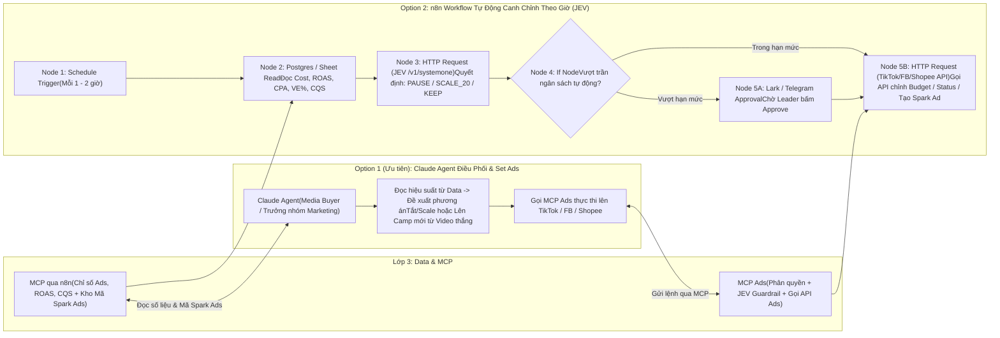

**2. Chi tiết công cụ sử dụng trong 2 phương án:**

| Phương Án | Các MCP Tools (Cho Claude) / Các Node Cụ Thể (Trong n8n) | Kết Quả Đầu Ra |
| :--- | :--- | :--- |
| **Option 1 (Ưu tiên): Dùng Claude Agent**<br/>*(Nhân sự/Quản lý Ads dùng Claude để rà soát tài khoản, chỉnh ngân sách và lên camp hàng loạt)* | **Các MCP Tools trên `MCP Ads` mà Claude gọi:**<br/>• `mcp_data_get_underperforming_and_winning_ads(channel, roas_threshold)`: Lấy danh sách các nhóm quảng cáo đang lỗ cần cắt và các nhóm đang thắng cần tăng ngân sách.<br/>• `mcp_ads_update_status_and_budget(channel, adgroup_ids, action, new_budget)`: Thực thi bật/tắt hoặc tăng/giảm ngân sách (có chốt chặn Guardrail trên `n8n` không cho phép tăng quá `%` quy định).<br/>• `mcp_ads_create_campaign_from_spark_code(advertiser_id, spark_auth_code, product_code, budget)`: Tự động gọi `/tt_video/authorize/` nạp mã video của KOC và tạo luôn Campaign + AdGroup + Ad theo cấu hình mẫu. | 1. Xử lý tối ưu hàng chục chiến dịch chỉ bằng 1 câu lệnh trên Claude.<br/>2. Tự động lên chiến dịch mới từ các video có `VE%` cao hoặc video KOC vừa trả mã Spark Ads. |
| **Option 2: Dùng n8n Workflow + JEV**<br/>*(Chạy canh gác tự động 24/7 mỗi 1–2 giờ)* | **Chuỗi 6 Node trên `n8n`:**<br/>1. `Schedule Trigger` (Mỗi 60 phút).<br/>2. `Postgres / Google Sheets Read`: Đọc chỉ số thời gian thực của các camp đang `ACTIVE`.<br/>3. `HTTP Request (JEV /v1/systemone)`: Truyền trạng thái camp để **JEV** trả về quyết định kiểu `choice` (`PAUSE_LOSS`, `SCALE_BUDGET`, `KEEP_MONITORING`) kèm `confidence`.<br/>4. `If Node (Safety Guardrail)`: Nếu là lệnh tắt camp lỗ hoặc tăng ngân sách nhỏ $\rightarrow$ Chạy thẳng; nếu tăng ngân sách lớn $\rightarrow$ Đi qua `Lark/Telegram Wait for Approval`.<br/>5. `HTTP Request (TikTok / Meta / Shopee Ads API)`: Gọi API cập nhật trạng thái/ngân sách.<br/>6. `Postgres / Sheets Log`: Ghi lịch sử thao tác của bot vào bảng Audit Log. | Không bao giờ bị cháy ngân sách vào ban đêm hoặc ngày nghỉ; tự động nắm bắt thời điểm vàng để scale các video đang cắn đơn tốt. |

---

##### Ví dụ 3.C: Agent Tự Động Thêm Sản Phẩm, Thay Ảnh Bìa Sàn (Test CTR) & Đồng Bộ Tồn Kho Đa Sàn

**1. Sơ đồ luồng hoạt động:**

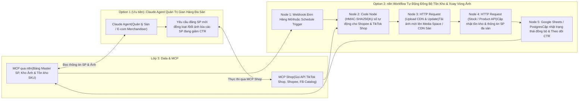

**2. Chi tiết công cụ sử dụng trong 2 phương án:**

| Phương Án | Các MCP Tools (Cho Claude) / Các Node Cụ Thể (Trong n8n) | Kết Quả Đầu Ra |
| :--- | :--- | :--- |
| **Option 1 (Ưu tiên): Dùng Claude Agent** | **Các MCP Tools trên `MCP Shop` mà Claude gọi:**<br/>• `mcp_shop_publish_new_product(internal_sku, target_platforms)`: Đọc thông tin chuẩn từ bảng Master Sản phẩm, tự động chuẩn hóa thuộc tính theo từng sàn và đăng đồng loạt lên TikTok Shop (`/product/202309/products`), Shopee (`add_item`) và Facebook Catalog.<br/>• `mcp_shop_update_product_thumbnail(product_code, platform, new_image_url)`: Tự động tải ảnh lên CDN của sàn và thay ảnh đại diện mới cho sản phẩm để test tỷ lệ click (CTR).<br/>• `mcp_shop_sync_sku_inventory(product_code, available_stock)`: Cập nhật tồn kho đồng bộ trên tất cả các gian hàng. | Nhân sự vận hành chỉ cần chuẩn bị nội dung 1 lần trên bảng Data và ra lệnh cho Claude đẩy lên toàn bộ các sàn; dễ dàng thay ảnh bìa hàng loạt trước các ngày Sale đôi (10/10, 11/11). |
| **Option 2: Dùng n8n Workflow** | **Chuỗi 5 Node trên `n8n`:**<br/>1. `Webhook Trigger` (Nhận sự kiện `ORDER_STATUS_CHANGE` từ sàn hoặc khi thêm dòng mới vào bảng Master SP).<br/>2. `Code Node`: Chạy thuật toán ký số `HMAC-SHA256` cho TikTok Shop và Shopee.<br/>3. `HTTP Request (Media Upload)`: Gọi `/product/202309/images/upload` (TikTok) và `/api/v2/media_space/upload_image` (Shopee).<br/>4. `HTTP Request (Product / Stock Update)`: Gọi API cập nhật sản phẩm và tồn kho.<br/>5. `Google Sheets / Postgres Update`: Lưu mã `platform_item_id` và log thay đổi ảnh để đo lường CTR trước/sau khi thay. | Tồn kho giữa Shopee và TikTok Shop luôn khớp nhau theo thời gian thực; tự động hóa việc thử nghiệm hình ảnh sản phẩm trên sàn. |

---

##### Ví dụ 3.D: Agent Tự Động Canh Chỉnh Quảng Cáo Livestream (`Live GMV Max`) Theo Sức Mua Phòng Live & Chốt Sổ Ca Live

> **Bối cảnh thực tế tại công ty:** Khi lên sóng Livestream, **Host tự vận hành phiên Live và tự ấp/ghim giỏ hàng**, không có nhân sự vận hành ngồi kèm để canh tiền quảng cáo hay cộng sổ. Do đó, Agent không can thiệp vào thao tác ghim giỏ hàng của Host mà tập trung giải quyết trọn vẹn **2 bài toán: (1) Canh chỉnh ngân sách Quảng cáo Live (`Live GMV Max` / `Shopee Live Ads`) theo sức mua thực tế của phòng Live mỗi 10–15 phút, và (2) Tự động đóng camp + xuất Báo cáo chốt sổ ca Live (Doanh thu - Chi phí Ads - ROI) ngay khi Host tắt sóng.**

**1. Sơ đồ luồng hoạt động:**

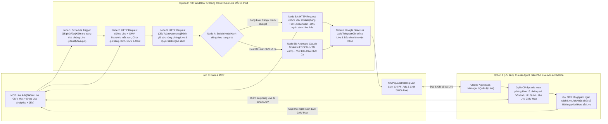

**2. Bộ quy tắc JEV đánh giá sức mua phòng Live & Chi tiết công cụ trong 2 phương án:**

- **Bộ chỉ số đầu vào truyền sang `JEV (/v1/systemone)` mỗi 15 phút khi `live_status = LIVE`:**
  - Chỉ số phòng Live (từ TikTok Shop `/analytics/202510/shop_lives/{live_id}/performance_per_minutes` hoặc Shopee `/api/v2/livestream/get_session_metric`): `concurrent_users` (mắt xem đồng thời), `product_clicks` (lượt bấm vào giỏ hàng), `order_count` (số đơn nổ trong 15 phút qua), `gmv` (doanh thu phiên).
  - Chỉ số quảng cáo (từ TikTok Business `/open_api/v1.3/gmv_max/report/get/?report_type=LIVE_GMV_MAX&metric_level=LIVESTREAM`): `stat_cost` (tiền Ads đã tiêu), `roi` (hiệu quả chi phí thực tế), `cost_per_order` (chi phí Ads trên mỗi đơn trong phiên).
- **Câu hỏi JEV đánh giá (`<300ms`):**
  - `live_room_momentum` (`score` thang 1–4): Sức mua thực tế của phòng Live trong 15 phút vừa qua (4 = Đang bùng nổ đơn & click giỏ hàng cao; 1 = Phòng lạnh, cắn tiền Ads nhưng khách không bấm giỏ hàng).
  - `live_ads_action` (`choice`):
    1. `SCALE_UP_BUDGET`: Khi `live_room_momentum >= 3.2` và `roi >= ROI mục tiêu` $\rightarrow$ Tự động bơm thêm ngân sách (+20% đến +30%) để đẩy thêm lưu lượng khách vào phòng lúc Host đang chốt tốt.
    2. `HOLD_CURRENT`: Khi các chỉ số ổn định trong ngưỡng KPI.
    3. `THROTTLE_DOWN_BUDGET`: Khi tiền quảng cáo cắn nhanh nhưng `product_clicks` và `order_count` trong 15 phút qua tụt thấp $\rightarrow$ Tự động kéo giảm ngân sách để bảo vệ tiền quảng cáo cho đến khi phòng Live ấm lại.
    4. `CLOSE_SHIFT_AND_REPORT`: Khi phát hiện `live_status = ENDED` (Host đã kết thúc phiên Live) $\rightarrow$ Đóng ngân sách chiến dịch và kích hoạt luồng chốt sổ ca Live.

| Phương Án | Các MCP Tools (Cho Claude) / Các Node Cụ Thể (Trong n8n) | Kết Quả Đầu Ra |
| :--- | :--- | :--- |
| **Option 1 (Ưu tiên): Dùng Claude Agent**<br/>*(Nhân sự Ads / Quản lý dùng Claude để kiểm tra các phòng Live đang phát sóng, điều chỉnh ngân sách Live GMV Max hoặc yêu cầu tổng kết ca)* | **Các MCP Tools trên `MCP Live Ads` & `MCP qua n8n` mà Claude gọi:**<br/>• `mcp_live_get_realtime_room_and_ads_metrics(room_id)`: Gọi đồng thời API TikTok Shop Live (`/performance_per_minutes`) và TikTok Business (`LIVE_GMV_MAX`) để trả về bức tranh tức thì của phiên Live: mắt xem, lượt bấm giỏ, số đơn, GMV, tiền Ads đã tiêu và ROI.<br/>• `mcp_live_evaluate_and_adjust_gmv_max(campaign_id, room_id, budget_action)`: Chạy **JEV** kiểm tra điều kiện an toàn và cập nhật ngân sách/mục tiêu ROI của chiến dịch `Live GMV Max` (có trần ngân sách tối đa theo ca).<br/>• `mcp_live_generate_shift_settlement_report(live_id, host_name)`: Khi ca Live kết thúc, tự động lấy bảng xếp hạng sản phẩm bán chạy nhất trong phiên (`/products_performance`), ghép với tổng chi phí Ads của khung giờ đó, ghi vào bảng `Data` và xuất phiếu chốt sổ ca Live. | 1. Host chỉ cần tập trung 100% vào lên sóng và ấp giỏ hàng.<br/>2. Quản lý nắm rõ từng phút ca Live đang lời hay lỗ tiền Ads và có thể ra lệnh điều chỉnh ngân sách ngay trong khung chat Claude. |
| **Option 2: Dùng n8n Workflow + JEV + Claude**<br/>*(Chạy ngầm tự động 15 phút/lần suốt thời gian có lịch Live)* | **Chuỗi 6 Node trên `n8n`:**<br/>1. `Schedule Trigger (15m)`: Quét `/open_api/v1.3/identity/live/get/` kiểm tra kênh có đang phát Live không.<br/>2. `HTTP Request (Shop Live + Live GMV Max)`: Kéo chỉ số phòng Live theo từng phút (`performance_per_minutes`) và báo cáo chi phí `LIVE_GMV_MAX`.<br/>3. `HTTP Request (JEV /v1/systemone)`: Chấm điểm `live_room_momentum` và chọn `live_ads_action`.<br/>4. `Switch Node`: Phân nhánh theo trạng thái (`Đang Live` hay `Vừa tắt Live`).<br/>5. `HTTP Request (Update Live GMV Max)` / `Anthropic Claude Node`: Tự động tăng/hãm ngân sách theo quyết định của JEV; hoặc nếu phiên Live vừa kết thúc (`ENDED`) thì gọi Claude tổng hợp **Báo cáo chốt sổ ca Live**.<br/>6. `Google Sheets / Postgres & Lark/Telegram`: Ghi nhận doanh thu - chi phí Ads - ROI của ca Live vào bảng `Data` và gửi tin nhắn tổng kết ca cho Host & Quản lý. | 1. Tự động bơm tiền Ads đúng lúc phòng Live đang "nóng" và tự động hãm phanh khi phòng Live vắng.<br/>2. Host tắt máy phát là 2 phút sau có ngay báo cáo chốt sổ ca Live chính xác từng đồng. |

---

<a id="phan-4-4"></a>
### 4.4. Khối 4: Agent Của Nhân Sự Tự Build

> **Luồng kết nối trên sơ đồ:** Kết nối vào **`MCP qua n8n`** (để đọc/ghi dữ liệu của bộ phận) và **`MCP`** (để gọi các công cụ chấm điểm `JEV`, tra cứu API) theo **cơ chế phân quyền cá nhân/phòng ban (Role-Based Access Control)**.  
> **Mục tiêu cốt lõi:** Khác với Khối 3 (các luồng chạy tự động hoàn toàn ở quy mô công ty), **Khối 4** là các **Agent / Workflow trợ lý chuyên biệt gắn liền với thao tác nghiệp vụ của từng nhân sự** (như rà soát & chấm điểm kịch bản/video trước và sau khi quay, săn tìm & chấm điểm KOC để nhân sự chủ động liên hệ theo cách riêng, hoặc tra cứu nhanh kịch bản thắng để viết bài).

Trong hộp **`4. Agent của nhân sự tự build`**, hệ thống tập trung vào **3 mô hình trợ lý nghiệp vụ trọng tâm**:

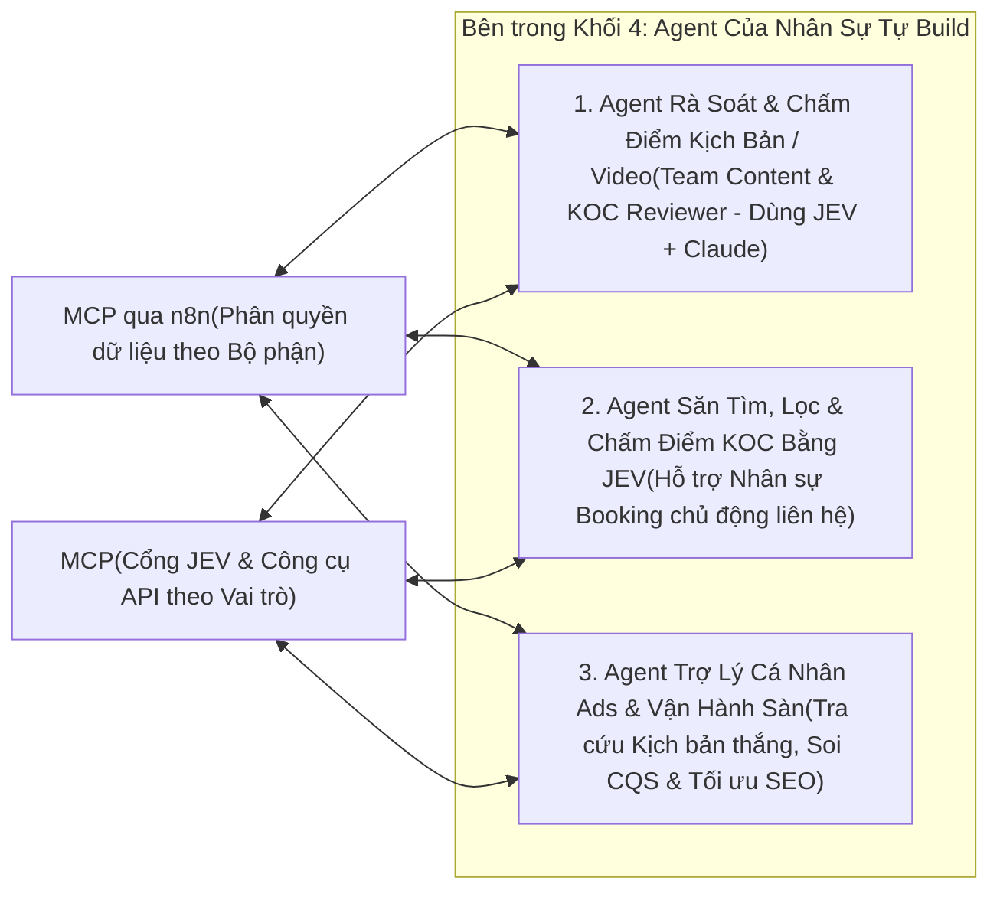

#### Mô hình 4.1: Agent / Workflow Kiểm duyệt & Chấm điểm Kịch bản / Video (In-house & KOC) bằng JEV theo chiến lược thử nghiệm
- **Bối cảnh:** Đội ngũ Content (`@Trang`, `Kha`, `Giang`) cần một công cụ để **kiểm tra chất lượng kịch bản nháp trước khi bấm máy quay** cũng như **kiểm duyệt video thành phẩm (của cả team In-house và KOC gửi về)** xem đã bám sát mục tiêu chiến lược và đúng **Hướng thử nghiệm** của từng giai đoạn sản phẩm (`S24`, `S25`, `G1`) hay chưa — giảm tối đa việc phải họp duyệt thủ công từng bài.
- **Cơ chế hoạt động:** Nhân sự đưa kịch bản nháp (hoặc link video/transcript) vào Agent $\rightarrow$ Agent gọi qua `MCP` chạy mô hình **[`JEV`](./JEV/README.md)** để chấm điểm đồng thời trên bộ tiêu chí chuẩn (*Hook 3 giây đầu*, *Hướng thử nghiệm*, *Độ phủ USP*, *Cảnh test thực tế*, *Rủi ro vi phạm chính sách sàn*) $\rightarrow$ **Claude** dựa trên bảng điểm của JEV để chỉ ra câu nào yếu và viết lại phương án sửa ngay cho nhân sự.

#### Mô hình 4.2: Agent / Workflow Hỗ trợ Tìm kiếm, Sàng lọc & Chấm điểm KOC bằng JEV (Để nhân sự chủ động liên hệ theo nghiệp vụ)
- **Bối cảnh:** Trong mảng KOC (`@Đỗ Trang`), việc liên hệ, đàm phán giá/hoa hồng và giữ mối quan hệ với KOC thường mang tính linh hoạt cao tùy theo từng KOC (nhắn qua Zalo, TikTok DM, Email hoặc gửi lời mời trên sàn). Điểm tốn thời gian nhất của nhân sự không phải là lúc nói chuyện, mà là **khâu mò tìm hàng trăm kênh, soi từng kênh xem có hợp với đồ công nghệ không và phân loại hạng KOC**.
- **Cơ chế hoạt động:** Agent đóng vai trò **Trợ lý Tìm kiếm & Chấm điểm (Discovery & Scoring Support)**: tự động quét danh sách KOC theo từ khóa/ngách hoặc đơn xin mẫu qua `MCP` $\rightarrow$ Dùng **JEV** chấm điểm độ phù hợp (`brand_fit_score`), tiềm năng chuyển đổi (`conversion_potential`), phân loại ngách (`koc_category`) và gợi ý kịch bản mở lời $\rightarrow$ Trả về danh sách KOC đã chấm điểm sẵn để nhân sự Booking chủ động chọn cách thức liên hệ phù hợp nhất theo nghiệp vụ riêng.

#### Mô hình 4.3: Agent Cá nhân của Nhân sự Ads & Vận hành Gian hàng
- **Bối cảnh:** Mỗi nhân viên chạy Ads hoặc vận hành sàn có thể tự tạo một Claude Project hoặc workflow nhỏ nối vào `MCP qua n8n` (chỉ mở quyền đúng mảng của mình) để tra cứu nhanh top kịch bản đang thắng, kiểm tra từ khóa SEO trên sàn và tối ưu tiêu đề sản phẩm.

---

#### 🛠️ Thiết Kế Chi Tiết Một Số Agent / Workflow Cụ Thể Trong Khối 4 (Ưu Tiên Claude Agent + Phương Án n8n Workflow)

---

##### Ví dụ 4.A: Workflow / Agent Kiểm Duyệt & Chấm Điểm Kịch Bản / Video (In-house & KOC) Bằng JEV Theo Chiến Lược Thử Nghiệm

> **Ứng dụng trực tiếp mẫu đánh giá đa chiều của `JEV` (Mục 5.5 & Cookbook 6):** Thay vì dùng LLM thông thường chấm điểm cảm tính (lúc cho 8 điểm, lúc cho 6 điểm và tốn nhiều token), workflow này truyền kịch bản/transcript cùng **Mục tiêu giai đoạn thử nghiệm** vào **[`JEV (/v1/systemone)`](./JEV/docs/05_cookbooks_and_patterns.md)** để chấm đồng thời bằng cả 3 kiểu nguyên thủy (`choice`, `score`, `noul`) trong `<300ms` với `$0` output token.

**1. Sơ đồ luồng hoạt động:**

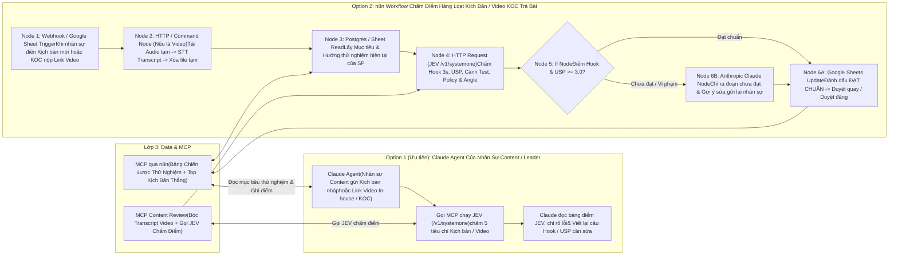

**2. Mẫu cấu hình JSON thực tế gọi `JEV (/v1/systemone)` để chấm điểm Kịch bản / Video:**

Dưới đây là cấu trúc payload gửi trực tiếp từ node `HTTP Request` của `n8n` (hoặc bên trong MCP Tool) tới `POST https://api.typesafe.ai/v1/systemone`:

```json
{
  "model": "jev-latest",
  "state": {
    "product_code": "S24",
    "current_testing_stage": "Giai đoạn 2: Tập trung chứng minh chất lượng thu âm vượt tầm giá và khả năng lọc ồn thực tế ngoài đường",
    "target_angles": [
      "S24-1000 chất lượng 10000",
      "Sự tiện lợi (Cắm là chạy, nhỏ gọn)",
      "Test khử ồn thực chiến ngoài trời / quán cafe"
    ],
    "submission_type": "VIDEO_TRANSCRIPT_OR_DRAFT_SCRIPT",
    "content_text": "0-3s: Mọi người đừng mua mic thu âm tiền triệu nữa nếu chưa nghe thử con GoChek S24 này ở ngay ngã tư đường! 3-15s: Hiện tại mình đang đứng cạnh bến xe cực ồn, bây giờ mình bật chế độ lọc ồn ENC trên mic S24 lên nhé... Đấy, tiếng còi xe biến mất hoàn toàn mà giọng vẫn ấm, không bị méo tiếng..."
  },
  "questions": {
    "matched_trial_angle": {
      "type": "choice",
      "instructions": "Kịch bản/video này đang triển khai theo hướng thử nghiệm (Testing Angle) nào của sản phẩm?",
      "criteria": {
        "s24_1000_quality_10000": "S24-1000 chất lượng 10000: So sánh mức giá rẻ nhưng chất lượng âm thanh ngang ngửa mic đắt tiền",
        "convenience": "Sự tiện lợi: Nhấn mạnh thao tác cắm nhận ngay, thiết kế nhỏ gọn, pin trâu",
        "real_world_noise_test": "Test khử ồn thực chiến: Trực tiếp thử nghiệm bật/tắt lọc ồn ở môi trường nhiều tạp âm",
        "off_strategy": "Lạc đề: Không bám sát bất kỳ hướng thử nghiệm nào trong chiến lược hiện tại"
      }
    },
    "hook_3s_score": {
      "type": "score",
      "instructions": "Chấm điểm sức hút của câu Hook mở đầu (3 giây đầu tiên):",
      "criteria": [
        "Mức 1 (Yếu): Mở đầu dài dòng, chào hỏi chung chung, không nêu được vấn đề hoặc sự tò mò",
        "Mức 2 (Trung bình): Có nhắc đến sản phẩm nhưng cách dẫn dắt bình thường, dễ bị lướt qua",
        "Mức 3 (Tốt): Đánh trúng nỗi đau người xem hoặc có câu so sánh/thử thách trực diện ngay đầu video",
        "Mức 4 (Xuất sắc): Hook cực mạnh, kết hợp bối cảnh đối lập hoặc kết quả gây bất ngờ giữ chân người xem ngay lập tức"
      ]
    },
    "usp_and_stage_score": {
      "type": "score",
      "instructions": "Mức độ bám sát mục tiêu giai đoạn thử nghiệm ('current_testing_stage') và truyền tải đúng USP sản phẩm:",
      "criteria": [
        "Mức 1: Sai lệch hoàn toàn so với định hướng giai đoạn thử nghiệm",
        "Mức 2: Có nhắc tên tính năng nhưng chỉ đọc thông số khô khan, thiếu thuyết phục",
        "Mức 3: Truyền tải đúng trọng tâm hướng thử nghiệm và nêu rõ lợi ích thực tế cho người dùng",
        "Mức 4: Thể hiện xuất sắc cả USP lẫn bằng chứng thực nghiệm đúng tinh thần giai đoạn test"
      ]
    },
    "has_before_after_demo": {
      "type": "noul",
      "instructions": "Nội dung kịch bản/video có đoạn đối chiếu thực tế trước và sau khi bật mic (hoặc bật/tắt chế độ lọc ồn) để người xem kiểm chứng ngay không?"
    },
    "policy_violation_risk": {
      "type": "noul",
      "instructions": "Nội dung có chứa các từ ngữ cam kết tuyệt đối sai sự thật, công kích đối thủ trực diện hoặc vi phạm chính sách quảng cáo TikTok Shop / Shopee không?"
    }
  }
}
```

**3. Chi tiết công cụ sử dụng trong 2 phương án:**

| Phương Án | Các MCP Tools (Cho Claude) / Các Node Cụ Thể (Trong n8n) | Kết Quả Đầu Ra |
| :--- | :--- | :--- |
| **Option 1 (Ưu tiên): Dùng Claude Agent**<br/>*(Nhân sự Content `Kha`, `Giang` hoặc Leader `@Trang` dùng trực tiếp trong lúc viết kịch bản và duyệt bài)* | **Các MCP Tools trên `MCP Content Review` & `MCP qua n8n` mà Claude gọi:**<br/>• `mcp_content_get_stage_strategy_and_winning_scripts(product_code)`: Lấy định hướng thử nghiệm hiện tại của mã `S24`/`S25`/`G1` cùng 3 kịch bản cũ có `VE%` và `CQS` cao nhất để làm chuẩn tham chiếu.<br/>• `mcp_jev_score_script_or_video(product_code, content_or_video_url)`: Nếu là kịch bản chữ thì gửi thẳng vào **JEV**; nếu là link video (In-house hoặc KOC trả bài) thì bóc tách `Transcript` rồi gửi vào **JEV** chấm 5 chỉ số (`matched_trial_angle`, `hook_3s_score`, `usp_and_stage_score`, `has_before_after_demo`, `policy_violation_risk`).<br/>• `mcp_data_save_review_result(item_id, scores, status)`: Ghi kết quả chấm điểm vào bảng theo dõi của phòng Content. | 1. Nhân sự tự kiểm tra và sửa kịch bản đạt điểm `>= 3.2/4.0` ngay trước khi đi quay, không cần chờ họp duyệt.<br/>2. Khi KOC gửi video nháp, chỉ mất 5 giây để biết video KOC có làm đúng Brief hay thiếu đoạn test thu âm để yêu cầu KOC bổ sung ngay. |
| **Option 2: Dùng n8n Workflow + JEV + Claude**<br/>*(Tự động chấm điểm khi nhân sự/KOC nộp bài vào Sheet hoặc Form)* | **Chuỗi 6 Node trên `n8n`:**<br/>1. `Google Sheets / Webhook Trigger`: Kích hoạt khi có dòng kịch bản mới hoặc link video nộp duyệt.<br/>2. `HTTP / Command Node`: Nếu đầu vào là link video thì tải audio vào `/tmp` $\rightarrow$ STT lấy Transcript $\rightarrow$ xóa ngay file tạm.<br/>3. `Postgres / Google Sheets Read`: Đọc mục tiêu giai đoạn thử nghiệm của sản phẩm.<br/>4. `HTTP Request (JEV /v1/systemone)`: Gửi JSON payload chấm đồng thời 5 tiêu chí trong `<300ms`.<br/>5. `If Node`: Kiểm tra `hook_3s_score >= 3.0`, `usp_and_stage_score >= 3.0` và `policy_violation_risk < 0.20`.<br/>6. `Anthropic Claude Node` + `Google Sheets Update`: Nếu chưa đạt, gọi Claude viết nhận xét chi tiết câu nào cần sửa và điền thẳng vào cột `"Góp ý sửa bài"` trên Sheet kèm thông báo cho nhân sự. | Tự động hóa khâu kiểm soát chất lượng (QC) cho toàn bộ kịch bản và video đầu ra của cả đội In-house lẫn KOC. |

---

##### Ví dụ 4.B: Agent / Workflow Hỗ Trợ Tìm Kiếm, Sàng Lọc & Chấm Điểm KOC Bằng JEV (Để Nhân Sự Chủ Động Liên Hệ Theo Nghiệp Vụ)

> **Đặc thù nghiệp vụ tại Khối 4:** Trong mảng Booking KOC (`@Đỗ Trang`), mỗi KOC có cách thức liên hệ khác nhau (nhắn Zalo qua số điện thoại trên Bio, nhắn TikTok DM, gửi Email hoặc mời qua Affiliate Center). Vì vậy, Agent được thiết kế chuyên biệt để **tự động hóa 100% khâu tìm kiếm, thu thập chỉ số kênh và dùng JEV chấm điểm/phân hạng KOC**, đồng thời chuẩn bị sẵn thông tin tóm tắt & gợi ý mở lời để **nhân sự chủ động liên hệ theo đúng nghiệp vụ riêng**.

**1. Sơ đồ luồng hoạt động:**

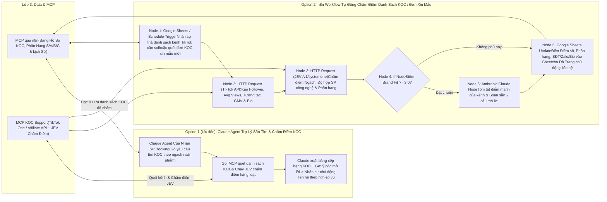

**2. Cấu trúc câu hỏi JEV chấm điểm & phân loại KOC:**

- **Bộ tiêu chí truyền vào `JEV (/v1/systemone)` cho mỗi hồ sơ KOC (kèm tiêu đề 5–10 video gần nhất và Bio của kênh):**
  - `koc_category` (`choice` kèm `confidence`): Phân loại ngách nội dung chính (*Review Đồ Công Nghệ / Setup góc làm việc*, *Vlog Đời Sống / Sáng Tạo Nội Dung*, *Ca Hát / Âm Nhạc - tệp cực hợp với mic thu âm*, *Giải Trí / Khác*).
  - `brand_fit_score` (`score` thang 1–4): Mức độ phù hợp của tệp khán giả và phong cách quay của KOC với các dòng mic `S24`, `S25`, `G1`.
  - `conversion_potential` (`score` thang 1–4): Đánh giá khả năng gắn giỏ hàng ra đơn dựa trên tỷ lệ tương tác thực tế và lịch sử bán hàng Affiliate.
  - `sample_approval_recommendation` (`noul` `0.0 -> 1.0`): Khuyến nghị có nên duyệt gửi hàng mẫu miễn phí cho KOC này hay không.

| Phương Án | Các MCP Tools (Cho Claude) / Các Node Cụ Thể (Trong n8n) | Kết Quả Đầu Ra |
| :--- | :--- | :--- |
| **Option 1 (Ưu tiên): Dùng Claude Agent**<br/>*(Nhân sự `@Đỗ Trang` mở Claude để tìm kiếm, lọc và chấm điểm danh sách KOC theo từng chiến dịch)* | **Các MCP Tools trên `MCP KOC Support` & `MCP qua n8n` mà Claude gọi:**<br/>• `mcp_koc_search_and_score_by_jev(keywords, product_code, min_followers)`: Quét danh sách Creator từ `TikTok One API` / `Affiliate API`, chạy **JEV** chấm điểm hàng loạt trong `<300ms` và lọc ra các KOC đạt điểm cao nhất.<br/>• `mcp_koc_evaluate_channel_list(channel_handles, product_code)`: Khi nhân sự có sẵn một danh sách link kênh TikTok vừa tìm được, gửi vào để Agent tự động kéo chỉ số và chấm điểm phân hạng (`Tier S/A/B/C`).<br/>• `mcp_koc_draft_personalized_icebreaker(creator_handle, product_code)`: Đọc chủ đề các video gần nhất của KOC để gợi ý 2–3 phương án tin nhắn mở lời tự nhiên (để nhân sự copy gửi qua Zalo/TikTok/Email hoặc gửi lời mời trên sàn tùy ý). | 1. Giải phóng 80% thời gian phải vào xem thủ công từng kênh KOC.<br/>2. Nhân sự có ngay bảng chấm điểm khách quan (`Hạng S/A/B/C`, thông tin liên hệ trên Bio, gợi ý câu chào) và hoàn toàn chủ động trong cách thức giao tiếp với KOC. |
| **Option 2: Dùng n8n Workflow + JEV + Claude** | **Chuỗi 6 Node trên `n8n`:**<br/>1. `Google Sheets / Schedule Trigger`: Nhân sự chỉ cần dán danh sách link/ID kênh TikTok vào cột A trên Sheet (hoặc workflow tự quét đơn xin mẫu mới `/sample_applications/search`).<br/>2. `HTTP Request (TikTok API)`: Tự động kéo lượng Follower, View trung bình 10 video gần nhất, GMV và thông tin liên hệ ở Bio.<br/>3. `HTTP Request (JEV /v1/systemone)`: Chấm điểm `koc_category`, `brand_fit_score`, `conversion_potential`.<br/>4. `If Node`: Lọc các kênh có `brand_fit_score >= 3.0`.<br/>5. `Anthropic Claude Node`: Viết tóm tắt 2 dòng về phong cách kênh và gợi ý câu mở lời.<br/>6. `Google Sheets Update`: Tự động điền đầy đủ Điểm số, Phân hạng và Gợi ý mở lời vào các cột bên cạnh trên Sheet để nhân sự nhìn vào liên hệ ngay. | Nhân sự chỉ cần thả link kênh vào Sheet, vài giây sau hệ thống tự điền đầy đủ điểm chấm và phân loại để nhân sự tiến hành liên hệ. |

---

##### Ví dụ 4.C: Agent Cá Nhân Của Nhân Sự Ads & Vận Hành Sàn (Soi Nhanh Kịch Bản Thắng & Tối Ưu SEO Gian Hàng)

**1. Sơ đồ luồng hoạt động:**

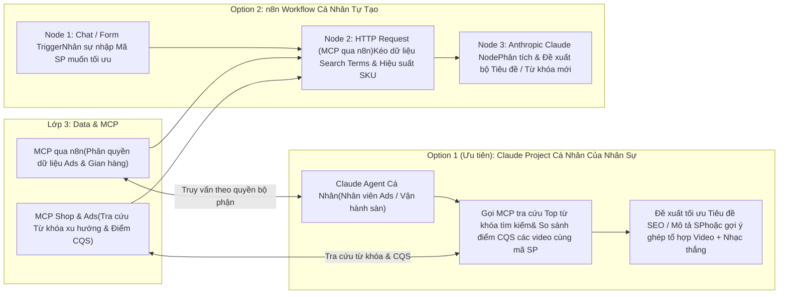

**2. Chi tiết công cụ sử dụng trong 2 phương án:**

| Phương Án | Các MCP Tools (Cho Claude) / Các Node Cụ Thể (Trong n8n) | Kết Quả Đầu Ra |
| :--- | :--- | :--- |
| **Option 1 (Ưu tiên): Dùng Claude Agent** | **Các MCP Tools phân quyền cho nhân sự vận hành:**<br/>• `mcp_ads_compare_creative_benchmarks(product_code)`: So sánh điểm `CQS`, `VE%`, `IE%` của các video đang chạy với trung bình ngành từ `/report/ad_benchmark/get/`.<br/>• `mcp_shop_audit_product_seo(product_code, platform)`: Kiểm tra tiêu đề, mô tả và bộ thuộc tính của sản phẩm trên Shopee/TikTok Shop để gợi ý từ khóa giúp tăng lưu lượng tìm kiếm tự nhiên. | Mỗi nhân sự có một trợ lý phân tích riêng gắn chặt với dữ liệu thật của công ty nhưng vẫn nằm trong hàng rào phân quyền an toàn của Lớp 3. |
| **Option 2: Dùng n8n Workflow cá nhân** | **Chuỗi 3 Node trên `n8n`:**<br/>`Chat/Form Trigger` $\rightarrow$ `HTTP Request (MCP qua n8n)` $\rightarrow$ `Anthropic Claude Node`. | Nhân sự không biết lập trình vẫn có thể tự kéo-thả các workflow nhỏ phục vụ công việc hàng ngày. |

---

<a id="phan-5"></a>
## Phần 5 (Phụ Lục): Giới Thiệu Chi Tiết Các Bộ Công Cụ & Nền Tảng Cốt Lõi

Phụ lục này tổng hợp chi tiết về **bản chất, cách đăng ký cấp quyền, cơ chế kỹ thuật khi gọi và các bài toán ứng dụng (Use Cases)** của toàn bộ 6 thành phần công nghệ cốt lõi trong kiến trúc hệ thống, bám sát bộ tài liệu nội bộ đã có sẵn trong thư mục dự án.

---

<a id="phan-5-1"></a>
### 5.1. TikTok Business API (`tiktok-business-api`)

> **Tài liệu gốc trong dự án:** [`./tiktok-business-api/README.md`](./tiktok-business-api/README.md) | **Hướng dẫn khởi tạo:** [`./tiktok-business-api/docs/04-get-started/bat-dau.md`](./tiktok-business-api/docs/04-get-started/bat-dau.md) | **Tài liệu MCP Server:** [`./tiktok-business-api/docs/05-mcp-server/mcp-server-tom-tat.md`](./tiktok-business-api/docs/05-mcp-server/mcp-server-tom-tat.md)

#### 1. Là gì?
**TikTok API for Business (phiên bản v1.3)** là giao diện lập trình chính thức của TikTok dành cho nhà quảng cáo và doanh nghiệp, bao gồm **16 phân hệ (74 nhóm endpoint kỹ thuật)** và hệ thống **TikTok for Business MCP Server (~400 công cụ)**. Công cụ này cho phép tự động hóa hoàn toàn việc quản lý chiến dịch quảng cáo đấu thầu (Auction), chiến dịch thương mại điện tử `GMV Max` (cả Video và Livestream), quản trị kho nội dung sáng tạo (Creatives & Spark Ads), đo lường sự kiện chuyển đổi (`Events 2.0`) và hợp tác nhà sáng tạo qua `TikTok One API`.

#### 2. Cách đăng ký & Cấp quyền (Onboarding & OAuth 2.0)
Quy trình 5 bước để lấy quyền truy cập API:
1. **Tạo tài khoản TikTok for Business & Business Center (BC):** Thiết lập tổ chức mẹ nắm giữ các tài khoản quảng cáo (`advertiser_id`), kênh TikTok chính thức (`Identity`) và kho sản phẩm (`Catalog`).
2. **Đăng ký Nhà phát triển (Developer):** Truy cập cổng `https://business-api.tiktok.com/portal`, đăng ký tài khoản Developer và liên kết với Business Center của công ty.
3. **Tạo Ứng dụng (Developer App):** Vào mục **My Apps** tạo ứng dụng mới, chọn các phạm vi quyền hạn (**Permission Scopes**) cần thiết như: *Ads Management*, *Reporting*, *Creative Management*, *Audience Management*, *TikTok One (TTO)* và điền địa chỉ `Redirect URL` (trỏ về webhook của `n8n`). Sau khi duyệt, hệ thống cấp `App ID` và `Secret`.
4. **Ủy quyền Tài khoản Quảng cáo (Advertiser Authorization):** Mở đường link ủy quyền (`Advertiser authorization URL`) bằng tài khoản chủ sở hữu Ad Account hoặc TTO Creator Marketplace để bấm phê duyệt $\rightarrow$ Hệ thống trả về mã `auth_code` tại `Redirect URL`.
5. **Đổi lấy Access Token dài hạn:** Gọi endpoint `POST https://business-api.tiktok.com/open_api/v1.3/oauth2/access_token/` truyền `app_id`, `secret`, `auth_code` để nhận `access_token` (token cấp qua API này có hiệu lực dài hạn cho đến khi chủ tài khoản thu hồi).

#### 3. Sử dụng như thế nào?
- **Phương thức 1 (RESTful API qua `n8n`):** Gửi HTTP Request tới Base URL `https://business-api.tiktok.com/open_api/v1.3/` (hoặc môi trường thử nghiệm `https://sandbox-ads.tiktok.com/open_api/v1.3/`) với Header bắt buộc:
  ```http
  Access-Token: <YOUR_ACCESS_TOKEN>
  Content-Type: application/json
  ```
- **Phương thức 2 (Kết nối qua TikTok MCP Server):** Có thể kết nối thông qua máy chủ MCP chính thức của TikTok (`https://business-api.tiktok.com/open_mcp/tt-ads-mcp-layer` hoặc `tt-ads-mcp-flat`) bằng chính `Access-Token` của Marketing API để hưởng hạn mức tốc độ gọi cao (10–50 QPS) và không bị hết hạn sau 30 ngày.

#### 4. Các Use Case trọng tâm tại công ty
- **Đo lường hiệu suất Content & Creative (Bảng Content Performance):** Gọi [`/report/integrated/get/`](./tiktok-business-api/docs/12-api-reference/58-reporting.md) và [`/report/ad_benchmark/get/`](./tiktok-business-api/docs/12-api-reference/37-creative-reports.md) để kéo tự động các chỉ số cốt lõi: `stat_cost` (Cost), `impressions`, `clicks`, **`VE%`** (`paid_engaged_view / impressions`), **`IE%`** (`(likes+comments+shares+follows)/impressions`), **`PE%`** (`video_play_actions / impressions`), điểm chất lượng sáng tạo **`CQS`**, chỉ số cân nhắc thương hiệu mới (`new_consideration_size`, `new_consideration_rate`, `cost_per_consideration`) và phễu giữ chân người xem (`video_watched_6s`, `video_views_p25` $\rightarrow$ `p100`).
- **Phân tích điểm rơi người xem từng giây:** Gọi `/report/video_performance/get/` để biết chính xác video bị rớt người xem ở giây thứ mấy.
- **Báo cáo & Vận hành `GMV Max` (Video & Livestream):** Gọi [`/gmv_max/report/get/`](./tiktok-business-api/docs/12-api-reference/45-gmv-max-p3.md) để lấy số đơn hàng (`orders`), doanh thu (`gross_revenue`), chi phí/đơn (`cost_per_order`) và `roi` của từng video hoặc từng phiên Livestream.
- **Kích hoạt Quảng cáo `Spark Ads` từ video KOC / Kênh tự nhiên:** Dùng [`/tt_video/authorize/`](./tiktok-business-api/docs/09-marketing-api/creatives/09-spark-ads-creator-video-api.md) để nạp mã ủy quyền của KOC và [`/identity/video/get/`](./tiktok-business-api/docs/09-marketing-api/creatives/09-spark-ads-creator-video-api.md) để lấy danh sách video mới đăng trên kênh TikTok thương hiệu.
- **Tìm kiếm & Quản lý chiến dịch KOC qua `TikTok One API`:** Xem thông tin nhân khẩu học của Creator, tạo chiến dịch và lấy link mời Creator gắn thẻ video qua [`tiktok-one-api.md`](./tiktok-business-api/docs/10-organic-api/tiktok-one-api.md).

---

<a id="phan-5-2"></a>
### 5.2. TikTok Shop Partner API (`tiktok-shop-api`)

> **Tài liệu gốc trong dự án:** [`./tiktok-shop-api/README.md`](./tiktok-shop-api/README.md) | **Xác thực OAuth:** [`./tiktok-shop-api/docs/02-xac-thuc-oauth-va-token/README.md`](./tiktok-shop-api/docs/02-xac-thuc-oauth-va-token/README.md) | **Ký số HMAC-SHA256:** [`./tiktok-shop-api/docs/03-co-che-goi-api-va-ky-so/README.md`](./tiktok-shop-api/docs/03-co-che-goi-api-va-ky-so/README.md)

#### 1. Là gì?
**TikTok Shop Partner API (phiên bản v2)** là hệ thống API thương mại điện tử của TikTok Shop gồm **19 phân hệ chức năng (344 API endpoints)** và **44 sự kiện Push Webhook thời gian thực**. Hệ thống bao phủ toàn bộ vòng đời vận hành gian hàng của Nhà bán hàng (`Seller`), Nhà sáng tạo tiếp thị liên kết (`Affiliate Creator`) và Đối tác đại lý MCN (`TAP Partner`).

#### 2. Cách đăng ký & Cấp quyền
1. **Đăng ký TikTok Shop Partner Center:** Truy cập `https://partner.tiktokshop.com`, đăng ký tài khoản đối tác phát triển.
2. **Tạo Ứng dụng (`Custom App` hoặc `Public App`):**
   - Chọn **Custom App** nếu chỉ kết nối nội bộ các gian hàng thuộc sở hữu của công ty (duyệt nhanh, bảo mật).
   - Chọn các gói quyền (**API Scopes**) như: *Seller Order*, *Product Basic/Modify*, *Fulfillment*, *Return & Refund*, *Finance*, *Affiliate Seller*, *Analytics*, *Customer Service IM*.
   - Hệ thống cấp `app_key`, `app_secret` và `service_id`.
3. **Ủy quyền Gian hàng (Shop Authorization):** Chủ gian hàng mở link `https://services.tiktokshop.com/open/authorize?service_id={service_id}` để bấm cấp quyền $\rightarrow$ Nhận về `auth_code` (hiệu lực 30 phút).
4. **Lấy bộ Token & Mã `shop_cipher`:**
   - Gọi `GET https://auth.tiktok-shops.com/api/v2/token/get` (lưu ý tham số bắt buộc `grant_type=authorized_code`) để lấy `access_token` (hạn 7 ngày) và `refresh_token`.
   - Gọi `GET https://open-api.tiktokglobalshop.com/authorization/202309/shops` để trích xuất trường **`cipher` (`shop_cipher`)** — mã định danh bắt buộc phải truyền trong mọi lệnh gọi API cấp độ cửa hàng.

#### 3. Sử dụng như thế nào?
- **Endpoint chính:** `https://open-api.tiktokglobalshop.com` với Header `x-tts-access-token: <YOUR_ACCESS_TOKEN>`.
- **Thuật toán ký số bắt buộc (`HMAC-SHA256`):** Mọi request đều phải tính toán tham số `sign` theo 6 bước chuẩn: lọc bỏ `sign` và `access_token` khỏi query params $\rightarrow$ sắp xếp tên tham số từ A–Z $\rightarrow$ nối liền `{key}{value}` $\rightarrow$ ghép đường dẫn API phía trước và raw JSON body phía sau: `{path}{params}{body}` $\rightarrow$ bao bọc `app_secret` ở cả 2 đầu `{app_secret}{path}{params}{body}{app_secret}` $\rightarrow$ băm HMAC-SHA256 với khóa `app_secret` (đã có sẵn script chuẩn trong [`./tiktok-shop-api/_scripts/sign_request.py`](./tiktok-shop-api/_scripts/sign_request.py)).
- **Lắng nghe Webhook:** Đăng ký URL của `n8n` để nhận 44 sự kiện thời gian thực (bắt buộc phản hồi HTTP 200 trong vòng 3 giây và đối chiếu chữ ký ở Header `x-tts-signature`).

#### 4. Các Use Case trọng tâm tại công ty
- **Quản lý Đơn hàng & Đóng gói vận chuyển:** Tìm kiếm đơn cần giao (`/order/202309/orders/search`), xác nhận giao hàng và tải tem vận đơn nhiệt A6 PDF (`/fulfillment/202309/packages/{id}/shipping_documents`).
- **Tự động hóa Sản phẩm & Tồn kho:** Tải ảnh sản phẩm lên CDN (`/product/202309/images/upload`), tạo mới/chỉnh sửa sản phẩm, cập nhật tồn kho SKU hàng loạt (`/product/202309/products/stocks`) và điều chỉnh giá bán.
- **Đối soát Tài chính & Phí sàn (`Finance`):** Gọi `/finance/202309/statements` và `/finance/202501/orders/{order_id}/statement_transactions` để bóc tách từng khoản trừ trên mỗi đơn hàng (phí hoa hồng sàn, phí giao dịch, phí vận chuyển, hoa hồng KOC) nhằm tính đúng doanh thu thực nhận.
- **Quản lý Affiliate & Duyệt Hàng mẫu KOC (`Affiliate Seller` - 45 endpoints):** Cài đặt hoa hồng mở (`open_collaboration_settings`), tạo kế hoạch mời riêng cho Top KOC (`targeted_collaborations`), tra cứu và bấm duyệt tự động/bán tự động các đơn xin hàng mẫu của KOC (`/affiliate_seller/202410/sample_applications/{id}/approve`).
- **Xử lý Đổi trả - Hoàn tiền & Live Chat CSKH:** Duyệt/từ chối yêu cầu hoàn hàng trong 48h (`/return_refund/202309/...`) và nhận/gửi tin nhắn chăm sóc khách hàng qua `/customer_service/202309/messages`.

---

<a id="phan-5-3"></a>
### 5.3. Shopee Open Platform API (`shoppe-api`)

> **Tài liệu gốc trong dự án:** [`./shoppe-api/README.md`](./shoppe-api/README.md) | **Quy trình ủy quyền & ký số:** [`./shoppe-api/docs/xac-thuc-va-uy-quyen/01-thuat-toan-chu-ky-sign.md`](./shoppe-api/docs/xac-thuc-va-uy-quyen/01-thuat-toan-chu-ky-sign.md) | **Bộ Script mẫu:** [`./shoppe-api/scripts/`](./shoppe-api/scripts/)

#### 1. Là gì?
**Shopee Open Platform API (phiên bản v2.0)** là cổng kết nối chính thức của sàn Shopee dành cho nhà bán hàng và hệ thống quản trị nội bộ, bao gồm **19 phân hệ API** và cơ chế **Shopee Push Webhook**, cho phép trích xuất toàn diện dữ liệu đơn hàng, sản phẩm, tồn kho, đối soát doanh thu (`Escrow`), lịch sử chat CSKH, đánh giá sản phẩm và chỉ số sức khỏe gian hàng.

#### 2. Cách đăng ký & Cấp quyền
1. **Đăng ký Tài khoản Developer:** Truy cập `https://open.shopee.com`, đăng ký tài khoản Partner Developer.
2. **Khởi tạo Ứng dụng (App):** Tạo ứng dụng trên Console để nhận `partner_id` và `partner_key` (Secret Key). Khai báo danh sách địa chỉ IP máy chủ `n8n` vào mục **IP Whitelist** và cấu hình Callback URL.
3. **Thử nghiệm Sandbox & Chuyển lên Live:** Kiểm thử luồng gọi tại `https://partner.test-stable.shopeemobile.com` trước khi dùng cổng chính thức `https://partner.shopeemobile.com`.
4. **Ủy quyền Gian hàng (Shop Auth):** Tạo đường dẫn `/api/v2/shop/auth_partner` kèm chữ ký `sign` để chủ Shop đăng nhập cấp quyền $\rightarrow$ Nhận về `code` và `shop_id` tại Callback URL.
5. **Lấy và Xoay vòng Token (Token Rotation):**
   - Gọi `POST /api/v2/auth/token/get` để đổi `code` lấy `access_token` (hiệu lực **4 giờ**) và `refresh_token` (hiệu lực **30 ngày**).
   - **Lưu ý quan trọng:** Mỗi lần gọi `/api/v2/auth/access_token/get` để làm mới token, Shopee cấp lại **cả `access_token` mới lẫn `refresh_token` mới**; `n8n` bắt buộc phải lưu đè cả 2 giá trị này vào Database.

#### 3. Sử dụng như thế nào?
- **Quy tắc truyền tham số:** Ngay cả với lệnh `POST`, các tham số bảo mật gồm `partner_id`, `timestamp`, `access_token`, `shop_id`, `sign` **bắt buộc phải đặt trên URL Query String**; phần JSON Body chỉ chứa dữ liệu nghiệp vụ.
- **Công thức ký số `HMAC-SHA256`:**
  - Với Shop API: Băm chuỗi `partner_id + api_path + timestamp + access_token + shop_id` bằng khóa `partner_key`.
  - Thời gian của máy chủ gọi API không được lệch quá **300 giây (5 phút)** so với giờ chuẩn NTP.

#### 4. Các Use Case trọng tâm tại công ty
- **Đồng bộ Đơn hàng 2 bước & Theo dõi Vận đơn:** Quét danh sách mã đơn qua `/api/v2/order/get_order_list` (chia theo khung tối đa 15 ngày/lần gọi) rồi lấy chi tiết qua `/api/v2/order/get_order_detail`; kết hợp lắng nghe Webhook Push để cập nhật trạng thái đơn tức thì.
- **Quản lý Sản phẩm, Biến thể SKU & Media Space:** Lấy và cập nhật thông tin sản phẩm (`get_item_list`, `get_item_base_info`, `get_model_list`), tải ảnh bìa mới lên `/api/v2/media_space/upload_image` để phục vụ Agent thay ảnh sàn.
- **Đối soát Tài chính & Phí sàn (`Escrow`):** Gọi `/api/v2/payment/get_escrow_detail` cho từng đơn hàng đã hoàn tất để lấy chính xác `escrow_amount` (tiền thực nhận), `commission_fee` (phí cố định), `service_fee` (phí gói Freeship/Hoàn xu), `transaction_fee` (phí thanh toán) và `voucher_from_seller`.
- **Chăm sóc Khách hàng, Đổi trả & Phân tích Đánh giá 1–5 sao:** Trích xuất hội thoại `/api/v2/sellerchat/...`, xử lý yêu cầu trả hàng `/api/v2/returns/...`, kéo toàn bộ đánh giá sản phẩm `/api/v2/product/get_comment` để phân tích lỗi sản phẩm công nghệ và theo dõi điểm phạt tại [`17-suc-khoe-tai-khoan-account-health.md`](./shoppe-api/docs/api-reference/17-suc-khoe-tai-khoan-account-health.md).

---

<a id="phan-5-4"></a>
### 5.4. Facebook Graph & Marketing API (`facebook-ads-api`)

> **Tài liệu gốc trong dự án:** [`./facebook-ads-api/README.md`](./facebook-ads-api/README.md) | **Quản lý System User Token:** [`./facebook-ads-api/docs/02-xac-thuc-oauth-va-quan-ly-token/README.md`](./facebook-ads-api/docs/02-xac-thuc-oauth-va-quan-ly-token/README.md) | **Bộ Script mẫu:** [`./facebook-ads-api/_scripts/`](./facebook-ads-api/_scripts/)

#### 1. Là gì?
**Meta (Facebook) Graph & Marketing API (chuẩn v21.0 / v22.0)** gồm **16 phân hệ nghiệp vụ**, cho phép lập trình hóa 100% quy trình tạo và tối ưu chiến dịch quảng cáo trên Facebook/Instagram, trích xuất báo cáo hiệu suất đa chiều (`Insights API`), gửi sự kiện chuyển đổi từ máy chủ (`Conversions API - CAPI`), đồng bộ danh mục sản phẩm (`Catalog API`) và quản lý gian hàng Meta Commerce.

#### 2. Cách đăng ký & Cấp quyền (Khuyên dùng System User Token Vĩnh Viễn)
Để hệ thống `n8n` của công ty chạy tự động 24/7 mà không bao giờ bị gián đoạn vì hết hạn token cá nhân, bộ tài liệu khuyến nghị sử dụng **System User Access Token vĩnh viễn**:
1. **Tạo Meta App:** Truy cập `https://developers.facebook.com/apps/`, tạo ứng dụng loại **Business**, kết nối vào **Meta Business Manager (Business Portfolio)** của công ty và bật 2 module *Marketing API* + *Webhooks*.
2. **Tạo Người dùng Hệ thống (System User):** Truy cập `https://business.facebook.com/settings/` > *Users* > **System Users** $\rightarrow$ Nhấn **Add** tạo một tài khoản hệ thống với vai trò **Admin**.
3. **Gán Quyền Tài sản (Assign Assets):** Bấm **Assign Assets** trên System User vừa tạo để cấp toàn quyền kiểm soát đối với các **Ad Accounts (`act_ID`)**, **Facebook Pages**, **Pixels / Datasets** và **Product Catalogs** của công ty.
4. **Sinh Token Vĩnh Viễn:** Bấm **Generate New Token**, chọn App đã tạo ở Bước 1, chọn thời hạn **Never (Không bao giờ hết hạn)** và tích chọn các quyền (`Scopes`): `ads_management`, `ads_read`, `business_management`, `catalog_management`, `leads_retrieval`, `pages_read_engagement`.

#### 3. Sử dụng như thế nào?
- **Endpoint chuẩn:** `https://graph.facebook.com/v22.0/{node_id}/{edge}` với Header `Authorization: Bearer <SYSTEM_USER_TOKEN>`.
- **Kiểm soát Rate Limit:** Luôn đọc Header phản hồi `X-Business-Use-Case-Usage`; nếu chỉ số `call_count` hoặc `total_time` vượt **90%**, `n8n` tự động giãn cách lệnh gọi.
- **Truy vấn Báo cáo Lớn (Async Insights):** Với các truy vấn dữ liệu nhiều ngày hoặc phân rã sâu, gọi `POST /act_{ID}/insights` để nhận `report_run_id`, chờ trạng thái đạt 100% rồi tải kết quả qua `GET /{report_run_id}/insights` (đã có script mẫu tại [`./facebook-ads-api/_scripts/insights_export.py`](./facebook-ads-api/_scripts/insights_export.py)).

#### 4. Các Use Case trọng tâm tại công ty
- **Kéo báo cáo chi phí & hiệu quả Facebook Ads về `Data`:** Tự động đồng bộ `spend`, `impressions`, `clicks`, `cpc`, `ctr`, `actions` (số đơn/chuyển đổi), `purchase_roas` theo từng Campaign / Ad Set / Ad mỗi ngày.
- **Tự động khởi tạo & điều chỉnh chiến dịch chuẩn ODAX:** Dùng Agent/Workflow tải ảnh (`/adimages`), tải video (`/advideos`), tạo `Ad Creative`, khởi tạo `Campaign` / `Ad Set` / `Ad` (theo mẫu [`marketing_api_campaign_builder.py`](./facebook-ads-api/_scripts/marketing_api_campaign_builder.py)) hoặc bật/tắt, tăng/giảm ngân sách qua `MCP Ads`.
- **Đo lường chuyển đổi chuẩn xác qua Conversions API (CAPI):** Gửi sự kiện đơn hàng thành công từ backend lên `POST /{PIXEL_ID}/events` kèm mã băm SHA-256 thông tin khách hàng và `event_id` khử trùng lặp (theo mẫu [`conversions_api_sender.py`](./facebook-ads-api/_scripts/conversions_api_sender.py)).
- **Thu thập Lead tức thì & Đồng bộ Catalog:** Nhận Webhook `leadgen` ngay khi khách điền form và cập nhật tồn kho sản phẩm lên Facebook Catalog qua `POST /{CATALOG_ID}/batch`.

---

<a id="phan-5-5"></a>
### 5.5. Mô Hình Quyết Định Nhanh JEV — TypeSafe AI (`JEV`)

> **Tài liệu gốc trong dự án:** [`./JEV/README.md`](./JEV/README.md) | **4 Kiểu nguyên thủy:** [`./JEV/docs/02_core_primitives.md`](./JEV/docs/02_core_primitives.md) | **Cookbooks thực chiến:** [`./JEV/docs/05_cookbooks_and_patterns.md`](./JEV/docs/05_cookbooks_and_patterns.md)

#### 1. Là gì?
**JEV (`jev-1.14.0` / `jev-1.13.0` / `jev-latest`)** của **TypeSafe AI** là mô hình trí tuệ nhân tạo thuộc phân loại hoàn toàn mới: **Mô hình System One (Hệ thống Phản xạ 1)**, được huấn luyện bằng phương pháp **RLCD (Reinforcement Learning for Calibrated Decisions)**.

Khác với các LLM truyền thống (System Two như GPT-4o, Claude 3.5) hoạt động bằng cách sinh văn bản từng từ một (tốn kém chi phí output token, độ trễ cao từ 2–6 giây, có nguy cơ bịa đặt hoặc làm gãy cấu trúc JSON), **JEV không sinh văn bản tự do mà thực hiện đánh giá trạng thái song song trong một lượt duy nhất (Single-pass parallel evaluation)**:
- **Độ trễ cực thấp:** Chỉ **`150ms – 400ms`** (dù hỏi cùng lúc 1 câu hay 50 câu hỏi).
- **Nguy cơ Hallucination (bịa đặt):** **Bằng `0`**, vì mô hình chỉ tính toán phân phối xác suất trên các tiêu chí (rubric) cố định.
- **Chi phí siêu tiết kiệm:** Đầu vào chỉ **`$0.042` / 1 triệu input tokens** (`$42` cho 1 tỷ tokens) và **Đầu ra (Output Tokens) = `$0` (Hoàn toàn miễn phí)**.

#### 2. Cách đăng ký & Sử dụng
1. **Đăng ký API Key:** Tạo tài khoản trên cổng `https://docs.typesafe.ai` để nhận khóa `TYPESAFE_API_KEY`.
2. **Cách gọi API (HTTP REST hoặc SDK):**
   - Trong `n8n`, chỉ cần dùng 1 node **HTTP Request** gọi tới endpoint duy nhất:
     `POST https://api.typesafe.ai/v1/systemone` với Header `Authorization: Bearer $TYPESAFE_API_KEY`.
   - Hoặc sử dụng SDK chính thức trong Python (`pip install typesafe-sdk`) và TypeScript (`npm install @typesafe-ai/sdk`).
3. **4 Kiểu câu hỏi nguyên thủy (Core Primitives) truyền vào `questions`:**
   - **`noul`:** Trả về xác suất đúng/sai từ `0.0` đến `1.0` cho một mệnh đề kiểm tra.
   - **`choice`:** Chọn phương án khớp nhất trong tập lựa chọn định sẵn, trả về kèm bảng phân phối xác suất (`probabilities`) và độ tin cậy (`confidence`).
   - **`score`:** Chấm điểm liên tục trên thang bậc định sẵn (ví dụ thang 1 đến 4) kèm `confidence`.
   - **`box`:** Trả về tọa độ khung hình chữ nhật `[top, bottom, left, right]` định vị vật thể trên ảnh (kích hoạt với `jev-1.14.0` và header `TypeSafe-Danger-Zone-Images: true`).

#### 3. Các Use Case trọng tâm tại công ty
- **Tự động khớp Video đã đăng với Kịch bản & Hướng thử nghiệm (Giải quyết bài toán Content Performance):**
  - Đưa `transcript` của video làm `state`, truyền danh sách kịch bản/hướng thử nghiệm của sản phẩm (`S24`, `S25`, `G1`) vào câu hỏi kiểu `choice`.
  - JEV trả về ngay mã kịch bản khớp nhất kèm chỉ số `confidence`. Nếu `confidence >= 0.80`, hệ thống tự động điền luôn vào bảng; nếu `< 0.80` (do người quay biến tấu quá nhiều), hệ thống đánh dấu để nhân sự kiểm tra lại.
- **Rà soát chất lượng kịch bản & Chấm điểm video In-house / KOC:** Dùng `score` và `noul` để kiểm tra đồng thời: *Video có nêu đúng Hook 3s đầu không? Có truyền tải đủ USP sản phẩm theo giai đoạn thử nghiệm không? Có chứa từ ngữ vi phạm chính sách sàn không?*.
- **Phân loại & Chấm điểm KOC hàng loạt:** Đánh giá hồ sơ và nội dung kênh KOC trong `< 300ms` để phân nhóm KOC (Tier S/A/B/C) và chấm độ phù hợp với đồ công nghệ trước khi gửi lời mời.
- **Bộ não Phản xạ cho Agent Ads & Tường lửa Guardrail ở cổng `MCP`:** Đánh giá nhanh hàng trăm nhóm quảng cáo mỗi giờ để quyết định tắt/bật/tăng ngân sách, đồng thời làm lớp kiểm duyệt chặn các lệnh bất thường hoặc prompt injection trước khi chạm tới LLM và API sàn.

---

<a id="phan-5-6"></a>
### 5.6. Nền Tảng Điều Phối & Cổng Trung Gian `n8n`

#### 1. Là gì?
**`n8n`** là nền tảng tự động hóa quy trình (Workflow Automation) và điều phối tác tử AI (AI Agent & MCP Orchestrator) theo mô hình node trực quan, cho phép kết nối mọi REST API, cơ sở dữ liệu (PostgreSQL, Google Sheets), mô hình AI (JEV, Claude, OpenAI) và các kênh giao tiếp nội bộ (Lark, Telegram, Slack, Zalo) trên cùng một hạ tầng.

#### 2. Cách đăng ký / Cài đặt & Triển khai tại công ty
- **Khuyến nghị triển khai bản Self-Hosted (Tự chủ máy chủ nội bộ):**
  - Cài đặt `n8n` thông qua **Docker Compose** trên máy chủ (VPS / Cloud Server) của công ty cùng cụm với cơ sở dữ liệu **PostgreSQL**.
  - **Lợi ích vượt trội của bản Self-Hosted:** Không bị giới hạn hay tính phí theo số lượt chạy workflow hàng tháng; toàn quyền sử dụng thư mục tạm (`/tmp`) và công cụ dòng lệnh (`ffmpeg`, script Python ký số) để tải/xử lý video tạm thời rồi xóa ngay; bảo mật 100% dữ liệu kinh doanh và khóa API nội bộ.
- **Quản trị khóa bảo mật tập trung (Credentials Manager):**
  - Chỉ Admin hệ thống mới có quyền nhập các khóa gốc (`Partner Key` Shopee, `App Secret` TikTok Shop, `Access Token` TikTok Business, `System User Token` Facebook, `API Key` JEV) vào kho lưu trữ mã hóa của `n8n`.

#### 3. Sử dụng như thế nào trong Kiến trúc 4 Lớp?
Trong sơ đồ kiến trúc của công ty, `n8n` đảm nhận **3 vai trò trụ cột**:
1. **Tại Lớp 2 (`Trung gian n8n`):**
   - Vận hành các luồng **Cron Job** chạy ngầm để tự động xoay vòng token (Token Rotation) và kéo dữ liệu Đơn hàng, Ads, Creative, Đối soát tài chính từ 4 đầu API về lưu song song vào **Google Sheets** và **PostgreSQL**.
   - Vận hành các cổng **Webhook Receiver** đón sự kiện thời gian thực từ Shopee, TikTok Shop và Facebook.
2. **Tại Lớp 3 — Nhánh trên (`MCP qua n8n`):**
   - Sử dụng node **MCP Server Trigger** của `n8n` để tạo các đầu nối đọc dữ liệu chuẩn hóa từ khối `Data`.
   - Khi các luồng ở Lớp 4 (`1. Báo cáo theo dõi`, Claude của sếp, hoặc các Agent) cần số liệu, chúng gọi vào `MCP qua n8n` để nhận về bảng dữ liệu đã được lọc gọn và kiểm soát quyền xem theo từng bộ phận.
3. **Tại Lớp 3 — Nhánh dưới (`MCP`):**
   - Đóng gói các lệnh gọi API có tác động thay đổi (Write/Action) thành bộ công cụ MCP phân quyền cho từng mảng (`MCP Ads`, `MCP Shop`, `MCP Content & KOC`, `MCP CSKH`).
   - Mọi lệnh gọi từ Agent (Lớp 4) đi vào `MCP` đều được `n8n` kiểm tra quyền hạn, chạy qua node **JEV** để kiểm tra ngưỡng an toàn, và (nếu cần) gửi tin nhắn kèm nút bấm phê duyệt (`Approve / Reject`) cho quản lý trước khi thực sự bắn lệnh sang API của TikTok, Shopee hay Facebook.


