# 🏛️ TÀI LIỆU KIẾN TRÚC HỆ THỐNG DATA, WORKFLOW & AI AGENT TOÀN CÔNG TY

> **Phạm vi áp dụng:** Hệ thống vận hành Thương mại Điện tử & Tiếp thị Đa kênh (`TikTok Business`, `TikTok Shop`, `Shopee`, `Facebook`) cho doanh nghiệp sản phẩm công nghệ (`GoChek S24`, `S25`, `G1`...).  
>
> **Mục tiêu tài liệu:** Định hình bộ khung kiến trúc tổng thể **4 Lớp**, quy chuẩn luồng dữ liệu tập trung, cơ chế phân quyền qua **`MCP / n8n`** và các mô hình ứng dụng **AI Agent / Workflow** (cả luồng tự động chung của công ty lẫn trợ lý do nhân sự tự phát triển) phục vụ thảo luận và thống nhất giữa các phòng ban.

---

## 📑 MỤC LỤC TÀI LIỆU

- **[PHẦN 1: TỔNG QUAN & SƠ ĐỒ KIẾN TRÚC KHUNG 4 LỚP](#phan-1)**
  - [1.1. Sơ Đồ Kiến Trúc Tổng Thể (Master Architecture)](#phan-1-1)
  - [1.2. Bốn Triết Lý Thiết Kế Cốt Lõi](#phan-1-2)

- **[PHẦN 2: LỚP 1 & LỚP 2 — ĐẦU API ĐA KÊNH & TRUNG GIAN ĐIỀU PHỐI (`n8n`)](#phan-2)**
  - [2.1. Lớp 1: 4 Đầu API Nền Tảng](#phan-2-1)
  - [2.2. Lớp 2: Trung Gian Điều Phối `n8n`](#phan-2-2)

- **[PHẦN 3: LỚP 3 — HỆ THỐNG `DATA`, `MCP QUA N8N` & `MCP`](#phan-3)**
  - [3.1. Khối `Data` (Google Sheets Song Song PostgreSQL)](#phan-3-1)
  - [3.2. Thiết Kế Tương Đối 10 Nhóm Bảng Dữ Liệu Cốt Lõi](#phan-3-2)
  - [3.3. Khối `MCP qua n8n` (Cổng Xuất & Truy Vấn Dữ Liệu)](#phan-3-3)
  - [3.4. Khối `MCP` (Cổng Phân Quyền & Thực Thi Tác Vụ API)](#phan-3-4)

- **[PHẦN 4: LỚP 4 (`USE RESOURCES`) — CHI TIẾT 4 KHỐI & CÁC VÍ DỤ WORKFLOW / AGENT CỤ THỂ](#phan-4)**
  - **[4.1. KHỐI 1: BÁO CÁO THEO DÕI](#phan-4-1)**
    - [Ví dụ 1.A: Agent Lập & Viết Báo Cáo Content Performance Theo Template](#vd-1a)
    - [Ví dụ 1.B: Agent Báo Cáo Doanh Số, Chi Phí Ads & Lãi/Lỗ Đa Sàn Hàng Ngày (Daily PnL)](#vd-1b)
    - [Ví dụ 1.C: Agent Hỏi - Đáp Số Liệu Tức Thì (Data Q&A) & Kết Nối Với Claude Của Quản Lý](#vd-1c)
  - **[4.2. KHỐI 2: PHÂN TÍCH DATA](#phan-4-2)**
    - [Ví dụ 2.A: Tạo Bảng Chấm Điểm CSKH Qua JEV & Viết Báo Cáo Phân Tích Qua Claude](#vd-2a)
    - [Ví dụ 2.B: Agent Phân Tích Sâu Hiệu Quả Video Content & Điểm Rơi Giữ Chân Từng Giây](#vd-2b)
    - [Ví dụ 2.C: Agent Phân Tích Nguyên Nhân Hoàn Hàng, Lỗi Kỹ Thuật Sản Phẩm & Đánh Giá 1–3 Sao](#vd-2c)
  - **[4.3. KHỐI 3: AGENT / WORKFLOW TỰ ĐỘNG CHUNG](#phan-4-3)**
    - [Ví dụ 3.A: Luồng Tự Động Tải Video -> Transcript -> JEV Khớp Kịch Bản & Hướng Thử Nghiệm](#vd-3a)
    - [Ví dụ 3.B: Agent Tự Động Điều Chỉnh Ngân Sách & Set Chiến Dịch Ads Mới](#vd-3b)
    - [Ví dụ 3.C: Agent Tự Động Thêm Sản Phẩm, Thay Ảnh Bìa Sàn & Đồng Bộ Tồn Kho Đa Sàn](#vd-3c)
    - [Ví dụ 3.D: Agent Tự Động Canh Chỉnh Quảng Cáo Livestream (`Live GMV Max`) & Chốt Sổ Ca Live](#vd-3d)
  - **[4.4. KHỐI 4: AGENT CỦA NHÂN SỰ TỰ BUILD](#phan-4-4)**
    - [Ví dụ 4.A: Workflow / Agent Kiểm Duyệt & Chấm Điểm Kịch Bản / Video Bằng JEV](#vd-4a)
    - [Ví dụ 4.B: Agent / Workflow Hỗ Trợ Tìm Kiếm, Sàng Lọc & Chấm Điểm KOC Bằng JEV](#vd-4b)
    - [Ví dụ 4.C: Agent Cá Nhân Của Nhân Sự Ads & Vận Hành Sàn (Soi CQS & Tối Ưu SEO)](#vd-4c)

- **[PHẦN 5 (PHỤ LỤC): GIỚI THIỆU CHI TIẾT CÁC BỘ CÔNG CỤ & NỀN TẢNG CỐT LÕI](#phan-5)**
  - [5.1. TikTok Business API (`tiktok-business-api`)](#phan-5-1)
  - [5.2. TikTok Shop Partner API (`tiktok-shop-api`)](#phan-5-2)
  - [5.3. Shopee Open Platform API (`shoppe-api`)](#phan-5-3)
  - [5.4. Facebook Graph & Marketing API (`facebook-ads-api`)](#phan-5-4)
  - [5.5. Mô Hình Quyết Định Nhanh JEV — TypeSafe AI (`JEV`)](#phan-5-5)
  - [5.6. Nền Tảng Điều Phối & Cổng Trung Gian `n8n`](#phan-5-6)

---
---

<a id="phan-1"></a>
# 🏛️ PHẦN 1: TỔNG QUAN & SƠ ĐỒ KIẾN TRÚC KHUNG 4 LỚP

<a id="phan-1-1"></a>
## 1.1. Sơ Đồ Kiến Trúc Tổng Thể (Master Architecture)

Hệ thống được chia làm **4 Lớp tách biệt từ trái sang phải**, ngăn cách rõ ràng trách nhiệm giữa:
**Nguồn kết nối (`Lớp 1`)** $\longrightarrow$ **Điều phối trung tâm (`Lớp 2`)** $\longrightarrow$ **Lưu trữ & Cổng phân quyền MCP (`Lớp 3`)** $\longrightarrow$ **Khai thác sử dụng (`Lớp 4`)**:

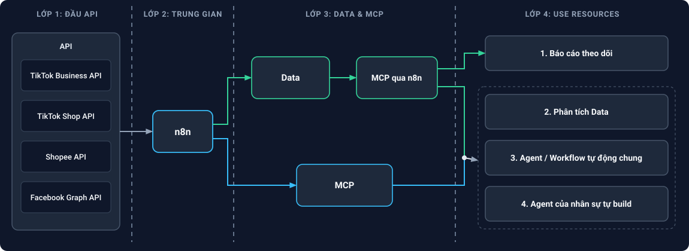

---

<a id="phan-1-2"></a>
## 1.2. Bốn Triết Lý Thiết Kế Cốt Lõi

1. **Tập trung hóa Data và Công cụ (Centralized Data & Tool Hub):**
   - Toàn bộ dữ liệu từ các sàn thương mại điện tử và các kênh quảng cáo được gom về một đầu mối duy nhất thông qua `n8n`.
   - Công ty chỉ cần xây dựng và duy trì một bộ bảng dữ liệu chuẩn kèm một số luồng/agent cốt lõi; nhân sự các phòng ban sẽ tận dụng hạ tầng sẵn có này để tự lắp ghép các Agent phục vụ công việc riêng.

2. **Không truy cập trực tiếp (Zero Direct Access):**
   - **Với API các sàn / kênh quảng cáo:** Không một AI Agent hay nhân sự nào gọi trực tiếp vào API gốc của TikTok, Shopee, Facebook. Mọi tác vụ đều phải đi qua **`MCP`** trên `n8n` để kiểm soát phân quyền và giới hạn an toàn.
   - **Với Kho dữ liệu (`Data`):** Các luồng ở Lớp 4 cũng không chọc trực tiếp làm xáo trộn file Google Sheets gốc hay Database, mà truy xuất thông qua cổng **`MCP qua n8n`** (API Export / Data MCP).

3. **Tách biệt rõ nhánh Chỉ Đọc (`Báo cáo theo dõi`) và nhánh Kết Hợp (`Phân tích`, `Agent chung`, `Agent nhân sự`):**
   - Khối **`1. Báo cáo theo dõi`** chỉ nhận dữ liệu một chiều từ nhánh `Data` $\rightarrow$ `MCP qua n8n`, đảm bảo an toàn tuyệt đối.
   - Ba khối **`2. Phân tích Data`**, **`3. Agent / Workflow tự động chung`**, và **`4. Agent của nhân sự tự build`** được kết nối đồng thời vào cả nhánh dữ liệu (`MCP qua n8n`) và nhánh công cụ thực thi (`MCP`).

4. **Kết hợp Mô hình Quyết định Nhanh [`JEV`](./JEV/README.md) (System One) và Mô hình Ngôn ngữ Lớn `LLM` (System Two):**
   - Dùng **JEV** cho các bài toán phân loại, khớp kịch bản video, chấm điểm chất lượng nội dung, chấm điểm CSKH, lọc KOC và xét điều kiện bật/tắt Ads (độ trễ `< 300ms`, `0` output token, không bịa đặt dữ liệu).
   - Dùng **LLM (Claude, GPT)** cho các bài toán viết báo cáo tổng hợp, hỏi đáp ngôn ngữ tự nhiên, góp ý sửa kịch bản và soạn tin nhắn mở lời.

---
---

<a id="phan-2"></a>
# 🔌 PHẦN 2: LỚP 1 & LỚP 2 — ĐẦU API ĐA KÊNH & TRUNG GIAN ĐIỀU PHỐI (`n8n`)

<a id="phan-2-1"></a>
## 2.1. Lớp 1: 4 Đầu API Nền Tảng

Toàn bộ tài liệu kỹ thuật và cURL thực thi của **4 đầu API** đã được chuẩn hóa sẵn trong kho tài liệu của công ty:

- **1. TikTok Business API** — Tài liệu: [`./tiktok-business-api/README.md`](./tiktok-business-api/README.md)
  - Quản lý chiến dịch quảng cáo (`Campaign`, `AdGroup`, `Ad`) và chiến dịch thương mại điện tử `GMV Max` (cả Video lẫn Livestream).
  - Báo cáo chỉ số hiệu suất quảng cáo & sáng tạo chuyên sâu: `Cost`, `Impressions`, `Clicks`, **`VE%`**, **`IE%`**, **`PE%`**, điểm chất lượng **`CQS`**, `New Consideration`, và tỷ lệ giữ chân người xem từng giây (`second-by-second retention`).
  - Quản lý danh tính `Spark Ads` (ủy quyền video KOC/Creator chạy quảng cáo) và `TikTok One API` (tìm kiếm, phân tích Creator).

- **2. TikTok Shop API** — Tài liệu: [`./tiktok-shop-api/README.md`](./tiktok-shop-api/README.md)
  - Quản lý Sản phẩm, Biến thể SKU, Giá bán, Tồn kho khả dụng và tải ảnh lên CDN.
  - Quản lý Đơn hàng, Đóng gói vận chuyển (`Fulfillment`), Hủy đơn - Trả hàng - Hoàn tiền (`Reverse`).
  - Quyết toán tài chính (`Finance Statements`), bóc tách chi tiết phí sàn, phí vận chuyển, hoa hồng.
  - Quản lý Tiếp thị liên kết (`Affiliate Seller / Creator / TAP`): kế hoạch hoa hồng mở, kế hoạch mục tiêu KOC VIP, duyệt gửi hàng mẫu (`Sample Applications`), phân tích phiên Live (`Shop Lives Analytics`) và Chat CSKH (`IM`).

- **3. Shopee API** — Tài liệu: [`./shoppe-api/README.md`](./shoppe-api/README.md)
  - Đồng bộ Đơn hàng, Sản phẩm, Biến thể `model_sku`, Tồn kho và tải ảnh `Media Space`.
  - Đối soát doanh thu thực nhận (`Escrow`), phí hoa hồng cố định, phí dịch vụ, phí thanh toán.
  - Quản lý Khiếu nại trả hàng, Đánh giá sản phẩm 1–5 sao (`Reviews / Comments`), Tin nhắn `Seller Chat`, Khuyến mãi Voucher / Flash Sale, `Shopee Ads`, `Shopee Live` và Sức khỏe gian hàng (`Account Health`).

- **4. Facebook Graph API** — Tài liệu: [`./facebook-ads-api/README.md`](./facebook-ads-api/README.md)
  - Khởi tạo và quản lý chiến dịch 3 tầng chuẩn ODAX (`Campaign` $\rightarrow$ `Ad Set` $\rightarrow$ `Ad Creative` $\rightarrow$ `Ad`).
  - Trích xuất báo cáo `Insights API` (`ROAS`, `CPA`, `CPC`, `CTR`, phân rã nhân khẩu học).
  - Đồng bộ danh mục sản phẩm (`Catalog API`), đo lường chuyển đổi máy chủ (`Conversions API - CAPI`), rút trích khách hàng tiềm năng (`Lead Ads`) và quy tắc tự động (`Automated Rules`).

---

<a id="phan-2-2"></a>
## 2.2. Lớp 2: Trung Gian Điều Phối `n8n`

`n8n` đóng vai trò là **"Trái tim điều phối" (Central Middleware)** đứng chắn giữa 4 Đầu API bên ngoài và toàn bộ hệ thống nội bộ bên trong:

- **Quản lý Xác thực & Vòng đời Token tự động:**
  - Tự động làm mới `access_token` và `refresh_token` theo chu kỳ của từng sàn (`4 giờ` với Shopee, `7 ngày` với TikTok Shop, `System User Token` vĩnh viễn với Meta).
  - Tự động tính toán chữ ký bảo mật `HMAC-SHA256` chuẩn xác cho mọi request gọi lên TikTok Shop và Shopee.

- **Luồng Thu thập Dữ liệu (ETL & Webhook Listener):**
  - Chạy lịch định kỳ (`Cron Job`) kéo số liệu báo cáo Ads, Creative, Đối soát tài chính về khối `Data`.
  - Lắng nghe sự kiện thời gian thực (`Webhook Push`) khi có đơn hàng mới, biến động tồn kho, yêu cầu trả hàng hoặc tin nhắn khách hàng.

- **Điều phối Công cụ (MCP Host & API Router):**
  - Cung cấp các đầu nối chuẩn hóa cho Lớp 3: **`MCP qua n8n`** (để xuất dữ liệu từ kho `Data`) và **`MCP`** (để thực thi lệnh gọi ngược lên 4 đầu API).

---
---

<a id="phan-3"></a>
# 🗄️ PHẦN 3: LỚP 3 — HỆ THỐNG `DATA`, `MCP QUA N8N` & `MCP`

Ở Lớp 3, hệ thống tách làm **2 nhánh song song** rõ rệt:
- **Nhánh Dữ liệu (Phía trên):** `Data` $\longrightarrow$ `MCP qua n8n`
- **Nhánh Tác vụ API (Phía dưới):** `MCP`

---

<a id="phan-3-1"></a>
## 3.1. Khối `Data` (Google Sheets Song Song PostgreSQL)

Dữ liệu sau khi được `n8n` thu thập và làm sạch từ 4 đầu API sẽ được lưu trữ đồng thời vào **2 nơi nằm chung trong khối `Data`**:

1. **Google Sheets (Tầng hiển thị & vận hành hàng ngày):**
   - Lưu dữ liệu theo các bảng chuẩn hóa (cửa sổ dữ liệu gần nhất hoặc bảng tổng hợp) để nhân sự các bộ phận quen thuộc thao tác, kiểm tra trực quan.
   - Không còn cảnh phải dùng hàng loạt hàm `ARRAYFORMULA` nối chéo gây đơ file, vì dữ liệu đã được `n8n` ghép nối sẵn trước khi ghi vào Sheet.

2. **PostgreSQL (Tầng Backup & Data Warehouse cho DA):**
   - Lưu trữ bản sao toàn diện và lịch sử dài hạn (hàng triệu bản ghi đơn hàng, lịch sử biến động chỉ số quảng cáo theo ngày/giờ, toàn văn lịch sử chat và transcript video).
   - Phục vụ đội ngũ Data Analytics (DA) và các AI Agent truy vấn tốc độ cao mà không lo giới hạn dòng của Google Sheets.

---

<a id="phan-3-2"></a>
## 3.2. Thiết Kế Tương Đối 10 Nhóm Bảng Dữ Liệu Cốt Lõi

Để phục vụ đầy đủ hoạt động của công ty bán sản phẩm công nghệ trên sàn TMĐT, khối `Data` được quy hoạch gồm **10 nhóm bảng liên kết với nhau** (thiết kế khung tương đối để thảo luận cùng các phòng ban):

1. **Bảng 1 — Master Sản Phẩm & Tồn Kho SKU Đa Sàn:**
   - **Trường thông tin chính:** Mã nội bộ gốc (`S24`, `S25`, `G1`...), ánh xạ `item_id` / `sku_id` trên TikTok Shop, Shopee, Facebook Catalog; giá niêm yết, giá vốn (`COGS`), tồn kho khả dụng từng kho.
   - **Mục đích:** Làm "cầu nối" gom số liệu đơn hàng, chi phí Ads và hiệu quả Content của cùng 1 sản phẩm trên mọi kênh về chung một mối; cảnh báo đứt hàng.

2. **Bảng 2 — Quản Lý Đơn Hàng Đa Sàn (`Orders`):**
   - **Trường thông tin chính:** Mã đơn hàng (`order_sn` / `order_id`), Sàn, Thị trường (`VN`, `TH`...), danh sách SKU mua, số lượng, tổng tiền khách trả, trạng thái đơn thống nhất (`Chờ giao`, `Đang giao`, `Hoàn thành`, `Đã hủy`, `Hoàn trả`).
   - **Mục đích:** Theo dõi sản lượng bán ra theo thời gian thực và đồng bộ đóng gói vận đơn.

3. **Bảng 3 — Quản Lý Ads Đa Kênh (`Omni-channel Ads`):**
   - **Trường thông tin chính:** Kênh chạy (`TikTok`, `Facebook`, `Shopee Ads`), Tài khoản Ads, cấu trúc `Campaign` $\rightarrow$ `AdGroup/AdSet` $\rightarrow$ `Ad`, Mục tiêu (`GMV`, `C-ads`, `Conversion`), cùng chỉ số theo ngày: `Cost`, `Impressions`, `Clicks`, `CPM`, `CPC`, `CTR`, `Orders`, `GMV`, `ROAS`.
   - **Mục đích:** Quản lý ngân sách, đo lường hiệu quả chuyển đổi và tối ưu hóa chiến dịch quảng cáo.

4. **Bảng 4 — Data Content & Creative Performance:**
   - **Bảng Kho Kịch Bản:** Mã kịch bản, Sản phẩm (`S24`, `S25`, `G1`), **Hướng thử nghiệm** (`S24-1000 chất lượng 10000`, `Sự tiện lợi`, `G1 - Before/After`...), Tên kịch bản, Hook 3s, Nhân sự phụ trách.
   - **Bảng Video & Chỉ số Sáng tạo:** `Link Video`, `ID Video`, Ngày air, `Transcript`, Kịch bản đã khớp (do `JEV` nhận định), cùng bộ chỉ số: **`VE%`**, **`IE%`**, **`PE%`**, **`CQS (consideration)`**, `Cost`, `Impressions`, `New consideration size/rate`, `Cost per consideration`, `Clicks`, `GMV`.
   - **Mục đích:** Giải quyết triệt để bài toán khớp hướng thử nghiệm với video đã đăng và theo dõi chất lượng/số lượng nội dung của cả team In-house lẫn KOC theo ngày.

5. **Bảng 5 — Quản Lý Affiliate & Thuê KOL/KOC (`Spark Ads`):**
   - **Trường thông tin chính:** Hồ sơ KOC/KOL (`Handle`, lượng Follow, view trung bình, phân hạng `Tier S/A/B/C`, điểm hợp ngành công nghệ do `JEV` chấm); trạng thái gửi hàng mẫu (`Sample`), chi phí booking, `%` hoa hồng Affiliate, link video trả bài và **Mã ủy quyền `Spark Ads Code`**.
   - **Mục đích:** Quản lý trọn vòng đời từ săn tìm KOC $\rightarrow$ gửi mẫu $\rightarrow$ nghiệm thu video $\rightarrow$ lấy mã Spark Ads chạy quảng cáo và tính ROI thuê KOC.

6. **Bảng 6 — Chi Phí & Đối Soát Tài Chính (`Finance & PnL`):**
   - **Trường thông tin chính:** Doanh thu gộp (`GMV`), Tiền thực nhận về ví (`Escrow / Settlement`), bóc tách chi tiết: phí hoa hồng sàn, phí thanh toán, phí Freeship/Voucher, phí vận chuyển chênh lệch, hoa hồng Affiliate; đối chiếu với Chi phí Ads + Chi phí Booking KOC + Giá vốn.
   - **Mục đích:** Tính toán chính xác Lãi/Lỗ ròng (`Net Profit`) theo từng ngày, từng mã sản phẩm và từng sàn.

7. **Bảng 7 — Chăm Sóc Khách Hàng (`CSKH & Scorecard`):**
   - **Trường thông tin chính:** Lịch sử hội thoại khách hàng từ TikTok Shop IM, Shopee Chat, Fanpage; chủ đề khách hỏi, tốc độ phản hồi (`SLA`) và **Bảng điểm chất lượng CSKH** do `JEV` chấm tự động.
   - **Mục đích:** Kiểm soát chất lượng tư vấn kỹ thuật sản phẩm, thái độ nhân sự và tỷ lệ chốt đơn qua chat.

8. **Bảng 8 — Đổi Trả, Bảo Hành & Đánh Giá 1–5 Sao:**
   - **Trường thông tin chính:** Danh sách đơn yêu cầu Trả hàng / Hoàn tiền, hạn xử lý (`48h`), nội dung bình luận đánh giá 1–5 sao kèm phân loại nguyên nhân bằng `JEV`: *Lỗi kỹ thuật phần cứng* hay *Khách mua nhầm chân cắm / chưa biết cách kết nối*.
   - **Mục đích:** Giúp bộ phận R&D cải tiến sản phẩm và giúp team Content làm video hướng dẫn sử dụng giảm tỷ lệ hoàn.

9. **Bảng 9 — Hiệu Suất Livestream & Ca Live (`Live Shift PnL`):**
   - **Trường thông tin chính:** Thông tin phiên Live (`room_id`, khung giờ, tên Host), mắt xem trực tiếp (`CCU`), lượt click giỏ hàng, chi phí chạy quảng cáo `Live GMV Max`, số đơn, doanh thu và ROI thực tế của từng ca Live.
   - **Mục đích:** Tự động chốt sổ hiệu quả từng ca Live của Host và tối ưu bơm ngân sách quảng cáo vào phòng Live.

10. **Bảng 10 — Khuyến Mãi Sàn & Sức Khỏe Gian Hàng (`Account Health`):**
    - **Trường thông tin chính:** Lịch chiến dịch Mega Sale (ngày đôi, Brand Day), hiệu quả từng mã Voucher / Flash Sale, chỉ số sức khỏe Shop (tỷ lệ giao trễ, tỷ lệ hủy đơn, điểm phạt sàn).
    - **Mục đích:** Bảo vệ nhãn Mall / Shop uy tín và đánh giá tác động của khuyến mãi lên doanh số.

---

<a id="phan-3-3"></a>
## 3.3. Khối `MCP qua n8n` (Cổng Xuất & Truy Vấn Dữ Liệu)

Thay vì để các công cụ hoặc AI Agent ở Lớp 4 đọc/ghi trực tiếp vào file Google Sheets (dễ gây lỗi xóa nhầm cột, hỏng công thức hoặc lộ dữ liệu nhạy cảm giữa các bộ phận), mọi truy vấn dữ liệu từ `Data` đi sang Lớp 4 đều đi qua **`MCP qua n8n`**:

- **Đóng gói thành các Data Tools / API Export chuẩn:**
  - Ví dụ: `get_daily_sales_summary`, `get_content_performance_by_product`, `get_ad_campaigns_metrics`, `get_koc_list`.
- **Lọc và nén dữ liệu trước khi đưa vào AI:**
  - Chỉ trả về đúng các dòng/cột cần thiết giúp giảm 70–80% lượng token tiêu thụ khi nối vào Claude hoặc các Agent.
- **Phân quyền xem dữ liệu:**
  - Nhân sự bộ phận nào chỉ truy xuất được các bảng dữ liệu thuộc phạm vi của bộ phận đó.

---

<a id="phan-3-4"></a>
## 3.4. Khối `MCP` (Cổng Phân Quyền & Thực Thi Tác Vụ API)

Ở nhánh dưới của Lớp 3, khối **`MCP`** là cổng duy nhất cho phép Lớp 4 tương tác ngược lại với 4 Đầu API (Lớp 1):

- **Tách nhóm công cụ theo nghiệp vụ phòng ban:**
  - **`MCP Ads`:** Bật/tắt chiến dịch, điều chỉnh ngân sách, tạo nhóm quảng cáo mới, gắn mã video `Spark Ads`, điều chỉnh ngân sách `Live GMV Max`.
  - **`MCP Shop`:** Tạo sản phẩm mới, cập nhật tồn kho đa sàn, thay đổi ảnh bìa sản phẩm, duyệt yêu cầu hoàn trả.
  - **`MCP Content & KOC`:** Tải luồng âm thanh/video tạm thời để lấy Transcript, gọi mô hình `JEV` chấm điểm kịch bản/video, quét thông tin kênh KOC và chấm điểm KOC.
  - **`MCP CSKH`:** Trích xuất chi tiết hội thoại chat, chấm điểm hội thoại qua `JEV`, gửi tin nhắn phản hồi.

- **Kiểm soát an toàn (Governance & Guardrails):**
  - Mọi lệnh gọi vào `MCP` đều được kiểm tra quyền hạn của Agent/nhân sự gọi lệnh, kiểm tra ngưỡng an toàn (ví dụ: không tự ý tăng ngân sách vượt trần quy định) và ghi lại nhật ký thao tác (`Audit Log`).

---
---

<a id="phan-4"></a>
# 🚀 PHẦN 4: LỚP 4 (`USE RESOURCES`) — CHI TIẾT 4 KHỐI & CÁC VÍ DỤ WORKFLOW / AGENT CỤ THỂ

Ở Lớp 4, tài nguyên dữ liệu (**`MCP qua n8n`**) và công cụ (**`MCP`**) được khai thác qua **4 hộp chức năng lớn**.

Trong mỗi hộp dưới đây, tài liệu trình bày:
1. **Tổng quan các mô hình trong hộp** kèm sơ đồ kết nối.
2. **Các Ví dụ Workflow / Agent cụ thể**, trong đó mỗi ví dụ đều được trình bày rõ ràng theo **3 mục con thụt lề**:
   - **Mục 1:** Sơ đồ luồng hoạt động (`Workflow Diagram`).
   - **Mục 2:** **Phương án 1 (Ưu tiên)** — Sử dụng **Claude Agent** kết nối qua `MCP Tools`.
   - **Mục 3:** **Phương án 2** — Sử dụng **n8n Workflow** tự động kèm danh sách các `Node` cụ thể.

---

<a id="phan-4-1"></a>
## 📊 4.1. KHỐI 1: BÁO CÁO THEO DÕI

> **Luồng kết nối trên sơ đồ:** Chỉ nhận dữ liệu một chiều từ nhánh **`Data` $\longrightarrow$ `MCP qua n8n`** (Chế độ Read-Only, an toàn tuyệt đối).  
>
> **Mục tiêu cốt lõi:** Tự động hóa hoàn toàn việc tổng hợp số liệu hàng ngày theo đúng biểu mẫu của công ty, giúp ban giám đốc và các phòng ban nắm bắt ngay tình hình số lượng & chất lượng công việc mà giảm tải tối đa thời gian họp hành thủ công.

### Tổng Quan 3 Mô Hình Trong Khối 1 (`Báo Cáo Theo Dõi`)

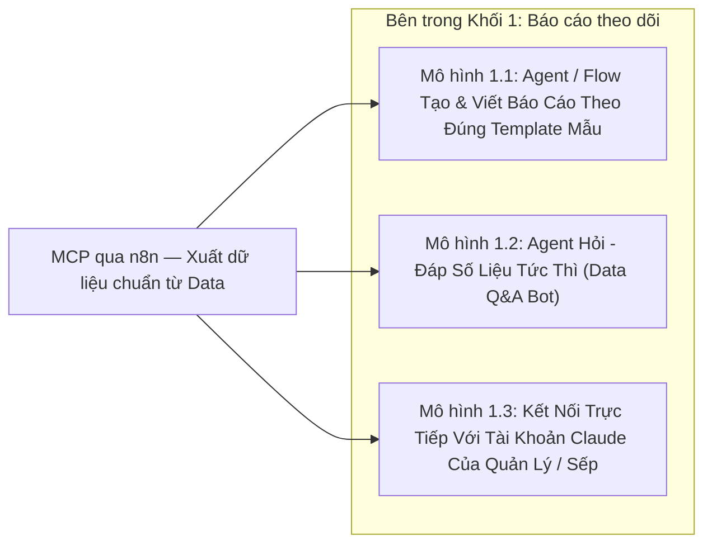

- **Mô hình 1.1 — Các Agent / Workflow chuyên tạo bảng và viết báo cáo theo đúng Template mẫu:**
  - Theo lịch cố định (ví dụ: `06:30` sáng hàng ngày), Workflow/Agent gọi qua `MCP qua n8n` lấy số liệu đã cập nhật từ `Data` và tự động điền vào đúng **Template mẫu cố định** của từng phòng ban.
  - Sau khi điền bảng, **Agent Chuyên Viết Báo Cáo** đọc bảng số liệu vừa tạo để viết bản **Tóm tắt nhận định (Executive Summary)** theo đúng văn phong mẫu và gửi vào nhóm chat của phòng ban.
  - **4 Template báo cáo tiêu biểu tại công ty:**
    1. *Template Báo cáo Content Performance (Theo dõi Số lượng & Chất lượng Nội dung):* Tổng hợp theo bộ lọc `Ngày bắt đầu - Ngày kết thúc` và `Sản phẩm` (`S24`, `S25`, `G1`...), hiển thị đầy đủ `Link Video`, `ID`, `Mục tiêu` (`GMV`, `C-ads`), `Nhân sự`, `Ngày air`, `Hướng thử nghiệm` (`S24-1000 chất lượng 10000`, `Sự tiện lợi`...), kèm các chỉ số **`VE%`**, **`IE%`**, **`PE%`**, **`consideration (CQS)`**, **`Cost`**, **`Impressions`**, **`New consideration size/rate`**, **`Cost per consideration`**, **`Clicks`**, và **`GMV`**.
    2. *Template Báo cáo Doanh thu - Chi phí Ads - Lãi/Lỗ (Daily Omni-channel PnL):* Tổng hợp GMV, tiền thực nhận sau phí sàn (TikTok Shop + Shopee) đối chiếu với tổng chi phí Ads các kênh theo từng mã sản phẩm.
    3. *Template Báo cáo Tiến độ KOC & Sức khỏe Gian hàng:* Tổng hợp số lượng KOC đã gửi mẫu, số video KOC trả bài, doanh số Affiliate và cảnh báo tồn kho.
    4. *Template Báo cáo Hiệu suất Ca Livestream & Chi phí Live Ads (Live Shift PnL):* Do tại công ty **Host tự vận hành phiên Live và tự ấp giỏ hàng**, hệ thống tự động ghép doanh thu/đơn hàng từng ca của Host (từ TikTok Shop `/performance_per_minutes` & Shopee Live `/get_session_metric`) với chi phí quảng cáo `Live GMV Max` trong đúng khung giờ đó để xuất báo cáo: *Doanh thu ca Live, Số đơn, Tỷ lệ click giỏ, Chi phí Ads của ca, ROI thực tế và Top sản phẩm bán chạy*.

- **Mô hình 1.2 — Agent Hỏi - Đáp (`Q&A Bot`) giải đáp thắc mắc về số liệu tức thì:**
  - Nhân sự các phòng ban chỉ cần gõ câu hỏi tự nhiên (ví dụ: *"Tuần này hướng thử nghiệm nào của mã S24 đang có VE% cao nhất?"*), Agent tự động gọi qua `MCP qua n8n` lấy số liệu chính xác từ `Data` và trả lời ngay kèm bảng trích xuất ngắn gọn.

- **Mô hình 1.3 — Kết nối trực tiếp vào tài khoản Claude của các Nhân sự Quản lý / Sếp:**
  - Đầu nối **`MCP qua n8n`** (Read-Only) được cắm trực tiếp làm MCP Connector trong tài khoản **Claude Desktop / Claude Web** của Ban giám đốc và các Leader để hỏi đáp, lập bảng so sánh mọi lúc mọi nơi.

---

<a id="vd-1a"></a>
### 📌 Ví Dụ 1.A (Thuộc Khối 1): Agent Lập & Viết Báo Cáo Content Performance Theo Template (`S24`, `S25`, `G1` & Hướng Thử Nghiệm)

> **Bài toán giải quyết:** Thay thế hoàn toàn thao tác lọc bảng thủ công và họp báo cáo hàng ngày của đội ngũ Content.

#### ▸ [Mục 1.A.1] Sơ Đồ Luồng Hoạt Động (Của Ví Dụ 1.A)

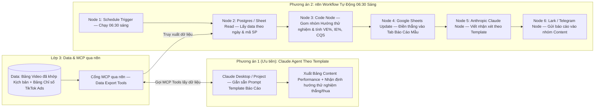

#### ▸ [Mục 1.A.2] Phương Án 1 (Ưu Tiên): Triển Khai Bằng Claude Agent (Của Ví Dụ 1.A)

- **Người sử dụng:** Trưởng bộ phận Content hoặc Ban Giám đốc mở **Claude Project** (đã gắn sẵn hướng dẫn định dạng Template báo cáo của công ty).
- **Danh sách các `MCP Tools` trên `MCP qua n8n` mà Claude tự động gọi:**
  1. `get_content_performance_table(product_code, start_date, end_date)`:
     - Trả về bảng chuẩn gồm các cột: `Link Video`, `ID`, `Mục tiêu (GMV/C-ads)`, `Nhân sự`, `Ngày air`, `Hướng thử nghiệm`, `VE%`, `IE%`, `PE%`, `CQS`, `Cost`, `Impressions`, `New consideration size/rate`, `Cost per consideration`, `Clicks`, `GMV`.
  2. `get_testing_angle_summary(product_code, date_range)`:
     - Gom nhóm và so sánh hiệu quả giữa các hướng thử nghiệm (ví dụ: đối chiếu hướng *`S24-1000 chất lượng 10000`* với hướng *`Sự tiện lợi`* và *`G1 - Before/After`*).
  3. `get_staff_kpi_progress(staff_name, date_range)`:
     - Kiểm tra định mức số lượng video đã đăng và tỷ lệ video đạt chuẩn của từng nhân sự Content.
- **Kết quả đầu ra trên Claude:**
  - Dựng bảng báo cáo đúng 100% cấu trúc mẫu ngay trên màn hình kèm bản nhận xét chiến lược: *Hướng thử nghiệm nào đang có `VE%` và `CQS` tốt nhất để nhân rộng trong tuần tới*.

#### ▸ [Mục 1.A.3] Phương Án 2: Triển Khai Bằng n8n Workflow Tự Động (Của Ví Dụ 1.A)

- **Cơ chế chạy:** Chạy ngầm tự động vào `06:30` sáng mỗi ngày mà không cần người bấm lệnh.
- **Chuỗi 6 Node cụ thể trong `n8n`:**
  1. **`Node 1 — Schedule Trigger`:** Hẹn giờ kích hoạt lúc `06:30` sáng hàng ngày.
  2. **`Node 2 — Postgres / Google Sheets (Get Rows)`:** Đọc dữ liệu video đã khớp kịch bản và chỉ số quảng cáo từ khối `Data`.
  3. **`Node 3 — Code Node (JS / Python)`:** Tính trung bình trọng số các chỉ số `VE%`, `IE%`, `PE%`, `Cost per consideration` theo từng mã sản phẩm (`S24`, `S25`, `G1`) và từng hướng thử nghiệm.
  4. **`Node 4 — Google Sheets (Update)`:** Ghi đè bảng kết quả đã tính sẵn vào tab Báo cáo (giúp loại bỏ hoàn toàn các hàm `ARRAYFORMULA` nặng nề làm treo Sheet).
  5. **`Node 5 — Anthropic Claude Node`:** Đưa bảng số liệu tóm tắt qua Claude API để viết 5 gạch đầu dòng điểm tin sáng theo đúng văn phong mẫu.
  6. **`Node 6 — Lark / Telegram Node`:** Gửi bản tóm tắt kèm đường link Google Sheets vào nhóm làm việc của phòng Content.

---

<a id="vd-1b"></a>
### 📌 Ví Dụ 1.B (Thuộc Khối 1): Agent Báo Cáo Doanh Số, Chi Phí Ads & Lãi/Lỗ Đa Sàn Hàng Ngày (Daily Omni-Channel PnL)

> **Bài toán giải quyết:** Tự động ghép nối Doanh thu thực nhận sau phí sàn (`Escrow / Settlement`) với Chi phí Quảng cáo đa kênh và Chi phí KOC để tính ra Lãi/Lỗ ròng theo từng mã sản phẩm mỗi ngày.

#### ▸ [Mục 1.B.1] Sơ Đồ Luồng Hoạt Động (Của Ví Dụ 1.B)

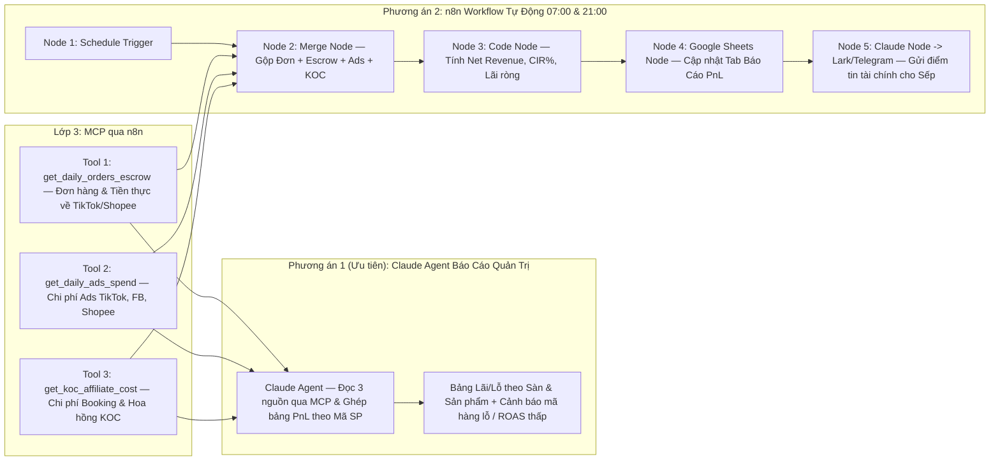

#### ▸ [Mục 1.B.2] Phương Án 1 (Ưu Tiên): Triển Khai Bằng Claude Agent (Của Ví Dụ 1.B)

- **Danh sách các `MCP Tools` trên `MCP qua n8n` mà Claude gọi:**
  1. `get_daily_orders_escrow(date_range, platform, product_code)`: Lấy tổng đơn thành công, đơn hoàn, GMV, tổng phí sàn khấu trừ và tiền thực nhận về ví (`Escrow / Settlement`).
  2. `get_daily_ads_spend(date_range, channel, product_code)`: Lấy tổng chi phí quảng cáo (`Cost`) và `ROAS` của từng kênh (`TikTok`, `Facebook`, `Shopee`).
  3. `get_koc_affiliate_cost(date_range, product_code)`: Lấy chi phí hoa hồng Affiliate và phí booking phân bổ theo mã sản phẩm.
- **Kết quả đầu ra:**
  - Báo cáo tài chính tổng hợp theo từng mã sản phẩm (`S24`, `S25`, `G1`), chỉ rõ biên lợi nhuận ròng (`Net Margin %`) sau khi trừ giá vốn, phí sàn và chi phí Ads.

#### ▸ [Mục 1.B.3] Phương Án 2: Triển Khai Bằng n8n Workflow Tự Động (Của Ví Dụ 1.B)

- **Chuỗi 5 Node cụ thể trong `n8n`:**
  1. **`Node 1 — Schedule Trigger`:** Chạy định kỳ lúc `07:00` sáng và `21:00` tối.
  2. **`Node 2 — Postgres Query & Merge Node`:** Gộp 3 bảng Đơn hàng, Đối soát tài chính và Chi phí Ads theo khóa chung là `product_code` (`S24`, `S25`, `G1`).
  3. **`Node 3 — Code Node`:** Tính toán tỷ lệ `% Chi phí Ads / Doanh thu (CIR)`, `% Phí sàn / Doanh thu` và `Lợi nhuận ròng`.
  4. **`Node 4 — Google Sheets (Update)`:** Điền vào bảng theo dõi PnL hàng ngày của Ban Giám đốc.
  5. **`Node 5 — Anthropic Claude Node -> Telegram / Lark`:** Viết bản nhận định nhanh các mã sản phẩm đang vượt KPI lợi nhuận hoặc đang bị đội chi phí Ads để cảnh báo ngay.

---

<a id="vd-1c"></a>
### 📌 Ví Dụ 1.C (Thuộc Khối 1): Agent Hỏi - Đáp Số Liệu Tức Thì (Data Q&A) & Kết Nối Trực Tiếp Với Claude Của Quản Lý

> **Bài toán giải quyết:** Cho phép Sếp, Quản lý và Nhân sự hỏi bất kỳ con số nào bằng tiếng Việt tự nhiên và nhận câu trả lời chính xác từ kho `Data` trong vài giây.

#### ▸ [Mục 1.C.1] Sơ Đồ Luồng Hoạt Động (Của Ví Dụ 1.C)

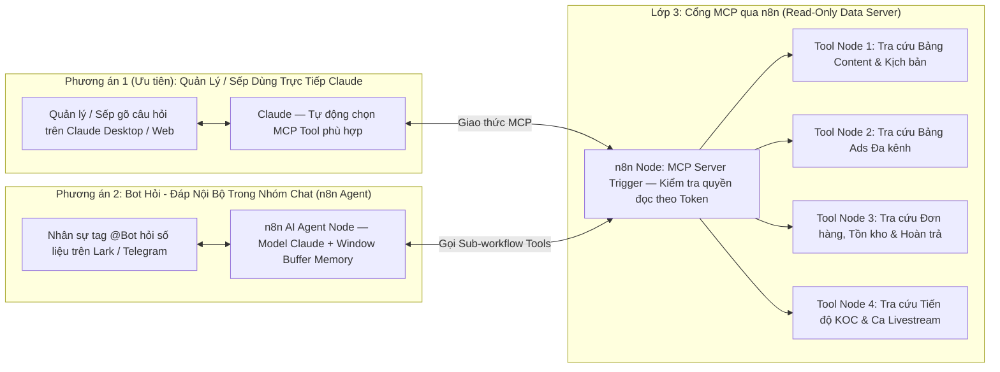

#### ▸ [Mục 1.C.2] Phương Án 1 (Ưu Tiên): Cắm Trực Tiếp `MCP qua n8n` Vào Tài Khoản Claude Của Quản Lý / Sếp (Của Ví Dụ 1.C)

- **Cách thiết lập:**
  - Trên `n8n`, đặt 1 node **`MCP Server Trigger`** ở đầu luồng, nối với 4 **`Custom Tool Nodes`** truy vấn dữ liệu Read-Only từ `Google Sheets` / `PostgreSQL`.
  - Dán đường dẫn URL của `MCP Server Trigger` vào mục **MCP Connectors** trên ứng dụng Claude của Sếp và các cấp Quản lý.
- **Cách sử dụng thực tế:**
  - Người quản lý mở Claude hỏi trực tiếp bằng tiếng Việt:
    - *"Cho anh xem 5 video của team Content tuần này có Cost per consideration thấp nhất"*
    - *"Tồn kho hiện tại của mã S24 còn đủ bán mấy ngày với tốc độ đơn tuần này?"*
  - Claude tự động gọi đúng Tool trên `n8n`, lấy số liệu thực tế và lập bảng trả lời ngay lập tức.

#### ▸ [Mục 1.C.3] Phương Án 2: Bot Hỏi - Đáp Trong Nhóm Chat Nội Bộ Bằng `n8n AI Agent` (Của Ví Dụ 1.C)

- **Chuỗi 4 Node cụ thể trong `n8n`:**
  1. **`Node 1 — Lark / Telegram Chat Trigger`:** Nhận câu hỏi khi nhân sự tag `@DataBot` trong nhóm chat.
  2. **`Node 2 — AI Agent Node (Anthropic Claude Model)`:** Phân tích ý định câu hỏi của nhân sự.
  3. **`Node 3 — Window Buffer Memory Node`:** Ghi nhớ ngữ cảnh hội thoại để nhân sự có thể hỏi nối tiếp nhiều câu.
  4. **`Node 4 — Custom Data Tool Nodes`:** Truy vấn số liệu từ `Data` và trả kết quả về nhóm chat.

---
---

<a id="phan-4-2"></a>
## 🔍 4.2. KHỐI 2: PHÂN TÍCH DATA

> **Luồng kết nối trên sơ đồ:** Nhận dữ liệu từ **`MCP qua n8n`** (đọc `Data` có sẵn) kết hợp với **`MCP`** (để chủ động gọi API trích xuất thêm dữ liệu chuyên sâu và gọi mô hình `JEV` chấm điểm).  
>
> **Mục tiêu cốt lõi:** Khác với Khối 1 (chỉ tổng hợp số liệu có sẵn theo mẫu hàng ngày), Khối 2 giải quyết các bài toán **đào sâu tìm nguyên nhân gốc rễ (Deep-Dive & Root-Cause Analysis)**, chấm điểm chất lượng hàng loạt bằng **[`JEV`](./JEV/README.md)** (System One) rồi đúc kết thành báo cáo phân tích chuyên sâu và đề xuất hành động thông qua **Claude** (System Two).

### Tổng Quan 3 Mô Hình Trong Khối 2 (`Phân Tích Data`)

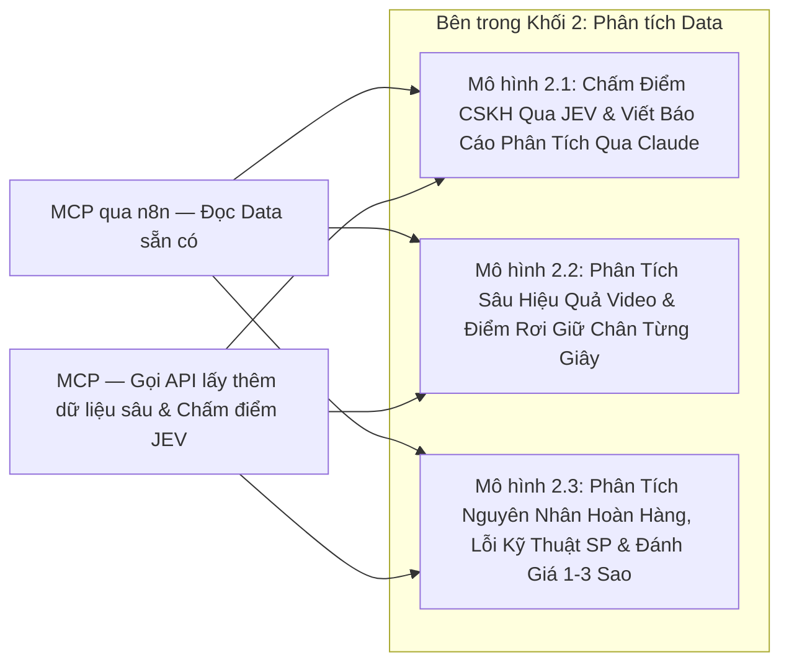

- **Mô hình 2.1 — Tạo bảng chấm điểm Chăm sóc Khách hàng (CSKH) qua JEV & Viết báo cáo phân tích qua Claude:**
  - Lấy lịch sử hội thoại khách hàng từ TikTok Shop IM, Shopee Chat, Fanpage $\rightarrow$ Đẩy qua **`JEV`** (`POST /v1/systemone`, tốn `$0` output token, `< 300ms`/cuộc) để chấm điểm tự động theo bộ tiêu chí chuẩn (*Thái độ*, *Kiến thức kỹ thuật sản phẩm*, *Kỹ năng chốt/giữ đơn*, *SLA phản hồi*) tạo thành **Bảng Chấm Điểm CSKH** $\rightarrow$ Dùng **Claude** đọc bảng điểm để viết báo cáo phân tích chất lượng CSKH và đề xuất kịch bản trả lời mẫu.

- **Mô hình 2.2 — Phân tích sâu hiệu quả Video Content & Điểm rơi giữ chân người xem từng giây:**
  - Kết hợp đọc `Transcript` + chỉ số tổng từ `MCP qua n8n` và gọi `MCP` chọc vào endpoint `/report/video_performance/get/` của TikTok Business API để lấy **biểu đồ giữ chân người xem từng giây (second-by-second retention)** $\rightarrow$ Đối chiếu giây bị rớt người xem mạnh nhất với câu thoại tương ứng trong `Transcript` để tìm nguyên nhân và sửa kịch bản.

- **Mô hình 2.3 — Phân tích nguyên nhân Hoàn hàng, Lỗi kỹ thuật sản phẩm & Đánh giá 1–3 sao:**
  - Kéo chi tiết lý do hoàn hàng (`get_return_detail`) và bình luận 1–3 sao (`get_comment`) của các mã mic `S24`, `S25`, `G1` $\rightarrow$ Dùng **`JEV`** phân loại xem khách hoàn vì *lỗi phần cứng thực sự* hay vì *mua nhầm chân cắm / không biết cách kết nối* $\rightarrow$ Dùng **Claude** tổng hợp báo cáo gửi bộ phận Sản phẩm và bộ phận Content.

---

<a id="vd-2a"></a>
### 📌 Ví Dụ 2.A (Thuộc Khối 2): Tạo Bảng Chấm Điểm Chăm Sóc Khách Hàng (CSKH) Qua JEV & Viết Báo Cáo Phân Tích Qua Claude

> **Bài toán giải quyết:** Kiểm soát chất lượng hàng trăm cuộc chat tư vấn và bảo hành mỗi ngày mà không tốn nhân sự ngồi đọc thủ công, đồng thời không tốn chi phí output token của LLM lớn nhờ dùng **JEV** ở bước chấm điểm.

#### ▸ [Mục 2.A.1] Sơ Đồ Luồng Hoạt Động (Của Ví Dụ 2.A)

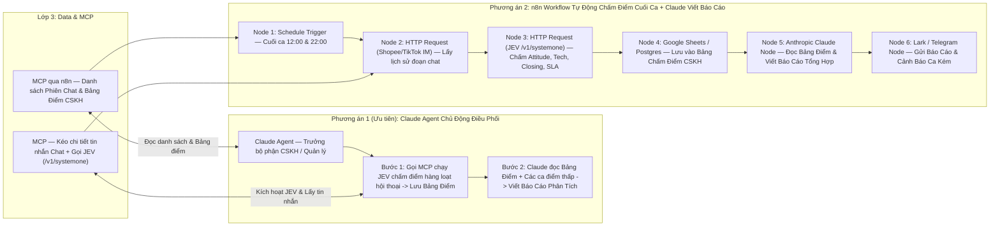

#### ▸ [Mục 2.A.2] Bộ Tiêu Chí Câu Hỏi Truyền Vào `JEV (/v1/systemone)` Để Chấm Điểm Từng Cuộc Chat (Của Ví Dụ 2.A)

Mỗi cuộc hội thoại được truyền vào trường `state`, và **JEV** chấm đồng thời 5 tiêu chí trong 1 lượt gọi (`< 300ms`):
- **`issue_topic` (`choice`):** Phân loại vấn đề khách hỏi (*Tư vấn chọn mua*, *Hướng dẫn kết nối/sử dụng mic*, *Khiếu nại lỗi âm thanh/kết nối*, *Yêu cầu đổi trả/hoàn tiền*).
- **`attitude_score` (`score` thang 1–4):** Thái độ phản hồi của nhân viên (`1`: Cộc lốc, thiếu nhiệt tình $\rightarrow$ `4`: Lễ phép, chủ động hỗ trợ).
- **`tech_knowledge_score` (`score` thang 1–4):** Độ chính xác khi giải thích tính năng và hướng dẫn khắc phục lỗi kỹ thuật sản phẩm.
- **`persuasion_score` (`score` thang 1–4):** Kỹ năng chốt đơn hoặc thuyết phục khách giữ lại sản phẩm khi khách định hủy/hoàn.
- **`needs_manager_review` (`noul` từ `0.0 -> 1.0`):** Cuộc chat này có nguy cơ dẫn tới đánh giá 1 sao hoặc khiếu nại lên sàn cần Quản lý can thiệp ngay không?

#### ▸ [Mục 2.A.3] Phương Án 1 (Ưu Tiên): Triển Khai Bằng Claude Agent (Của Ví Dụ 2.A)

- **Danh sách các `MCP Tools` mà Claude gọi:**
  1. `mcp_cs_fetch_and_score_chats(date_range, shop_id, staff_name)`:
     - Gọi luồng `MCP` tự động kéo các đoạn chat chưa chấm từ Shopee (`SellerChat`) và TikTok Shop (`IM`), đẩy qua **JEV** chấm 5 chỉ số trên và ghi vào **Bảng Chấm Điểm CSKH**.
  2. `mcp_data_get_cskh_scorecard(date_range, staff_name)`:
     - Đọc bảng tổng hợp điểm trung bình của từng nhân viên CSKH từ `MCP qua n8n`.
  3. `mcp_cs_get_low_score_transcripts(max_score=2.0)`:
     - Lấy toàn văn một số đoạn chat bị JEV chấm điểm thấp nhất để Claude đọc làm dẫn chứng thực tế.
- **Kết quả đầu ra:**
  - Cập nhật **Bảng Chấm Điểm CSKH** chi tiết từng phiên chat trên Google Sheets / PostgreSQL.
  - Xuất **Báo cáo phân tích chất lượng CSKH** trên Claude: xếp hạng nhân viên, chỉ ra các câu hỏi kỹ thuật mà nhân viên hay trả lời lúng túng nhất và viết sẵn mẫu câu trả lời chuẩn để đào tạo lại.

#### ▸ [Mục 2.A.4] Phương Án 2: Triển Khai Bằng n8n Workflow + JEV + Claude Node (Của Ví Dụ 2.A)

- **Chuỗi 6 Node cụ thể trong `n8n`:**
  1. **`Node 1 — Schedule Trigger`:** Chạy tự động vào cuối ca sáng (`12:00`) và cuối ca tối (`22:00`).
  2. **`Node 2 — HTTP Request (Shopee SellerChat / TikTok IM)`:** Kéo nội dung các hội thoại phát sinh trong ca.
  3. **`Node 3 — HTTP Request (POST api.typesafe.ai/v1/systemone)`:** Gửi lịch sử từng cuộc chat sang **JEV** để chấm điểm song song.
  4. **`Node 4 — Google Sheets / Postgres Node`:** Ghi điểm số từng cuộc chat vào `Bảng Chấm Điểm CSKH`.
  5. **`Node 5 — Anthropic Claude Node`:** Đọc bảng thống kê điểm cả ca và các đoạn chat có `needs_manager_review > 0.80` để viết báo cáo tổng kết ca.
  6. **`Node 6 — Lark / Telegram Node`:** Gửi báo cáo chất lượng ca trực kèm cảnh báo các ca nóng cho Trưởng bộ phận CSKH.

---

<a id="vd-2b"></a>
### 📌 Ví Dụ 2.B (Thuộc Khối 2): Agent Phân Tích Sâu Hiệu Quả Video Content & Điểm Rơi Giữ Chân Từng Giây (Creative Deep-Dive)

> **Bài toán giải quyết:** Khi một lô video thử nghiệm cắn tiền quảng cáo nhưng `VE%` thấp hoặc không ra đơn, Agent tự động mổ xẻ biểu đồ giữ chân người xem từng giây (`second-by-second retention`) đối chiếu với từng câu chữ trong `Transcript` để tìm đúng giây bị gãy.

#### ▸ [Mục 2.B.1] Sơ Đồ Luồng Hoạt Động (Của Ví Dụ 2.B)

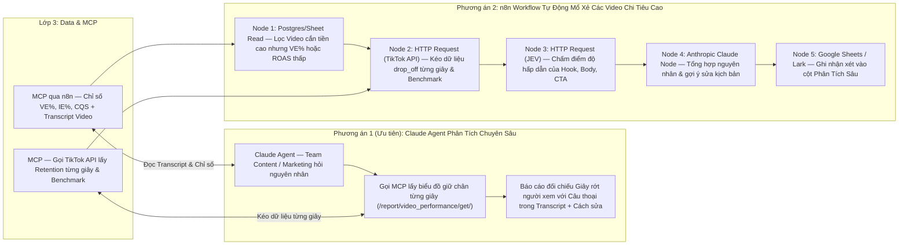

#### ▸ [Mục 2.B.2] Phương Án 1 (Ưu Tiên): Triển Khai Bằng Claude Agent (Của Ví Dụ 2.B)

- **Danh sách các `MCP Tools` mà Claude gọi:**
  1. `mcp_data_get_video_transcript_and_metrics(video_id / testing_angle)`:
     - Lấy toàn văn lời thoại (`Transcript`), `Hướng thử nghiệm` và bộ chỉ số `VE%`, `IE%`, `PE%`, `CQS` từ `Data`.
  2. `mcp_tiktok_get_second_by_second_retention(ad_id / item_id)`:
     - Gọi qua `MCP` lên TikTok Business API (`/report/video_performance/get/`) lấy mảng tỷ lệ giữ chân ở giây thứ 1, 2, 3... đến hết video.
  3. `mcp_tiktok_get_industry_benchmark(ad_id)`:
     - Lấy điểm chuẩn trung bình ngành từ `/report/ad_benchmark/get/`.
- **Kết quả đầu ra:**
  - Claude chỉ ra chính xác: *"Video rớt 45% người xem ở giây thứ 3–5 khi nhân vật đang nói câu X, cao hơn mức rớt trung bình ngành 18%"* và viết lại 3 phương án sửa câu Hook.

#### ▸ [Mục 2.B.3] Phương Án 2: Triển Khai Bằng n8n Workflow + JEV + Claude (Của Ví Dụ 2.B)

- **Chuỗi 5 Node cụ thể trong `n8n`:**
  1. **`Node 1 — Postgres / Sheet Filter`:** Lọc các video đã tiêu tiền quảng cáo vượt ngưỡng nhưng `VE%` hoặc `ROAS` thấp.
  2. **`Node 2 — HTTP Request (TikTok Video Performance API)`:** Kéo dữ liệu giữ chân từng giây và điểm chuẩn ngành.
  3. **`Node 3 — HTTP Request (JEV /v1/systemone)`:** Chấm điểm từng phần của kịch bản (`Hook`, `Body`, `CTA`).
  4. **`Node 4 — Anthropic Claude Node`:** Viết chẩn đoán chi tiết điểm gãy của video.
  5. **`Node 5 — Google Sheets Update`:** Điền thẳng nhận xét vào cột *"Phân tích sâu"* trên bảng theo dõi của team Content.

---

<a id="vd-2c"></a>
### 📌 Ví Dụ 2.C (Thuộc Khối 2): Agent Phân Tích Nguyên Nhân Hoàn Hàng, Lỗi Kỹ Thuật Sản Phẩm & Đánh Giá 1–3 Sao

> **Bài toán giải quyết:** Bóc tách định lượng xem khách trả hàng / đánh giá 1–3 sao cho các mã mic `S24`, `S25`, `G1` là do **lỗi phần cứng thực sự** hay do **khách mua nhầm chân cắm / không biết cách sử dụng**.

#### ▸ [Mục 2.C.1] Sơ Đồ Luồng Hoạt Động (Của Ví Dụ 2.C)

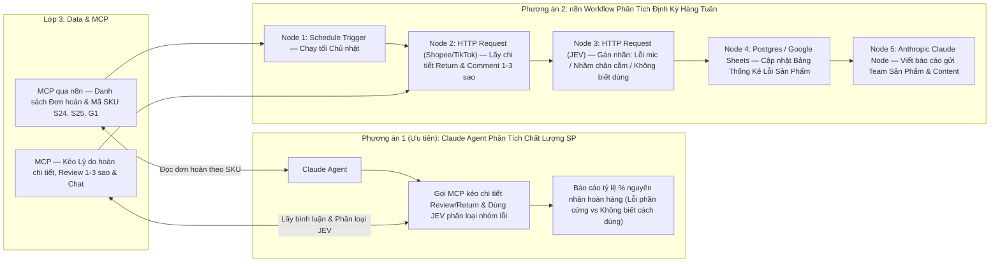

#### ▸ [Mục 2.C.2] Phương Án 1 (Ưu Tiên): Triển Khai Bằng Claude Agent (Của Ví Dụ 2.C)

- **Danh sách các `MCP Tools` mà Claude gọi:**
  1. `mcp_shop_fetch_returns_and_negative_reviews(product_code, date_range)`:
     - Gọi `MCP` lấy toàn bộ văn bản khiếu nại hoàn tiền và đánh giá 1–3 sao từ Shopee (`get_return_detail`, `get_comment`) và TikTok Shop.
  2. `mcp_jev_classify_product_issues(items_list)`:
     - Dùng **JEV** phân loại từng ca vào 4 nhóm nguyên nhân:
       - *(1) Lỗi phần cứng (hỏng thu âm, lỗi mạch, chai pin)*
       - *(2) Khách mua nhầm phân loại chân cắm (Type-C / Lightning)*
       - *(3) Khách không biết cách kết nối hoặc bật chế độ khử ồn*
       - *(4) Lỗi vận chuyển / đóng gói thiếu phụ kiện*
- **Kết quả đầu ra:**
  - Báo cáo định lượng chính xác tỷ lệ `%` từng nguyên nhân hoàn hàng theo từng mã `S24`, `S25`, `G1`, giúp team Content biết cần làm ngay video hướng dẫn gì và team Shop biết cần sửa ảnh phân loại hàng ra sao.

#### ▸ [Mục 2.C.3] Phương Án 2: Triển Khai Bằng n8n Workflow + JEV + Claude (Của Ví Dụ 2.C)

- **Chuỗi 5 Node cụ thể trong `n8n`:**
  1. **`Node 1 — Schedule Trigger`:** Chạy định kỳ vào tối Chủ nhật hàng tuần.
  2. **`Node 2 — HTTP Request (Shopee & TikTok Return / Comment API)`:** Kéo toàn bộ lý do hoàn và đánh giá 1–3 sao trong tuần.
  3. **`Node 3 — HTTP Request (JEV /v1/systemone)`:** Phân loại nhóm nguyên nhân bằng primitive `choice` và chấm mức độ nghiêm trọng bằng `score`.
  4. **`Node 4 — Postgres / Google Sheets Update`:** Lưu vào bảng thống kê chất lượng sản phẩm.
  5. **`Node 5 — Anthropic Claude Node -> Lark / Telegram`:** Viết báo cáo tổng hợp gửi bộ phận R&D/Sản phẩm, CSKH và Content.

---
---

<a id="phan-4-3"></a>
## ⚙️ 4.3. KHỐI 3: AGENT / WORKFLOW TỰ ĐỘNG CHUNG

> **Luồng kết nối trên sơ đồ:** Kết nối đồng thời vào **`MCP qua n8n`** (để đọc dữ liệu đầu vào và cập nhật trạng thái vào bảng `Data`) và **`MCP`** (để thực thi các lệnh Write / Action có phân quyền lên hệ thống API).  
>
> **Mục tiêu cốt lõi:** Tự động hóa các quy trình vận hành xương sống chạy chung cho toàn công ty (**Content, Marketing Ads, Vận hành Sàn, Livestream Ads**). Mọi tác vụ thực thi đều bắt buộc đi qua **`MCP`** trên `n8n` (Agent không bao giờ gọi trực tiếp vào API gốc của sàn/ads) và tận dụng **[`JEV`](./JEV/README.md)** để ra quyết định nhanh, chính xác trước khi thực thi.

### Tổng Quan 4 Luồng Tự Động Hóa Chủ Lực Trong Khối 3 (`Agent / Workflow Tự Động Chung`)

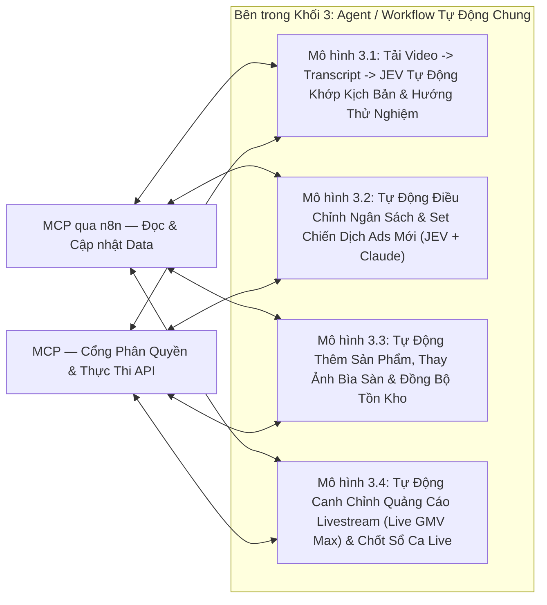

- **Mô hình 3.1 — Tự động tải Video $\rightarrow$ Transcript $\rightarrow$ JEV khớp Kịch bản / Hướng thử nghiệm vào bảng Data:**
  - Phát hiện video mới đăng trên kênh TikTok / chiến dịch Ads $\rightarrow$ Tải luồng âm thanh vào thư mục tạm `/tmp` trên `n8n` $\rightarrow$ Chuyển giọng nói thành văn bản (**Transcript**) và **xóa ngay file video tạm** $\rightarrow$ Đưa `Transcript` vào **`JEV`** để tự động nhận diện video thuộc **Kịch bản nào**, **Hướng thử nghiệm nào** (`S24-1000 chất lượng 10000`, `Sự tiện lợi`, `G1 - Before/After`...) và điền thẳng vào bảng `Data`.

- **Mô hình 3.2 — Tự động điều chỉnh ngân sách & Set chiến dịch Ads mới (`Smart Ads Automation`):**
  - Đọc chỉ số hiệu suất từ `MCP qua n8n` $\rightarrow$ Dùng **`JEV`** hoặc **Claude Agent** đánh giá sức khỏe từng nhóm quảng cáo theo bộ quy tắc (`ROAS`, `CPA`, `CQS`, `VE%`, tốc độ cắn tiền) $\rightarrow$ Gọi `MCP Ads` tự động tắt nhóm lỗ, tăng ngân sách nhóm đang thắng hoặc tự động lên chiến dịch mới từ mã `Spark Ads Code`.

- **Mô hình 3.3 — Tự động thêm sản phẩm mới, thay ảnh bìa sàn & đồng bộ tồn kho đa sàn:**
  - Đọc thông tin sản phẩm gốc và kho ảnh từ `MCP qua n8n`, sau đó gọi `MCP Shop` để tự động tải ảnh lên CDN các sàn, đăng/cập nhật thông tin sản phẩm đồng loạt và đồng bộ tồn kho SKU theo thời gian thực.

- **Mô hình 3.4 — Tự động canh chỉnh Quảng cáo Livestream (`Live GMV Max`) theo sức mua phòng Live & Chốt sổ ca Live:**
  - Do tại công ty **Host tự vận hành phiên Live và tự ấp giỏ hàng**, hệ thống tự động theo dõi sức mua của phòng Live mỗi 10–15 phút (`concurrent_users`, `product_clicks`, `order_count`, `gmv`) đối chiếu với tốc độ tiêu tiền và ROI của chiến dịch `LIVE_GMV_MAX` $\rightarrow$ Dùng **`JEV`** quyết định tăng ngân sách khi phòng Live đang nổ đơn tốt hoặc giảm ngân sách khi phòng "lạnh", và tự động tắt camp + xuất báo cáo chốt sổ ca ngay khi Host tắt sóng (`ENDED`).

---

<a id="vd-3a"></a>
### 📌 Ví Dụ 3.A (Thuộc Khối 3): Luồng Tự Động Tải Video $\rightarrow$ Transcript $\rightarrow$ JEV Khớp Kịch Bản & Hướng Thử Nghiệm

> **Bài toán giải quyết:** Xóa bỏ hoàn toàn công việc gán tay từng `Link Video` và `ID` với `Hướng thử nghiệm` / `Tên kịch bản` trên Google Sheets của nhân sự Content, đồng thời không làm đầy ổ cứng máy chủ nhờ cơ chế xóa file tạm ngay sau khi lấy xong Transcript.

#### ▸ [Mục 3.A.1] Sơ Đồ Luồng Hoạt Động (Của Ví Dụ 3.A)

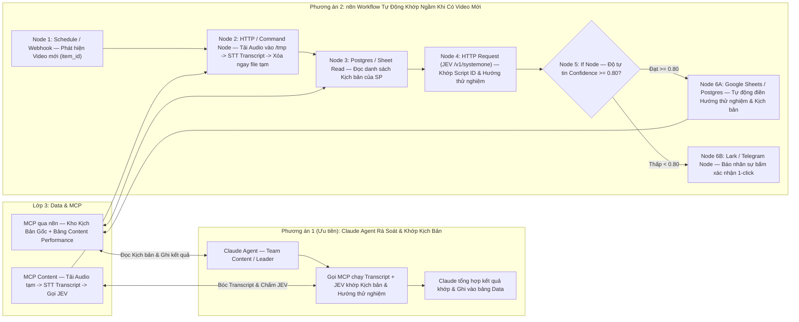

#### ▸ [Mục 3.A.2] Bộ Câu Hỏi Truyền Vào `JEV (/v1/systemone)` Để Khớp Kịch Bản (Của Ví Dụ 3.A)

- **`matched_script_id` (`choice` kèm `confidence`):** Chọn chính xác mã kịch bản trong kho kịch bản đang chạy của sản phẩm (`S24`, `S25`, `G1`) khớp với nội dung `Transcript`.
- **`testing_angle` (`choice`):** Xác định video thuộc **Hướng thử nghiệm** nào (`S24-1000 chất lượng 10000`, `Nâng hạng content`, `Sự tiện lợi`, `G1 - Before/After`...).
- **`script_compliance_score` (`score` thang 1–4):** Chấm điểm mức độ video thực tế tuân thủ đúng Hook 3s đầu và các luận điểm bán hàng (USP) trong kịch bản gốc.

#### ▸ [Mục 3.A.3] Phương Án 1 (Ưu Tiên): Triển Khai Bằng Claude Agent (Của Ví Dụ 3.A)

- **Danh sách các `MCP Tools` mà Claude gọi:**
  1. `mcp_data_get_script_library(product_code, stage)`: Lấy danh sách kịch bản gốc và các hướng thử nghiệm theo giai đoạn chiến lược.
  2. `mcp_content_transcribe_and_match_video(video_url / item_id)`: Gọi `MCP` tải âm thanh tạm thời vào `/tmp`, chuyển thành `Transcript`, xóa file tạm và chạy **JEV** trả về kịch bản khớp nhất kèm độ tự tin `confidence`.
  3. `mcp_data_confirm_video_script_match(item_id, script_id, testing_angle)`: Ghi kết quả đã khớp vào bảng `Data` để nối tự động với các chỉ số `VE%`, `IE%`, `PE%`, `CQS`.

#### ▸ [Mục 3.A.4] Phương Án 2: Triển Khai Bằng n8n Workflow + STT + JEV (Của Ví Dụ 3.A)

- **Chuỗi 7 Node cụ thể trong `n8n`:**
  1. **`Node 1 — Schedule / Webhook Trigger`:** Quét danh sách video mới từ `/identity/video/get/` hoặc `/report/integrated/get/`.
  2. **`Node 2 — Execute Command / HTTP Node (Ephemeral STT)`:** Tải audio vào `/tmp` $\rightarrow$ Chạy Speech-to-Text lấy `Transcript` $\rightarrow$ Xóa ngay file trong `/tmp`.
  3. **`Node 3 — Postgres / Google Sheets Read`:** Lấy danh sách kịch bản đang active của sản phẩm đó.
  4. **`Node 4 — HTTP Request (JEV /v1/systemone)`:** Đối chiếu `Transcript` với kho kịch bản trong `< 300ms`.
  5. **`Node 5 — If Node`:** Kiểm tra ngưỡng tin cậy `confidence >= 0.80`.
  6. **`Node 6A — Google Sheets / Postgres Update`:** Nếu `confidence >= 0.80`, tự động điền luôn `Hướng thử nghiệm`, `Mã kịch bản` và `Nhân sự` vào bảng.
  7. **`Node 6B — Lark / Telegram Node`:** Nếu `confidence < 0.80` (do người quay biến tấu lời thoại nhiều), gửi tin nhắn kèm dự đoán của JEV để nhân sự Content bấm xác nhận 1-click.

---

<a id="vd-3b"></a>
### 📌 Ví Dụ 3.B (Thuộc Khối 3): Agent Tự Động Điều Chỉnh Ngân Sách & Set Chiến Dịch Ads Mới (Smart Ads Controller)

> **Bài toán giải quyết:** Tự động canh gác hàng trăm nhóm quảng cáo trên TikTok, Facebook, Shopee 24/7 để cắt lỗ kịp thời, tăng ngân sách các nhóm đang thắng và tự động lên camp mới từ các video có `VE%` cao hoặc mã `Spark Ads` của KOC.

#### ▸ [Mục 3.B.1] Sơ Đồ Luồng Hoạt Động (Của Ví Dụ 3.B)

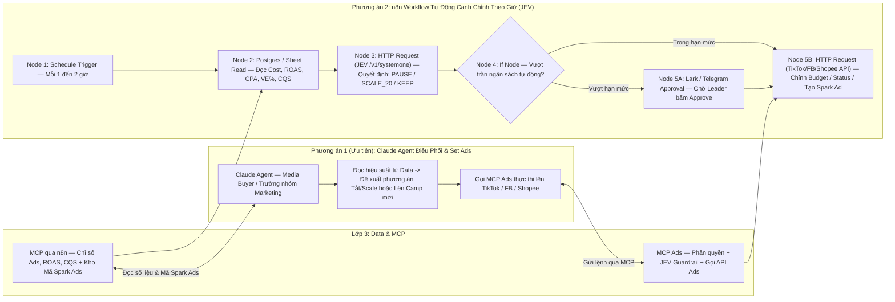

#### ▸ [Mục 3.B.2] Phương Án 1 (Ưu Tiên): Triển Khai Bằng Claude Agent (Của Ví Dụ 3.B)

- **Danh sách các `MCP Tools` trên `MCP Ads` mà Claude gọi:**
  1. `mcp_data_get_underperforming_and_winning_ads(channel, roas_threshold)`:
     - Lấy danh sách các nhóm quảng cáo đang lỗ cần cắt và các nhóm đang thắng cần tăng ngân sách.
  2. `mcp_ads_update_status_and_budget(channel, adgroup_ids, action, new_budget)`:
     - Thực thi bật/tắt hoặc tăng/giảm ngân sách (có chốt chặn Guardrail trên `n8n` không cho phép tăng quá `%` quy định).
  3. `mcp_ads_create_campaign_from_spark_code(advertiser_id, spark_auth_code, product_code, budget)`:
     - Tự động gọi `/tt_video/authorize/` nạp mã video của KOC và khởi tạo luôn `Campaign` + `AdGroup` + `Ad` theo cấu hình mẫu.

#### ▸ [Mục 3.B.3] Phương Án 2: Triển Khai Bằng n8n Workflow + JEV (Của Ví Dụ 3.B)

- **Chuỗi 6 Node cụ thể trong `n8n`:**
  1. **`Node 1 — Schedule Trigger`:** Chạy mỗi `60 phút` một lần.
  2. **`Node 2 — Postgres / Google Sheets Read`:** Đọc chỉ số thời gian thực của các chiến dịch đang `ACTIVE`.
  3. **`Node 3 — HTTP Request (JEV /v1/systemone)`:** Truyền trạng thái camp để **JEV** trả về quyết định kiểu `choice` (`PAUSE_LOSS`, `SCALE_BUDGET`, `KEEP_MONITORING`) kèm `confidence`.
  4. **`Node 4 — If Node (Safety Guardrail)`:** Nếu là lệnh tắt camp lỗ hoặc tăng ngân sách nhỏ trong hạn mức $\rightarrow$ Chạy thẳng; nếu tăng ngân sách lớn $\rightarrow$ Đi qua node chờ phê duyệt.
  5. **`Node 5 — HTTP Request (TikTok / Meta / Shopee Ads API)`:** Gọi API cập nhật trạng thái và ngân sách.
  6. **`Node 6 — Postgres / Sheets Log`:** Ghi lịch sử thao tác vào bảng `Audit Log`.

---

<a id="vd-3c"></a>
### 📌 Ví Dụ 3.C (Thuộc Khối 3): Agent Tự Động Thêm Sản Phẩm, Thay Ảnh Bìa Sàn (Test CTR) & Đồng Bộ Tồn Kho Đa Sàn

> **Bài toán giải quyết:** Chuẩn bị nội dung sản phẩm 1 lần duy nhất và đẩy đồng loạt lên TikTok Shop, Shopee, Facebook Catalog; tự động thay ảnh bìa (Thumbnail) để test CTR và giữ tồn kho SKU khớp nhau theo thời gian thực.

#### ▸ [Mục 3.C.1] Sơ Đồ Luồng Hoạt Động (Của Ví Dụ 3.C)

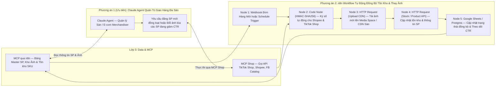

#### ▸ [Mục 3.C.2] Phương Án 1 (Ưu Tiên): Triển Khai Bằng Claude Agent (Của Ví Dụ 3.C)

- **Danh sách các `MCP Tools` trên `MCP Shop` mà Claude gọi:**
  1. `mcp_shop_publish_new_product(internal_sku, target_platforms)`:
     - Đọc thông tin chuẩn từ bảng Master Sản phẩm, tự động chuẩn hóa thuộc tính theo từng sàn và đăng đồng loạt lên TikTok Shop (`/product/202309/products`), Shopee (`add_item`) và Facebook Catalog.
  2. `mcp_shop_update_product_thumbnail(product_code, platform, new_image_url)`:
     - Tự động tải ảnh lên CDN của sàn và thay ảnh đại diện mới cho sản phẩm để test tỷ lệ click (`CTR`).
  3. `mcp_shop_sync_sku_inventory(product_code, available_stock)`:
     - Cập nhật tồn kho đồng bộ trên tất cả các gian hàng.

#### ▸ [Mục 3.C.3] Phương Án 2: Triển Khai Bằng n8n Workflow Tự Động (Của Ví Dụ 3.C)

- **Chuỗi 5 Node cụ thể trong `n8n`:**
  1. **`Node 1 — Webhook Trigger`:** Nhận sự kiện `ORDER_STATUS_CHANGE` từ sàn hoặc khi thêm dòng sản phẩm mới vào bảng Master SP.
  2. **`Node 2 — Code Node (HMAC-SHA256)`:** Chạy thuật toán ký số bảo mật cho TikTok Shop và Shopee.
  3. **`Node 3 — HTTP Request (Media Upload)`:** Gọi `/product/202309/images/upload` (TikTok) và `/api/v2/media_space/upload_image` (Shopee).
  4. **`Node 4 — HTTP Request (Product / Stock Update)`:** Gọi API cập nhật sản phẩm và tồn kho khả dụng.
  5. **`Node 5 — Google Sheets / Postgres Update`:** Lưu mã `platform_item_id` và nhật ký thay đổi ảnh để đo lường CTR trước/sau khi thay.

---

<a id="vd-3d"></a>
### 📌 Ví Dụ 3.D (Thuộc Khối 3): Agent Tự Động Canh Chỉnh Quảng Cáo Livestream (`Live GMV Max`) Theo Sức Mua Phòng Live & Chốt Sổ Ca Live

> **Bối cảnh thực tế tại công ty:** Khi lên sóng Livestream, **Host tự vận hành phiên Live và tự ấp/ghim giỏ hàng**, không có nhân sự vận hành ngồi kèm để canh tiền quảng cáo hay cộng sổ. Do đó, Agent không can thiệp vào thao tác ghim giỏ hàng của Host mà tập trung giải quyết trọn vẹn **2 bài toán:**
> 1. **Canh chỉnh ngân sách Quảng cáo Live (`Live GMV Max` / `Shopee Live Ads`)** theo sức mua thực tế của phòng Live mỗi 10–15 phút.
> 2. **Tự động đóng camp + xuất Báo cáo chốt sổ ca Live (Doanh thu - Chi phí Ads - ROI)** ngay khi Host tắt sóng.

#### ▸ [Mục 3.D.1] Sơ Đồ Luồng Hoạt Động (Của Ví Dụ 3.D)

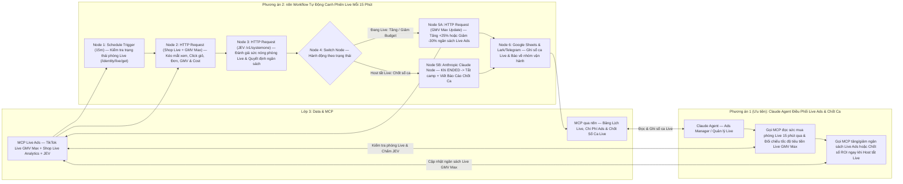

#### ▸ [Mục 3.D.2] Bộ Quy Tắc `JEV (/v1/systemone)` Đánh Giá Sức Mua Phòng Live Mỗi 15 Phút (Của Ví Dụ 3.D)

- **Dữ liệu đầu vào (`state`) lấy mỗi 15 phút khi `live_status = LIVE`:**
  - *Chỉ số phòng Live* (từ TikTok Shop `/analytics/202510/shop_lives/{live_id}/performance_per_minutes` hoặc Shopee `/api/v2/livestream/get_session_metric`): `concurrent_users` (mắt xem đồng thời), `product_clicks` (lượt bấm vào giỏ hàng), `order_count` (số đơn nổ trong 15 phút qua), `gmv` (doanh thu phiên).
  - *Chỉ số quảng cáo* (từ TikTok Business `/open_api/v1.3/gmv_max/report/get/?report_type=LIVE_GMV_MAX&metric_level=LIVESTREAM`): `stat_cost` (tiền Ads đã tiêu), `roi` (hiệu quả chi phí thực tế), `cost_per_order` (chi phí Ads trên mỗi đơn trong phiên).
- **Câu hỏi JEV đánh giá (`< 300ms`):**
  - **`live_room_momentum` (`score` thang 1–4):** Sức mua thực tế của phòng Live trong 15 phút vừa qua (`4` = Đang bùng nổ đơn & click giỏ hàng cao; `1` = Phòng lạnh, cắn tiền Ads nhưng khách không bấm giỏ hàng).
  - **`live_ads_action` (`choice`):**
    1. `SCALE_UP_BUDGET`: Khi `live_room_momentum >= 3.2` và `roi >= ROI mục tiêu` $\rightarrow$ Tự động bơm thêm ngân sách (`+20%` đến `+30%`) để đẩy thêm lưu lượng khách vào phòng lúc Host đang chốt tốt.
    2. `HOLD_CURRENT`: Khi các chỉ số ổn định trong ngưỡng KPI.
    3. `THROTTLE_DOWN_BUDGET`: Khi tiền quảng cáo cắn nhanh nhưng `product_clicks` và `order_count` trong 15 phút qua tụt thấp $\rightarrow$ Tự động kéo giảm ngân sách để bảo vệ tiền quảng cáo cho đến khi phòng Live ấm lại.
    4. `CLOSE_SHIFT_AND_REPORT`: Khi phát hiện `live_status = ENDED` (Host đã kết thúc phiên Live) $\rightarrow$ Đóng ngân sách chiến dịch và kích hoạt luồng chốt sổ ca Live.

#### ▸ [Mục 3.D.3] Phương Án 1 (Ưu Tiên): Triển Khai Bằng Claude Agent (Của Ví Dụ 3.D)

- **Danh sách các `MCP Tools` trên `MCP Live Ads` & `MCP qua n8n` mà Claude gọi:**
  1. `mcp_live_get_realtime_room_and_ads_metrics(room_id)`:
     - Gọi đồng thời API TikTok Shop Live (`/performance_per_minutes`) và TikTok Business (`LIVE_GMV_MAX`) để trả về bức tranh tức thì của phiên Live: mắt xem, lượt bấm giỏ, số đơn, GMV, tiền Ads đã tiêu và ROI.
  2. `mcp_live_evaluate_and_adjust_gmv_max(campaign_id, room_id, budget_action)`:
     - Chạy **JEV** kiểm tra điều kiện an toàn và cập nhật ngân sách/mục tiêu ROI của chiến dịch `Live GMV Max` (có trần ngân sách tối đa theo ca).
  3. `mcp_live_generate_shift_settlement_report(live_id, host_name)`:
     - Khi ca Live kết thúc, tự động lấy bảng xếp hạng sản phẩm bán chạy nhất trong phiên (`/products_performance`), ghép với tổng chi phí Ads của khung giờ đó, ghi vào bảng `Data` và xuất phiếu chốt sổ ca Live.

#### ▸ [Mục 3.D.4] Phương Án 2: Triển Khai Bằng n8n Workflow + JEV + Claude (Của Ví Dụ 3.D)

- **Chuỗi 6 Node cụ thể trong `n8n`:**
  1. **`Node 1 — Schedule Trigger (15m)`:** Quét `/open_api/v1.3/identity/live/get/` kiểm tra kênh có đang phát Live không.
  2. **`Node 2 — HTTP Request (Shop Live + Live GMV Max)`:** Kéo chỉ số phòng Live theo từng phút (`performance_per_minutes`) và báo cáo chi phí `LIVE_GMV_MAX`.
  3. **`Node 3 — HTTP Request (JEV /v1/systemone)`:** Chấm điểm `live_room_momentum` và chọn `live_ads_action`.
  4. **`Node 4 — Switch Node`:** Phân nhánh theo trạng thái (`Đang Live` hay `Vừa tắt Live`).
  5. **`Node 5 — HTTP Request (Update Live GMV Max) / Anthropic Claude Node`:** Tự động tăng/hãm ngân sách theo quyết định của JEV; hoặc nếu phiên Live vừa kết thúc (`ENDED`) thì gọi Claude tổng hợp **Báo cáo chốt sổ ca Live**.
  6. **`Node 6 — Google Sheets / Postgres & Lark / Telegram`:** Ghi nhận doanh thu - chi phí Ads - ROI của ca Live vào bảng `Data` và gửi tin nhắn tổng kết ca cho Host & Quản lý.

---
---

<a id="phan-4-4"></a>
## 🧑‍💻 4.4. KHỐI 4: AGENT CỦA NHÂN SỰ TỰ BUILD

> **Luồng kết nối trên sơ đồ:** Kết nối vào **`MCP qua n8n`** (để đọc/ghi dữ liệu của bộ phận) và **`MCP`** (để gọi các công cụ chấm điểm `JEV`, tra cứu API) theo **cơ chế phân quyền cá nhân / phòng ban (Role-Based Access Control)**.  
>
> **Mục tiêu cốt lõi:** Khác với Khối 3 (các luồng chạy tự động hoàn toàn ở quy mô công ty), **Khối 4** là các **Agent / Workflow trợ lý chuyên biệt gắn liền với thao tác nghiệp vụ của từng nhân sự** — nơi Agent hỗ trợ chấm điểm, rà soát chất lượng hoặc săn tìm/lọc danh sách, còn nhân sự giữ quyền chủ động sáng tạo và liên hệ theo nghiệp vụ riêng.

### Tổng Quan 3 Mô Hình Trợ Lý Nghiệp Vụ Trong Khối 4 (`Agent Của Nhân Sự Tự Build`)

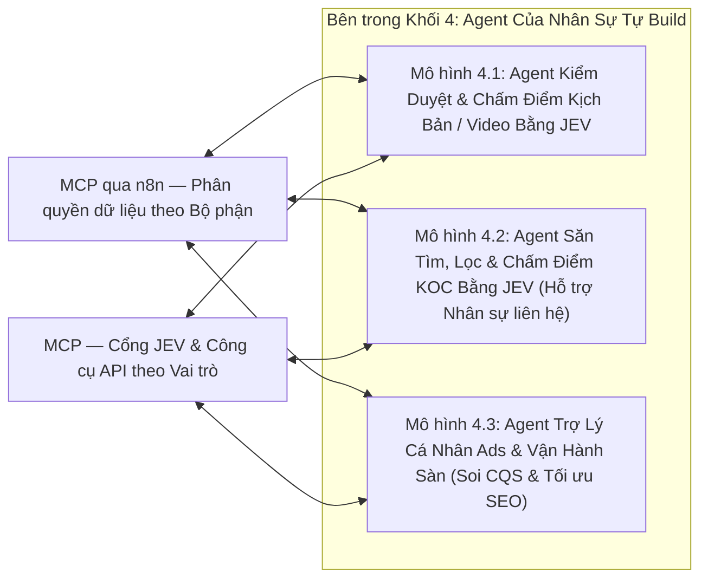

- **Mô hình 4.1 — Agent / Workflow Kiểm duyệt & Chấm điểm Kịch bản / Video (In-house & KOC) bằng JEV theo chiến lược thử nghiệm:**
  - Đội ngũ Content dùng để **kiểm tra chất lượng kịch bản nháp trước khi bấm máy quay** cũng như **kiểm duyệt video thành phẩm (của cả team In-house và KOC gửi về)** xem đã bám sát mục tiêu chiến lược và đúng **Hướng thử nghiệm** của từng giai đoạn sản phẩm (`S24`, `S25`, `G1`) hay chưa.

- **Mô hình 4.2 — Agent / Workflow Hỗ trợ Tìm kiếm, Sàng lọc & Chấm điểm KOC bằng JEV (Để nhân sự chủ động liên hệ theo nghiệp vụ):**
  - Trong mảng KOC, việc liên hệ, đàm phán giá/hoa hồng và giữ mối quan hệ với KOC mang tính linh hoạt cao tùy theo từng KOC (nhắn qua Zalo, TikTok DM, Email hoặc gửi lời mời trên sàn). Agent đóng vai trò **Trợ lý Tìm kiếm & Chấm điểm (Discovery & Scoring Support)**: tự động quét kênh, kéo chỉ số và dùng **`JEV`** chấm điểm phân hạng (`Tier S/A/B/C`, độ hợp ngành công nghệ) để nhân sự chủ động liên hệ theo cách riêng.

- **Mô hình 4.3 — Agent Cá nhân của Nhân sự Ads & Vận hành Gian hàng:**
  - Mỗi nhân viên chạy Ads hoặc vận hành sàn tự tạo một Claude Project hoặc workflow nhỏ nối vào `MCP qua n8n` (chỉ mở quyền đúng mảng của mình) để tra cứu nhanh top kịch bản đang thắng, đối chiếu điểm `CQS` và tối ưu tiêu đề SEO sản phẩm.

---

<a id="vd-4a"></a>
### 📌 Ví Dụ 4.A (Thuộc Khối 4): Workflow / Agent Kiểm Duyệt & Chấm Điểm Kịch Bản / Video (In-house & KOC) Bằng JEV Theo Chiến Lược Thử Nghiệm

> **Ứng dụng trực tiếp mẫu đánh giá đa chiều của `JEV` ([Mục 5.5](#phan-5-5) & [`Cookbook 6`](./JEV/docs/05_cookbooks_and_patterns.md)):** Thay vì dùng LLM thông thường chấm điểm cảm tính (lúc cho 8 điểm, lúc cho 6 điểm và tốn nhiều token), workflow này truyền kịch bản/transcript cùng **Mục tiêu giai đoạn thử nghiệm** vào **`JEV (/v1/systemone)`** để chấm đồng thời bằng cả 3 kiểu nguyên thủy (`choice`, `score`, `noul`) trong `< 300ms` với `$0` output token.

#### ▸ [Mục 4.A.1] Sơ Đồ Luồng Hoạt Động (Của Ví Dụ 4.A)

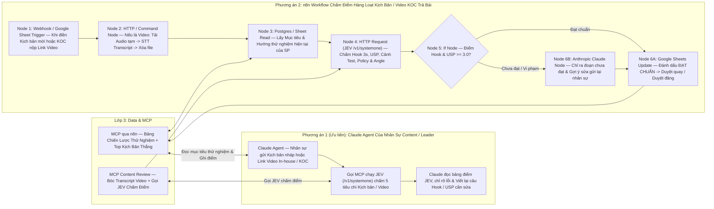

#### ▸ [Mục 4.A.2] Mẫu Cấu Hình JSON Thực Tế Gọi `JEV (/v1/systemone)` Để Chấm Điểm Kịch Bản / Video (Của Ví Dụ 4.A)

Dưới đây là cấu trúc payload gửi trực tiếp từ node `HTTP Request` của `n8n` (hoặc bên trong MCP Tool) tới `POST https://api.typesafe.ai/v1/systemone`:

```json
{
  "model": "jev-latest",
  "state": {
    "product_code": "S24",
    "current_testing_stage": "Giai đoạn 2: Tập trung chứng minh chất lượng thu âm vượt tầm giá và khả năng lọc ồn thực tế ngoài đường",
    "target_angles": [
      "S24-1000 chất lượng 10000",
      "Sự tiện lợi (Cắm là chạy, nhỏ gọn)",
      "Test khử ồn thực chiến ngoài trời / quán cafe"
    ],
    "submission_type": "VIDEO_TRANSCRIPT_OR_DRAFT_SCRIPT",
    "content_text": "0-3s: Mọi người đừng mua mic thu âm tiền triệu nữa nếu chưa nghe thử con GoChek S24 này ở ngay ngã tư đường! 3-15s: Hiện tại mình đang đứng cạnh bến xe cực ồn, bây giờ mình bật chế độ lọc ồn ENC trên mic S24 lên nhé... Đấy, tiếng còi xe biến mất hoàn toàn mà giọng vẫn ấm, không bị méo tiếng..."
  },
  "questions": {
    "matched_trial_angle": {
      "type": "choice",
      "instructions": "Kịch bản/video này đang triển khai theo hướng thử nghiệm (Testing Angle) nào của sản phẩm?",
      "criteria": {
        "s24_1000_quality_10000": "S24-1000 chất lượng 10000: So sánh mức giá rẻ nhưng chất lượng âm thanh ngang ngửa mic đắt tiền",
        "convenience": "Sự tiện lợi: Nhấn mạnh thao tác cắm nhận ngay, thiết kế nhỏ gọn, pin trâu",
        "real_world_noise_test": "Test khử ồn thực chiến: Trực tiếp thử nghiệm bật/tắt lọc ồn ở môi trường nhiều tạp âm",
        "off_strategy": "Lạc đề: Không bám sát bất kỳ hướng thử nghiệm nào trong chiến lược hiện tại"
      }
    },
    "hook_3s_score": {
      "type": "score",
      "instructions": "Chấm điểm sức hút của câu Hook mở đầu (3 giây đầu tiên):",
      "criteria": [
        "Mức 1 (Yếu): Mở đầu dài dòng, chào hỏi chung chung, không nêu được vấn đề hoặc sự tò mò",
        "Mức 2 (Trung bình): Có nhắc đến sản phẩm nhưng cách dẫn dắt bình thường, dễ bị lướt qua",
        "Mức 3 (Tốt): Đánh trúng nỗi đau người xem hoặc có câu so sánh/thử thách trực diện ngay đầu video",
        "Mức 4 (Xuất sắc): Hook cực mạnh, kết hợp bối cảnh đối lập hoặc kết quả gây bất ngờ giữ chân người xem ngay lập tức"
      ]
    },
    "usp_and_stage_score": {
      "type": "score",
      "instructions": "Mức độ bám sát mục tiêu giai đoạn thử nghiệm ('current_testing_stage') và truyền tải đúng USP sản phẩm:",
      "criteria": [
        "Mức 1: Sai lệch hoàn toàn so với định hướng giai đoạn thử nghiệm",
        "Mức 2: Có nhắc tên tính năng nhưng chỉ đọc thông số khô khan, thiếu thuyết phục",
        "Mức 3: Truyền tải đúng trọng tâm hướng thử nghiệm và nêu rõ lợi ích thực tế cho người dùng",
        "Mức 4: Thể hiện xuất sắc cả USP lẫn bằng chứng thực nghiệm đúng tinh thần giai đoạn test"
      ]
    },
    "has_before_after_demo": {
      "type": "noul",
      "instructions": "Nội dung kịch bản/video có đoạn đối chiếu thực tế trước và sau khi bật mic (hoặc bật/tắt chế độ lọc ồn) để người xem kiểm chứng ngay không?"
    },
    "policy_violation_risk": {
      "type": "noul",
      "instructions": "Nội dung có chứa các từ ngữ cam kết tuyệt đối sai sự thật, công kích đối thủ trực diện hoặc vi phạm chính sách quảng cáo TikTok Shop / Shopee không?"
    }
  }
}
```

#### ▸ [Mục 4.A.3] Phương Án 1 (Ưu Tiên): Triển Khai Bằng Claude Agent (Của Ví Dụ 4.A)

- **Người sử dụng:** Nhân sự Content hoặc Trưởng nhóm dùng trực tiếp trong lúc viết kịch bản và duyệt video trả bài.
- **Danh sách các `MCP Tools` trên `MCP Content Review` & `MCP qua n8n` mà Claude gọi:**
  1. `mcp_content_get_stage_strategy_and_winning_scripts(product_code)`:
     - Lấy định hướng thử nghiệm hiện tại của mã `S24` / `S25` / `G1` cùng 3 kịch bản cũ có `VE%` và `CQS` cao nhất để làm chuẩn tham chiếu.
  2. `mcp_jev_score_script_or_video(product_code, content_or_video_url)`:
     - Nếu là kịch bản chữ thì gửi thẳng vào **JEV**; nếu là link video (In-house hoặc KOC trả bài) thì bóc tách `Transcript` rồi gửi vào **JEV** chấm 5 chỉ số (`matched_trial_angle`, `hook_3s_score`, `usp_and_stage_score`, `has_before_after_demo`, `policy_violation_risk`).
  3. `mcp_data_save_review_result(item_id, scores, status)`:
     - Ghi kết quả chấm điểm vào bảng theo dõi của phòng Content.
- **Kết quả đầu ra:**
  - Nhân sự tự kiểm tra và sửa kịch bản đạt điểm `>= 3.2 / 4.0` ngay trước khi đi quay, không cần chờ họp duyệt.
  - Khi KOC gửi video nháp, chỉ mất 5 giây để biết video KOC có làm đúng Brief hay thiếu đoạn test thu âm để yêu cầu KOC bổ sung ngay.

#### ▸ [Mục 4.A.4] Phương Án 2: Triển Khai Bằng n8n Workflow + JEV + Claude (Của Ví Dụ 4.A)

- **Chuỗi 6 Node cụ thể trong `n8n`:**
  1. **`Node 1 — Google Sheets / Webhook Trigger`:** Kích hoạt khi có dòng kịch bản mới hoặc link video nộp duyệt trên Sheet.
  2. **`Node 2 — HTTP / Command Node`:** Nếu đầu vào là link video thì tải audio vào `/tmp` $\rightarrow$ STT lấy `Transcript` $\rightarrow$ xóa ngay file tạm.
  3. **`Node 3 — Postgres / Google Sheets Read`:** Đọc mục tiêu giai đoạn thử nghiệm hiện tại của sản phẩm.
  4. **`Node 4 — HTTP Request (JEV /v1/systemone)`:** Gửi JSON payload chấm đồng thời 5 tiêu chí trong `< 300ms`.
  5. **`Node 5 — If Node`:** Kiểm tra điều kiện đạt chuẩn (`hook_3s_score >= 3.0`, `usp_and_stage_score >= 3.0` và `policy_violation_risk < 0.20`).
  6. **`Node 6 — Anthropic Claude Node + Google Sheets Update`:** Nếu chưa đạt, gọi Claude viết nhận xét chi tiết câu nào cần sửa và điền thẳng vào cột *"Góp ý sửa bài"* trên Sheet kèm thông báo cho nhân sự.

---

<a id="vd-4b"></a>
### 📌 Ví Dụ 4.B (Thuộc Khối 4): Agent / Workflow Hỗ Trợ Tìm Kiếm, Sàng Lọc & Chấm Điểm KOC Bằng JEV (Để Nhân Sự Chủ Động Liên Hệ Theo Nghiệp Vụ)

> **Đặc thù nghiệp vụ tại Khối 4:** Trong mảng Booking KOC, mỗi KOC có cách thức liên hệ khác nhau (nhắn Zalo qua số điện thoại trên Bio, nhắn TikTok DM, gửi Email hoặc mời qua Affiliate Center). Vì vậy, Agent được thiết kế chuyên biệt để **tự động hóa 100% khâu tìm kiếm, thu thập chỉ số kênh và dùng JEV chấm điểm / phân hạng KOC**, đồng thời chuẩn bị sẵn thông tin tóm tắt & gợi ý mở lời để **nhân sự chủ động liên hệ theo đúng nghiệp vụ riêng**.

#### ▸ [Mục 4.B.1] Sơ Đồ Luồng Hoạt Động (Của Ví Dụ 4.B)

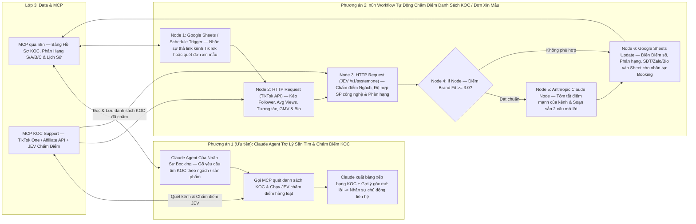

#### ▸ [Mục 4.B.2] Bộ Tiêu Chí Câu Hỏi Truyền Vào `JEV (/v1/systemone)` Để Chấm Điểm & Phân Loại KOC (Của Ví Dụ 4.B)

Với mỗi kênh KOC (kèm tiêu đề 5–10 video gần nhất và Bio của kênh), **JEV** đánh giá đồng thời 4 tiêu chí:
- **`koc_category` (`choice` kèm `confidence`):** Phân loại ngách nội dung chính (*Review Đồ Công Nghệ / Setup góc làm việc*, *Vlog Đời Sống / Sáng Tạo Nội Dung*, *Ca Hát / Âm Nhạc - tệp cực hợp với mic thu âm*, *Giải Trí / Khác*).
- **`brand_fit_score` (`score` thang 1–4):** Mức độ phù hợp của tệp khán giả và phong cách quay của KOC với các dòng mic `S24`, `S25`, `G1`.
- **`conversion_potential` (`score` thang 1–4):** Đánh giá khả năng gắn giỏ hàng ra đơn dựa trên tỷ lệ tương tác thực tế và lịch sử bán hàng Affiliate.
- **`sample_approval_recommendation` (`noul` từ `0.0 -> 1.0`):** Khuyến nghị có nên duyệt gửi hàng mẫu miễn phí cho KOC này hay không.

#### ▸ [Mục 4.B.3] Phương Án 1 (Ưu Tiên): Triển Khai Bằng Claude Agent (Của Ví Dụ 4.B)

- **Danh sách các `MCP Tools` trên `MCP KOC Support` & `MCP qua n8n` mà Claude gọi:**
  1. `mcp_koc_search_and_score_by_jev(keywords, product_code, min_followers)`:
     - Quét danh sách Creator từ `TikTok One API` / `Affiliate API`, chạy **JEV** chấm điểm hàng loạt trong `< 300ms` và lọc ra các KOC đạt điểm cao nhất.
  2. `mcp_koc_evaluate_channel_list(channel_handles, product_code)`:
     - Khi nhân sự có sẵn một danh sách link kênh TikTok vừa tìm được bên ngoài, gửi vào để Agent tự động kéo chỉ số và chấm điểm phân hạng (`Tier S/A/B/C`).
  3. `mcp_koc_draft_personalized_icebreaker(creator_handle, product_code)`:
     - Đọc chủ đề các video gần nhất của KOC để gợi ý 2–3 phương án tin nhắn mở lời tự nhiên (để nhân sự copy gửi qua Zalo / TikTok DM / Email hoặc gửi lời mời trên sàn tùy theo nghiệp vụ).

#### ▸ [Mục 4.B.4] Phương Án 2: Triển Khai Bằng n8n Workflow + JEV + Claude (Của Ví Dụ 4.B)

- **Chuỗi 6 Node cụ thể trong `n8n`:**
  1. **`Node 1 — Google Sheets / Schedule Trigger`:** Nhân sự chỉ cần dán danh sách link/ID kênh TikTok vào cột A trên Sheet (hoặc workflow tự quét đơn xin mẫu mới `/sample_applications/search`).
  2. **`Node 2 — HTTP Request (TikTok API)`:** Tự động kéo lượng Follower, View trung bình 10 video gần nhất, GMV và thông tin liên hệ (SĐT/Zalo/Email) ở phần Bio.
  3. **`Node 3 — HTTP Request (JEV /v1/systemone)`:** Chấm điểm `koc_category`, `brand_fit_score`, `conversion_potential`.
  4. **`Node 4 — If Node`:** Lọc các kênh có `brand_fit_score >= 3.0`.
  5. **`Node 5 — Anthropic Claude Node`:** Viết tóm tắt 2 dòng về phong cách kênh và gợi ý câu mở lời cá nhân hóa.
  6. **`Node 6 — Google Sheets Update`:** Tự động điền đầy đủ Điểm số, Phân hạng, SĐT/Zalo trên Bio và Gợi ý mở lời vào các cột bên cạnh trên Sheet để nhân sự nhìn vào liên hệ ngay.

---

<a id="vd-4c"></a>
### 📌 Ví Dụ 4.C (Thuộc Khối 4): Agent Cá Nhân Của Nhân Sự Ads & Vận Hành Sàn (Soi Nhanh Kịch Bản Thắng & Tối Ưu SEO Gian Hàng)

> **Bài toán giải quyết:** Cung cấp cho mỗi nhân viên chạy Ads hoặc vận hành sàn một trợ lý phân tích riêng gắn chặt với dữ liệu thật của công ty nhưng vẫn nằm trong hàng rào phân quyền an toàn của Lớp 3.

#### ▸ [Mục 4.C.1] Sơ Đồ Luồng Hoạt Động (Của Ví Dụ 4.C)

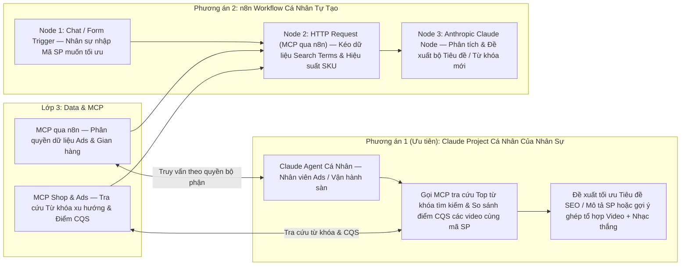

#### ▸ [Mục 4.C.2] Phương Án 1 (Ưu Tiên): Triển Khai Bằng Claude Agent Cá Nhân (Của Ví Dụ 4.C)

- **Danh sách các `MCP Tools` phân quyền cho nhân sự vận hành:**
  1. `mcp_ads_compare_creative_benchmarks(product_code)`:
     - So sánh điểm `CQS`, `VE%`, `IE%` của các video đang chạy với trung bình ngành từ `/report/ad_benchmark/get/`.
  2. `mcp_shop_audit_product_seo(product_code, platform)`:
     - Kiểm tra tiêu đề, mô tả và bộ thuộc tính của sản phẩm trên Shopee / TikTok Shop để gợi ý từ khóa giúp tăng lưu lượng tìm kiếm tự nhiên.

#### ▸ [Mục 4.C.3] Phương Án 2: Triển Khai Bằng n8n Workflow Cá Nhân (Của Ví Dụ 4.C)

- **Chuỗi 3 Node cụ thể trong `n8n`:**
  1. **`Node 1 — Chat / Form Trigger`:** Nhân sự nhập mã sản phẩm muốn kiểm tra.
  2. **`Node 2 — HTTP Request (MCP qua n8n)`:** Kéo dữ liệu từ khóa tìm kiếm và hiệu suất SKU.
  3. **`Node 3 — Anthropic Claude Node`:** Phân tích và đề xuất bộ tiêu đề / từ khóa SEO mới.

---
---

<a id="phan-5"></a>
# 📚 PHẦN 5 (PHỤ LỤC): GIỚI THIỆU CHI TIẾT CÁC BỘ CÔNG CỤ & NỀN TẢNG CỐT LÕI

Phụ lục này tổng hợp chi tiết về **bản chất, cách đăng ký cấp quyền, cơ chế kỹ thuật khi gọi và các bài toán ứng dụng (`Use Cases`)** của toàn bộ **6 thành phần công nghệ cốt lõi** trong kiến trúc hệ thống, bám sát bộ tài liệu nội bộ đã có sẵn trong thư mục dự án.

---

<a id="phan-5-1"></a>
## 5.1. TikTok Business API (`tiktok-business-api`)

> **Tài liệu gốc trong dự án:** [`./tiktok-business-api/README.md`](./tiktok-business-api/README.md) | **Hướng dẫn khởi tạo:** [`./tiktok-business-api/docs/04-get-started/bat-dau.md`](./tiktok-business-api/docs/04-get-started/bat-dau.md) | **Tài liệu MCP Server:** [`./tiktok-business-api/docs/05-mcp-server/mcp-server-tom-tat.md`](./tiktok-business-api/docs/05-mcp-server/mcp-server-tom-tat.md)

### ▸ [5.1.1] Là gì?
- **TikTok API for Business (phiên bản v1.3)** là giao diện lập trình chính thức của TikTok dành cho nhà quảng cáo và doanh nghiệp, bao gồm **16 phân hệ (74 nhóm endpoint kỹ thuật)** và hệ thống **TikTok for Business MCP Server (~400 công cụ)**.
- Công cụ này cho phép tự động hóa hoàn toàn việc quản lý chiến dịch quảng cáo đấu thầu (`Auction`), chiến dịch thương mại điện tử `GMV Max` (cả Video và Livestream), quản trị kho nội dung sáng tạo (`Creatives & Spark Ads`), đo lường sự kiện chuyển đổi (`Events 2.0`) và hợp tác nhà sáng tạo qua `TikTok One API`.

### ▸ [5.1.2] Cách đăng ký & Cấp quyền (Onboarding & OAuth 2.0)
1. **Tạo tài khoản TikTok for Business & Business Center (BC):**
   - Thiết lập tổ chức mẹ nắm giữ các tài khoản quảng cáo (`advertiser_id`), kênh TikTok chính thức (`Identity`) và kho sản phẩm (`Catalog`).
2. **Đăng ký Nhà phát triển (Developer):**
   - Truy cập cổng `https://business-api.tiktok.com/portal`, đăng ký tài khoản Developer và liên kết với Business Center của công ty.
3. **Tạo Ứng dụng (Developer App):**
   - Vào mục **My Apps** tạo ứng dụng mới, chọn các phạm vi quyền hạn (**Permission Scopes**) cần thiết như: *Ads Management*, *Reporting*, *Creative Management*, *Audience Management*, *TikTok One (TTO)* và điền địa chỉ `Redirect URL` (trỏ về webhook của `n8n`). Sau khi duyệt, hệ thống cấp `App ID` và `Secret`.
4. **Ủy quyền Tài khoản Quảng cáo (Advertiser Authorization):**
   - Mở đường link ủy quyền (`Advertiser authorization URL`) bằng tài khoản chủ sở hữu Ad Account hoặc TTO Creator Marketplace để bấm phê duyệt $\rightarrow$ Hệ thống trả về mã `auth_code` tại `Redirect URL`.
5. **Đổi lấy Access Token dài hạn:**
   - Gọi endpoint `POST https://business-api.tiktok.com/open_api/v1.3/oauth2/access_token/` truyền `app_id`, `secret`, `auth_code` để nhận `access_token` (token cấp qua API này có hiệu lực dài hạn cho đến khi chủ tài khoản thu hồi).

### ▸ [5.1.3] Sử dụng như thế nào?
- **Phương thức 1 (RESTful API qua `n8n`):** Gửi HTTP Request tới Base URL `https://business-api.tiktok.com/open_api/v1.3/` (hoặc môi trường thử nghiệm `https://sandbox-ads.tiktok.com/open_api/v1.3/`) với Header bắt buộc:
  ```http
  Access-Token: <YOUR_ACCESS_TOKEN>
  Content-Type: application/json
  ```
- **Phương thức 2 (Kết nối qua TikTok MCP Server):** Có thể kết nối thông qua máy chủ MCP chính thức của TikTok (`https://business-api.tiktok.com/open_mcp/tt-ads-mcp-layer` hoặc `tt-ads-mcp-flat`) bằng chính `Access-Token` của Marketing API để hưởng hạn mức tốc độ gọi cao (`10–50 QPS`) và không bị hết hạn sau 30 ngày.

### ▸ [5.1.4] Các Use Case trọng tâm tại công ty
- **Đo lường hiệu suất Content & Creative (Bảng Content Performance):**
  - Gọi [`/report/integrated/get/`](./tiktok-business-api/docs/12-api-reference/58-reporting.md) và [`/report/ad_benchmark/get/`](./tiktok-business-api/docs/12-api-reference/37-creative-reports.md) để kéo tự động các chỉ số cốt lõi: `stat_cost` (`Cost`), `impressions`, `clicks`, **`VE%`** (`paid_engaged_view / impressions`), **`IE%`** (`(likes+comments+shares+follows)/impressions`), **`PE%`** (`video_play_actions / impressions`), điểm chất lượng sáng tạo **`CQS`**, chỉ số cân nhắc thương hiệu mới (`new_consideration_size`, `new_consideration_rate`, `cost_per_consideration`) và phễu giữ chân người xem (`video_watched_6s`, `video_views_p25` $\rightarrow$ `p100`).
- **Phân tích điểm rơi người xem từng giây:**
  - Gọi `/report/video_performance/get/` để biết chính xác video bị rớt người xem ở giây thứ mấy.
- **Báo cáo & Vận hành `GMV Max` (Video & Livestream):**
  - Gọi [`/gmv_max/report/get/`](./tiktok-business-api/docs/12-api-reference/45-gmv-max-p3.md) để lấy số đơn hàng (`orders`), doanh thu (`gross_revenue`), chi phí/đơn (`cost_per_order`) và `roi` của từng video hoặc từng phiên Livestream.
- **Kích hoạt Quảng cáo `Spark Ads` từ video KOC / Kênh tự nhiên:**
  - Dùng [`/tt_video/authorize/`](./tiktok-business-api/docs/09-marketing-api/creatives/09-spark-ads-creator-video-api.md) để nạp mã ủy quyền của KOC và [`/identity/video/get/`](./tiktok-business-api/docs/09-marketing-api/creatives/09-spark-ads-creator-video-api.md) để lấy danh sách video mới đăng trên kênh TikTok thương hiệu.
- **Tìm kiếm & Quản lý chiến dịch KOC qua `TikTok One API`:**
  - Xem thông tin nhân khẩu học của Creator, tạo chiến dịch và lấy link mời Creator gắn thẻ video qua [`tiktok-one-api.md`](./tiktok-business-api/docs/10-organic-api/tiktok-one-api.md).

---

<a id="phan-5-2"></a>
## 5.2. TikTok Shop Partner API (`tiktok-shop-api`)

> **Tài liệu gốc trong dự án:** [`./tiktok-shop-api/README.md`](./tiktok-shop-api/README.md) | **Xác thực OAuth:** [`./tiktok-shop-api/docs/02-xac-thuc-oauth-va-token/README.md`](./tiktok-shop-api/docs/02-xac-thuc-oauth-va-token/README.md) | **Ký số HMAC-SHA256:** [`./tiktok-shop-api/docs/03-co-che-goi-api-va-ky-so/README.md`](./tiktok-shop-api/docs/03-co-che-goi-api-va-ky-so/README.md)

### ▸ [5.2.1] Là gì?
- **TikTok Shop Partner API (phiên bản v2)** là hệ thống API thương mại điện tử của TikTok Shop gồm **19 phân hệ chức năng (344 API endpoints)** và **44 sự kiện Push Webhook thời gian thực**.
- Hệ thống bao phủ toàn bộ vòng đời vận hành gian hàng của Nhà bán hàng (`Seller`), Nhà sáng tạo tiếp thị liên kết (`Affiliate Creator`) và Đối tác đại lý MCN (`TAP Partner`).

### ▸ [5.2.2] Cách đăng ký & Cấp quyền
1. **Đăng ký TikTok Shop Partner Center:**
   - Truy cập `https://partner.tiktokshop.com`, đăng ký tài khoản đối tác phát triển.
2. **Tạo Ứng dụng (`Custom App` hoặc `Public App`):**
   - Chọn **Custom App** nếu chỉ kết nối nội bộ các gian hàng thuộc sở hữu của công ty (duyệt nhanh, bảo mật).
   - Chọn các gói quyền (**API Scopes**) như: *Seller Order*, *Product Basic/Modify*, *Fulfillment*, *Return & Refund*, *Finance*, *Affiliate Seller*, *Analytics*, *Customer Service IM*.
   - Hệ thống cấp `app_key`, `app_secret` và `service_id`.
3. **Ủy quyền Gian hàng (Shop Authorization):**
   - Chủ gian hàng mở link `https://services.tiktokshop.com/open/authorize?service_id={service_id}` để bấm cấp quyền $\rightarrow$ Nhận về `auth_code` (hiệu lực 30 phút).
4. **Lấy bộ Token & Mã `shop_cipher`:**
   - Gọi `GET https://auth.tiktok-shops.com/api/v2/token/get` (lưu ý tham số bắt buộc `grant_type=authorized_code`) để lấy `access_token` (hạn 7 ngày) và `refresh_token`.
   - Gọi `GET https://open-api.tiktokglobalshop.com/authorization/202309/shops` để trích xuất trường **`cipher` (`shop_cipher`)** — mã định danh bắt buộc phải truyền trong mọi lệnh gọi API cấp độ cửa hàng.

### ▸ [5.2.3] Sử dụng như thế nào?
- **Endpoint chính:** `https://open-api.tiktokglobalshop.com` với Header `x-tts-access-token: <YOUR_ACCESS_TOKEN>`.
- **Thuật toán ký số bắt buộc (`HMAC-SHA256`):**
  - Mọi request đều phải tính toán tham số `sign` theo 6 bước chuẩn: lọc bỏ `sign` và `access_token` khỏi query params $\rightarrow$ sắp xếp tên tham số từ A–Z $\rightarrow$ nối liền `{key}{value}` $\rightarrow$ ghép đường dẫn API phía trước và raw JSON body phía sau: `{path}{params}{body}` $\rightarrow$ bao bọc `app_secret` ở cả 2 đầu `{app_secret}{path}{params}{body}{app_secret}` $\rightarrow$ băm HMAC-SHA256 với khóa `app_secret` (đã có sẵn script chuẩn trong [`./tiktok-shop-api/_scripts/sign_request.py`](./tiktok-shop-api/_scripts/sign_request.py)).
- **Lắng nghe Webhook:**
  - Đăng ký URL của `n8n` để nhận 44 sự kiện thời gian thực (bắt buộc phản hồi HTTP 200 trong vòng 3 giây và đối chiếu chữ ký ở Header `x-tts-signature`).

### ▸ [5.2.4] Các Use Case trọng tâm tại công ty
- **Quản lý Đơn hàng & Đóng gói vận chuyển:** Tìm kiếm đơn cần giao (`/order/202309/orders/search`), xác nhận giao hàng và tải tem vận đơn nhiệt A6 PDF (`/fulfillment/202309/packages/{id}/shipping_documents`).
- **Tự động hóa Sản phẩm & Tồn kho:** Tải ảnh sản phẩm lên CDN (`/product/202309/images/upload`), tạo mới/chỉnh sửa sản phẩm, cập nhật tồn kho SKU hàng loạt (`/product/202309/products/stocks`).
- **Đối soát Tài chính & Phí sàn (`Finance`):** Gọi `/finance/202309/statements` và `/finance/202501/orders/{order_id}/statement_transactions` để bóc tách từng khoản trừ trên mỗi đơn hàng (phí hoa hồng sàn, phí giao dịch, phí vận chuyển, hoa hồng KOC).
- **Quản lý Affiliate & Duyệt Hàng mẫu KOC (`Affiliate Seller` - 45 endpoints):** Cài đặt hoa hồng mở (`open_collaboration_settings`), tạo kế hoạch mời riêng cho Top KOC (`targeted_collaborations`), tra cứu và duyệt đơn xin hàng mẫu (`/affiliate_seller/202410/sample_applications/{id}/approve`).
- **Xử lý Đổi trả - Hoàn tiền & Live Chat CSKH:** Duyệt/từ chối yêu cầu hoàn hàng trong 48h (`/return_refund/202309/...`) và nhận/gửi tin nhắn chăm sóc khách hàng qua `/customer_service/202309/messages`.

---

<a id="phan-5-3"></a>
## 5.3. Shopee Open Platform API (`shoppe-api`)

> **Tài liệu gốc trong dự án:** [`./shoppe-api/README.md`](./shoppe-api/README.md) | **Quy trình ủy quyền & ký số:** [`./shoppe-api/docs/xac-thuc-va-uy-quyen/01-thuat-toan-chu-ky-sign.md`](./shoppe-api/docs/xac-thuc-va-uy-quyen/01-thuat-toan-chu-ky-sign.md) | **Bộ Script mẫu:** [`./shoppe-api/scripts/`](./shoppe-api/scripts/)

### ▸ [5.3.1] Là gì?
- **Shopee Open Platform API (phiên bản v2.0)** là cổng kết nối chính thức của sàn Shopee dành cho nhà bán hàng và hệ thống quản trị nội bộ, bao gồm **19 phân hệ API** và cơ chế **Shopee Push Webhook**, cho phép trích xuất toàn diện dữ liệu đơn hàng, sản phẩm, tồn kho, đối soát doanh thu (`Escrow`), lịch sử chat CSKH, đánh giá sản phẩm và chỉ số sức khỏe gian hàng.

### ▸ [5.3.2] Cách đăng ký & Cấp quyền
1. **Đăng ký Tài khoản Developer:** Truy cập `https://open.shopee.com`, đăng ký tài khoản Partner Developer.
2. **Khởi tạo Ứng dụng (App):** Tạo ứng dụng trên Console để nhận `partner_id` và `partner_key` (`Secret Key`). Khai báo danh sách địa chỉ IP máy chủ `n8n` vào mục **IP Whitelist** và cấu hình Callback URL.
3. **Thử nghiệm Sandbox & Chuyển lên Live:** Kiểm thử luồng gọi tại `https://partner.test-stable.shopeemobile.com` trước khi dùng cổng chính thức `https://partner.shopeemobile.com`.
4. **Ủy quyền Gian hàng (Shop Auth):** Tạo đường dẫn `/api/v2/shop/auth_partner` kèm chữ ký `sign` để chủ Shop đăng nhập cấp quyền $\rightarrow$ Nhận về `code` và `shop_id` tại Callback URL.
5. **Lấy và Xoay vòng Token (Token Rotation):**
   - Gọi `POST /api/v2/auth/token/get` để đổi `code` lấy `access_token` (hiệu lực **4 giờ**) và `refresh_token` (hiệu lực **30 ngày**).
   - **Lưu ý quan trọng:** Mỗi lần gọi `/api/v2/auth/access_token/get` để làm mới token, Shopee cấp lại **cả `access_token` mới lẫn `refresh_token` mới**; `n8n` bắt buộc phải lưu đè cả 2 giá trị này vào Database.

### ▸ [5.3.3] Sử dụng như thế nào?
- **Quy tắc truyền tham số:** Ngay cả với lệnh `POST`, các tham số bảo mật gồm `partner_id`, `timestamp`, `access_token`, `shop_id`, `sign` **bắt buộc phải đặt trên URL Query String**; phần JSON Body chỉ chứa dữ liệu nghiệp vụ.
- **Công thức ký số `HMAC-SHA256`:**
  - Với Shop API: Băm chuỗi `partner_id + api_path + timestamp + access_token + shop_id` bằng khóa `partner_key`.
  - Thời gian của máy chủ gọi API không được lệch quá **300 giây (5 phút)** so với giờ chuẩn NTP.

### ▸ [5.3.4] Các Use Case trọng tâm tại công ty
- **Đồng bộ Đơn hàng 2 bước & Theo dõi Vận đơn:** Quét danh sách mã đơn qua `/api/v2/order/get_order_list` (chia theo khung tối đa 15 ngày/lần gọi) rồi lấy chi tiết qua `/api/v2/order/get_order_detail`; kết hợp lắng nghe Webhook Push để cập nhật trạng thái đơn tức thì.
- **Quản lý Sản phẩm, Biến thể SKU & Media Space:** Lấy và cập nhật thông tin sản phẩm (`get_item_list`, `get_item_base_info`, `get_model_list`), tải ảnh bìa mới lên `/api/v2/media_space/upload_image` để phục vụ Agent thay ảnh sàn.
- **Đối soát Tài chính & Phí sàn (`Escrow`):** Gọi `/api/v2/payment/get_escrow_detail` cho từng đơn hàng đã hoàn tất để lấy chính xác `escrow_amount` (tiền thực nhận), `commission_fee` (phí cố định), `service_fee` (phí gói Freeship/Hoàn xu), `transaction_fee` (phí thanh toán) và `voucher_from_seller`.
- **Chăm sóc Khách hàng, Đổi trả & Phân tích Đánh giá 1–5 sao:** Trích xuất hội thoại `/api/v2/sellerchat/...`, xử lý yêu cầu trả hàng `/api/v2/returns/...`, kéo toàn bộ đánh giá sản phẩm `/api/v2/product/get_comment` để phân tích lỗi sản phẩm công nghệ và theo dõi điểm phạt tại [`17-suc-khoe-tai-khoan-account-health.md`](./shoppe-api/docs/api-reference/17-suc-khoe-tai-khoan-account-health.md).

---

<a id="phan-5-4"></a>
## 5.4. Facebook Graph & Marketing API (`facebook-ads-api`)

> **Tài liệu gốc trong dự án:** [`./facebook-ads-api/README.md`](./facebook-ads-api/README.md) | **Quản lý System User Token:** [`./facebook-ads-api/docs/02-xac-thuc-oauth-va-quan-ly-token/README.md`](./facebook-ads-api/docs/02-xac-thuc-oauth-va-quan-ly-token/README.md) | **Bộ Script mẫu:** [`./facebook-ads-api/_scripts/`](./facebook-ads-api/_scripts/)

### ▸ [5.4.1] Là gì?
- **Meta (Facebook) Graph & Marketing API (chuẩn v21.0 / v22.0)** gồm **16 phân hệ nghiệp vụ**, cho phép lập trình hóa 100% quy trình tạo và tối ưu chiến dịch quảng cáo trên Facebook / Instagram, trích xuất báo cáo hiệu suất đa chiều (`Insights API`), gửi sự kiện chuyển đổi từ máy chủ (`Conversions API - CAPI`), đồng bộ danh mục sản phẩm (`Catalog API`) và quản lý gian hàng Meta Commerce.

### ▸ [5.4.2] Cách đăng ký & Cấp quyền (Khuyên dùng System User Token Vĩnh Viễn)
1. **Tạo Meta App:** Truy cập `https://developers.facebook.com/apps/`, tạo ứng dụng loại **Business**, kết nối vào **Meta Business Manager (Business Portfolio)** của công ty và bật 2 module *Marketing API* + *Webhooks*.
2. **Tạo Người dùng Hệ thống (System User):** Truy cập `https://business.facebook.com/settings/` > *Users* > **System Users** $\rightarrow$ Nhấn **Add** tạo một tài khoản hệ thống với vai trò **Admin**.
3. **Gán Quyền Tài sản (Assign Assets):** Bấm **Assign Assets** trên System User vừa tạo để cấp toàn quyền kiểm soát đối với các **Ad Accounts (`act_ID`)**, **Facebook Pages**, **Pixels / Datasets** và **Product Catalogs** của công ty.
4. **Sinh Token Vĩnh Viễn:** Bấm **Generate New Token**, chọn App đã tạo ở Bước 1, chọn thời hạn **Never (Không bao giờ hết hạn)** và tích chọn các quyền (`Scopes`): `ads_management`, `ads_read`, `business_management`, `catalog_management`, `leads_retrieval`, `pages_read_engagement`.

### ▸ [5.4.3] Sử dụng như thế nào?
- **Endpoint chuẩn:** `https://graph.facebook.com/v22.0/{node_id}/{edge}` với Header `Authorization: Bearer <SYSTEM_USER_TOKEN>`.
- **Kiểm soát Rate Limit:** Luôn đọc Header phản hồi `X-Business-Use-Case-Usage`; nếu chỉ số `call_count` hoặc `total_time` vượt **90%**, `n8n` tự động giãn cách lệnh gọi.
- **Truy vấn Báo cáo Lớn (Async Insights):** Với các truy vấn dữ liệu nhiều ngày hoặc phân rã sâu, gọi `POST /act_{ID}/insights` để nhận `report_run_id`, chờ trạng thái đạt 100% rồi tải kết quả qua `GET /{report_run_id}/insights` (đã có script mẫu tại [`./facebook-ads-api/_scripts/insights_export.py`](./facebook-ads-api/_scripts/insights_export.py)).

### ▸ [5.4.4] Các Use Case trọng tâm tại công ty
- **Kéo báo cáo chi phí & hiệu quả Facebook Ads về `Data`:** Tự động đồng bộ `spend`, `impressions`, `clicks`, `cpc`, `ctr`, `actions` (số đơn/chuyển đổi), `purchase_roas` theo từng Campaign / Ad Set / Ad mỗi ngày.
- **Tự động khởi tạo & điều chỉnh chiến dịch chuẩn ODAX:** Dùng Agent/Workflow tải ảnh (`/adimages`), tải video (`/advideos`), tạo `Ad Creative`, khởi tạo `Campaign` / `Ad Set` / `Ad` (theo mẫu [`marketing_api_campaign_builder.py`](./facebook-ads-api/_scripts/marketing_api_campaign_builder.py)) hoặc bật/tắt, tăng/giảm ngân sách qua `MCP Ads`.
- **Đo lường chuyển đổi chuẩn xác qua Conversions API (CAPI):** Gửi sự kiện đơn hàng thành công từ backend lên `POST /{PIXEL_ID}/events` kèm mã băm SHA-256 thông tin khách hàng và `event_id` khử trùng lặp (theo mẫu [`conversions_api_sender.py`](./facebook-ads-api/_scripts/conversions_api_sender.py)).
- **Thu thập Lead tức thì & Đồng bộ Catalog:** Nhận Webhook `leadgen` ngay khi khách điền form và cập nhật tồn kho sản phẩm lên Facebook Catalog qua `POST /{CATALOG_ID}/batch`.

---

<a id="phan-5-5"></a>
## 5.5. Mô Hình Quyết Định Nhanh JEV — TypeSafe AI (`JEV`)

> **Tài liệu gốc trong dự án:** [`./JEV/README.md`](./JEV/README.md) | **4 Kiểu nguyên thủy:** [`./JEV/docs/02_core_primitives.md`](./JEV/docs/02_core_primitives.md) | **Cookbooks thực chiến:** [`./JEV/docs/05_cookbooks_and_patterns.md`](./JEV/docs/05_cookbooks_and_patterns.md)

### ▸ [5.5.1] Là gì?
- **JEV (`jev-1.14.0` / `jev-1.13.0` / `jev-latest`)** của **TypeSafe AI** là mô hình trí tuệ nhân tạo thuộc phân loại hoàn toàn mới: **Mô hình System One (Hệ thống Phản xạ 1)**, được huấn luyện bằng phương pháp **RLCD (Reinforcement Learning for Calibrated Decisions)**.
- Khác với các LLM truyền thống (System Two như GPT-4o, Claude 3.5) hoạt động bằng cách sinh văn bản từng từ một (tốn kém chi phí output token, độ trễ cao từ 2–6 giây, có nguy cơ bịa đặt hoặc làm gãy cấu trúc JSON), **JEV không sinh văn bản tự do mà thực hiện đánh giá trạng thái song song trong một lượt duy nhất (`Single-pass parallel evaluation`)**:
  - **Độ trễ cực thấp:** Chỉ **`150ms – 400ms`** (dù hỏi cùng lúc 1 câu hay 50 câu hỏi).
  - **Nguy cơ Hallucination (bịa đặt):** **Bằng `0`**, vì mô hình chỉ tính toán phân phối xác suất trên các tiêu chí (`rubric`) cố định.
  - **Chi phí siêu tiết kiệm:** Đầu vào chỉ **`$0.042` / 1 triệu input tokens** (`$42` cho 1 tỷ tokens) và **Đầu ra (`Output Tokens`) = `$0` (Hoàn toàn miễn phí)**.

### ▸ [5.5.2] Cách đăng ký & Sử dụng
1. **Đăng ký API Key:** Tạo tài khoản trên cổng `https://docs.typesafe.ai` để nhận khóa `TYPESAFE_API_KEY`.
2. **Cách gọi API (HTTP REST hoặc SDK):**
   - Trong `n8n`, chỉ cần dùng 1 node **HTTP Request** gọi tới endpoint duy nhất:
     `POST https://api.typesafe.ai/v1/systemone` với Header `Authorization: Bearer $TYPESAFE_API_KEY`.
   - Hoặc sử dụng SDK chính thức trong Python (`pip install typesafe-sdk`) và TypeScript (`npm install @typesafe-ai/sdk`).
3. **4 Kiểu câu hỏi nguyên thủy (`Core Primitives`) truyền vào `questions`:**
   - **`noul`:** Trả về xác suất đúng/sai từ `0.0` đến `1.0` cho một mệnh đề kiểm tra.
   - **`choice`:** Chọn phương án khớp nhất trong tập lựa chọn định sẵn, trả về kèm bảng phân phối xác suất (`probabilities`) và độ tin cậy (`confidence`).
   - **`score`:** Chấm điểm liên tục trên thang bậc định sẵn (ví dụ thang 1 đến 4) kèm `confidence`.
   - **`box`:** Trả về tọa độ khung hình chữ nhật `[top, bottom, left, right]` định vị vật thể trên ảnh (kích hoạt với `jev-1.14.0` và header `TypeSafe-Danger-Zone-Images: true`).

### ▸ [5.5.3] Các Use Case trọng tâm tại công ty
- **Tự động khớp Video đã đăng với Kịch bản & Hướng thử nghiệm (`Ví dụ 3.A`):**
  - Đưa `transcript` của video làm `state`, truyền danh sách kịch bản/hướng thử nghiệm của sản phẩm (`S24`, `S25`, `G1`) vào câu hỏi kiểu `choice`.
  - JEV trả về ngay mã kịch bản khớp nhất kèm chỉ số `confidence`. Nếu `confidence >= 0.80`, hệ thống tự động điền luôn vào bảng; nếu `< 0.80`, hệ thống đánh dấu để nhân sự kiểm tra lại.
- **Rà soát chất lượng kịch bản & Chấm điểm video In-house / KOC (`Ví dụ 4.A`):**
  - Dùng `score`, `choice` và `noul` để kiểm tra đồng thời: *Video có nêu đúng Hook 3s đầu không? Có truyền tải đủ USP sản phẩm theo giai đoạn thử nghiệm không? Có cảnh test trước/sau không? Có chứa từ ngữ vi phạm chính sách sàn không?*.
- **Phân loại & Chấm điểm KOC hàng loạt (`Ví dụ 4.B`) và Chấm điểm CSKH (`Ví dụ 2.A`):**
  - Đánh giá hồ sơ kênh KOC hoặc lịch sử chat CSKH trong `< 300ms` với `$0` output token.
- **Bộ não Phản xạ cho Agent Ads & Live Ads (`Ví dụ 3.B` & `Ví dụ 3.D`):**
  - Đánh giá nhanh hàng trăm nhóm quảng cáo và sức mua phòng Livestream để quyết định tắt/bật/tăng ngân sách an toàn.

---

<a id="phan-5-6"></a>
## 5.6. Nền Tảng Điều Phối & Cổng Trung Gian `n8n`

### ▸ [5.6.1] Là gì?
- **`n8n`** là nền tảng tự động hóa quy trình (`Workflow Automation`) và điều phối tác tử AI (`AI Agent & MCP Orchestrator`) theo mô hình node trực quan, cho phép kết nối mọi REST API, cơ sở dữ liệu (`PostgreSQL`, `Google Sheets`), mô hình AI (`JEV`, `Claude`, `OpenAI`) và các kênh giao tiếp nội bộ (`Lark`, `Telegram`, `Slack`, `Zalo`) trên cùng một hạ tầng.

### ▸ [5.6.2] Cách đăng ký / Cài đặt & Triển khai tại công ty
- **Khuyến nghị triển khai bản Self-Hosted (Tự chủ máy chủ nội bộ):**
  - Cài đặt `n8n` thông qua **Docker Compose** trên máy chủ (`VPS / Cloud Server`) của công ty cùng cụm với cơ sở dữ liệu **PostgreSQL**.
  - **Lợi ích vượt trội của bản Self-Hosted:** Không bị giới hạn hay tính phí theo số lượt chạy workflow hàng tháng; toàn quyền sử dụng thư mục tạm (`/tmp`) và công cụ dòng lệnh (`ffmpeg`, script Python ký số) để tải/xử lý video tạm thời rồi xóa ngay; bảo mật 100% dữ liệu kinh doanh và khóa API nội bộ.
- **Quản trị khóa bảo mật tập trung (`Credentials Manager`):**
  - Chỉ Admin hệ thống mới có quyền nhập các khóa gốc (`Partner Key` Shopee, `App Secret` TikTok Shop, `Access Token` TikTok Business, `System User Token` Facebook, `API Key` JEV) vào kho lưu trữ mã hóa của `n8n`.

### ▸ [5.6.3] Sử dụng như thế nào trong Kiến trúc 4 Lớp?
Trong sơ đồ kiến trúc của công ty, `n8n` đảm nhận **3 vai trò trụ cột**:
1. **Tại Lớp 2 (`Trung gian n8n`):**
   - Vận hành các luồng **Cron Job** chạy ngầm để tự động xoay vòng token (`Token Rotation`) và kéo dữ liệu Đơn hàng, Ads, Creative, Đối soát tài chính từ 4 đầu API về lưu song song vào **Google Sheets** và **PostgreSQL**.
   - Vận hành các cổng **Webhook Receiver** đón sự kiện thời gian thực từ Shopee, TikTok Shop và Facebook.
2. **Tại Lớp 3 — Nhánh trên (`MCP qua n8n`):**
   - Sử dụng node **MCP Server Trigger** của `n8n` để tạo các đầu nối đọc dữ liệu chuẩn hóa từ khối `Data`.
   - Khi các luồng ở Lớp 4 (`1. Báo cáo theo dõi`, Claude của sếp, hoặc các Agent) cần số liệu, chúng gọi vào `MCP qua n8n` để nhận về bảng dữ liệu đã được lọc gọn và kiểm soát quyền xem theo từng bộ phận.
3. **Tại Lớp 3 — Nhánh dưới (`MCP`):**
   - Đóng gói các lệnh gọi API có tác động thay đổi (`Write / Action`) thành bộ công cụ MCP phân quyền cho từng mảng (`MCP Ads`, `MCP Shop`, `MCP Content & KOC`, `MCP CSKH`).
   - Mọi lệnh gọi từ Agent (Lớp 4) đi vào `MCP` đều được `n8n` kiểm tra quyền hạn, chạy qua node **JEV** để kiểm tra ngưỡng an toàn, và (nếu cần) gửi tin nhắn kèm nút bấm phê duyệt (`Approve / Reject`) cho quản lý trước khi thực sự bắn lệnh sang API của TikTok, Shopee hay Facebook.
