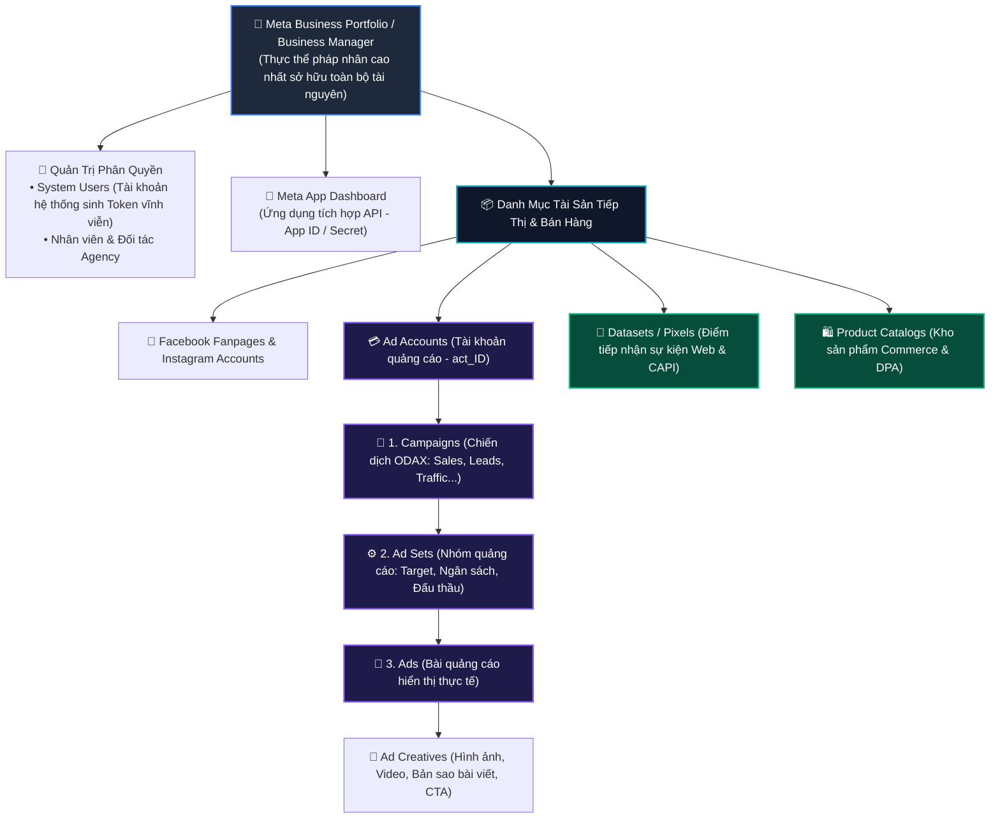
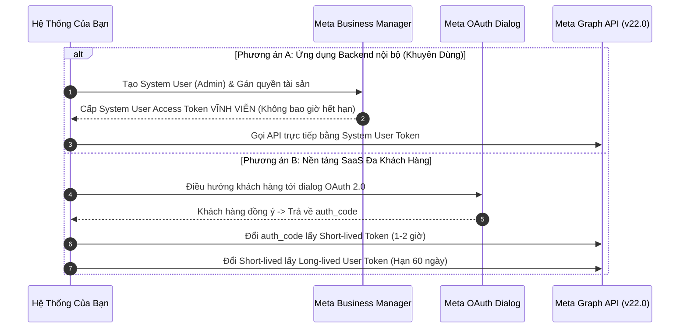
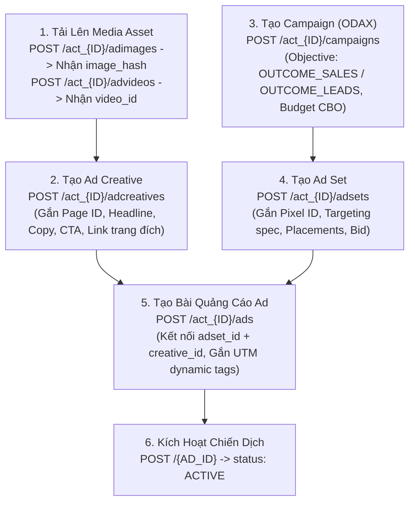
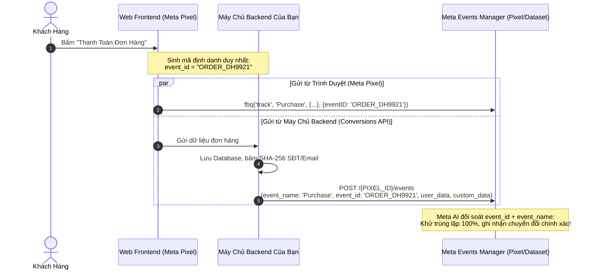
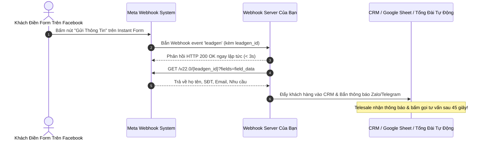
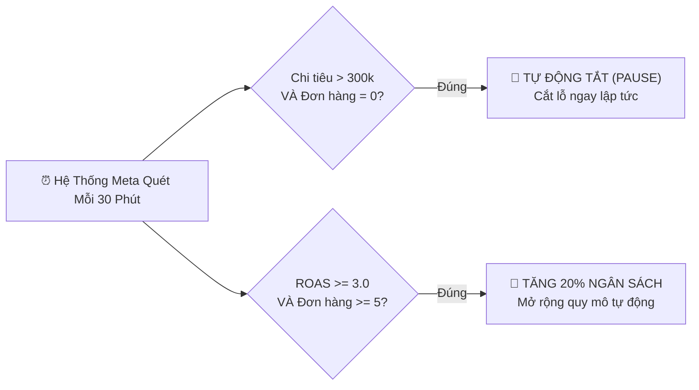
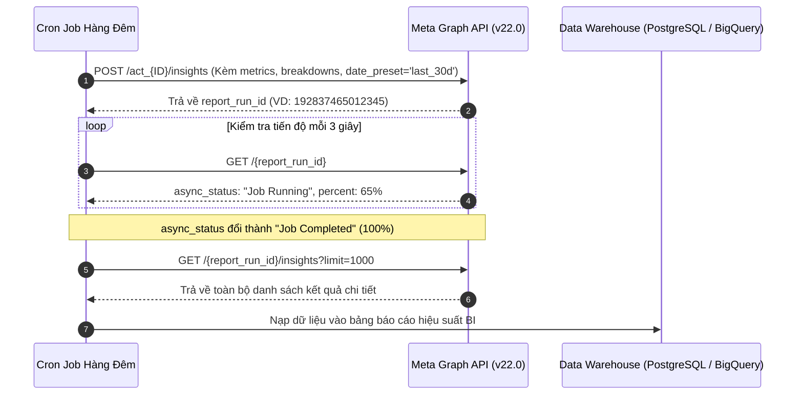

# Bộ Tài Liệu Tiếng Việt Chuẩn: Meta Facebook Ads & Commerce API (`facebook-ads-api`)

Chào mừng bạn đến với bộ tài liệu kỹ thuật tiếng Việt chi tiết, chuẩn hóa và đầy đủ nhất dành cho **Meta (Facebook) Marketing & Commerce API** (cập nhật tương thích chuẩn **Graph API v21.0 / v22.0**). Bộ tài liệu này được biên soạn chuyên sâu phục vụ các kỹ sư phần mềm, quản trị viên hệ thống, đội ngũ tăng trưởng (Growth Hackers) và doanh nghiệp thương mại điện tử đa kênh muốn tự động hóa 100% quy trình tiếp thị số, theo dõi chuyển đổi phía máy chủ (Server-side tracking) và đồng bộ kho hàng bán lẻ.

Toàn bộ các ví dụ và hướng dẫn gọi API trong bộ tài liệu được ưu tiên trình bày bằng **lệnh cURL hoàn chỉnh** (kèm URL endpoint phiên bản v22.0, Header xác thực Bearer Token, `Content-Type: application/json` và JSON Body thực tế) cùng mã nguồn mẫu bằng Python và Node.js để có thể thực thi ngay lập tức trong Terminal hoặc nạp vào Postman / Insomnia.

---

## 📌 Mục Lục Điều Hướng Nhanh

1. [Cấu Trúc Phân Cấp Doanh Nghiệp & Định Danh Meta (Developer Hierarchy)](#1-cấu-trúc-phân-cấp-doanh-nghiệp--định-danh-meta)
2. [Cây Hệ Sinh Thái API Toàn Diện (16 Phân Hệ Chuẩn)](#2-cây-hệ-sinh-thái-api-toàn-diện)
3. [Sơ Đồ Các Luồng Nghiệp Vụ Cốt Lõi & Hướng Dẫn Thực Thi](#3-sơ-đồ-các-luồng-nghiệp-vụ-cốt-lõi)
   - [3.1. Luồng Xác Thực System User Token Vĩnh Viễn & OAuth 2.0](#31-luồng-xác-thực-token)
   - [3.2. Vòng Đời Khởi Tạo Chiến Dịch 3 Tầng Chuẩn ODAX (Campaign - Ad Set - Creative - Ad)](#32-vòng-đời-khởi-tạo-quảng-cáo)
   - [3.3. Đo Lường Chuyển Đổi Phía Máy Chủ Conversions API (CAPI) & Khử Trùng Lặp](#33-conversions-api-server-side-tracking)
   - [3.4. Rút Trích Dữ Liệu Khách Hàng Tiềm Năng Tức Thì (Lead Ads API & CRM Sync)](#34-lead-ads-crm-sync)
   - [3.5. Bộ Máy Tự Động Bật/Tắt & Scale Ngân Sách (Automated Rules Engine)](#35-automated-rules-engine)
   - [3.6. Đường Ống Dữ Liệu Báo Cáo Bất Đồng Bộ (Async Insights ETL Pipeline)](#36-async-insights-reporting)
4. [Mục Lục Toàn Bộ 16 Phân Hệ Tài Liệu Con Chi Tiết (`docs/`)](#4-mục-lục-toàn-bộ-16-phân-hệ-tài-liệu-con-chi-tiết)
5. [Bảng Tra Cứu Nhanh Các Endpoint Cốt Lõi (Graph API Cheat Sheet)](#5-bảng-tra-cứu-nhanh-các-endpoint-cốt-lõi)
6. [Từ Điển Mã Lỗi & Giới Hạn Tần Suất (Rate Limits)](#6-từ-điển-mã-lỗi--giới-hạn-tần-suất)
7. [Kế Hoạch Mở Rộng Hệ Sinh Thái API Tiếp Theo (Meta Social, Google, WhatsApp, Zalo, Lazada)](#7-kế-hoạch-mở-rộng-hệ-sinh-thái-api-tiếp-theo)

---

<a id="1-cấu-trúc-phân-cấp-doanh-nghiệp--định-danh-meta"></a>
## 1. Cấu Trúc Phân Cấp Doanh Nghiệp & Định Danh Meta

Mô hình dữ liệu quan hệ (Entity Hierarchy) trong hệ sinh thái Meta được tổ chức chặt chẽ từ cấp pháp nhân đến từng bài quảng cáo:



---

<a id="2-cây-hệ-sinh-thái-api-toàn-diện"></a>
## 2. Cây Hệ Sinh Thái API Toàn Diện (16 Phân Hệ Chuẩn)

Bộ tài liệu `facebook-ads-api` được phân chia thành **16 module nghiệp vụ độc lập**, bao phủ 100% tài liệu chính thức [Meta Ads & Commerce Documentation](https://developers.facebook.com/documentation/ads-commerce):

```text
facebook-ads-api/
├── 01. Tổng Quan & Kiến Trúc Meta Ads (Phân cấp tài sản, Onboarding 4 bước, Smoke test API)
├── 02. Xác Thực OAuth & Quản Lý Token (System User Token vĩnh viễn, Long-lived Token 60 ngày, Debug token)
├── 03. Cấu Trúc Chiến Dịch Campaigns (Chuẩn ODAX 6 mục tiêu v22.0, Ngân sách CBO vs ABO, CRUD Campaign)
├── 04. Nhóm Quảng Cáo Ad Sets & Targeting (Đấu thầu COST_CAP/BID_CAP, Flexible targeting spec, Vị trí hiển thị)
├── 05. Nội Dung Quảng Cáo Ad Creatives & Assets (Tải ảnh hash, Upload video resumable, Carousel, Dynamic Creative)
├── 06. Khởi Tạo & Quản Lý Bài Quảng Cáo Ads (Kết nối Ad Set & Creative, Trạng thái xét duyệt, Dynamic URL Tags)
├── 07. Đối Tượng Tùy Chỉnh & Lookalike Audiences (Tệp khách hàng băm SHA-256, Lookalike 1%-10%, Chuẩn SAC v22.0)
├── 08. Conversions API (CAPI) & Server-Side Tracking (Khử trùng lặp event_id, EMQ 8.5+, Payload chuẩn, Python Script)
├── 09. Báo Cáo Hiệu Suất Insights API (Truy vấn Đồng bộ vs Bất đồng bộ Async Job, Phân rã đa chiều, ROAS, CPC)
├── 10. Chiến Dịch Thông Minh Advantage+ & Automated Rules (Chiến dịch ASC, Tự động tắt lỗ, Tự động scale ngân sách)
├── 11. Khách Hàng Tiềm Năng Lead Ads API (Rút trích Instant Form < 60s, Đồng bộ CRM HubSpot/Lark, Webhook leadgen)
├── 12. Quản Lý Danh Mục Sản Phẩm Catalog API (Data Feeds XML/CSV, Realtime Batch API cập nhật tồn kho, Product Sets)
├── 13. Nền Tảng Thương Mại Điện Tử Meta Commerce (Facebook/IG Shops, Vòng đời đơn hàng, Fulfillment vận đơn)
├── 14. Webhooks & Sự Kiện Thời Gian Thực (Xác thực Handshake, Bảo mật chữ ký X-Hub-Signature-256, Express Server)
├── 15. Từ Điển Mã Lỗi & Giới Hạn Tần Suất (Header X-Business-Use-Case-Usage, Bảng mã lỗi 100/190/17/80004, Backoff Jitter)
└── 16. Kế Hoạch Mở Rộng Hệ Sinh Thái API Tiếp Theo (Lộ trình Meta Social, WhatsApp Cloud, Google Ads, Zalo, Lazada)
```

---

<a id="3-sơ-đồ-các-luồng-nghiệp-vụ-cốt-lõi"></a>
## 3. Sơ Đồ Các Luồng Nghiệp Vụ Cốt Lõi & Hướng Dẫn Thực Thi

---

<a id="31-luồng-xác-thực-token"></a>
### 3.1. Luồng Xác Thực Token Vĩnh Viễn vs OAuth 2.0

Meta cung cấp hai cơ chế xác thực riêng biệt tùy thuộc vào loại hình ứng dụng của bạn:



---

<a id="32-vòng-đời-khởi-tạo-quảng-cáo"></a>
### 3.2. Vòng Đời Khởi Tạo Chiến Dịch 3 Tầng Chuẩn ODAX

Quy trình tự động hóa lập trình một chiến dịch quảng cáo hoàn chỉnh từ đầu đến cuối:



---

<a id="33-conversions-api-server-side-tracking"></a>
### 3.3. Đo Lường Chuyển Đổi Phía Máy Chủ Conversions API (CAPI) & Khử Trùng Lặp

Để không bị thất thoát dữ liệu do chính sách chặn cookie của iOS 14.5+ và Safari, mọi sự kiện mua hàng cần được gửi song song từ cả trình duyệt và máy chủ backend:



---

<a id="34-lead-ads-crm-sync"></a>
### 3.4. Rút Trích Khách Hàng Tiềm Năng Tức Thì (Lead Ads & CRM Sync)



---

<a id="35-automated-rules-engine"></a>
### 3.5. Bộ Máy Tự Động Bật/Tắt & Scale Ngân Sách (Automated Rules Engine)

Quản lý rủi ro chi tiêu tự động mà không cần treo máy chủ riêng:



---

<a id="36-async-insights-reporting"></a>
### 3.6. Đường Ống Dữ Liệu Báo Cáo Bất Đồng Bộ (Async Insights ETL Pipeline)

Quy trình rút trích dữ liệu lớn phục vụ hệ thống báo cáo BI / Kho dữ liệu (Data Warehouse):



---

<a id="4-mục-lục-toàn-bộ-16-phân-hệ-tài-liệu-con-chi-tiết"></a>
## 4. Mục Lục Toàn Bộ 16 Phân Hệ Tài Liệu Con Chi Tiết

| STT | Phân hệ tài liệu | Đường dẫn chi tiết | Nội dung trọng tâm |
| :---: | :--- | :--- | :--- |
| **01** | **Tổng Quan & Kiến Trúc** | [`docs/01-tong-quan-va-kien-truc-meta-ads/`](docs/01-tong-quan-va-kien-truc-meta-ads/README.md) | Phân cấp tài sản Business Portfolio, Ad Account, Onboarding 4 bước, Smoke test cURL |
| **02** | **Xác Thực OAuth & Token** | [`docs/02-xac-thuc-oauth-va-quan-ly-token/`](docs/02-xac-thuc-oauth-va-quan-ly-token/README.md) | System User Token vĩnh viễn, Long-lived Token 60 ngày, Debug token, Bắt lỗi code 190 |
| **03** | **Cấu Trúc Chiến Dịch** | [`docs/03-cau-truc-chien-dich-campaigns/`](docs/03-cau-truc-chien-dich-campaigns/README.md) | Chuẩn ODAX 6 mục tiêu v22.0, Ngân sách CBO vs ABO, Special Ad Categories (SAC) |
| **04** | **Nhóm Quảng Cáo & Targeting**| [`docs/04-nhom-quang-cao-adsets-va-nham-muc-tieu-targeting/`](docs/04-nhom-quang-cao-adsets-va-nham-muc-tieu-targeting/README.md) | Đấu thầu COST_CAP/BID_CAP, Cấu trúc `targeting` đa tầng (AND/OR), Vị trí hiển thị |
| **05** | **Nội Dung Ad Creatives** | [`docs/05-noi-dung-quang-cao-adcreatives-va-media-assets/`](docs/05-noi-dung-quang-cao-adcreatives-va-media-assets/README.md) | Tải ảnh lấy `image_hash`, Tải video chunked, Mẫu quảng cáo ảnh đơn, Video, Quay vòng Carousel |
| **06** | **Quản Lý Bài Quảng Cáo** | [`docs/06-khoi-tao-va-quan-ly-quang-cao-ads/`](docs/06-khoi-tao-va-quan-ly-quang-cao-ads/README.md) | Kết nối Ad Set & Creative, Trạng thái `effective_status`, Xem trước giao diện thực tế (Previews) |
| **07** | **Đối Tượng Tùy Chỉnh & Lookalike**| [`docs/07-doi-tuong-tuy-chinh-custom-va-lookalike-audiences/`](docs/07-doi-tuong-tuy-chinh-custom-va-lookalike-audiences/README.md) | Băm SHA-256 SĐT/Email, Tải lên tệp khách hàng VIP, Tạo đối tượng tương tự Lookalike 1%-10% |
| **08** | **Conversions API (CAPI)** | [`docs/08-conversions-api-capi-va-server-side-tracking/`](docs/08-conversions-api-capi-va-server-side-tracking/README.md) | Đo lường Server-to-Server, Khử trùng lặp `event_id`, Điểm EMQ 8.5+, Mã Python mẫu hoàn chỉnh |
| **09** | **Báo Cáo Insights API** | [`docs/09-bao-cao-hieu-suat-insights-api-va-analytics/`](docs/09-bao-cao-hieu-suat-insights-api-va-analytics/README.md) | Truy vấn Sync vs Async Job, Phân rã độ tuổi, thiết bị, vị trí, Chỉ số ROAS, CPA, CPC, CPM |
| **10** | **Advantage+ & Automated Rules**| [`docs/10-chien-dich-thong-minh-advantage-plus-va-automated-rules/`](docs/10-chien-dich-thong-minh-advantage-plus-va-automated-rules/README.md) | Chiến dịch ASC thương mại điện tử, Tạo quy tắc tự động cắt lỗ khi đắt, Tự tăng ngân sách |
| **11** | **Khách Hàng Tiềm Năng (Lead Ads)**| [`docs/11-quan-ly-khach-hang-tiem-nang-lead-ads-api/`](docs/11-quan-ly-khach-hang-tiem-nang-lead-ads-api/README.md) | Rút trích Instant Form, Phân giải mảng `field_data`, Đồng bộ tức thời về CRM & Bắn Telesale |
| **12** | **Danh Mục Sản Phẩm (Catalog)** | [`docs/12-quan-ly-danh-muc-san-pham-catalog-api/`](docs/12-quan-ly-danh-muc-san-pham-catalog-api/README.md) | Quản lý Product Feeds XML/CSV, Realtime Batch API (tối đa 10k SKU/request), Product Sets |
| **13** | **Thương Mại Điện Tử Commerce** | [`docs/13-thuong-mai-dien-tu-meta-commerce-platform/`](docs/13-thuong-mai-dien-tu-meta-commerce-platform/README.md) | Quản lý gian hàng Meta Shops, Đồng bộ đơn hàng, Bắn thông tin vận đơn Fulfillment 3PL |
| **14** | **Webhooks Thời Gian Thực** | [`docs/14-webhook-va-lang-nghe-su-kien-thoi-gian-thuc/`](docs/14-webhook-va-lang-nghe-su-kien-thoi-gian-thuc/README.md) | Bắt tay xác thực Challenge, Xác minh chữ ký `X-Hub-Signature-256`, Mã máy chủ Express.js |
| **15** | **Từ Điển Mã Lỗi & Rate Limits** | [`docs/15-tu-dien-ma-loi-gioi-han-rate-limit-va-khac-phuc/`](docs/15-tu-dien-ma-loi-gioi-han-rate-limit-va-khac-phuc/README.md) | Header `X-Business-Use-Case-Usage`, Bảng tra cứu mã lỗi 100/190/17/80004, Thuật toán Jitter |
| **16** | **Kế Hoạch Mở Rộng Tiếp Theo** | [`docs/16-ke-hoach-mo-rong-he-sinh-thai-api-tiep-theo/`](docs/16-ke-hoach-mo-rong-he-sinh-thai-api-tiep-theo/README.md) | Lộ trình tích hợp Meta Social, WhatsApp Cloud, Google Ads, Zalo OA/ZNS, Lazada Open Platform |

---

<a id="5-bảng-tra-cứu-nhanh-các-endpoint-cốt-lõi"></a>
## 5. Bảng Tra Cứu Nhanh Các Endpoint Cốt Lõi (Graph API Cheat Sheet)

| Tác vụ nghiệp vụ | Phương thức | Endpoint Graph API v22.0 | Quyền hạn yêu cầu (`Scopes`) |
| :--- | :---: | :--- | :--- |
| **Kiểm tra thông tin tài khoản quảng cáo** | `GET` | `/act_{AD_ACCOUNT_ID}?fields=id,name,currency,balance` | `ads_read` |
| **Tạo mới Chiến dịch (Campaign)** | `POST` | `/act_{AD_ACCOUNT_ID}/campaigns` | `ads_management` |
| **Tạo mới Nhóm quảng cáo (Ad Set)** | `POST` | `/act_{AD_ACCOUNT_ID}/adsets` | `ads_management` |
| **Tải lên hình ảnh quảng cáo** | `POST` | `/act_{AD_ACCOUNT_ID}/adimages` | `ads_management` |
| **Tạo mới nội dung sáng tạo (Ad Creative)** | `POST` | `/act_{AD_ACCOUNT_ID}/adcreatives` | `ads_management` |
| **Tạo mới Bài quảng cáo (Ad)** | `POST` | `/act_{AD_ACCOUNT_ID}/ads` | `ads_management` |
| **Bắn sự kiện đo lường máy chủ (CAPI)** | `POST` | `/{PIXEL_ID}/events` | `ads_management` |
| **Khởi tạo tiến trình xuất báo cáo Async** | `POST` | `/act_{AD_ACCOUNT_ID}/insights` | `ads_read` |
| **Kiểm tra tiến độ báo cáo Async** | `GET` | `/{REPORT_RUN_ID}` | `ads_read` |
| **Tải kết quả dữ liệu báo cáo Async** | `GET` | `/{REPORT_RUN_ID}/insights` | `ads_read` |
| **Rút trích thông tin 1 khách hàng tiềm năng**| `GET` | `/{LEADGEN_ID}?fields=field_data` | `leads_retrieval`, `pages_read_engagement` |
| **Đẩy sản phẩm hàng loạt lên Catalog** | `POST` | `/{CATALOG_ID}/batch` | `catalog_management` |
| **Lấy danh sách đơn hàng Meta Shops** | `GET` | `/{CMS_ID}/commerce_orders` | `commerce_account_read_orders` |

---

<a id="6-từ-điển-mã-lỗi--giới-hạn-tần-suất"></a>
## 6. Từ Điển Mã Lỗi & Giới Hạn Tần Suất

- **Header kiểm soát tần suất:** Luôn đọc header `X-Business-Use-Case-Usage`. Nếu `call_count` hoặc `total_time` vượt quá **90%**, hệ thống phải kích hoạt chế độ giãn cách request hoặc tạm dừng gửi tác vụ mới.
- **Quy tắc thử lại:** Khi gặp các lỗi mã `17` (User Request Limit), `613` (Rate Limit) hoặc `80004` (Too Many Calls), thực thi thuật toán **Exponential Backoff kèm Jitter** (thử lại sau $2^{\text{lần}} + \text{độ trễ ngẫu nhiên}$).
- **Lỗi 190 (Token hết hạn):** Tự động chuyển cờ trạng thái kết nối tài khoản sang `DISCONNECTED` và gửi thông báo cảnh báo qua Telegram/Email/Slack cho quản trị viên.

---

<a id="7-kế-hoạch-mở-rộng-hệ-sinh-thái-api-tiếp-theo"></a>
## 7. Kế Hoạch Mở Rộng Hệ Sinh Thái API Tiếp Theo

Để tiến tới một nền tảng vận hành tự động hóa tiếp thị và bán hàng đa kênh toàn diện (Omnichannel Automation Engine), lộ trình phát triển được định hướng như sau:

1. **Hệ sinh thái Hội thoại Meta (`meta-graph-api` & `whatsapp-cloud-api`)**: Tự động hóa chatbot trả lời bình luận Fanpage, tin nhắn Messenger, Instagram DM và tin nhắn tiếp thị hội thoại trên WhatsApp.
2. **Hệ sinh thái Tiếp thị Tìm kiếm Google (`google-ads-api` & `google-merchant-center-api`)**: Bao phủ toàn bộ các chiến dịch Google Search, YouTube Ads, chiến dịch Hiệu suất Tối đa (PMax) và đồng bộ kho hàng Google Shopping.
3. **Hệ sinh thái Nội địa Việt Nam (`zalo-ads-api` & `zalo-zns-api`)**: Tiếp cận hơn 75 triệu người dùng nội địa với chi phí tối ưu, tự động gửi thông báo vận đơn ZNS qua số điện thoại khách hàng.
4. **Sàn Thương Mại Điện Tử Đông Nam Á (`lazada-open-platform-api`)**: Hoàn thiện bộ ba sàn thương mại lớn nhất (Shopee + TikTok Shop + Lazada) với cơ chế đồng bộ tồn kho thời gian thực đa sàn.

---

## 🛠️ Công Cụ & Mã Nguồn Bổ Trợ Sẵn Có (`_scripts/`)

- [`conversions_api_sender.py`](_scripts/conversions_api_sender.py): Script gửi sự kiện Conversions API tự động chuẩn hóa và băm SHA-256 dữ liệu khách hàng.
- [`marketing_api_campaign_builder.py`](_scripts/marketing_api_campaign_builder.py): Module tự động tạo chiến dịch 3 tầng (Campaign -> Ad Set -> Creative -> Ad) chuẩn Graph API v22.0.
- [`insights_export.py`](_scripts/insights_export.py): Script tự động xuất báo cáo hiệu suất bất đồng bộ (Async Insights Job) chống quá tải và chống timeout.

