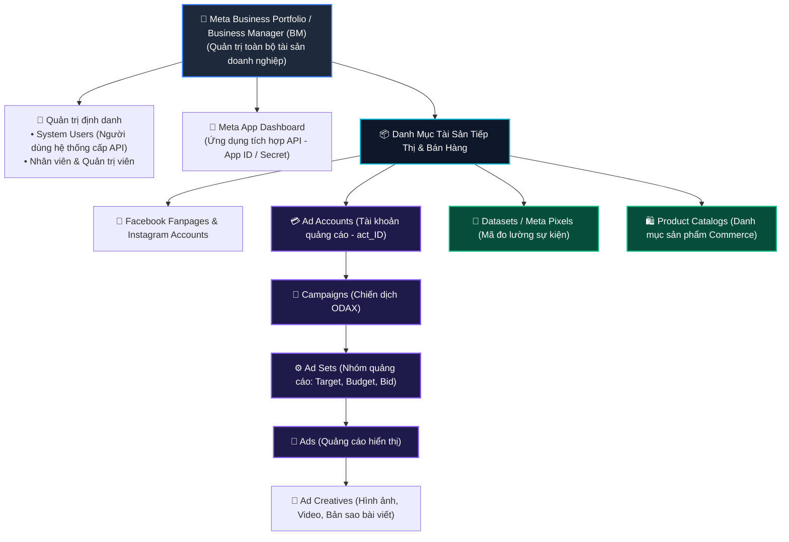
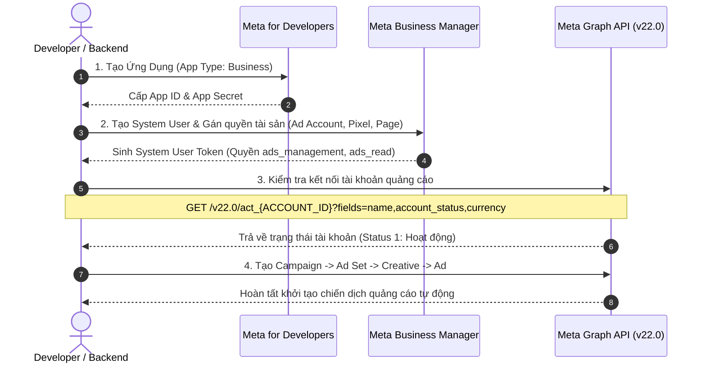

# 01. Tổng Quan & Kiến Trúc Hệ Sinh Thái Meta Ads & Commerce API

Chào mừng bạn đến với tài liệu kỹ thuật chuyên sâu về **Meta (Facebook) Marketing & Commerce API** (cập nhật tương thích chuẩn **Graph API v21.0 / v22.0**). Hệ sinh thái API này cho phép các kỹ sư phần mềm, agency tiếp thị và doanh nghiệp tự động hóa 100% quy trình tạo lập, quản lý, tối ưu chiến dịch quảng cáo, đo lường chuyển đổi phía máy chủ (Server-side tracking) và đồng bộ thương mại điện tử đa kênh.

---

## 1. Cấu Trúc Phân Cấp Tài Sản Doanh Nghiệp (Meta Business Hierarchy)

Trước khi viết bất kỳ dòng mã nào, điều quan trọng nhất là bạn phải hiểu mô hình dữ liệu quan hệ (Entity Relationship) giữa các thực thể trong hệ thống của Meta.



### Giải nghĩa các thành phần cốt lõi:
1. **Business Portfolio (Business Manager - BM)**: Thực thể pháp nhân cấp cao nhất sở hữu toàn bộ tài nguyên: tài khoản quảng cáo, trang, ứng dụng, pixel và danh mục.
2. **System User (Người dùng hệ thống)**: Tài khoản không có mật khẩu đăng nhập cá nhân, chuyên dùng để sinh **System User Access Token vĩnh viễn (Never-expiring)** phục vụ các tác vụ chạy ngầm backend/cron job tự động.
3. **Ad Account (`act_{AD_ACCOUNT_ID}`)**: Container chứa toàn bộ ngân sách, chiến dịch, nhóm quảng cáo, quảng cáo và báo cáo hiệu suất. Hầu hết các API tiếp thị đều thao tác trực tiếp trên node này.
4. **Dataset / Pixel (`{PIXEL_ID}`)**: Nơi tiếp nhận và xử lý tín hiệu hành vi người dùng từ cả trình duyệt (Meta Pixel Web) và máy chủ (Conversions API - CAPI).
5. **Product Catalog (`{CATALOG_ID}`)**: Cơ sở dữ liệu sản phẩm phục vụ hiển thị trên Meta Shops và chạy quảng cáo động Advantage+ Catalog Ads (DPA).

---

## 2. Cấu Trúc 3 Tầng Của Quảng Cáo Meta (The 3-Tier Ad Hierarchy)

Mọi chiến dịch quảng cáo trên nền tảng Meta bắt buộc phải tuân theo cấu trúc 3 tầng nghiêm ngặt:

```text
Ad Account (act_<AD_ACCOUNT_ID>)
 └── Campaign (Chiến dịch)
      │   ├── Mục tiêu chiến dịch (Objective: OUTCOME_SALES, OUTCOME_LEADS...)
      │   ├── Danh mục quảng cáo đặc biệt (Special Ad Categories)
      │   └── Ngân sách chiến dịch (CBO / Advantage Campaign Budget - Tùy chọn)
      │
      └── Ad Set (Nhóm quảng cáo)
           │   ├── Lịch chạy & Ngân sách nhóm (ABO - Nếu không dùng CBO)
           │   ├── Đối tượng nhắm mục tiêu (Targeting Spec: Geo, Tuổi, Sở thích, Custom Audience)
           │   ├── Vị trí hiển thị (Placements: Facebook, Instagram, Messenger, Audience Network)
           │   ├── Chiến lược giá thầu (Bid Strategy: LOWEST_COST, COST_CAP, BID_CAP)
           │   └── Mục tiêu tối ưu hóa (Optimization Goal: CONVERSIONS, LINK_CLICKS...)
           │
           └── Ad (Quảng cáo hiển thị)
                ├── Kết nối Ad Creative (ID hình ảnh/video/bài viết)
                ├── Văn bản, Tiêu đề, Nút kêu gọi hành động (Call To Action)
                └── Tham số theo dõi (Tracking Specs, URL Parameters, UTM tags)
```

---

## 3. Lộ Trình 4 Bước Triển Khai Gọi API Thực Tế



### Bước 1: Tạo ứng dụng trên cổng Meta for Developers
1. Truy cập [Meta for Developers](https://developers.facebook.com/).
2. Bấm **My Apps** > **Create App**.
3. Chọn loại ứng dụng: **Business** (Bắt buộc để tích hợp Marketing API và Conversions API).
4. Điền tên ứng dụng, email liên hệ và liên kết với Business Portfolio tương ứng.
5. Trong trang tổng quan Dashboard của ứng dụng, thêm sản phẩm **Marketing API**.

### Bước 2: Tạo System User và sinh Access Token vĩnh viễn
1. Mở **Meta Business Suite / Business Manager Settings** (`business.facebook.com/settings`).
2. Vào mục **Users** > **System Users** > Bấm **Add**.
3. Đặt vai trò: **Admin System User** hoặc **Employee System User**.
4. Bấm **Add Assets**:
   - Gán quyền **Manage campaigns** và **View performance** trên Ad Account mục tiêu.
   - Gán quyền **Manage Page** trên Fanpage liên quan.
   - Gán quyền **Manage dataset** trên Pixel/Dataset.
5. Bấm **Generate New Token**:
   - Chọn ứng dụng vừa tạo ở Bước 1.
   - Tích chọn các quyền thiết yếu:
     - `ads_management`: Tạo, chỉnh sửa, xóa chiến dịch và quảng cáo.
     - `ads_read`: Đọc báo cáo, thông số chiến dịch.
     - `business_management`: Quản lý tài sản trong Business Manager.
     - `pages_read_engagement` & `pages_show_list`: Đọc thông tin Fanpage.
     - `leads_retrieval`: Lấy dữ liệu khách hàng tiềm năng Lead Form.
   - Sao lưu chuỗi Access Token này vào biến môi trường an toàn (ví dụ `.env`).

### Bước 3: Lệnh kiểm tra kết nối API đầu tiên (Smoke Test cURL)

Kiểm tra thông tin Ad Account để xác nhận Token hợp lệ và có đủ quyền:

```bash
curl -i -X GET \
  "https://graph.facebook.com/v22.0/act_<AD_ACCOUNT_ID>?fields=id,name,account_status,currency,timezone_name,balance,amount_spent&access_token=<YOUR_SYSTEM_USER_TOKEN>"
```

**Phản hồi mẫu thành công từ Meta:**
```json
{
  "id": "act_1022345678901234",
  "name": "E-Commerce Master Vietnam Ads",
  "account_status": 1,
  "currency": "VND",
  "timezone_name": "Asia/Ho_Chi_Minh",
  "balance": "0",
  "amount_spent": "452500000"
}
```

> **Ghi chú về mã `account_status`:**
> - `1`: ACTIVE (Tài khoản đang hoạt động bình thường).
> - `2`: DISABLED (Tài khoản bị vô hiệu hóa do chính sách hoặc thẻ lỗi).
> - `3`: UNSETTLED (Tài khoản nợ tiền hoặc thẻ từ chối thanh toán).
> - `7`: PENDING_RISK_REVIEW (Đang trong quá trình xét duyệt bảo mật).

---

## 4. Bảng Tra Cứu Phiên Bản & Địa Chỉ Gốc Graph API

| Thuộc tính | Giá trị chuẩn |
| :--- | :--- |
| **Giao thức** | HTTPS REST API |
| **Base URL** | `https://graph.facebook.com` |
| **Phiên bản khuyến nghị** | `v22.0` (Hỗ trợ đầy đủ tính năng ODAX và tiêu chuẩn SAC mới nhất) |
| **Node tài khoản quảng cáo** | `/v22.0/act_{AD_ACCOUNT_ID}` (Lưu ý: Luôn có tiền tố `act_`) |
| **Định dạng dữ liệu gửi** | `application/json` hoặc `application/x-www-form-urlencoded` |
| **Định dạng dữ liệu nhận** | `application/json; charset=UTF-8` |
| **Đơn vị tiền tệ hiển thị** | Nguyên tệ hoặc Cent x100 (Với USD/EUR là cent; với VND là số tiền thực tế) |

---

## 5. Tài Liệu Điều Hướng Chi Tiết Trong Bộ Sách

- [02. Xác Thực OAuth & Quản Lý Token Vĩnh Viễn](../02-xac-thuc-oauth-va-quan-ly-token/README.md)
- [03. Khởi Tạo & Cấu Trúc Chiến Dịch Chuẩn ODAX](../03-cau-truc-chien-dich-campaigns/README.md)
- [04. Nhóm Quảng Cáo Ad Sets & Bộ Nhắm Mục Tiêu Targeting](../04-nhom-quang-cao-adsets-va-nham-muc-tieu-targeting/README.md)
- [08. Conversions API (CAPI) & Server-Side Tracking](../08-conversions-api-capi-va-server-side-tracking/README.md)
- [09. Báo Cáo Hiệu Suất Insights API](../09-bao-cao-hieu-suat-insights-api-va-analytics/README.md)
- [16. Kế Hoạch Mở Rộng Hệ Sinh Thái API Tiếp Theo](../16-ke-hoach-mo-rong-he-sinh-thai-api-tiep-theo/README.md)

