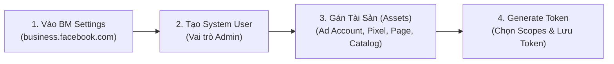
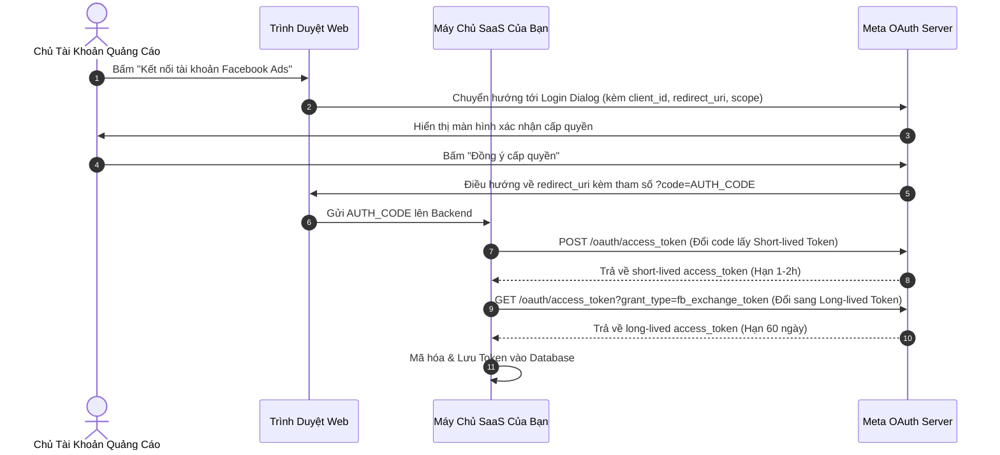

# 02. Cơ Chế Xác Thực OAuth 2.0 & Quản Lý Access Token

Xác thực (Authentication) và phân quyền (Authorization) là nền tảng cốt lõi của mọi ứng dụng làm việc với Meta Marketing & Commerce API. Tài liệu này hướng dẫn chi tiết cách thức sinh, kiểm tra tính hợp lệ và quản lý các loại **Access Token** theo tiêu chuẩn bảo mật của Meta.

---

## 1. Phân Loại 4 Loại Access Token Trong Hệ Sinh Thái Meta

| Loại Token | Thời hạn sử dụng (TTL) | Trường hợp sử dụng tối ưu | Phương thức cấp phát |
| :--- | :--- | :--- | :--- |
| **System User Token** | **Không bao giờ hết hạn (Never-expiring)** | Ứng dụng Backend nội bộ, Script tự động hóa, Cron job đồng bộ CAPI, CRM nội bộ | Sinh trực tiếp từ **Meta Business Manager** (Khuyên dùng số 1 cho đội ngũ kỹ thuật) |
| **Long-lived User Token** | **60 ngày** | Phần mềm SaaS đa khách hàng (người dùng bấm ủy quyền tài khoản quảng cáo của họ) | Đổi từ Short-lived User Token qua API trao đổi token |
| **Short-lived User Token** | **1 - 2 giờ** | Phiên đăng nhập tạm thời trên giao diện Web/Mobile qua Facebook Login SDK | Sinh ngay sau khi người dùng bấm đồng ý trên hộp thoại OAuth |
| **Page Access Token** | **Vĩnh viễn hoặc 60 ngày** (Tùy theo User Token sinh ra nó) | Thao tác quản lý nội dung Fanpage, bình luận quảng cáo, bài viết trang | Lấy từ endpoint `/{PAGE_ID}?fields=access_token` |

---

## 2. Phương Án 1: Sinh System User Token Vĩnh Viễn (Dành Cho Backend/Doanh Nghiệp)

Đây là phương thức được 99% các kỹ sư backend lựa chọn khi phát triển hệ thống nội bộ vì không cần bảo trì việc làm mới token (Refresh Token) định kỳ:



### Các quyền (Scopes) bắt buộc phải tích chọn:
- `ads_management`: Cho phép tạo, sửa, xóa chiến dịch, nhóm quảng cáo, bài quảng cáo.
- `ads_read`: Đọc chi tiết chiến dịch và báo cáo hiệu suất Insights.
- `business_management`: Truy vấn danh sách tài khoản quảng cáo, pixel trực thuộc Business Portfolio.
- `pages_read_engagement`, `pages_manage_ads`: Đọc thông tin và đại diện trang xuất bản bài quảng cáo.
- `leads_retrieval`: Rút dữ liệu khách hàng tiềm năng tức thì khi có người điền Lead Form.
- `catalog_management`: Đồng bộ và quản trị danh mục sản phẩm thương mại.

---

## 3. Phương Án 2: Luồng Ủy Quyền OAuth 2.0 (Dành Cho Ứng Dụng SaaS Đa Người Dùng)

Khi bạn xây dựng nền tảng SaaS (ví dụ: Nền tảng Omnichannel quản lý quảng cáo cho hàng ngàn chủ shop), bạn phải để khách hàng ủy quyền thông qua luồng OAuth 2.0.



### Bước 3.1: Tạo liên kết ủy quyền (Authorization URL)
Chuyển hướng người dùng đến URL sau:

```text
https://www.facebook.com/v22.0/dialog/oauth?
  client_id=<YOUR_APP_ID>
  &redirect_uri=<YOUR_REDIRECT_URI>
  &scope=ads_management,ads_read,business_management,pages_read_engagement,pages_manage_ads,leads_retrieval
  &response_type=code
  &state=<SECURE_CSRF_TOKEN>
```

### Bước 3.2: Đổi `code` lấy Short-lived Token

```bash
curl -i -X GET "https://graph.facebook.com/v22.0/oauth/access_token?\
client_id=<YOUR_APP_ID>\
&redirect_uri=<YOUR_REDIRECT_URI>\
&client_secret=<YOUR_APP_SECRET>\
&code=<AUTHORIZATION_CODE>"
```

**Phản hồi JSON:**
```json
{
  "access_token": "EAAG...",
  "token_type": "bearer",
  "expires_in": 5184000
}
```

### Bước 3.3: Gia hạn sang Long-lived User Token (Hạn 60 Ngày)

```bash
curl -i -X GET "https://graph.facebook.com/v22.0/oauth/access_token?\
grant_type=fb_exchange_token\
&client_id=<YOUR_APP_ID>\
&client_secret=<YOUR_APP_SECRET>\
&fb_exchange_token=<SHORT_LIVED_ACCESS_TOKEN>"
```

**Phản hồi JSON:**
```json
{
  "access_token": "EAAG_LONG_LIVED_STRING...",
  "token_type": "bearer",
  "expires_in": 5183999
}
```

---

## 4. API Soi Chi Tiết Token & Quyền Hạn (`/debug_token`)

Để kiểm tra xem một Access Token có còn sống hay không, thuộc sở hữu của ai và có những quyền hạn nào, hãy sử dụng endpoint `debug_token`:

```bash
curl -i -X GET \
  "https://graph.facebook.com/v22.0/debug_token?\
input_token=<TOKEN_CAN_KIEM_TRA>\
&access_token=<YOUR_APP_ID>|<YOUR_APP_SECRET>"
```

**Phản hồi chuẩn chi tiết:**
```json
{
  "data": {
    "app_id": "123456789012345",
    "type": "USER",
    "application": "Ecom Marketing Hub",
    "data_access_expires_at": 1785000000,
    "expires_at": 0,
    "is_valid": true,
    "issued_at": 1740000000,
    "scopes": [
      "ads_management",
      "ads_read",
      "business_management",
      "pages_read_engagement",
      "leads_retrieval",
      "public_profile"
    ],
    "user_id": "100088991234567"
  }
}
```

> **Mẹo bảo mật:** Nếu trường `expires_at = 0`, điều đó chứng minh Token này là **vĩnh viễn (Never-expiring)**.

---

## 5. Danh Sách Lấy Các Tài Khoản Quảng Cáo Được Phép Truy Cập

Sau khi có Access Token, hãy gọi endpoint `/me/adaccounts` để lấy toàn bộ danh sách `act_<AD_ACCOUNT_ID>` mà token có quyền quản trị:

```bash
curl -i -X GET \
  "https://graph.facebook.com/v22.0/me/adaccounts?fields=id,name,account_id,account_status,currency,amount_spent&access_token=<ACCESS_TOKEN>"
```

**Phản hồi:**
```json
{
  "data": [
    {
      "id": "act_102030405060708",
      "name": "Tai Khoan Chinh - Brand A",
      "account_id": "102030405060708",
      "account_status": 1,
      "currency": "VND",
      "amount_spent": "125000000"
    }
  ],
  "paging": {
    "cursors": {
      "before": "QVFIU...",
      "after": "QVFIU..."
    }
  }
}
```

---

## 6. Xử Lý Token Hết Hạn & Lỗi Xác Thực (Error Code 190)

Khi một Access Token bị thu hồi (người dùng đổi mật khẩu, xóa liên kết ứng dụng, hoặc token 60 ngày hết hạn), Meta sẽ trả về mã lỗi `190`:

```json
{
  "error": {
    "message": "Error validating access token: Session has expired on Sunday, 15-Mar-26 12:00:00 PDT.",
    "type": "OAuthException",
    "code": 190,
    "error_subcode": 463,
    "fbtrace_id": "AJ6..."
  }
}
```

### Chiến lược xử lý tự động trong code backend:
1. **Bắt mã lỗi `code == 190`**:
   - Đánh dấu trạng thái kết nối trong database là `DISCONNECTED` hoặc `NEEDS_REAUTH`.
   - Gửi thông báo tức thì (Email, Telegram Bot, Slack, Web Notification) cho quản trị viên hoặc khách hàng yêu cầu ủy quyền lại.
   - Dừng ngay lập tức các cron job tiếp thị tự động đối với tài khoản này để tránh kích hoạt cơ chế giới hạn tần suất (Rate Limiting).

