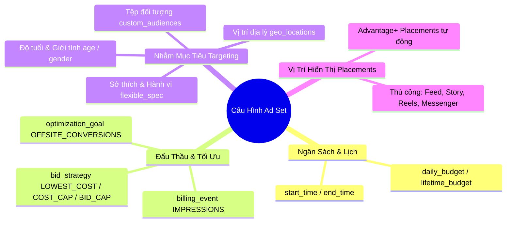

# 04. Nhóm Quảng Cáo & Bộ Nhắm Mục Tiêu Chuyên Sâu (Ad Sets & Targeting API)

Nhóm quảng cáo (Ad Set) là nơi quyết định 4 yếu tố sống còn của hiệu quả quảng cáo: **Ai sẽ xem** (Targeting), **Xem ở đâu** (Placements), **Khi nào chạy** (Schedule) và **Đấu thầu bao nhiêu** (Bidding & Budget).

---

## 1. Các Trụ Cột Cốt Lõi Trong Cấu Hình Ad Set



---

## 2. Chiến Lược Đấu Thầu & Mục Tiêu Tối Ưu

### Bảng tra cứu `optimization_goal` theo mục tiêu:
| Mục tiêu kinh doanh | `optimization_goal` | `billing_event` | Đối tượng gắn kết (`promoted_object`) |
| :--- | :--- | :--- | :--- |
| Mua hàng trên Website | `OFFSITE_CONVERSIONS` | `IMPRESSIONS` | `{"pixel_id": "...", "custom_event_type": "PURCHASE"}` |
| Tạo Lead trên Web | `OFFSITE_CONVERSIONS` | `IMPRESSIONS` | `{"pixel_id": "...", "custom_event_type": "LEAD"}` |
| Thu Lead qua Form Facebook | `LEAD_GENERATION` | `IMPRESSIONS` | `{"page_id": "..."}` |
| Tối đa giá trị đơn hàng (ROAS) | `VALUE` | `IMPRESSIONS` | `{"pixel_id": "...", "custom_event_type": "PURCHASE"}` |
| Kéo lượng truy cập website | `LANDING_PAGE_VIEWS` hoặc `LINK_CLICKS` | `IMPRESSIONS` | `{"application_id": "..."}` hoặc URL trang |
| Tăng tương tác tin nhắn | `CONVERSATIONS` | `IMPRESSIONS` | `{"page_id": "..."}` |

### Chiến lược giá thầu (`bid_strategy`):
1. `LOWEST_COST_WITHOUT_BID_CAP` (Khuyên dùng): Tự động đấu thầu để mang lại nhiều kết quả nhất với toàn bộ ngân sách.
2. `COST_CAP`: Kiểm soát chi phí trung bình trên mỗi kết quả (ví dụ: Giữ giá CPA mỗi đơn hàng không vượt quá 150.000 VNĐ). Bắt buộc đi kèm tham số `bid_amount`.
3. `BID_CAP`: Đặt mức trần giá thầu tối đa trong phiên đấu giá.
4. `MINIMUM_ROAS`: Yêu cầu hệ thống chỉ đấu thầu khi đạt tỷ suất hoàn vốn tối thiểu (ví dụ: ROAS >= 2.5).

---

## 3. Cấu Trúc Đối Tượng Nhắm Mục Tiêu (`targeting` Spec)

Tham số `targeting` là một JSON Object phức hợp với khả năng kết hợp đa tầng điều kiện:

```json
{
  "geo_locations": {
    "countries": ["VN"],
    "regions": [{"key": "3834"}],
    "cities": [
      {
        "key": "2599270",
        "radius": 15,
        "distance_unit": "kilometer"
      }
    ],
    "location_types": ["home", "recent"]
  },
  "age_min": 22,
  "age_max": 45,
  "genders": [1, 2],
  "locales": [6],
  "flexible_spec": [
    {
      "interests": [
        {"id": "6003139266461", "name": "Online shopping"},
        {"id": "6003010776991", "name": "Fashion accessories"}
      ]
    },
    {
      "behaviors": [
        {"id": "6002714886772", "name": "Engaged Shoppers"}
      ]
    }
  ],
  "exclusions": {
    "interests": [
      {"id": "6003144883901", "name": "Discount stores"}
    ]
  },
  "custom_audiences": [
    {"id": "23849501827364"}
  ]
}
```

> **Quy tắc Logic trong `flexible_spec`:**
> - Các item trong cùng một mảng con (`interests`: `[A, B]`): Phép **HOẶC (OR)** -> Thỏa mãn A hoặc B.
> - Các mảng con khác nhau trong `flexible_spec`: Phép **VÀ (AND)** -> Phải thỏa mãn (A hoặc B) **VÀ** Hành vi mua hàng.
> - `exclusions`: Loại trừ tuyệt đối những ai có đặc điểm này.

---

## 4. API Thao Tác Với Ad Set

### 4.1. Tạo mới Nhóm Quảng Cáo (POST)

Tạo nhóm quảng cáo tối ưu hóa chuyển đổi mua hàng trên Website, gắn với Meta Pixel và nhắm đến khách hàng tại Việt Nam:

```bash
curl -i -X POST \
  "https://graph.facebook.com/v22.0/act_<AD_ACCOUNT_ID>/adsets" \
  -H "Content-Type: application/json" \
  -d '{
    "name": "AdSet 01 - VN - Tuoi 22-45 - Engaged Shoppers",
    "campaign_id": "120205847392810234",
    "status": "PAUSED",
    "billing_event": "IMPRESSIONS",
    "optimization_goal": "OFFSITE_CONVERSIONS",
    "promoted_object": {
      "pixel_id": "192837465019283",
      "custom_event_type": "PURCHASE"
    },
    "bid_strategy": "LOWEST_COST_WITHOUT_BID_CAP",
    "daily_budget": "500000",
    "start_time": "2026-10-25T00:00:00+0700",
    "targeting": {
      "geo_locations": {
        "countries": ["VN"]
      },
      "age_min": 22,
      "age_max": 45,
      "genders": [1, 2],
      "flexible_spec": [
        {
          "interests": [{"id": "6003139266461", "name": "Online shopping"}]
        }
      ]
    },
    "access_token": "<YOUR_ACCESS_TOKEN>"
  }'
```

**Phản hồi:**
```json
{
  "id": "120205848572010234"
}
```

---

### 4.2. Truy Vấn Thông Tin Ad Set (GET)

```bash
curl -i -X GET \
  "https://graph.facebook.com/v22.0/120205848572010234?\
fields=id,name,status,effective_status,daily_budget,bid_strategy,optimization_goal,targeting,promoted_object,start_time\
&access_token=<YOUR_ACCESS_TOKEN>"
```

---

### 4.3. Cập Nhật Ngân Sách & Đổi Trạng Thái Ad Set (POST)

Tăng ngân sách nhóm quảng cáo từ 500.000 VNĐ lên 800.000 VNĐ và kích hoạt chạy:

```bash
curl -i -X POST \
  "https://graph.facebook.com/v22.0/120205848572010234" \
  -H "Content-Type: application/json" \
  -d '{
    "daily_budget": "800000",
    "status": "ACTIVE",
    "access_token": "<YOUR_ACCESS_TOKEN>"
  }'
```

**Phản hồi:**
```json
{
  "success": true
}
```

---

## 5. API Tìm Kiếm Mã Định Danh Sở Thích (Targeting Search API)

Để biết mã `id` chính xác của một từ khóa sở thích/ngành nghề khi cấu hình `flexible_spec`, hãy gọi Search API:

```bash
curl -i -X GET \
  "https://graph.facebook.com/v22.0/search?\
type=adinterest\
&q=fashion\
&limit=10\
&locale=vi_VN\
&access_token=<YOUR_ACCESS_TOKEN>"
```

**Phản hồi JSON:**
```json
{
  "data": [
    {
      "id": "6003139266461",
      "name": "Thời trang",
      "audience_size_lower_bound": 35000000,
      "audience_size_upper_bound": 42000000,
      "path": ["Sở thích", "Mua sắm và thời trang", "Thời trang"],
      "topic": "Lifestyle and culture"
    }
  ]
}
```
Lấy mã `id` này truyền thẳng vào trường `interests` trong `targeting`.

