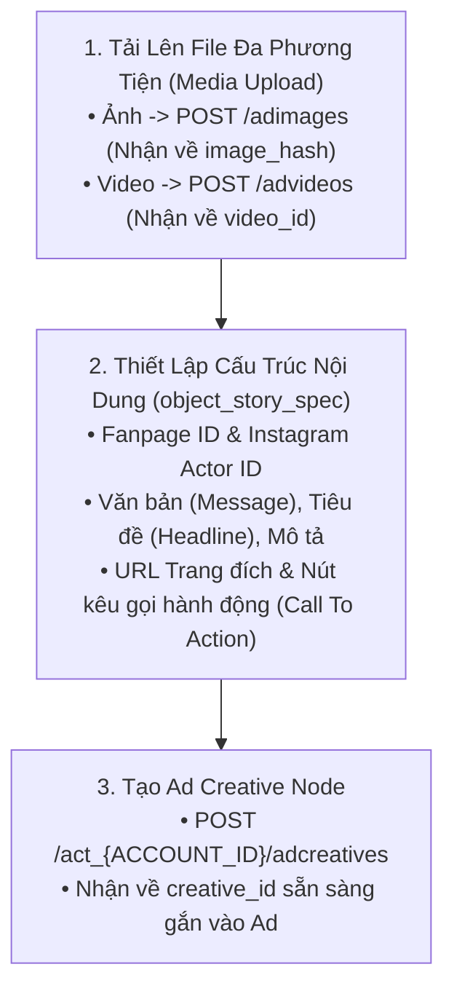

# 05. Quản Lý Nội Dung Sáng Tạo & Tải Lên Media (Ad Creatives & Media Assets)

Nội dung quảng cáo (Ad Creative) là linh hồn quyết định tỷ lệ nhấp chuột (CTR) và tỷ lệ chuyển đổi (CVR). Trong kiến trúc của Meta, **Ad Creative là một thực thể độc lập** tách rời khỏi bài quảng cáo (Ad). Điều này cho phép một Creative có thể tái sử dụng cho nhiều Ad khác nhau hoặc thử nghiệm nhiều biến thể nội dung.

---

## 1. Quy Trình 3 Bước Xây Dựng Ad Creative Hoàn Chỉnh



---

## 2. Bước 1: Tải Lên Hình Ảnh & Video Lấy Định Danh

### 2.1. Tải Lên Hình Ảnh (`POST /adimages`)

Tải lên tệp ảnh từ máy tính hoặc qua tham số nhị phân:

```bash
curl -i -X POST \
  "https://graph.facebook.com/v22.0/act_<AD_ACCOUNT_ID>/adimages" \
  -F "filename=@/Users/hattorimk/Desktop/banner_sale.png" \
  -F "access_token=<YOUR_ACCESS_TOKEN>"
```

**Phản hồi trả về:**
```json
{
  "images": {
    "banner_sale.png": {
      "hash": "b2f0a8d9e7c6b5a43210fedcba987654",
      "url": "https://scontent.xx.fbcdn.net/..."
    }
  }
}
```
> **Quan trọng:** Bạn cần lưu lại chuỗi `hash` (32 ký tự MD5). Toàn bộ các API tạo Creative sau này đều dùng `image_hash` chứ không dùng URL ảnh.

---

### 2.2. Tải Lên Video (`POST /advideos`)

Với các video dung lượng dưới 100MB, bạn có thể tải lên trực tiếp:

```bash
curl -i -X POST \
  "https://graph.facebook.com/v22.0/act_<AD_ACCOUNT_ID>/advideos" \
  -F "source=@/Users/hattorimk/Desktop/product_video.mp4" \
  -F "title=Video Gioi Thieu San Pham 2026" \
  -F "access_token=<YOUR_ACCESS_TOKEN>"
```

**Phản hồi:**
```json
{
  "id": "987654321098765"
}
```
Lưu lại mã `id` của video (`video_id`).

---

## 3. Bước 2 & 3: Khởi Tạo Ad Creative (`/adcreatives`)

### 3.1. Mẫu Quảng Cáo Đơn Ảnh Kèm Nút Kêu Gọi (Single Image Link Ad)

Đây là định dạng phổ biến nhất dùng để dẫn khách hàng về Website/Landing page mua sắm:

```bash
curl -i -X POST \
  "https://graph.facebook.com/v22.0/act_<AD_ACCOUNT_ID>/adcreatives" \
  -H "Content-Type: application/json" \
  -d '{
    "name": "Creative 01 - Single Image Flash Sale Tet",
    "object_story_spec": {
      "page_id": "100234567890123",
      "instagram_actor_id": "17841400123456789",
      "link_data": {
        "image_hash": "b2f0a8d9e7c6b5a43210fedcba987654",
        "link": "https://myshop.vn/san-pham-hot?utm_source=fb&utm_medium=cpc&utm_campaign=tet2026",
        "message": "🔥 SIÊU SALE TẾT 2026 - Giảm ngay 50% toàn bộ bộ sưu tập mới. Miễn phí vận chuyển toàn quốc!",
        "name": "Bộ Sưu Tập Tết 2026 - Giảm 50% Hôm Nay",
        "description": "Ưu đãi có hạn cho 100 khách hàng đầu tiên.",
        "call_to_action": {
          "type": "SHOP_NOW",
          "value": {
            "link": "https://myshop.vn/san-pham-hot"
          }
        }
      }
    },
    "access_token": "<YOUR_ACCESS_TOKEN>"
  }'
```

**Phản hồi:**
```json
{
  "id": "120205849887010234"
}
```

---

### 3.2. Mẫu Quảng Cáo Video (Single Video Ad)

```bash
curl -i -X POST \
  "https://graph.facebook.com/v22.0/act_<AD_ACCOUNT_ID>/adcreatives" \
  -H "Content-Type: application/json" \
  -d '{
    "name": "Creative 02 - Video Review San Pham",
    "object_story_spec": {
      "page_id": "100234567890123",
      "video_data": {
        "video_id": "987654321098765",
        "image_hash": "b2f0a8d9e7c6b5a43210fedcba987654",
        "title": "Trải Nghiệm Đột Phá Công Nghệ Mới",
        "message": "Xem ngay đánh giá chi tiết tính năng sản phẩm thế hệ mới!",
        "call_to_action": {
          "type": "LEARN_MORE",
          "value": {
            "link": "https://myshop.vn/chi-tiet-video"
          }
        }
      }
    },
    "access_token": "<YOUR_ACCESS_TOKEN>"
  }'
```

---

### 3.3. Mẫu Quảng Cáo Quay Vòng Đa Sản Phẩm (Carousel Ad)

Định dạng quay vòng nhiều thẻ (mỗi thẻ là một ảnh, tiêu đề và link sản phẩm khác nhau):

```bash
curl -i -X POST \
  "https://graph.facebook.com/v22.0/act_<AD_ACCOUNT_ID>/adcreatives" \
  -H "Content-Type: application/json" \
  -d '{
    "name": "Creative 03 - Carousel 3 San Pham",
    "object_story_spec": {
      "page_id": "100234567890123",
      "link_data": {
        "link": "https://myshop.vn",
        "message": "Khám phá top các mẫu bán chạy nhất tuần này:",
        "child_attachments": [
          {
            "link": "https://myshop.vn/ao-khoac-nam",
            "name": "Áo Khoác Nam Cao Cấp",
            "description": "Giá 499.000đ",
            "image_hash": "b2f0a8d9e7c6b5a43210fedcba987654",
            "call_to_action": {"type": "SHOP_NOW"}
          },
          {
            "link": "https://myshop.vn/giay-the-thao",
            "name": "Giày Thể Thao Sneaker",
            "description": "Giá 799.000đ",
            "image_hash": "c3e1b9a8d7e6c5b43210fedcba112233",
            "call_to_action": {"type": "SHOP_NOW"}
          }
        ]
      }
    },
    "access_token": "<YOUR_ACCESS_TOKEN>"
  }'
```

---

## 4. Danh Sách Các Loại Nút Kêu Gọi Hành Động Phổ Biến (`call_to_action.type`)

- `SHOP_NOW`: Mua ngay (Thương mại điện tử).
- `LEARN_MORE`: Tìm hiểu thêm (Giới thiệu giải pháp/bài viết).
- `SIGN_UP`: Đăng ký (Thu lead, mở tài khoản).
- `ORDER_NOW`: Đặt hàng ngay (F&B, bán buôn).
- `SEND_MESSAGE`: Gửi tin nhắn (Quảng cáo Click-to-Messenger).
- `CONTACT_US`: Liên hệ với chúng tôi.
- `GET_OFFER`: Nhận ưu đãi.
- `DOWNLOAD`: Tải ứng dụng hoặc tài liệu.

