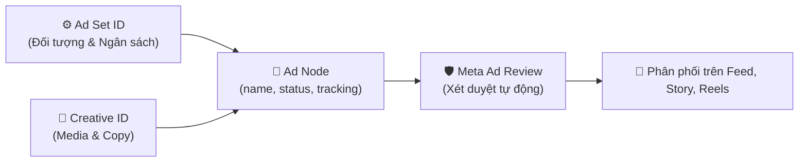

# 06. Khởi Tạo & Quản Lý Bài Quảng Cáo (Ads Management API)

Quảng cáo (Ad) là mắt xích cuối cùng kết nối **Nhóm quảng cáo** (chứa ngân sách, lịch chạy, tập khách hàng) với **Ad Creative** (chứa hình ảnh, video, thông điệp bài viết). Khi một Ad được tạo và kích hoạt thành công, hệ thống đấu giá của Meta sẽ bắt đầu phân phối nội dung tới người dùng mục tiêu.

---

## 1. Cấu Trúc Khởi Tạo Bài Quảng Cáo (Ad Entity)



### Các trường dữ liệu cốt lõi:
- `name`: Tên bài quảng cáo để quản trị nội bộ.
- `adset_id`: Mã định danh nhóm quảng cáo chứa Ad này.
- `creative`: Đối tượng chỉ định nội dung: `{"creative_id": "<CREATIVE_ID>"}`.
- `status`: Trạng thái ban đầu (`PAUSED` hoặc `ACTIVE`).
- `tracking_specs`: Mảng cấu hình theo dõi sự kiện chuyển đổi gắn với Pixel/Dataset.
- `url_tags`: Chuỗi tham số UTM tracking động tự động điền tên chiến dịch, vị trí quảng cáo.

---

## 2. API Thao Tác Với Bài Quảng Cáo

### 2.1. Khởi Tạo Bài Quảng Cáo (POST `/ads`)

Kết nối `adset_id` và `creative_id` vừa tạo ở các bước trước:

```bash
curl -i -X POST \
  "https://graph.facebook.com/v22.0/act_<AD_ACCOUNT_ID>/ads" \
  -H "Content-Type: application/json" \
  -d '{
    "name": "Ad 01 - Flash Sale Tet Banner A",
    "adset_id": "120205848572010234",
    "creative": {
      "creative_id": "120205849887010234"
    },
    "status": "PAUSED",
    "url_tags": "utm_source=facebook&utm_medium={{placement}}&utm_campaign={{campaign.name}}&utm_content={{ad.name}}",
    "access_token": "<YOUR_ACCESS_TOKEN>"
  }'
```

> **Mẹo cao cấp - Meta Dynamic URL Tags:**
> - `{{placement}}`: Tự động thay bằng `Facebook_Desktop_Feed`, `Instagram_Stories`, `Instagram_Reels`...
> - `{{campaign.name}}`: Tự động điền tên chiến dịch.
> - `{{ad.name}}`: Tự động điền tên bài quảng cáo giúp Google Analytics phân tích chi tiết.

**Phản hồi thành công:**
```json
{
  "id": "120205851234010234"
}
```

---

### 2.2. Lấy Chi Tiết Trạng Thái & Lý Do Không Duyệt (GET `/ads`)

Quảng cáo sau khi tạo sẽ trải qua quá trình máy học kiểm duyệt chính sách. Bạn cần kiểm tra trường `effective_status` và `ad_review_feedback`:

```bash
curl -i -X GET \
  "https://graph.facebook.com/v22.0/120205851234010234?\
fields=id,name,status,effective_status,ad_review_feedback,issues_info,created_time,updated_time\
&access_token=<YOUR_ACCESS_TOKEN>"
```

**Phản hồi JSON:**
```json
{
  "id": "120205851234010234",
  "name": "Ad 01 - Flash Sale Tet Banner A",
  "status": "PAUSED",
  "effective_status": "CAMPAIGN_PAUSED",
  "created_time": "2026-10-24T08:50:00+0000"
}
```

> **Bảng tra cứu `effective_status`:**
> - `ACTIVE`: Đang phân phối bình thường.
> - `PENDING_REVIEW`: Đang chờ kiểm duyệt chính sách.
> - `DISAPPROVED`: Bị từ chối do vi phạm tiêu chuẩn cộng đồng hoặc chính sách quảng cáo.
> - `PREAPPROVED`: Đã duyệt sơ bộ, chờ lịch kích hoạt.
> - `CAMPAIGN_PAUSED` / `ADSET_PAUSED`: Quảng cáo bật nhưng cấp cha (Campaign hoặc Ad Set) đang tắt.

---

### 2.3. Bật/Tắt Quảng Cáo Hoặc Đổi Creative (POST `/{AD_ID}`)

Kích hoạt quảng cáo chạy chính thức:

```bash
curl -i -X POST \
  "https://graph.facebook.com/v22.0/120205851234010234" \
  -H "Content-Type: application/json" \
  -d '{
    "status": "ACTIVE",
    "access_token": "<YOUR_ACCESS_TOKEN>"
  }'
```

Thay đổi Ad Creative sang phiên bản mới mà giữ nguyên lịch sử báo cáo:

```bash
curl -i -X POST \
  "https://graph.facebook.com/v22.0/120205851234010234" \
  -H "Content-Type: application/json" \
  -d '{
    "creative": {
      "creative_id": "120205849999010234"
    },
    "access_token": "<YOUR_ACCESS_TOKEN>"
  }'
```

---

## 3. API Tạo Link Xem Trước Quảng Cáo Thực Tế (Generate Previews)

Để kiểm tra xem bài quảng cáo hiển thị trên điện thoại người dùng trông như thế nào trước khi duyệt ngân sách, hãy gọi endpoint `generatepreviews`:

```bash
curl -i -X GET \
  "https://graph.facebook.com/v22.0/120205849887010234/generatepreviews?\
ad_format=MOBILE_FEED_STANDARD\
&access_token=<YOUR_ACCESS_TOKEN>"
```

**Các định dạng xem trước (`ad_format`):**
- `MOBILE_FEED_STANDARD`: Bảng tin Facebook trên di động.
- `DESKTOP_FEED_STANDARD`: Bảng tin Facebook trên máy tính.
- `INSTAGRAM_STANDARD`: Bảng tin Instagram (Feed).
- `INSTAGRAM_STORY`: Tin Instagram (Stories).
- `INSTAGRAM_REELS`: Thước phim Instagram (Reels).

**Phản hồi JSON:**
```json
{
  "data": [
    {
      "body": "<iframe src=\"https://www.facebook.com/ads/experience/render/?id=...\" width=\"100%\" height=\"600\" frameborder=\"0\"></iframe>"
    }
  ]
}
```
Nhúng chuỗi `iframe` này vào giao diện ứng dụng quản lý của bạn để khách hàng hoặc sếp duyệt mẫu quảng cáo trực quan 100%.

