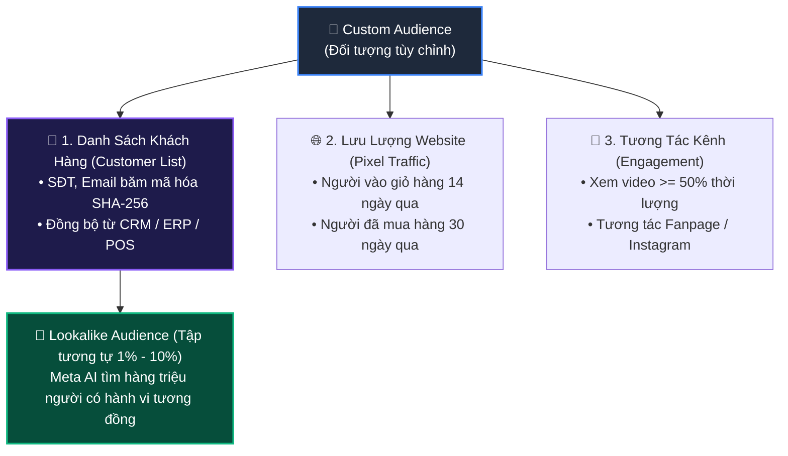

# 07. Đối Tượng Tùy Chỉnh & Đối Tượng Tương Tự (Custom & Lookalike Audiences)

Đối tượng tùy chỉnh (Custom Audience) và Đối tượng tương tự (Lookalike Audience) là vũ khí tối thượng giúp giảm chi phí mua khách hàng (CAC) và bùng nổ doanh số. Thay vì nhắm mục tiêu chung chung theo sở thích, bạn có thể tải danh sách số điện thoại/email khách hàng cũ lên để remarketing hoặc yêu cầu thuật toán Meta AI tìm kiếm 1% - 10% người dùng có hành vi giống hệt khách VIP của bạn.

---

## 1. Các Loại Đối Tượng Tùy Chỉnh Phổ Biến



---

## 2. Quy Chuẩn Chuẩn Hóa & Băm Dữ Liệu (SHA-256 Hashing)

Khi gửi dữ liệu khách hàng (PII) lên Meta, bạn **bắt buộc phải băm bằng thuật toán SHA-256** để đảm bảo tuân thủ quyền riêng tư:

| Trường thông tin | Mã trường Meta | Quy tắc chuẩn hóa trước khi băm SHA-256 | Ví dụ trước băm | Ví dụ sau băm SHA-256 |
| :--- | :--- | :--- | :--- | :--- |
| **Email** | `EMAIL` | Viết thường toàn bộ, bỏ khoảng trắng đầu/cuối | `nguyenvana@gmail.com` | `7a8c3...` (64 ký tự hex) |
| **Số điện thoại** | `PHONE` | Bỏ số 0 đầu, thêm mã quốc gia (Việt Nam là `84`), bỏ dấu chấm/khoảng trắng | `0912345678` -> `84912345678` | `4b9e2...` |
| **Tên** | `FN` | Viết thường, bỏ dấu câu và khoảng trắng thừa | `van a` | `1c89f...` |
| **Họ** | `LN` | Viết thường | `nguyen` | `3f2a1...` |
| **Quốc gia** | `COUNTRY` | Viết thường mã ISO 2 ký tự | `vn` | `3d681...` |

---

## 3. Quy Trình 3 Bước Tạo Tệp Đối Tượng Từ Danh Sách Khách Hàng (Customer List)

### Bước 3.1: Tạo Thùng Chứa Đối Tượng (POST `/customaudiences`)

```bash
curl -i -X POST \
  "https://graph.facebook.com/v22.0/act_<AD_ACCOUNT_ID>/customaudiences" \
  -H "Content-Type: application/json" \
  -d '{
    "name": "Tep Khach Hang VIP - Doanh Thu > 5 Trieu",
    "subtype": "CUSTOM",
    "description": "Dong bo tu he thong CRM ERP thang 10/2026",
    "customer_file_source": "USER_PROVIDED_ONLY",
    "access_token": "<YOUR_ACCESS_TOKEN>"
  }'
```

**Phản hồi:**
```json
{
  "id": "23849501827364"
}
```

---

### Bước 3.2: Tải Lên Dữ Liệu Khách Hàng Đã Băm (POST `/{CUSTOM_AUDIENCE_ID}/users`)

Đẩy danh sách Email và Số điện thoại đã băm SHA-256 (hỗ trợ đẩy tối đa 10.000 dòng mỗi request):

```bash
curl -i -X POST \
  "https://graph.facebook.com/v22.0/23849501827364/users" \
  -H "Content-Type: application/json" \
  -d '{
    "payload": {
      "schema": ["EMAIL_SHA256", "PHONE_SHA256"],
      "data": [
        ["7a8c3b4d5e6f708192a3b4c5d6e7f80912a3b4c5d6e7f80912a3b4c5d6e7f809", "4b9e2c3d4e5f60718293a4b5c6d7e80912a3b4c5d6e7f80912a3b4c5d6e7f809"],
        ["9876543210abcdef0123456789abcdef0123456789abcdef0123456789abcdef", "1234567890abcdef0123456789abcdef0123456789abcdef0123456789abcdef"]
      ]
    },
    "access_token": "<YOUR_ACCESS_TOKEN>"
  }'
```

**Phản hồi thành công:**
```json
{
  "users_received": 2,
  "num_received": 2,
  "num_invalid_entries": 0
}
```

> **Lưu ý tuân thủ Graph API v22.0:** Nếu chạy quảng cáo ngành tài chính, tuyển dụng hoặc bất động sản, bạn phải truyền thêm cờ xác nhận `is_sac_cfca_terms_certified: true`.

---

## 4. API Tạo Tập Tương Tự (Lookalike Audience 1% - 10%)

Dựa trên tệp khách hàng VIP ở trên, yêu cầu Meta tìm kiếm 1% người dùng tương tự nhất tại Việt Nam:

```bash
curl -i -X POST \
  "https://graph.facebook.com/v22.0/act_<AD_ACCOUNT_ID>/customaudiences" \
  -H "Content-Type: application/json" \
  -d '{
    "name": "Lookalike 1% - Khach Hang VIP Vietnam",
    "subtype": "LOOKALIKE",
    "origin_audience_id": "23849501827364",
    "lookalike_spec": {
      "type": "similarity",
      "country": "VN",
      "ratio": 0.01
    },
    "access_token": "<YOUR_ACCESS_TOKEN>"
  }'
```

> **Giải thích tham số `ratio`:**
> - `0.01`: 1% dân số Facebook tại quốc gia mục tiêu (Độ chính xác cao nhất, tệp khoảng 700.000 - 800.000 người tại VN).
> - `0.02`: 2% (Cân bằng giữa độ chính xác và quy mô).
> - `0.05` đến `0.10`: 5% - 10% (Tập rộng để mở rộng quy mô khi scale ngân sách lớn).

**Phản hồi:**
```json
{
  "id": "23849501999988"
}
```
Lấy mã `id` này điền vào trường `targeting.custom_audiences` trong Ad Set để bắt đầu nhắm mục tiêu.

