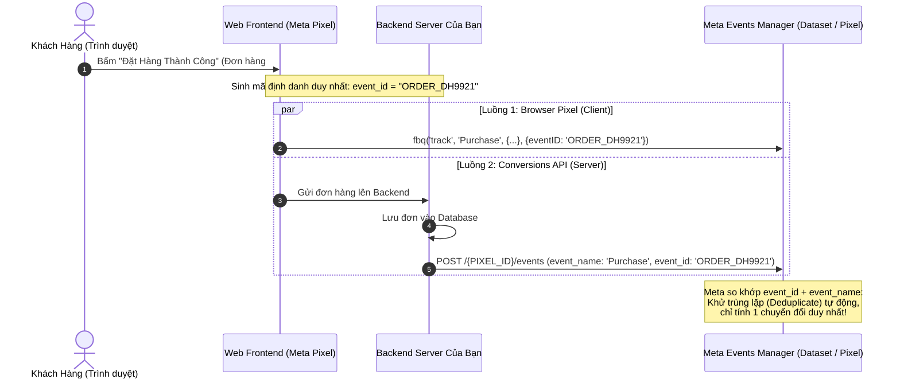

# 08. Conversions API (CAPI) & Đo Lường Phía Máy Chủ (Server-Side Tracking)

Trong kỷ nguyên bảo mật dữ liệu nghiêm ngặt (Apple iOS 14.5+ App Tracking Transparency, cơ chế Safari ITP và các tiện ích AdBlock trên trình duyệt), mã theo dõi Meta Pixel truyền thống phía client có thể bị thất thoát từ **30% đến 50%** dữ liệu chuyển đổi.

**Conversions API (CAPI)** là giao thức máy chủ tới máy chủ (Server-to-Server) giúp bạn bắn tín hiệu sự kiện mua hàng, đăng ký, thêm vào giỏ hàng trực tiếp từ backend máy chủ của bạn sang hệ thống Meta.

---

## 1. Cơ Chế Bắn Tín Hiệu Song Song & Khử Trùng Lặp (Deduplication)

Meta khuyến nghị triển khai mô hình **Hybrid (Song song cả Pixel Web và CAPI Server)** để đạt tỷ lệ quy kết doanh số cao nhất:



> ⚠️ **Quy tắc vàng về Khử trùng lặp (Deduplication):**
> 1. `event_name` phải giống hệt nhau (ví dụ cùng là `"Purchase"`).
> 2. `event_id` phải là một chuỗi duy nhất khớp nhau 100% giữa hai luồng (ví dụ: mã đơn hàng hoặc mã phiên giao dịch).
> 3. `event_id` **bắt buộc đặt ở tầng ngoài cùng** của đối tượng sự kiện, không được nhét vào trong `custom_data`.

---

## 2. Cấu Trúc Payload Chuẩn Của Conversions API

Endpoint tiếp nhận sự kiện: `POST https://graph.facebook.com/v22.0/{PIXEL_ID}/events`

```json
{
  "data": [
    {
      "event_name": "Purchase",
      "event_time": 1740000000,
      "event_id": "ORDER_DH9921",
      "event_source_url": "https://myshop.vn/checkout/success?order_id=DH9921",
      "action_source": "website",
      "user_data": {
        "em": [
          "7a8c3b4d5e6f708192a3b4c5d6e7f80912a3b4c5d6e7f80912a3b4c5d6e7f809"
        ],
        "ph": [
          "4b9e2c3d4e5f60718293a4b5c6d7e80912a3b4c5d6e7f80912a3b4c5d6e7f809"
        ],
        "client_ip_address": "113.190.234.12",
        "client_user_agent": "Mozilla/5.0 (iPhone; CPU iPhone OS 17_4 like Mac OS X) AppleWebKit/605.1.15",
        "fbc": "fb.1.1739000000.IwAR2_EXAMPLE_FBCLID",
        "fbp": "fb.1.1739000000.1234567890"
      },
      "custom_data": {
        "currency": "VND",
        "value": 1450000,
        "content_type": "product",
        "contents": [
          {
            "id": "SKU_AO_KHOAC_01",
            "quantity": 1,
            "item_price": 950000
          },
          {
            "id": "SKU_NON_LEN_02",
            "quantity": 2,
            "item_price": 250000
          }
        ],
        "order_id": "DH9921"
      }
    }
  ],
  "test_event_code": "TEST89123"
}
```

---

## 3. Bảng Giải Nghĩa Chi Tiết Các Tham Số

### 3.1. Tham số định danh người dùng (`user_data`) - Quyết định điểm chất lượng Event Match Quality (EMQ):
- `em`: Mảng chứa địa chỉ email đã viết thường, bỏ khoảng trắng và băm SHA-256.
- `ph`: Mảng số điện thoại kèm mã quốc tế (VD: `84912345678`) đã băm SHA-256.
- `client_ip_address`: Địa chỉ IP thực của khách hàng (lấy từ Header `X-Forwarded-For` trên máy chủ).
- `client_user_agent`: Chuỗi User Agent trình duyệt của khách hàng.
- `fbc`: Giá trị cookie `_fbc` (chứa Click ID `fbclid` khi người dùng bấm vào quảng cáo Facebook).
- `fbp`: Giá trị cookie `_fbp` (Meta Browser ID do Pixel tạo trên trình duyệt).

> **Lời khuyên thực chiến:** Khi bạn truyền đủ cả `em`, `ph`, `client_ip_address`, `client_user_agent`, `fbp` và `fbc`, điểm **Event Match Quality** sẽ đạt **8.5/10 - 10/10**, giúp AI của Meta tối ưu máy học chuyển đổi chính xác gần như tuyệt đối.

### 3.2. Tham số sự kiện (`custom_data`):
- `currency`: Mã tiền tệ ISO (ví dụ: `"VND"`, `"USD"`).
- `value`: Tổng giá trị thanh toán của đơn hàng (dạng số).
- `contents`: Danh sách các SKU hàng hóa trong đơn, giúp thuật toán nhận biết khách đã mua sản phẩm nào để tự động loại trừ hoặc gợi ý sản phẩm bán kèm (Cross-sell).

---

## 4. Lệnh cURL Gửi Sự Kiện Chuyển Đổi Thực Tế

```bash
curl -i -X POST \
  "https://graph.facebook.com/v22.0/<PIXEL_ID>/events" \
  -H "Content-Type: application/json" \
  -d '{
    "data": [
      {
        "event_name": "Purchase",
        "event_time": 1740000000,
        "event_id": "ORDER_DH9921",
        "action_source": "website",
        "user_data": {
          "em": ["7a8c3b4d5e6f708192a3b4c5d6e7f80912a3b4c5d6e7f80912a3b4c5d6e7f809"],
          "client_ip_address": "113.190.234.12",
          "client_user_agent": "Mozilla/5.0 (Macintosh; Intel Mac OS X 10_15_7)"
        },
        "custom_data": {
          "currency": "VND",
          "value": 1450000
        }
      }
    ],
    "access_token": "<YOUR_ACCESS_TOKEN>"
  }'
```

**Phản hồi thành công từ Meta:**
```json
{
  "events_received": 1,
  "messages": [],
  "fbtrace_id": "Abc123XyZ..."
}
```

---

## 5. Mã Nguồn Mẫu Bắn CAPI Tự Động Bằng Python

Dưới đây là module hoàn chỉnh có sẵn cơ chế tự động chuẩn hóa và băm SHA-256 dữ liệu:

```python
import hashlib
import time
import requests

def hash_sha256(value: str) -> str:
    """Chuẩn hóa viết thường, bỏ khoảng trắng và băm SHA-256."""
    if not value:
        return ""
    clean_val = value.strip().lower()
    return hashlib.sha256(clean_val.encode('utf-8')).hexdigest()

def normalize_vn_phone(phone: str) -> str:
    """Đổi 0912345678 thành 84912345678 rồi băm."""
    p = phone.strip().replace(" ", "").replace(".", "").replace("+", "")
    if p.startswith("0"):
        p = "84" + p[1:]
    return hash_sha256(p)

def send_capi_purchase_event(pixel_id: str, access_token: str, order_info: dict, test_code: str = None):
    url = f"https://graph.facebook.com/v22.0/{pixel_id}/events"
    
    event_payload = {
        "event_name": "Purchase",
        "event_time": int(time.time()),
        "event_id": order_info["order_id"],
        "event_source_url": order_info.get("source_url", "https://myshop.vn"),
        "action_source": "website",
        "user_data": {
            "em": [hash_sha256(order_info["email"])],
            "ph": [normalize_vn_phone(order_info["phone"])],
            "client_ip_address": order_info.get("client_ip"),
            "client_user_agent": order_info.get("user_agent"),
            "fbp": order_info.get("fbp"),
            "fbc": order_info.get("fbc")
        },
        "custom_data": {
            "currency": order_info.get("currency", "VND"),
            "value": float(order_info["total_amount"]),
            "order_id": order_info["order_id"],
            "contents": order_info.get("items", [])
        }
    }

    body = {
        "data": [event_payload],
        "access_token": access_token
    }
    
    if test_code:
        body["test_event_code"] = test_code

    response = requests.post(url, json=body, timeout=10)
    return response.json()

# Ví dụ chạy thử:
if __name__ == "__main__":
    order_data = {
        "order_id": "DH_20261024_01",
        "email": "khachhang@gmail.com",
        "phone": "0987654321",
        "total_amount": 550000,
        "currency": "VND",
        "client_ip": "14.232.208.50",
        "user_agent": "Mozilla/5.0...",
        "items": [{"id": "AO_THUN_01", "quantity": 1, "item_price": 550000}]
    }
    # res = send_capi_purchase_event("PIXEL_ID", "TOKEN", order_data, test_code="TEST12345")
    # print(res)
```

---

## 6. Hướng Dẫn Kiểm Thử Bằng Công Cụ "Test Events" Của Meta

1. Truy cập **Meta Events Manager** (`business.facebook.com/events_manager`).
2. Chọn Pixel / Dataset mục tiêu > Chuyển qua tab **Test Events (Thử nghiệm sự kiện)**.
3. Trong mục **Confirm your server events are set up correctly**, sao chép chuỗi mã thử nghiệm (ví dụ: `TEST89123`).
4. Điền mã này vào trường `test_event_code` trong payload CAPI.
5. Thực hiện gửi request. Trong vòng 1 giây, bạn sẽ thấy sự kiện xuất hiện tức thì trên màn hình giao diện của Meta kèm nhãn trạng thái khử trùng lặp `Deduplicated` hoặc `Processed`.

