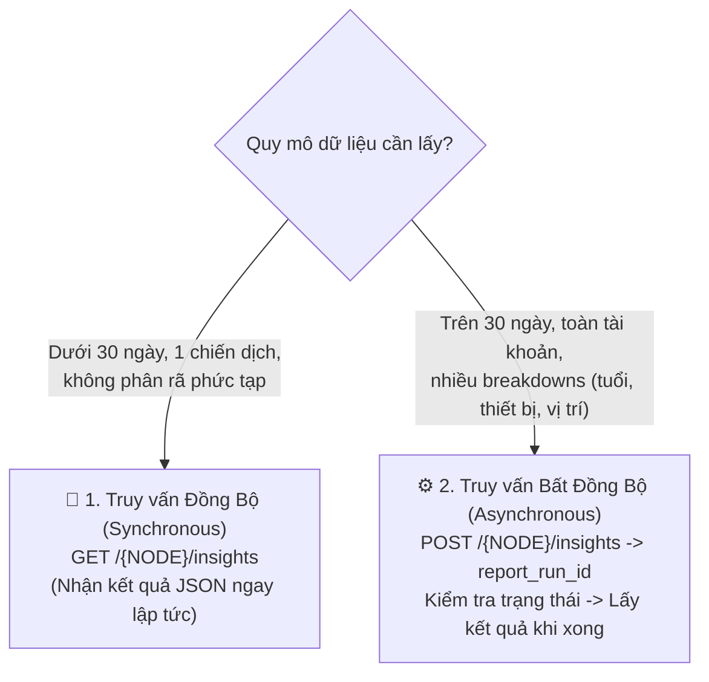

# 09. Báo Cáo Hiệu Suất & Phân Tích Dữ Liệu (Insights API)

Insights API là công cụ đắc lực nhất giúp các nhà phát triển và data analyst rút trích toàn bộ dữ liệu hiệu suất quảng cáo (chi tiêu, hiển thị, lượt nhấp, chuyển đổi, doanh thu, ROAS) từ cấp tài khoản cho đến từng bài quảng cáo riêng lẻ.

---

## 1. Hai Cơ Chế Truy Vấn: Đồng Bộ (Sync) vs Bất Đồng Bộ (Async)



> 💡 **Khuyến nghị kỹ thuật:** Khi xây dựng hệ thống ETL/Data Pipeline kéo báo cáo hàng đêm hoặc Dashboard BI, hãy **luôn luôn dùng cơ chế Bất đồng bộ (Async)** để tránh lỗi quá tải (Timeout 504) và không bị giới hạn Rate Limit.

---

## 2. Danh Mục Các Chỉ Số Hiệu Suất Sống Còn (`fields`)

| Tên trường (`fields`) | Ý nghĩa nghiệp vụ | Đơn vị tính |
| :--- | :--- | :--- |
| `spend` | Tổng số tiền đã chi tiêu trong kỳ | Tiền tệ (VND/USD) |
| `impressions` | Số lần quảng cáo xuất hiện trên màn hình | Lượt |
| `reach` | Số người dùng duy nhất nhìn thấy quảng cáo | Người |
| `frequency` | Tần suất hiển thị trung bình trên mỗi người (`impressions / reach`) | Lần / người |
| `clicks` | Tổng số lượt nhấp vào quảng cáo | Lượt |
| `cpc` | Chi phí trung bình cho mỗi lượt nhấp (`spend / clicks`) | Tiền tệ / click |
| `cpm` | Chi phí cho mỗi 1.000 lượt hiển thị | Tiền tệ / 1000 impr |
| `ctr` | Tỷ lệ nhấp chuột (`clicks / impressions * 100%`) | % |
| `actions` | Mảng chứa toàn bộ các hành động chuyển đổi (mua hàng, lead, add to cart...) | Mảng Object |
| `action_values`| Tổng doanh thu tương ứng theo từng loại chuyển đổi | Mảng Object |
| `purchase_roas`| Tỷ suất hoàn vốn chi tiêu quảng cáo (Doanh thu / Chi tiêu) | Hệ số (VD: 3.5) |

---

## 3. Phân Rã Dữ Liệu Đa Chiều (`breakdowns`)

Bạn có thể chia nhỏ dữ liệu báo cáo theo các khía cạnh phân tích bằng tham số `breakdowns`:
- **Nhân khẩu học**: `age`, `gender`.
- **Vị trí hiển thị**: `publisher_platform` (facebook, instagram, audience_network), `platform_position` (feed, story, reel), `impression_device` (iphone, android_smartphone, desktop).
- **Địa lý**: `country`, `region`.
- **Thời gian**: `hourly_stats_aggregated_by_audience_time_zone` (Báo cáo hiệu suất theo từng khung giờ trong ngày).

---

## 4. Thực Thi Truy Vấn Báo Cáo

### 4.1. Truy Vấn Đồng Bộ (GET) - Xem Nhanh Hôm Nay

Lấy báo cáo chi tiêu, lượt click, CTR, CPC và doanh số mua hàng của toàn bộ tài khoản trong ngày hôm nay:

```bash
curl -i -X GET \
  "https://graph.facebook.com/v22.0/act_<AD_ACCOUNT_ID>/insights?\
fields=campaign_name,spend,impressions,reach,clicks,ctr,cpc,actions,action_values,purchase_roas\
&date_preset=today\
&level=campaign\
&access_token=<YOUR_ACCESS_TOKEN>"
```

**Phản hồi mẫu:**
```json
{
  "data": [
    {
      "campaign_name": "Tet 2026 - Chien Dich Doanh So Flash Sale",
      "spend": "1500000",
      "impressions": "68500",
      "reach": "52000",
      "clicks": "1850",
      "ctr": "2.70",
      "cpc": "810.81",
      "actions": [
        {"action_type": "link_click", "value": "1850"},
        {"action_type": "purchase", "value": "42"}
      ],
      "action_values": [
        {"action_type": "purchase", "value": "18900000"}
      ],
      "purchase_roas": [
        {"action_type": "purchase", "value": "12.6"}
      ],
      "date_start": "2026-10-24",
      "date_stop": "2026-10-24"
    }
  ]
}
```

---

### 4.2. Truy Vấn Bất Đồng Bộ (Async Job) - Kéo Dữ Liệu Lớn

#### Bước 1: Khởi tạo tiến trình xuất báo cáo (POST)

```bash
curl -i -X POST \
  "https://graph.facebook.com/v22.0/act_<AD_ACCOUNT_ID>/insights" \
  -H "Content-Type: application/json" \
  -d '{
    "level": "ad",
    "fields": "campaign_name,adset_name,ad_name,spend,impressions,clicks,actions,purchase_roas",
    "date_preset": "last_30d",
    "breakdowns": "age,gender",
    "access_token": "<YOUR_ACCESS_TOKEN>"
  }'
```

**Phản hồi:**
```json
{
  "report_run_id": "192837465012345"
}
```

#### Bước 2: Kiểm tra trạng thái hoàn thành tiến trình (GET `/{report_run_id}`)

```bash
curl -i -X GET \
  "https://graph.facebook.com/v22.0/192837465012345?access_token=<YOUR_ACCESS_TOKEN>"
```

**Phản hồi khi đang xử lý:**
```json
{
  "id": "192837465012345",
  "async_status": "Job Running",
  "async_percent_completion": 65
}
```

**Phản hồi khi đã xong:**
```json
{
  "id": "192837465012345",
  "async_status": "Job Completed",
  "async_percent_completion": 100
}
```

#### Bước 3: Tải dữ liệu kết quả báo cáo (GET `/{report_run_id}/insights`)

```bash
curl -i -X GET \
  "https://graph.facebook.com/v22.0/192837465012345/insights?limit=1000&access_token=<YOUR_ACCESS_TOKEN>"
```

---

## 5. Script Python Tự Động Kéo Báo Cáo Async Hoàn Chỉnh

```python
import time
import requests

def run_async_insights_report(ad_account_id: str, access_token: str):
    base_url = "https://graph.facebook.com/v22.0"
    
    # 1. Bắt đầu Job
    post_url = f"{base_url}/act_{ad_account_id}/insights"
    payload = {
        "level": "campaign",
        "fields": "campaign_name,spend,impressions,clicks,ctr,purchase_roas",
        "date_preset": "last_7d",
        "access_token": access_token
    }
    init_res = requests.post(post_url, json=payload).json()
    report_id = init_res.get("report_run_id")
    print(f"[*] Đã khởi tạo Async Job ID: {report_id}")
    
    # 2. Vòng lặp chờ Job hoàn tất
    while True:
        status_url = f"{base_url}/{report_id}?access_token={access_token}"
        status_res = requests.get(status_url).json()
        status = status_res.get("async_status")
        percent = status_res.get("async_percent_completion", 0)
        print(f"[*] Tiến độ: {percent}% ({status})")
        
        if status == "Job Completed":
            break
        elif status in ["Job Failed", "Job Skipped"]:
            raise Exception(f"Lỗi xuất báo cáo: {status}")
            
        time.sleep(3)  # Chờ 3 giây kiểm tra lại
        
    # 3. Lấy dữ liệu
    data_url = f"{base_url}/{report_id}/insights?limit=500&access_token={access_token}"
    data_res = requests.get(data_url).json()
    return data_res.get("data", [])
```

