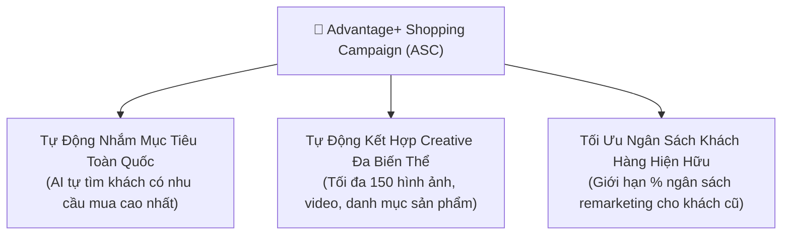
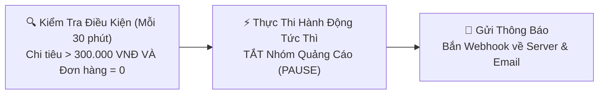

# 10. Chiến Dịch Thông Minh Advantage+ & Bộ Máy Quy Tắc Tự Động (Automated Rules)

Hệ sinh thái Meta AI ngày càng tự động hóa sâu vào từng phiên đấu giá. Nắm vững **Advantage+ Shopping Campaigns (ASC)** và **Automated Rules Engine API** cho phép bạn giải phóng sức lao động thủ công, tự động tăng ngân sách cho quảng cáo "thắng" (Winning Ads) và tự động tắt ngay lập tức các bài quảng cáo gây lỗ chi phí.

---

## 1. Chiến Dịch Mua Sắm Thông Minh Advantage+ (ASC)

Advantage+ Shopping Campaigns (ASC) là định dạng chiến dịch ứng dụng máy học toàn diện nhất của Meta cho thương mại điện tử. Thay vì chia nhỏ nhiều nhóm đối tượng, ASC gộp toàn bộ khách hàng (khách mới tiềm năng + khách cũ mua lại) vào một chiến dịch duy nhất và tự động phân bổ ngân sách theo thời gian thực.



### Khởi tạo Chiến Dịch ASC qua API:

```bash
curl -i -X POST \
  "https://graph.facebook.com/v22.0/act_<AD_ACCOUNT_ID>/campaigns" \
  -H "Content-Type: application/json" \
  -d '{
    "name": "ASC - Chien Dich Advantage+ Shopping Tet 2026",
    "objective": "OUTCOME_SALES",
    "smart_promotion_type": "SMART_SHOPPING_CAMPAIGN",
    "status": "PAUSED",
    "special_ad_categories": [],
    "daily_budget": "5000000",
    "access_token": "<YOUR_ACCESS_TOKEN>"
  }'
```

---

## 2. Bộ Máy Quy Tắc Tự Động (Automated Rules Engine API)

Thay vì phải duy trì máy chủ chạy cron job kiểm tra liên tục mỗi phút, bạn có thể thiết lập **Automated Rules** ngay trên hạ tầng của Meta thông qua API. Hệ thống Meta sẽ tự động quét các chỉ số và thực hiện hành động (Tắt nhóm quảng cáo, Tăng ngân sách, Bắn email/Webhook cảnh báo).



---

## 3. Tạo Quy Tắc Tự Động: Tắt Quảng Cáo Kém Hiệu Quả (Stop-Loss Rule)

Tạo quy tắc: *Nếu trong ngày hôm nay, một Ad Set đã tiêu quá 300.000 VNĐ mà không ra bất kỳ đơn mua hàng nào (`purchase == 0`), tự động TẮT nhóm quảng cáo đó ngay lập tức*:

```bash
curl -i -X POST \
  "https://graph.facebook.com/v22.0/act_<AD_ACCOUNT_ID>/adrules_library" \
  -H "Content-Type: application/json" \
  -d '{
    "name": "Quy Tac Tu Dong: Cat Lo Ad Set Khong Ra Don",
    "status": "ACTIVE",
    "evaluation_spec": {
      "evaluation_type": "SCHEDULE",
      "filters": [
        {
          "field": "entity_type",
          "value": "ADSET",
          "operator": "EQUAL"
        },
        {
          "field": "time_preset",
          "value": "TODAY",
          "operator": "EQUAL"
        },
        {
          "field": "spend",
          "value": 300000,
          "operator": "GREATER_THAN"
        },
        {
          "field": "actions:purchase",
          "value": 0,
          "operator": "EQUAL"
        }
      ]
    },
    "execution_spec": {
      "execution_type": "PAUSE"
    },
    "schedule_spec": {
      "schedule_type": "HOURLY"
    },
    "access_token": "<YOUR_ACCESS_TOKEN>"
  }'
```

**Phản hồi:**
```json
{
  "id": "1928374650998877"
}
```

---

## 4. Tạo Quy Tắc Tự Động: Tăng Ngân Sách Khi ROAS Ngon (Scale-Up Rule)

Tạo quy tắc: *Nếu trong 3 ngày qua, nhóm quảng cáo đạt ROAS >= 3.0 và có tối thiểu 5 đơn hàng, tự động TĂNG 20% ngân sách hàng ngày (giới hạn tối đa 5.000.000 VNĐ/ngày)*:

```bash
curl -i -X POST \
  "https://graph.facebook.com/v22.0/act_<AD_ACCOUNT_ID>/adrules_library" \
  -H "Content-Type: application/json" \
  -d '{
    "name": "Quy Tac Tu Dong: Scale 20% Ngan Sach Khi ROAS >= 3.0",
    "status": "ACTIVE",
    "evaluation_spec": {
      "evaluation_type": "SCHEDULE",
      "filters": [
        {
          "field": "entity_type",
          "value": "ADSET",
          "operator": "EQUAL"
        },
        {
          "field": "time_preset",
          "value": "LAST_3D",
          "operator": "EQUAL"
        },
        {
          "field": "purchase_roas:purchase",
          "value": 3.0,
          "operator": "GREATER_THAN"
        },
        {
          "field": "actions:purchase",
          "value": 5,
          "operator": "GREATER_THAN"
        }
      ]
    },
    "execution_spec": {
      "execution_type": "CHANGE_BUDGET",
      "change_spec": {
        "amount": 20,
        "unit": "PERCENTAGE"
      }
    },
    "schedule_spec": {
      "schedule_type": "DAILY"
    },
    "access_token": "<YOUR_ACCESS_TOKEN>"
  }'
```

---

## 5. Quản Lý & Tắt Quy Tắc Tự Động

- **Lấy danh sách các quy tắc đang chạy:**
  ```bash
  curl -i -X GET \
    "https://graph.facebook.com/v22.0/act_<AD_ACCOUNT_ID>/adrules_library?fields=id,name,status,evaluation_spec,execution_spec&access_token=<YOUR_ACCESS_TOKEN>"
  ```
- **Tạm dừng quy tắc:**
  ```bash
  curl -i -X POST \
    "https://graph.facebook.com/v22.0/<RULE_ID>" \
    -d "status=PAUSED&access_token=<YOUR_ACCESS_TOKEN>"
  ```

