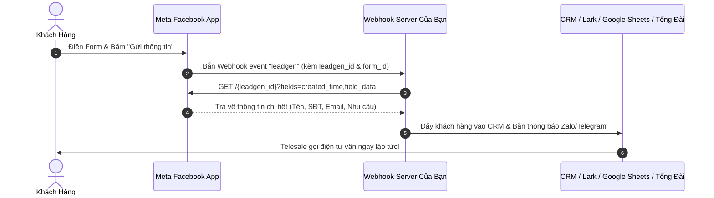

# 11. Khách Hàng Tiềm Năng Tức Thì (Lead Ads API & CRM Sync)

Quảng cáo tìm kiếm khách hàng tiềm năng (Meta Lead Ads) sử dụng **Mẫu biểu tức thì (Instant Forms)** hiển thị trực tiếp trong ứng dụng Facebook/Instagram mà không cần tải trang web ngoài. Do hệ thống tự động điền sẵn tên, số điện thoại và email từ hồ sơ người dùng, tỷ lệ chuyển đổi thu Lead thường cao gấp **2 đến 3 lần** so với Landing page thông thường.

---

## 1. Kiến Trúc Đồng Bộ Lead Về CRM Thời Gian Thực (< 60 Giây)

Quy tắc vàng trong bán hàng: *"Khách hàng được telesale liên hệ trong vòng 5 phút đầu tiên có tỷ lệ chốt đơn cao gấp 9 lần so với sau 30 phút"*. Tích hợp Lead Ads API cho phép bạn bắn dữ liệu khách hàng về CRM/Zalo/Telesale trong chưa đầy 1 phút:



---

## 2. Quyền Hạn Cần Thiết (Permissions Required)

Để lấy được dữ liệu khách hàng tiềm năng, Access Token bắt buộc phải có các quyền sau:
- `leads_retrieval`: Quyền giải mã và đọc thông tin cá nhân khách hàng trong Lead.
- `pages_read_engagement` & `pages_manage_ads`: Quyền kết nối với Fanpage sở hữu Form.

---

## 3. Các API Thao Tác Với Lead Ads

### 3.1. Rút Trích Chi Tiết 1 Lead Theo Mã (`GET /{LEADGEN_ID}`)

Khi máy chủ của bạn nhận được tín hiệu Webhook chứa `leadgen_id`, hãy gọi ngay endpoint này:

```bash
curl -i -X GET \
  "https://graph.facebook.com/v22.0/<LEADGEN_ID>?\
fields=id,created_time,ad_id,ad_name,form_id,field_data\
&access_token=<YOUR_PAGE_OR_SYSTEM_USER_TOKEN>"
```

**Phản hồi JSON chi tiết:**
```json
{
  "id": "456789012345678",
  "created_time": "2026-10-24T09:15:30+0000",
  "ad_id": "120205851234010234",
  "ad_name": "Ad 01 - Lead Gen Dang Ky Lai Thu",
  "form_id": "987654321098765",
  "field_data": [
    {
      "name": "full_name",
      "values": ["Nguyễn Văn An"]
    },
    {
      "name": "phone_number",
      "values": ["+84912345678"]
    },
    {
      "name": "email",
      "values": ["nguyenvanan@gmail.com"]
    },
    {
      "name": "thoi_gian_lai_thu_mong_muon",
      "values": ["Cuối tuần này (Thứ 7)"]
    }
  ]
}
```

---

### 3.2. Tải Toàn Bộ Danh Sách Khách Hàng Từ Một Form (`GET /{FORM_ID}/leads`)

Dùng để quét định kỳ hoặc tải lại dữ liệu khi mất kết nối Webhook:

```bash
curl -i -X GET \
  "https://graph.facebook.com/v22.0/<FORM_ID>/leads?\
fields=id,created_time,field_data\
&limit=100\
&access_token=<YOUR_PAGE_OR_SYSTEM_USER_TOKEN>"
```

---

## 4. Xử Lý Phân Giải Mảng `field_data` Bằng Mã Nguồn (Python)

```python
def parse_lead_data(raw_lead_json: dict) -> dict:
    """Chuyển đổi mảng field_data của Meta thành dict dễ đọc cho CRM."""
    parsed = {
        "lead_id": raw_lead_json.get("id"),
        "created_time": raw_lead_json.get("created_time"),
        "ad_id": raw_lead_json.get("ad_id"),
        "form_id": raw_lead_json.get("form_id"),
    }
    
    for item in raw_lead_json.get("field_data", []):
        field_name = item.get("name")
        field_values = item.get("values", [])
        parsed[field_name] = field_values[0] if field_values else None
        
    return parsed

# Ví dụ kết quả sau khi parse:
# {
#   "lead_id": "456789012345678",
#   "full_name": "Nguyễn Văn An",
#   "phone_number": "+84912345678",
#   "email": "nguyenvanan@gmail.com",
#   "thoi_gian_lai_thu_mong_muon": "Cuối tuần này (Thứ 7)"
# }
```

---

## 5. Đăng Ký Nhận Lead Qua Webhook Fanpage

Để máy chủ nhận Webhook mỗi khi có khách gửi form, bạn cần đăng ký ứng dụng theo dõi Fanpage:

```bash
curl -i -X POST \
  "https://graph.facebook.com/v22.0/<PAGE_ID>/subscribed_apps" \
  -d "subscribed_fields=leadgen&access_token=<YOUR_PAGE_ACCESS_TOKEN>"
```

**Phản hồi:**
```json
{
  "success": true
}
```
Từ thời điểm này, mọi khách hàng điền form trên Fanpage sẽ lập tức kích hoạt Webhook bắn về máy chủ của bạn trong tích tắc!

