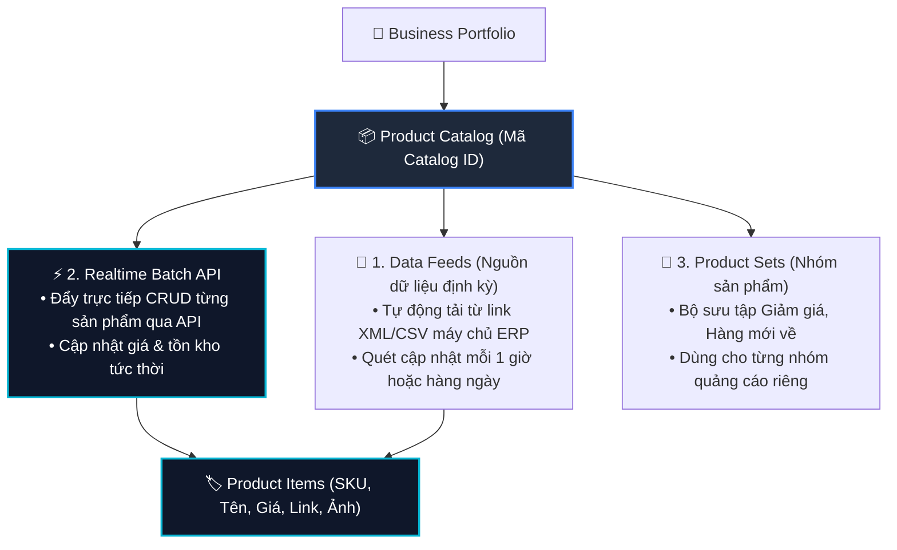

# 12. Quản Lý Danh Mục Sản Phẩm (Catalog Management API)

Danh mục sản phẩm (Product Catalog) là kho chứa toàn bộ thông tin hàng hóa (SKU, giá bán, tồn kho, hình ảnh, đường dẫn sản phẩm). Catalog đóng vai trò là "trái tim" cung cấp dữ liệu cho hai nghiệp vụ cốt lõi:
1. **Quảng cáo động Advantage+ Catalog Ads (DPA)**: Tự động hiển thị đúng món đồ người dùng vừa xem trên website/ứng dụng.
2. **Cửa hàng Meta Shops**: Trưng bày gian hàng trên Facebook Page và Instagram Shop.

---

## 1. Kiến Trúc Cấu Trúc Catalog



---

## 2. Chuẩn Thuộc Tính Sản Phẩm (Meta Product Spec)

Khi gửi dữ liệu sản phẩm lên Catalog, bạn cần tuân thủ các trường dữ liệu tiêu chuẩn sau:

| Tên trường | Bắt buộc? | Kiểu dữ liệu | Mô tả & Quy chuẩn | Ví dụ |
| :--- | :--- | :--- | :--- | :--- |
| `id` | **Có** | Chuỗi (Max 100) | Mã định danh duy nhất (SKU) của sản phẩm trong kho của bạn | `"SKU-VAY-HOA-01"` |
| `title` | **Có** | Chuỗi (Max 150) | Tên sản phẩm rõ ràng, không viết hoa toàn bộ | `"Váy Hoa Nhí Vintage Dáng Xòe"` |
| `description` | **Có** | Chuỗi (Max 5000)| Mô tả chất liệu, kiểu dáng, công dụng | `"Chất liệu voan hàn mềm mại, thoáng mát..."` |
| `availability`| **Có** | Enum | Tình trạng tồn kho: `in stock`, `out of stock`, `preorder` | `"in stock"` |
| `condition` | **Có** | Enum | Tình trạng hàng: `new`, `refurbished`, `used` | `"new"` |
| `price` | **Có** | Chuỗi | Giá bán hiện tại kèm mã tiền tệ | `"350000 VND"` |
| `link` | **Có** | URL | Đường dẫn trang chi tiết sản phẩm trên website | `"https://myshop.vn/p/vay-hoa-01"` |
| `image_link` | **Có** | URL | Đường dẫn ảnh đại diện chất lượng cao (tối thiểu 500x500px)| `"https://cdn.myshop.vn/img/vay-01.jpg"` |
| `brand` | **Có** | Chuỗi | Thương hiệu sản phẩm | `"Zara"`, `"OEM"` |

---

## 3. Các API Quản Trị Catalog

### 3.1. Tạo Catalog Mới Trong Doanh Nghiệp (POST)

```bash
curl -i -X POST \
  "https://graph.facebook.com/v22.0/<BUSINESS_ID>/owned_product_catalogs" \
  -H "Content-Type: application/json" \
  -d '{
    "name": "Catalog Kho Tong E-Commerce 2026",
    "access_token": "<YOUR_ACCESS_TOKEN>"
  }'
```

**Phản hồi:**
```json
{
  "id": "1928374650112233"
}
```

---

### 3.2. Cập Nhật Sản Phẩm Thời Gian Thực Bằng Batch API (`POST /{CATALOG_ID}/batch`)

Batch API là phương thức tối ưu nhất để thêm, sửa giá hoặc cập nhật tồn kho hàng loạt (tối đa 10.000 sản phẩm mỗi request):

```bash
curl -i -X POST \
  "https://graph.facebook.com/v22.0/1928374650112233/batch" \
  -H "Content-Type: application/json" \
  -d '{
    "requests": [
      {
        "method": "CREATE",
        "data": {
          "id": "SKU-VAY-HOA-01",
          "title": "Váy Hoa Nhí Vintage Dáng Xòe",
          "description": "Váy thiết kế nữ tính, chất vải voan hàn cao cấp.",
          "availability": "in stock",
          "condition": "new",
          "price": "350000 VND",
          "link": "https://myshop.vn/p/vay-hoa-01",
          "image_link": "https://cdn.myshop.vn/img/vay-01.jpg",
          "brand": "MyBrand"
        }
      },
      {
        "method": "UPDATE",
        "data": {
          "id": "SKU-AO-KHOAC-02",
          "price": "499000 VND",
          "availability": "in stock"
        }
      },
      {
        "method": "DELETE",
        "data": {
          "id": "SKU-HANG-CU-09"
        }
      }
    ],
    "access_token": "<YOUR_ACCESS_TOKEN>"
  }'
```

**Phản hồi thành công:**
```json
{
  "handles": [
    "batch_upload_1740000000_123"
  ]
}
```

---

### 3.3. Tạo Nhóm Sản Phẩm (Product Set) Cho Chiến Dịch Bán Hàng

Tạo một Product Set lọc toàn bộ các sản phẩm có giá trên 300.000 VNĐ để chạy quảng cáo cao cấp:

```bash
curl -i -X POST \
  "https://graph.facebook.com/v22.0/1928374650112233/product_sets" \
  -H "Content-Type: application/json" \
  -d '{
    "name": "Bo Suu Tap Cao Cap (> 300k)",
    "filter": {
      "price": {
        "gt": 300000
      }
    },
    "access_token": "<YOUR_ACCESS_TOKEN>"
  }'
```

**Phản hồi:**
```json
{
  "id": "283746501928374"
}
```
Mã `id` của Product Set này sẽ được gán vào `promoted_object.product_set_id` ở cấp Ad Set khi bạn chạy chiến dịch bán hàng tự động từ Catalog.

