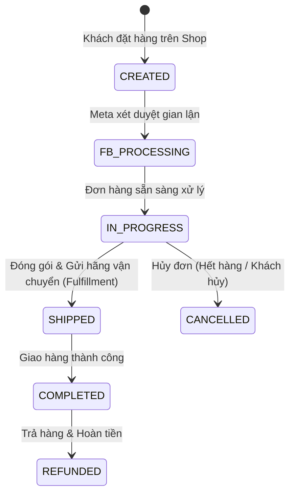

# 13. Nền Tảng Thương Mại Điện Tử (Meta Commerce Platform API)

Meta Commerce Platform cho phép các nhà bán lẻ và sàn thương mại tích hợp sâu hệ thống quản lý kho, xử lý đơn hàng và dịch vụ khách hàng với gian hàng **Facebook Shop & Instagram Shopping**.

---

## 1. Vòng Đời Đơn Hàng Thương Mại Điện Tử (Order Lifecycle)

Đối với các thị trường hoặc gian hàng có kích hoạt tính năng thanh toán trực tiếp (Native Checkout) hoặc đơn hàng đồng bộ qua Meta Shops, đơn hàng sẽ trải qua các trạng thái sau:



---

## 2. API Quản Lý Đơn Hàng Thương Mại

Cần có mã **Commerce Merchant Settings ID (`CMS_ID`)** của doanh nghiệp.

### 2.1. Lấy Danh Sách Đơn Hàng Cần Xử Lý (`GET /{CMS_ID}/commerce_orders`)

Truy vấn các đơn hàng đang ở trạng thái `IN_PROGRESS` (đã thanh toán/xác nhận, đang chờ người bán đóng gói và gửi hàng):

```bash
curl -i -X GET \
  "https://graph.facebook.com/v22.0/<CMS_ID>/commerce_orders?\
state=IN_PROGRESS\
&fields=id,buyer_details,channel,order_status,created,estimated_payment_details,items,shipping_address\
&limit=50\
&access_token=<YOUR_COMMERCE_ACCESS_TOKEN>"
```

**Phản hồi JSON:**
```json
{
  "data": [
    {
      "id": "987654321012345",
      "order_status": {
        "state": "IN_PROGRESS"
      },
      "channel": "instagram_shop",
      "buyer_details": {
        "name": "Trần Thị Mai",
        "email": "tranmai92@gmail.com"
      },
      "shipping_address": {
        "street1": "Số 123 Đường Nguyễn Trãi",
        "city": "Hà Nội",
        "postal_code": "100000",
        "country": "VN"
      },
      "estimated_payment_details": {
        "subtotal": {"amount": "550000", "currency": "VND"},
        "tax": {"amount": "0", "currency": "VND"},
        "shipping_fee": {"amount": "30000", "currency": "VND"},
        "total_amount": {"amount": "580000", "currency": "VND"}
      },
      "items": {
        "data": [
          {
            "retailer_id": "SKU-VAY-HOA-01",
            "quantity": 1,
            "price": "550000 VND"
          }
        ]
      }
    }
  ]
}
```

---

### 2.2. Cập Nhật Vận Đơn & Giao Hàng (Order Fulfillment)

Khi kho xuất hàng và giao cho đơn vị vận chuyển (Giao Hàng Nhanh, Viettel Post, Ninja Van...), gửi thông tin vận đơn để thông báo cho khách hàng:

```bash
curl -i -X POST \
  "https://graph.facebook.com/v22.0/987654321012345/shipments" \
  -H "Content-Type: application/json" \
  -d '{
    "tracking_info": {
      "tracking_number": "VNPOST123456789",
      "carrier": "OTHER",
      "other_carrier_name": "VNPost",
      "shipping_method_name": "Giao Hang Nhanh 24h"
    },
    "items": [
      {
        "retailer_id": "SKU-VAY-HOA-01",
        "quantity": 1
      }
    ],
    "access_token": "<YOUR_COMMERCE_ACCESS_TOKEN>"
  }'
```

**Phản hồi:**
```json
{
  "success": true
}
```

---

### 2.3. Hủy Đơn Hàng (Order Cancellation)

Nếu mặt hàng hết tồn kho hoặc khách hàng yêu cầu hủy đơn trước khi giao:

```bash
curl -i -X POST \
  "https://graph.facebook.com/v22.0/987654321012345/cancellations" \
  -H "Content-Type: application/json" \
  -d '{
    "cancel_reason": {
      "reason_code": "CUSTOMER_REQUESTED",
      "reason_description": "Khách hàng đổi ý muốn đổi size khác"
    },
    "items": [
      {
        "retailer_id": "SKU-VAY-HOA-01",
        "quantity": 1
      }
    ],
    "access_token": "<YOUR_COMMERCE_ACCESS_TOKEN>"
  }'
```

**Mã lý do hủy đơn hợp lệ (`reason_code`):**
- `CUSTOMER_REQUESTED`: Khách hàng chủ động yêu cầu hủy.
- `OUT_OF_STOCK`: Hết hàng trong kho.
- `SUSPICIOUS_ORDER`: Nghi ngờ đơn hàng gian lận/bom hàng.
- `UNDELIVERABLE_SHIPPING_ADDRESS`: Địa chỉ giao hàng không hợp lệ.

