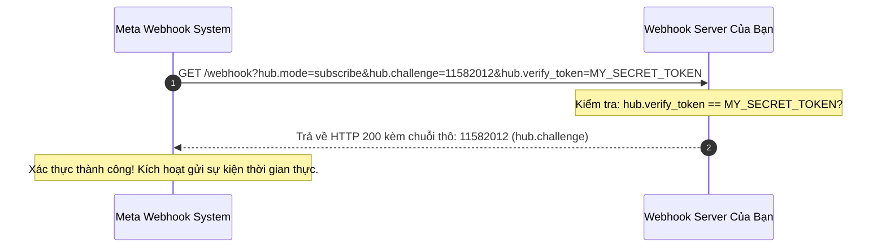
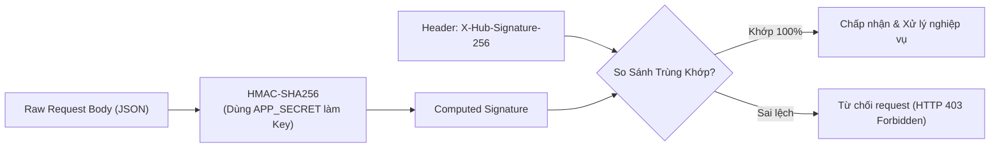

# 14. Webhooks & Cơ Chế Lắng Nghe Sự Kiện Thời Gian Thực

Thay vì phải liên tục gọi API thăm dò (polling) gây lãng phí tài nguyên máy chủ và dễ bị chạm giới hạn Rate Limit, Meta cung cấp cơ chế **Webhooks** để chủ động đẩy (push) thông báo sự kiện về máy chủ của bạn ngay khi có biến động: khách điền Lead Form mới, quy tắc quảng cáo được kích hoạt, hoặc có đơn hàng mới phát sinh.

---

## 1. Cơ Chế Bắt Tay Xác Thực Webhook (Verification Handshake)

Khi bạn cấu hình Webhook URL trên Meta App Dashboard, Meta sẽ gửi một request `GET` kiểm tra tính hợp lệ của máy chủ:



---

## 2. Xác Minh Chữ Ký Bảo Mật (`X-Hub-Signature-256`)

Để ngăn chặn tin tặc giả mạo request gửi đến endpoint của bạn, mỗi khi Meta bắn sự kiện `POST`, Meta luôn đính kèm header:
`X-Hub-Signature-256: sha256=<HMAC_HEX_DIGEST>`

Chữ ký này được sinh bằng thuật toán **HMAC-SHA256** với khóa bí mật là **`APP_SECRET`** của bạn và nội dung là toàn bộ chuỗi **Raw JSON Body**:



---

## 3. Cấu Trúc Payload Webhook Sự Kiện Khách Hàng Tiềm Năng (`leadgen`)

Khi khách hàng gửi Form Lead trên Facebook/Instagram, máy chủ nhận payload sau:

```json
{
  "object": "page",
  "entry": [
    {
      "id": "100234567890123",
      "time": 1740000000,
      "changes": [
        {
          "field": "leadgen",
          "value": {
            "ad_id": "120205851234010234",
            "form_id": "987654321098765",
            "leadgen_id": "456789012345678",
            "created_time": 1740000000,
            "page_id": "100234567890123",
            "adgroup_id": "120205848572010234"
          }
        }
      ]
    }
  ]
}
```
Lấy mã `leadgen_id` (`456789012345678`) và gọi ngay API `/v22.0/{leadgen_id}` để bóc tách thông tin khách hàng.

---

## 4. Mã Nguồn Máy Chủ Webhook Chuẩn Production (Node.js & Express)

```javascript
const express = require('express');
const crypto = require('crypto');

const app = express();
const PORT = process.env.PORT || 3000;
const VERIFY_TOKEN = process.env.VERIFY_TOKEN || 'MY_SECURE_TOKEN_2026';
const APP_SECRET = process.env.APP_SECRET || 'YOUR_APP_SECRET';

// Giữ raw body phục vụ tính toán chữ ký HMAC-SHA256
app.use(express.json({
  verify: (req, res, buf) => {
    req.rawBody = buf;
  }
}));

// 1. Endpoint Xác Thực Challenge (GET)
app.get('/webhook', (req, res) => {
  const mode = req.query['hub.mode'];
  const token = req.query['hub.verify_token'];
  const challenge = req.query['hub.challenge'];

  if (mode === 'subscribe' && token === VERIFY_TOKEN) {
    console.log('[*] Webhook xác thực thành công!');
    return res.status(200).send(challenge);
  }
  return res.sendStatus(403);
});

// 2. Endpoint Tiếp Nhận & Xác Minh Sự Kiện (POST)
app.post('/webhook', (req, res) => {
  const signature = req.headers['x-hub-signature-256'];

  if (!signature) {
    return res.status(401).send('Thieu chu ky X-Hub-Signature-256');
  }

  // Tính toán chữ ký HMAC
  const expectedSignature = 'sha256=' + crypto
    .createHmac('sha256', APP_SECRET)
    .update(req.rawBody)
    .digest('hex');

  if (crypto.timingSafeEqual(Buffer.from(signature), Buffer.from(expectedSignature))) {
    // Phải trả HTTP 200 ngay lập tức trong vòng 3 giây
    res.status(200).send('EVENT_RECEIVED');

    // Đẩy tác vụ xử lý vào hàng đợi background (Queue / Celery / BullMQ)
    const body = req.body;
    if (body.object === 'page') {
      body.entry.forEach(entry => {
        entry.changes.forEach(change => {
          if (change.field === 'leadgen') {
            const leadgenId = change.value.leadgen_id;
            console.log(`[+] Phat hien Lead moi: ${leadgenId}`);
            // TODO: Gọi API /v22.0/${leadgenId} & Đẩy sang CRM
          }
        });
      });
    }
  } else {
    console.error('[-] Chữ ký không hợp lệ! Nghi vấn request giả mạo.');
    return res.sendStatus(403);
  }
});

app.listen(PORT, () => {
  console.log(`Server Webhook dang lang nghe tai port ${PORT}`);
});
```

> ⚠️ **Quy tắc hiệu năng:** Máy chủ của bạn bắt buộc phải phản hồi mã **`HTTP 200 OK`** cho Meta trong vòng **dưới 3 giây**. Nếu quá 3 giây, Meta sẽ coi là timeout và tự động thử lại (Retry) liên tục, gây nghẽn hàng đợi hoặc thậm chí tự động ngắt Webhook nếu tỷ lệ lỗi vượt quá giới hạn. Hãy luôn đẩy dữ liệu vào Queue để xử lý bất đồng bộ!

