# 16. Kế Hoạch Mở Rộng Hệ Sinh Thái API Tiếp Theo (Omnichannel Ads & Commerce Roadmap)

Để xây dựng một hệ thống phần mềm quản lý bán hàng và tiếp thị đa kênh (Omnichannel Marketing & E-Commerce Hub) hoàn chỉnh, việc kết nối riêng lẻ từng sàn là chưa đủ. Dưới đây là kế hoạch chiến lược và lộ trình tích hợp các bộ API tiếp theo, được thiết kế đồng bộ với kho dữ liệu sẵn có của bạn (`shoppe-api`, `tiktok-business-api`, `tiktok-shop-api`, và `facebook-ads-api`).

---

## 1. Bản Đồ Tổng Thể Hệ Sinh Thái API Tiếp Thị & Thương Mại Đa Sàn

```mermaid
flowchart TD
    classDef metaStyle fill:#1e293b,stroke:#3b82f6,stroke-width:2px,color:#fff;
    classDef googleStyle fill:#1e1b4b,stroke:#ea4335,stroke-width:2px,color:#fff;
    classDef ecomStyle fill:#064e3b,stroke:#10b981,stroke-width:2px,color:#fff;
    classDef vnStyle fill:#422006,stroke:#f59e0b,stroke-width:2px,color:#fff;

    HUB["⚡ Unified Marketing & Commerce Engine<br/>(Hệ thống ERP / CRM / Ads Hub Trung Tâm)"]

    HUB --> META["🌐 1. Hệ Sinh Thái Meta (Facebook/IG/WhatsApp)"]:::metaStyle
    META --> META_ADS["facebook-ads-api (ĐÃ HOÀN THIỆN)"]
    META --> META_SOCIAL["meta-graph-api (Fanpage, Instagram, Messenger Bot)"]
    META --> WHATSAPP["whatsapp-cloud-api (Tiếp thị hội thoại)"]

    HUB --> GOOGLE["🔍 2. Hệ Sinh Thái Google Ads & Data"]:::googleStyle
    GOOGLE --> GG_ADS["google-ads-api (Search, PMax, YouTube, Shopping)"]
    GOOGLE --> GMC["google-merchant-center-api (Đồng bộ danh mục)"]
    GOOGLE --> GA4["ga4-measurement-protocol (Server-side tracking)"]

    HUB --> ECOM["🛍️ 3. Sàn Thương Mại Điện Tử Quốc Tế & ĐNA"]:::ecomStyle
    ECOM --> TIKTOK_SHOP["tiktok-shop-api (ĐÃ HOÀN THIỆN)"]
    ECOM --> TIKTOK_ADS["tiktok-business-api (ĐÃ HOÀN THIỆN)"]
    ECOM --> SHOPEE["shoppe-api (ĐÃ HOÀN THIỆN)"]
    ECOM --> LAZADA["lazada-open-platform-api (Sản phẩm, Đơn, Vận chuyển)"]
    ECOM --> AMAZON["amazon-sp-api (Selling Partner Quốc tế)"]

    HUB --> LOCAL["🇻🇳 4. Nền Tảng Nội Địa Việt Nam"]:::vnStyle
    LOCAL --> ZALO_OA["zalo-oa-api (Chăm sóc khách hàng, Chat)"]
    LOCAL --> ZNS["zalo-zns-api (Gửi thông báo biến động đơn qua SĐT)"]
    LOCAL --> ZALO_ADS["zalo-ads-api (Quảng cáo nhắm người dùng VN)"]
```

---

## 2. Kế Hoạch Chi Tiết Các Bộ API Cần Triển Khai Tiếp Theo

### Giai Đoạn 1: Mở rộng hội thoại Meta (Fanpage, Messenger, Instagram & WhatsApp)
Sau khi đã làm chủ việc chạy quảng cáo (`facebook-ads-api`), việc tiếp theo là **tự động hóa khâu phản hồi khách hàng và chốt đơn** khi có tương tác từ quảng cáo:
1. **`meta-graph-api` (Facebook Fanpage & Instagram Graph API)**:
   - **Tác vụ**: Tự động trả lời bình luận (Comment), ẩn bình luận rác/chứa số điện thoại, chatbot tự động trả lời Messenger & Instagram Direct Messages (DM).
   - **Lợi ích**: Tăng tốc độ phản hồi trang đạt 100%, tự động tạo đơn hàng ngay trong khung chat.
2. **`whatsapp-cloud-api`**:
   - **Tác vụ**: Gửi tin nhắn tiếp thị qua danh bạ WhatsApp, gửi thẻ sản phẩm kèm nút thanh toán trực tiếp, gửi thông báo vận chuyển.

---

### Giai Đoạn 2: Tích hợp Google Ads & Google Shopping (`google-ads-api`)
Google là trụ cột còn lại lớn nhất trong mảng tìm kiếm và thương mại điện tử intent-based (người dùng chủ động tìm mua sản phẩm):
1. **Google Ads API (REST & gRPC v18+)**:
   - **Tác vụ**: Tự động hóa chiến dịch tìm kiếm (Search Ads), Chiến dịch Hiệu suất Tối đa (Performance Max - PMax), Quảng cáo YouTube Video Ads.
   - **Tự động đấu thầu**: Tích hợp thuật toán Smart Bidding (Target CPA, Target ROAS).
2. **Google Merchant Center API (Content API for Shopping)**:
   - **Tác vụ**: Đồng bộ nguồn cấp dữ liệu sản phẩm từ kho ERP lên Google Shopping (tương tự như Catalog API của Meta).
3. **Google Analytics 4 Measurement Protocol API**:
   - **Tác vụ**: Bắn tín hiệu chuyển đổi Server-to-Server về GA4 (tương đương với CAPI của Meta).

---

### Giai Đoạn 3: Tích hợp Zalo Ecosystem (`zalo-ads-api` & `zalo-zns-api`)
Thị trường Việt Nam có hơn 75 triệu người dùng hoạt động tích cực trên Zalo. Đây là kênh tiếp cận nội địa có chi phí chuyển đổi rất tốt:
1. **Zalo Notification Service (ZNS API)**:
   - **Tác vụ**: Gửi tin nhắn thông báo xác nhận đơn hàng, mã vận đơn, tích điểm thành viên trực tiếp vào số điện thoại người nhận qua Zalo với chi phí chỉ bằng 1/3 SMS Brandname truyền thống.
2. **Zalo Official Account (Zalo OA API)**:
   - **Tác vụ**: Quản lý hội thoại chăm sóc khách hàng tập trung đa kênh (Facebook + TikTok + Zalo).
3. **Zalo Ads API**:
   - **Tác vụ**: Tạo chiến dịch Form thu lead, chiến dịch Website traffic trên mạng lưới Zalo Network (Zalo, Báo Mới, Zing MP3).

---

### Giai Đoạn 4: Tích hợp sàn Lazada (`lazada-open-platform-api`)
Để hoàn thiện thế chân vạc thương mại điện tử Đông Nam Á (TikTok Shop + Shopee + Lazada):
- **Tác vụ**: Đồng bộ tồn kho SKU đa sàn theo thời gian thực (giảm tồn kho trên Lazada khi Shopee có đơn), in tem vận chuyển 3PL tập trung, bóc tách báo cáo tài chính đối soát chu kỳ.

---

## 3. Kiến Trúc Lõi Phục Vụ Quản Lý & Tự Động Hóa Đa Nền Tảng (Unified Data Schema)

Khi thiết kế phần mềm kết nối đa sàn, bạn nên xây dựng một **Lớp chuẩn hóa dữ liệu chung (Unified Data Model)** ở tầng giữa:

| Khái niệm nghiệp vụ | Meta (Facebook) | TikTok | Google | Shopee | Zalo |
| :--- | :--- | :--- | :--- | :--- | :--- |
| **Cấp tài khoản** | `act_{ID}` (Ad Account) | `advertiser_id` | `customer_id` | `shop_id` | `oa_id` / `ad_id` |
| **Tầng chiến dịch** | `Campaign` | `Campaign` | `Campaign` | `Keyword Campaign`| `Campaign` |
| **Tầng nhóm quảng cáo**| `Ad Set` | `Ad Group` | `Ad Group` | - | `Ad Group` |
| **Tầng quảng cáo** | `Ad` | `Ad` | `Ad` | `Item / Search Ad`| `Ad` |
| **Theo dõi Server-side**| `Conversions API` | `Events API` | `Measurement Protocol`| - | `Tracking API` |
| **Danh mục hàng hóa** | `Product Catalog` | `Catalog` | `Merchant Center` | `Item / Product` | `Zalo Shop Catalog`|

---

## 4. Thứ Tự Đề Xuất Thực Hiện Tiếp Theo

1. **Bước 1 (Ưu tiên cao nhất)**: Triển khai vận hành thực tế bộ `facebook-ads-api` này để chạy thử nghiệm các chiến dịch ODAX và tích hợp Conversions API (CAPI) vào website/CRM của bạn.
2. **Bước 2**: Xây dựng bộ tài liệu kỹ thuật **`google-ads-api`** để bao phủ toàn bộ 2 gã khổng lồ Digital Marketing (Meta + Google).
3. **Bước 3**: Xây dựng bộ tài liệu **`zalo-ads-api` & `zalo-zns-api`** để thống lĩnh thị trường chuyển đổi tin nhắn tại Việt Nam.
4. **Bước 4**: Tích hợp các bộ tài liệu trên vào một trung tâm điều phối quảng cáo hợp nhất (All-in-one Ads Manager Engine).

