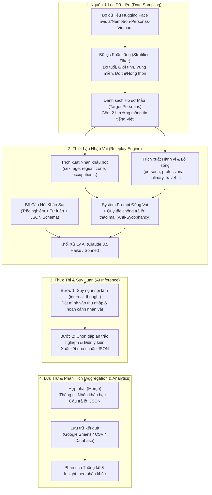
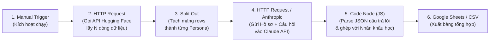

# Hướng Dẫn Tạo Khảo Sát Ảo Dựa Trên AI (Synthetic Survey) Với `Nemotron-Personas-Vietnam`

Tài liệu này hướng dẫn chi tiết cách xây dựng hệ thống **Khảo sát ảo bằng AI (Silicon Sampling / Synthetic Survey)**: trích xuất hồ sơ người dùng Việt Nam từ bộ dữ liệu [`nvidia/Nemotron-Personas-Vietnam`](https://huggingface.co/datasets/nvidia/Nemotron-Personas-Vietnam), cho mô hình AI (Claude) nhập vai từng người để trả lời bảng hỏi, và tự động hóa toàn bộ quy trình bằng **n8n** hoặc **Python + Claude API**.

---

## 1. Sơ Đồ Khối Luồng Hoạt Động (System Architecture & Flow)

### 1.1. Sơ đồ khối tổng quan (End-to-End Pipeline)



### 1.2. Sơ đồ luồng các Node trong n8n



### 1.3. Sơ đồ dạng văn bản (ASCII)

```text
+-----------------------------------------------------------------------+
| 1. HUGGING FACE DATASET (nvidia/Nemotron-Personas-Vietnam)            |
|    Lọc theo: Độ tuổi (age), Giới tính (sex), Khu vực (zone, region)   |
+-----------------------------------+-----------------------------------+
                                    |
                                    v
+-----------------------------------------------------------------------+
| 2. TRÍCH XUẤT HỒ SƠ CÁ NHÂN (PERSONA INJECTION)                       |
|    - Nhân khẩu học: uuid, sex, age, marital_status, occupation...     |
|    - Chiều sâu hành vi: persona, professional_persona, culinary...    |
+-----------------------------------+-----------------------------------+
                                    |
                                    v
+-----------------------------------------------------------------------+
| 3. CLAUDE AI ĐÓNG VAI & TRẢ LỜI (ROLEPLAY & INFERENCE)                |
|    - System Prompt: Hồ sơ nhân vật + Ràng buộc thực tế (không thảo mai)|
|    - User Prompt: Bộ câu hỏi khảo sát + Ép kiểu đầu ra JSON           |
|    - Cơ chế: Suy nghĩ nội tâm (internal_thought) -> Chọn đáp án       |
+-----------------------------------+-----------------------------------+
                                    |
                                    v
+-----------------------------------------------------------------------+
| 4. HỢP NHẤT & XUẤT BÁO CÁO (MERGE & EXPORT)                           |
|    Ghép [Thông tin nhân khẩu học] + [JSON câu trả lời] -> CSV / Sheet |
+-----------------------------------------------------------------------+
```

---

## 2. Cấu Trúc Dữ Liệu `Nemotron-Personas-Vietnam` Cần Lưu Ý

Bộ dữ liệu gồm **21 trường** hoàn toàn bằng tiếng Việt, được tổng hợp bám sát phân bố dân số và lao động tại Việt Nam. Khi đưa vào AI, bạn cần kết hợp 2 nhóm trường sau:

| Nhóm thông tin | Tên trường (Fields) | Mục đích sử dụng |
| :--- | :--- | :--- |
| **1. Định danh & Nhân khẩu học** | `uuid`, `sex`, `age`, `marital_status`, `education_level`, `occupation`, `zone` (*Đô Thị / Nông Thôn*), `region` (*Vùng miền*), `country` | Dùng để **lọc mẫu (Sampling)** trước khi khảo sát và dùng làm **biến phân tích chéo (Cross-tabulation)** sau khi có kết quả. |
| **2. Mô tả tính cách & Lối sống** | `persona` (tổng quan), `professional_persona` (công việc), `cultural_background` (văn hóa), `hobbies_and_interests` (sở thích), `career_goals_and_ambitions` (mục tiêu) | Đưa vào **System Prompt** để mô hình AI hiểu rõ hoàn cảnh sống, mức thu nhập ước tính và tâm lý của nhân vật. |
| **3. Mô tả chuyên biệt theo ngành** | `culinary_persona` (ẩm thực), `travel_persona` (du lịch), `sports_persona` (thể thao), `arts_persona` (nghệ thuật/giải trí) | Chọn lọc để đưa thêm vào System Prompt tùy theo chủ đề khảo sát (F&B, Du lịch, Sức khỏe, Giải trí...). |

---

## 3. Mẫu Prompt Chuẩn (Chống Hiệu Ứng "AI Trả Lời Thảo Mai")

Một hạn chế phổ biến khi khảo sát bằng LLM là mô hình thường có xu hướng trả lời tích cực quá mức (Sycophancy). Để khắc phục, hãy sử dụng cấu trúc Prompt dưới đây:

### System Prompt (Đóng vai nhân vật)
```text
Bạn đang tham gia một cuộc khảo sát thị trường tại Việt Nam.
Nhiệm vụ của bạn là NHẬP VAI HOÀN TOÀN vào nhân vật có hồ sơ dưới đây và trả lời khảo sát đúng với tâm lý, mức sống, trình độ học vấn, vùng miền và thói quen của người đó.

<ho_so_nhan_vat>
- Giới tính: {{sex}} | Tuổi: {{age}} | Tình trạng hôn nhân: {{marital_status}}
- Khu vực sống: {{zone}} - {{region}}
- Học vấn: {{education_level}} | Nghề nghiệp: {{occupation}}
- Tính cách & Hoàn cảnh chung: {{persona}}
- Đặc điểm công việc: {{professional_persona}}
- Văn hóa & Lối sống: {{cultural_background}}
- Sở thích: {{hobbies_and_interests}}
- Thói quen bổ sung (Ẩm thực/Du lịch): {{culinary_persona}} {{travel_persona}}
</ho_so_nhan_vat>

QUY TẮC BẮT BUỘC:
1. KHÔNG trả lời như một trợ lý AI. Hãy suy nghĩ thực tế: Nếu nhân vật ở nông thôn, thu nhập thấp hoặc lớn tuổi, họ sẽ khắt khe về giá cả, ngại công nghệ phức tạp, hoặc không quan tâm đến các dịch vụ xa xỉ.
2. Trả lời thẳng thắn, có thể từ chối mua hoặc chê bai nếu sản phẩm không phù hợp với nhu cầu của nhân vật.
3. Chỉ trả về kết quả dưới định dạng JSON hợp lệ theo schema được yêu cầu, không giải thích gì thêm bên ngoài JSON.
```

### User Prompt (Bộ câu hỏi khảo sát)
```text
Hãy trả lời bộ khảo sát sau về: "Ứng dụng đặt đồ ăn lành mạnh (Healthy Food) giao tận nơi giá 65.000đ - 95.000đ/suất".

Câu 1 (q1_interest): Mức độ quan tâm của bạn đến dịch vụ này? (Chọn 1: "Rất quan tâm", "Bình thường", "Không quan tâm")
Câu 2 (q2_price_perception): Bạn đánh giá mức giá 65k-95k/suất như thế nào so với thu nhập của bạn? (Chọn 1: "Rẻ", "Hợp lý", "Đắt", "Quá đắt không thể mua")
Câu 3 (q3_open_feedback): Chia sẻ thật lòng bằng giọng văn tự nhiên của bạn (1-2 câu): Tại sao bạn chọn như vậy?

Trả về JSON theo cấu trúc:
{
  "internal_thought": "Suy nghĩ ngắn gọn của nhân vật dựa trên hoàn cảnh bản thân",
  "q1_interest": "...",
  "q2_price_perception": "...",
  "q3_open_feedback": "..."
}
```

---

## 4. Cách 1: Workflow n8n Dựng Sẳn (Copy & Paste)

Workflow này gọi trực tiếp **Hugging Face Datasets Server API** để lấy danh sách personas từ `nvidia/Nemotron-Personas-Vietnam` mà không cần tải cả bộ dữ liệu nặng về máy, sau đó lặp qua từng người và gọi **Claude API** để trả lời khảo sát.

### Các bước cài đặt trong n8n:
1. Copy toàn bộ đoạn JSON bên dưới.
2. Mở màn hình làm việc (Canvas) của **n8n**, nhấn **`Ctrl + V`** (hoặc **`Cmd + V`** trên macOS) để dán trực tiếp workflow vào.
3. Mở node **`Claude - Trả lời khảo sát`**, chọn hoặc tạo mới Credential **`Anthropic API`** và điền API Key của bạn.
4. Nhấn **Test Workflow** để chạy thử với 5 người đầu tiên (có thể tăng tham số `length` trong node `Lấy Personas từ HuggingFace` lên 50–100 người).

```json
{
  "name": "AI Synthetic Survey - Nemotron Personas Vietnam",
  "nodes": [
    {
      "parameters": {},
      "id": "1a2b3c4d-0001-4000-8000-000000000001",
      "name": "Bắt đầu (Manual Trigger)",
      "type": "n8n-nodes-base.manualTrigger",
      "typeVersion": 1,
      "position": [200, 300]
    },
    {
      "parameters": {
        "method": "GET",
        "url": "https://datasets-server.huggingface.co/rows",
        "sendQuery": true,
        "queryParameters": {
          "parameters": [
            { "name": "dataset", "value": "nvidia/Nemotron-Personas-Vietnam" },
            { "name": "config", "value": "default" },
            { "name": "split", "value": "train" },
            { "name": "offset", "value": "0" },
            { "name": "length", "value": "5" }
          ]
        },
        "options": {}
      },
      "id": "1a2b3c4d-0002-4000-8000-000000000002",
      "name": "Lấy Personas từ HuggingFace",
      "type": "n8n-nodes-base.httpRequest",
      "typeVersion": 4.2,
      "position": [420, 300]
    },
    {
      "parameters": {
        "fieldToSplitOut": "rows",
        "options": {}
      },
      "id": "1a2b3c4d-0003-4000-8000-000000000003",
      "name": "Tách từng Persona",
      "type": "n8n-nodes-base.splitOut",
      "typeVersion": 1,
      "position": [640, 300]
    },
    {
      "parameters": {
        "method": "POST",
        "url": "https://api.anthropic.com/v1/messages",
        "authentication": "predefinedCredentialType",
        "nodeCredentialType": "anthropicApi",
        "sendHeaders": true,
        "headerParameters": {
          "parameters": [
            { "name": "anthropic-version", "value": "2023-06-01" },
            { "name": "content-type", "value": "application/json" }
          ]
        },
        "sendBody": true,
        "specifyBody": "json",
        "jsonBody": "={\n  \"model\": \"claude-3-5-haiku-latest\",\n  \"max_tokens\": 600,\n  \"temperature\": 0.7,\n  \"system\": {{ JSON.stringify('Bạn đang tham gia khảo sát tại Việt Nam. Hãy NHẬP VAI HOÀN TOÀN vào hồ sơ sau và trả lời đúng với hoàn cảnh, mức sống, tuổi tác, vùng miền của nhân vật:\\n- Giới tính: ' + $json.row.sex + ' | Tuổi: ' + $json.row.age + ' | Hôn nhân: ' + $json.row.marital_status + '\\n- Khu vực: ' + $json.row.zone + ' - ' + $json.row.region + '\\n- Học vấn: ' + $json.row.education_level + ' | Nghề nghiệp: ' + $json.row.occupation + '\\n- Tính cách: ' + $json.row.persona + '\\n- Công việc: ' + $json.row.professional_persona + '\\n- Ẩm thực: ' + $json.row.culinary_persona + '\\nChỉ trả về JSON hợp lệ, không dùng markdown code block.') }},\n  \"messages\": [\n    {\n      \"role\": \"user\",\n      \"content\": \"Khảo sát về: Ứng dụng đặt suất ăn Healthy giao tận nơi giá 65.000đ - 95.000đ/bữa.\\n\\nHãy trả lời đúng định dạng JSON sau:\\n{\\n  \\\"internal_thought\\\": \\\"Suy nghĩ nội tâm dựa trên thu nhập và thói quen\\\",\\n  \\\"q1_interest\\\": \\\"Chọn 1: Rất quan tâm | Bình thường | Không quan tâm\\\",\\n  \\\"q2_price\\\": \\\"Chọn 1: Rẻ | Hợp lý | Đắt | Quá đắt\\\",\\n  \\\"q3_feedback\\\": \\\"Chia sẻ 1-2 câu tự nhiên theo giọng nhân vật\\\"\\n}\"\n    }\n  ]\n}",
        "options": {}
      },
      "id": "1a2b3c4d-0004-4000-8000-000000000004",
      "name": "Claude - Trả lời khảo sát",
      "type": "n8n-nodes-base.httpRequest",
      "typeVersion": 4.2,
      "position": [860, 300]
    },
    {
      "parameters": {
        "jsCode": "const results = [];\nconst personas = $('Tách từng Persona').all();\nconst responses = $input.all();\n\nfor (let i = 0; i < responses.length; i++) {\n  const p = personas[i].json.row;\n  const rawText = responses[i].json.content?.[0]?.text || '{}';\n  const cleaned = rawText.replace(/```json|```/g, '').trim();\n  let ans = {};\n  try {\n    ans = JSON.parse(cleaned);\n  } catch (e) {\n    ans = { raw_response: rawText };\n  }\n  results.push({\n    json: {\n      uuid: p.uuid,\n      sex: p.sex,\n      age: p.age,\n      region: p.region,\n      zone: p.zone,\n      occupation: p.occupation,\n      ...ans\n    }\n  });\n}\nreturn results;"
      },
      "id": "1a2b3c4d-0005-4000-8000-000000000005",
      "name": "Gộp kết quả & Nhân khẩu học",
      "type": "n8n-nodes-base.code",
      "typeVersion": 2,
      "position": [1080, 300]
    }
  ],
  "connections": {
    "Bắt đầu (Manual Trigger)": {
      "main": [[{ "node": "Lấy Personas từ HuggingFace", "type": "main", "index": 0 }]]
    },
    "Lấy Personas từ HuggingFace": {
      "main": [[{ "node": "Tách từng Persona", "type": "main", "index": 0 }]]
    },
    "Tách từng Persona": {
      "main": [[{ "node": "Claude - Trả lời khảo sát", "type": "main", "index": 0 }]]
    },
    "Claude - Trả lời khảo sát": {
      "main": [[{ "node": "Gộp kết quả & Nhân khẩu học", "type": "main", "index": 0 }]]
    }
  }
}
```

---

## 5. Cách 2: Workflow Python + Claude (Có Lọc Mẫu Chi Tiết)

Khi bạn muốn lọc đúng tệp khách hàng mục tiêu (ví dụ: *Chỉ khảo sát người từ 22–35 tuổi sống ở Đô thị*) và xuất thẳng ra file CSV/Excel:

### Cài đặt thư viện:
```bash
pip install datasets anthropic pandas
```

### Mã nguồn Python (`run_synthetic_survey.py`):
```python
import json
import anthropic
import pandas as pd
from datasets import load_dataset

# 1. Đọc dữ liệu ở chế độ streaming (không cần tải toàn bộ dataset về máy)
dataset = load_dataset("nvidia/Nemotron-Personas-Vietnam", split="train", streaming=True)

# 2. Lọc mẫu mục tiêu (Ví dụ: 22-35 tuổi, sống ở Đô thị, lấy 10 người)
target_personas = []
for row in dataset:
    if 22 <= int(row["age"]) <= 35 and "Đô Thị" in str(row["zone"]):
        target_personas.append(row)
    if len(target_personas) >= 10:
        break

client = anthropic.Anthropic(api_key="YOUR_ANTHROPIC_API_KEY")

SURVEY_QUESTIONS = """
Khảo sát về: "Dịch vụ đặt suất ăn Healthy giao tận nơi giá 65.000đ - 95.000đ/bữa".
Hãy trả lời dưới dạng JSON gồm các trường:
- "internal_thought": Suy nghĩ nội tâm dựa trên thu nhập và lối sống của bạn.
- "q1_interest": Chọn 1 trong ["Rất quan tâm", "Bình thường", "Không quan tâm"]
- "q2_price": Chọn 1 trong ["Rẻ", "Hợp lý", "Đắt", "Quá đắt"]
- "q3_feedback": Chia sẻ 1-2 câu tự nhiên theo đúng giọng văn của bạn.
"""

results = []
for p in target_personas:
    persona_prompt = (
        f"Nhập vai hoàn toàn vào người Việt Nam có hồ sơ sau:\n"
        f"- Giới tính: {p['sex']} | Tuổi: {p['age']} | Hôn nhân: {p['marital_status']}\n"
        f"- Khu vực: {p['zone']} - {p['region']} | Nghề nghiệp: {p['occupation']}\n"
        f"- Tính cách: {p['persona']}\n"
        f"- Công việc: {p['professional_persona']}\n"
        f"- Ẩm thực: {p['culinary_persona']}\n"
        f"Trả lời thực tế, không thảo mai. Chỉ xuất JSON hợp lệ."
    )

    msg = client.messages.create(
        model="claude-3-5-haiku-latest",
        max_tokens=500,
        temperature=0.7,
        system=persona_prompt,
        messages=[{"role": "user", "content": SURVEY_QUESTIONS}],
    )

    raw_text = msg.content[0].text.strip().removeprefix("```json").removesuffix("```").strip()
    ans = json.loads(raw_text)
    results.append({
        "uuid": p["uuid"],
        "sex": p["sex"],
        "age": p["age"],
        "region": p["region"],
        "zone": p["zone"],
        "occupation": p["occupation"],
        **ans,
    })

# 3. Xuất kết quả ra file CSV
df = pd.DataFrame(results)
df.to_csv("ket_qua_khao_sat_ao.csv", index=False, encoding="utf-8-sig")
print("Đã hoàn thành khảo sát! Xem kết quả tại file ket_qua_khao_sat_ao.csv")
```

---

## 6. Mẹo Tối Ưu Độ Chính Xác (Best Practices)

1. **Bắt buộc có bước `"internal_thought"` trước khi chọn đáp án:** Việc yêu cầu AI suy nghĩ nội tâm dựa trên thu nhập và hoàn cảnh trước khi điền các câu trắc nghiệm giúp câu trả lời khớp chặt chẽ với nhân khẩu học (Chain-of-Thought).
2. **Đặt `temperature = 0.7`:** Giúp câu trả lời tự nhiên và tạo độ phân tán giống khảo sát người thật.
3. **Chọn đúng trường Persona bổ trợ theo ngành hàng:**
   * **Khảo sát F&B / Tiêu dùng nhanh (FMCG):** Ghép thêm trường `culinary_persona`.
   * **Khảo sát B2B / Phần mềm / Việc làm:** Ghép thêm trường `professional_persona`, `skills_and_expertise`, `career_goals_and_ambitions`.
   * **Khảo sát Du lịch / Nghỉ dưỡng:** Ghép thêm trường `travel_persona`.
   * **Khảo sát Thể thao / Chăm sóc sức khỏe:** Ghép thêm trường `sports_persona`.

