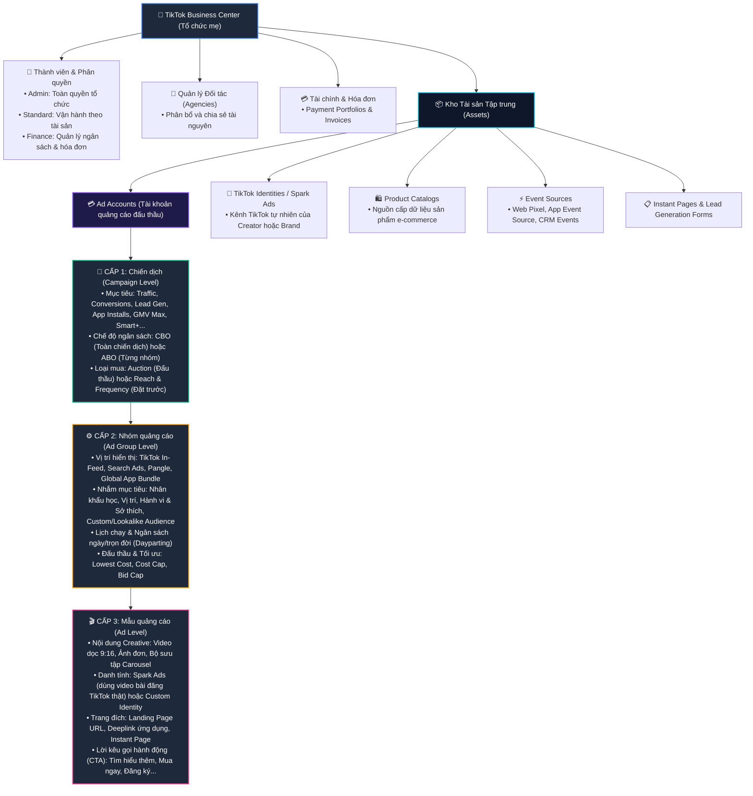
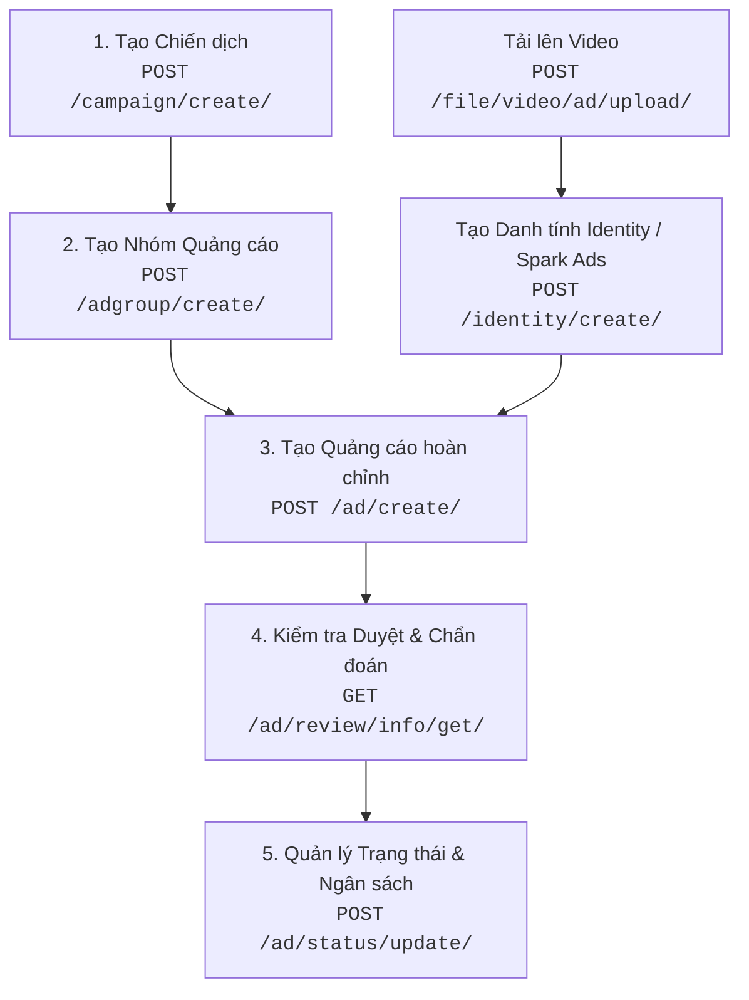
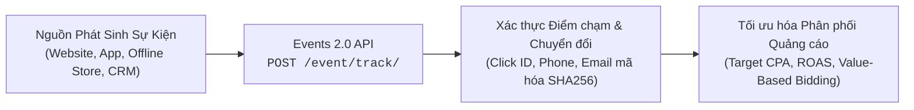
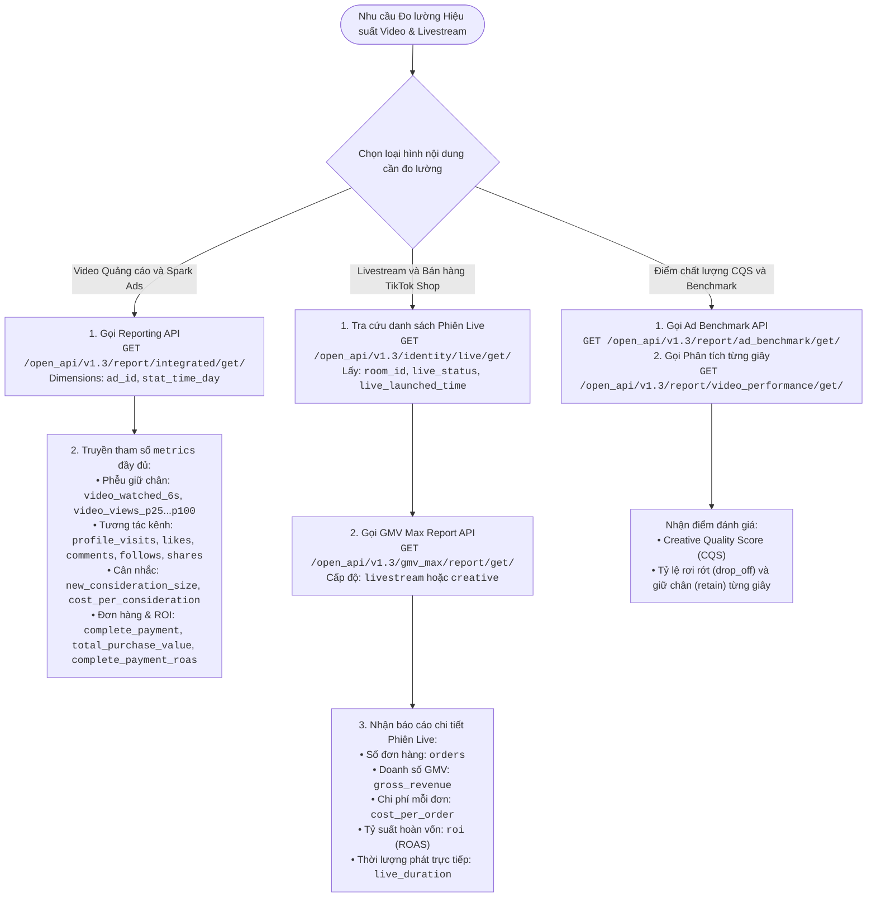
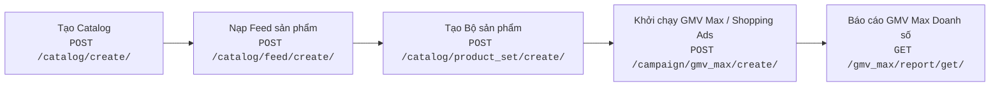
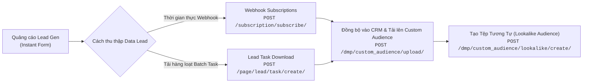

# Bộ Tài Liệu Tiếng Việt Chuẩn: TikTok Business API v1.3 (`tiktok-business api`)

Chào mừng bạn đến với bộ tài liệu tiếng Việt chi tiết và đầy đủ nhất dành cho **TikTok API for Business (phiên bản v1.3)**. Bộ tài liệu này được biên soạn và cấu trúc chuẩn hóa **khớp 1:1 với 16 phân hệ danh mục** trên cổng thông tin chính thức [TikTok Business API Portal v1.3](https://business-api.tiktok.com/portal/docs/about-the-guide/v1.3).

Toàn bộ các ví dụ và hướng dẫn gọi API trong bộ tài liệu được ưu tiên trình bày bằng **lệnh cURL hoàn chỉnh** (kèm URL endpoint, Header xác thực `Access-Token`, `Content-Type` và JSON Body thực tế) để các kỹ sư dữ liệu, nhà phát triển và nhà quảng cáo có thể thực thi ngay lập tức trong Terminal hoặc nhập thẳng vào Postman / Insomnia.

---

## 📌 Mục Lục Điều Hướng Nhanh

1. [Cấu Trúc Phân Cấp Tài Khoản (Account Hierarchy)](#1-cấu-trúc-phân-cấp-tài-khoản-account-hierarchy)
2. [Cây Hệ Sinh Thái API Toàn Diện (API Architecture Tree)](#2-cây-hệ-sinh-thái-api-toàn-diện-api-architecture-tree)
3. [Sơ Đồ Các Luồng Chức Năng Cơ Bản & Liên Kết Chi Tiết](#3-sơ-đồ-các-luồng-chức-năng-cơ-bản--liên-kết-chi-tiết)
   - [3.1. Luồng Xác thực & Ủy quyền (OAuth 2.0 Flow)](#31-luồng-xác-thực--ủy-quyền-oauth-20-flow)
   - [3.2. Vòng đời Khởi tạo & Quản lý Chiến dịch (Campaign Lifecycle)](#32-vòng-đời-khởi-tạo--quản-lý-chiến-dịch-campaign-lifecycle)
   - [3.3. Quy trình Quản trị Tài nguyên Sáng tạo (Creative Pipeline)](#33-quy-trình-quản-trị-tài-nguyên-sáng-tạo-creative-pipeline)
   - [3.4. Luồng Thu thập & Theo dõi Sự kiện Chuyển đổi (Events 2.0 & Pixels)](#34-luồng-thu-thập--theo-dõi-sự-kiện-chuyển-đổi-events-20--pixels)
   - [3.5. [ĐẶC BIỆT] Luồng Đo lường Video / Spark Ads, Livestream & Hiệu quả Bán hàng (Đơn hàng, GMV, ROI, CQS, VE%, IE%, PE%)](#35-đặc-biệt-luồng-đo-lường-video--spark-ads-livestream--hiệu-quả-bán-hàng)
   - [3.6. Luồng Quản lý Danh mục & Thương mại Điện tử (Catalog & GMV Max)](#36-luồng-quản-lý-danh-mục--thương-mại-điện-tử-catalog--gmv-max)
   - [3.7. Luồng Khách hàng Tiềm năng & Tệp Đối tượng (Leads & Custom Audience)](#37-luồng-khách-hàng-tiềm-năng--tệp-đối-tượng-leads--custom-audience)
4. [Mục Lục Toàn Bộ 16 Phân Hệ Chuẩn (Khớp 1:1 Cổng Web)](#4-mục-lục-toàn-bộ-16-phân-hệ-chuẩn-khớp-11-cổng-web)
5. [Quy Chuẩn Gọi cURL & Xử Lý Phản Hồi](#5-quy-chuẩn-gọi-curl--xử-lý-phản-hồi)

---

<a id="1-cấu-trúc-phân-cấp-tài-khoản-account-hierarchy"></a>
## 1. Cấu Trúc Phân Cấp Tài Khoản (Account Hierarchy)

Hệ thống TikTok for Business được tổ chức theo mô hình quản trị doanh nghiệp phân tầng:



---

<a id="2-cây-hệ-sinh-thái-api-toàn-diện-api-architecture-tree"></a>
## 2. Cây Hệ Sinh Thái API Toàn Diện (API Architecture Tree)

Toàn bộ 74 nhóm endpoint kỹ thuật của TikTok Business API v1.3 được phân định theo 8 nhóm chức năng chính:

```mermaid
graph TD
    classDef root fill:#0f172a,stroke:#3b82f6,stroke-width:3px,color:#fff;
    classDef group fill:#1e293b,stroke:#06b6d4,stroke-width:1.5px,color:#fff;
    classDef api fill:#334155,stroke:#94a3b8,stroke-width:1px,color:#fff;

    API["🌐 Hệ Sinh Thái TikTok Business API v1.3"]:::root

    %% Nhóm 1: Quản trị & Xác thực
    API --> G1["🔐 1. Quản trị Tổ chức & Xác thực"]:::group
    G1 --> G1_1["OAuth 2.0 Authentication"]:::api
    G1 --> G1_2["Business Center Management API"]:::api
    G1 --> G1_3["Ad Accounts & Users API"]:::api
    G1 --> G1_4["Account Verification API"]:::api

    %% Nhóm 2: Tiếp thị & Chiến dịch
    API --> G2["🎯 2. Vận hành Chiến dịch (Core Ads)"]:::group
    G2 --> G2_1["Campaign API"]:::api
    G2 --> G2_2["Ad Group API"]:::api
    G2 --> G2_3["Ad API & Trạng thái phân phối"]:::api
    G2 --> G2_4["Automated Rules & Super Split Test"]:::api
    G2 --> G2_5["Upgraded Smart+ & GMV Max Campaigns"]:::api

    %% Nhóm 3: Tài sản Sáng tạo
    API --> G3["🎨 3. Nội dung Sáng tạo (Creative Assets)"]:::group
    G3 --> G3_1["Video Upload (Chunk / URL)"]:::api
    G3 --> G3_2["Image & Âm nhạc bản quyền CML"]:::api
    G3 --> G3_3["AI Creative Tools (Smart Video/Text)"]:::api
    G3 --> G3_4["Creative Pre-review (Tiền duyệt)"]:::api
    G3 --> G3_5["Spark Ads Post Authorization"]:::api

    %% Nhóm 4: Đo lường & Sự kiện
    API --> G4["⚡ 4. Theo dõi & Sự kiện Chuyển đổi"]:::group
    G4 --> G4_1["Events 2.0 (Web Pixel & App Events)"]:::api
    G4 --> G4_2["Events 1.0 (Offline & CRM Events)"]:::api
    G4 --> G4_3["Custom Conversions API"]:::api

    %% Nhóm 5: Báo cáo & Dữ liệu
    API --> G5["📊 5. Báo cáo & Trí tuệ Hiệu suất"]:::group
    G5 --> G5_1["Synchronous Reporting (Tức thời)"]:::api
    G5 --> G5_2["Asynchronous Report Tasks (File lớn CSV)"]:::api
    G5 --> G5_3["Video Retention & Creative Fatigue"]:::api
    G5 --> G5_4["Creative Insights & Ad Benchmarks"]:::api

    %% Nhóm 6: Thương mại & Bán lẻ
    API --> G6["🛍️ 6. Thương mại Điện tử & Catalog"]:::group
    G6 --> G6_1["Catalog Feeds & Products API"]:::api
    G6 --> G6_2["Product Sets (Bộ sản phẩm)"]:::api
    G6 --> G6_3["TikTok Store Integration"]:::api
    G6 --> G6_4["GMV Max Campaign Reports"]:::api

    %% Nhóm 7: CRM & Khách hàng
    API --> G7["📋 7. Khách hàng Tiềm năng & CRM"]:::group
    G7 --> G7_1["Lead Generation API"]:::api
    G7 --> G7_2["Custom Audience (DMP Upload)"]:::api
    G7 --> G7_3["Webhook Event Subscriptions"]:::api

    %% Nhóm 8: Tự nhiên & Hội thoại
    API --> G8["💬 8. Tự nhiên & Tin nhắn Doanh nghiệp"]:::group
    G8 --> G8_1["Organic Accounts & Mentions API"]:::api
    G8 --> G8_2["Business Messaging API"]:::api
    G8 --> G8_3["TikTok One API & MCP Server"]:::api
```



---

<a id="3-sơ-đồ-các-luồng-chức-năng-cơ-bản--liên-kết-chi-tiết"></a>
## 3. Sơ Đồ Các Luồng Chức Năng Cơ Bản & Liên Kết Chi Tiết

Mỗi khối chức năng trong các sơ đồ dưới đây đều chứa **đường dẫn (clickable link)** nhảy trực tiếp vào file tài liệu kỹ thuật chi tiết tương ứng.

<a id="31-luồng-xác-thực--ủy-quyền-oauth-20-flow"></a>
### 3.1. Luồng Xác thực & Ủy quyền (OAuth 2.0 Flow)

```mermaid
flowchart LR
    A["1. Đăng ký App<br/>(Developer Portal)"] --> B["2. Mở URL Cấp quyền OAuth<br/>Người dùng bấm Ủy quyền"]
    B --> C["3. Nhận mã Ủy quyền<br/><code>auth_code</code> tại Redirect URL"]
    C --> D["4. Đổi Token truy cập<br/><code>POST /oauth2/token/</code>"]
    D --> E["5. Quản lý & Làm mới Token<br/><code>POST /oauth2/refresh_token/</code>"]
    E --> F["6. Gọi API với Header:<br/><code>Access-Token: xxx</code>"]

    click B "docs/04-get-started/bat-dau.md" "Xem hướng dẫn quy trình xác thực từng bước"
    click D "docs/12-api-reference/10-authentication.md#doc-1781892384100354" "Xem chi tiết API đổi Access Token"
    click E "docs/12-api-reference/10-authentication.md" "Xem chi tiết API làm mới Token"
```



**cURL mẫu đổi mã ủy quyền lấy `access_token`:**
```bash
curl -X POST "https://business-api.tiktok.com/open_api/v1.3/oauth2/token/" \
  -H "Content-Type: application/json" \
  -d '{
    "app_id": "YOUR_APP_ID",
    "secret": "YOUR_SECRET",
    "auth_code": "YOUR_AUTH_CODE"
  }'
```

---

<a id="32-vòng-đời-khởi-tạo--quản-lý-chiến-dịch-campaign-lifecycle"></a>
### 3.2. Vòng đời Khởi tạo & Quản lý Chiến dịch (Campaign Lifecycle)



---

<a id="33-quy-trình-quản-trị-tài-nguyên-sáng-tạo-creative-pipeline"></a>
### 3.3. Quy trình Quản trị Tài nguyên Sáng tạo (Creative Pipeline)

```mermaid
flowchart LR
    A["Tải lên Video / Ảnh<br/><code>/file/video/ad/upload/</code>"] --> B["Kho Nhạc Bản Quyền CML<br/><code>/music/cml/list/</code>"]
    B --> C["AI Creative Tools<br/>Smart Video & Smart Text"]
    C --> D["Tiền kiểm duyệt Pre-review<br/><code>/creative/pre_review/</code>"]
    D --> E["Liên kết Video Spark Ads<br/>Gắn mã Creator Post"]
    E --> F["Gắn vào Ad hoàn chỉnh<br/><code>POST /ad/create/</code>"]

    click A "docs/12-api-reference/71-video.md" "Xem API Video"
    click B "docs/12-api-reference/52-music.md" "Xem API Âm nhạc CML"
    click C "docs/12-api-reference/38-creative-tools.md" "Xem API Công cụ sáng tạo AI"
    click D "docs/12-api-reference/35-creative-pre-review.md" "Xem API Tiền kiểm duyệt"
    click E "docs/12-api-reference/46-identity.md" "Xem API Danh tính & Spark Ads"
    click F "docs/12-api-reference/02-ads-p1.md" "Xem API Tạo Quảng cáo"
```



---

<a id="34-luồng-thu-thập--theo-dõi-sự-kiện-chuyển-đổi-events-20--pixels"></a>
### 3.4. Luồng Thu thập & Theo dõi Sự kiện Chuyển đổi (Events 2.0 & Pixels)



---

### 3.5. [ĐẶC BIỆT] Luồng Đo lường Video / Spark Ads, Livestream & Hiệu quả Bán hàng

> [!IMPORTANT]
> Đây là quy trình được thiết kế chuyên sâu để giải quyết bài toán: **Bóc tách hiệu quả Video quảng cáo thường, Video Spark Ads của Creator và Livestream bán hàng ra được bao nhiêu Đơn hàng, GMV, ROI cùng các chỉ số giữ chân người xem (2s, 6s, 25%–100%), tương tác mạng xã hội trả phí và điểm chất lượng nội dung CQS.**

#### Bảng Ánh Xạ Tham Số Đo Lường Kỹ Thuật

| Nhóm dữ liệu | Chỉ số mục tiêu | Trường kỹ thuật trong API (`metrics`) | Diễn giải nghiệp vụ |
|:---|:---|:---|:---|
| **Đơn hàng & Doanh thu & ROI** | **Đơn hàng (Orders)** | `complete_payment` (Web) / `orders` (TikTok Shop) | Tổng số đơn đặt hàng thành công ghi nhận cho ad |
| | **GMV (Doanh số bán lẻ)** | `total_purchase_value` (Web/App) / `gross_revenue` (Shop) | Tổng doanh thu / giá trị hàng hóa giao dịch |
| | **ROI / ROAS** | `complete_payment_roas` (Web) / `roi` (GMV Max) | Lợi tức chi tiêu quảng cáo (Doanh thu / Chi phí) |
| **Chi phí & Phân phối** | **Cost** | `stat_cost` | Tổng chi phí tiêu thụ của quảng cáo |
| | **Impressions** | `impressions` | Tổng số lượt hiển thị quảng cáo |
| | **Clicks (destination)** | `clicks` | Lượt nhấp chuyển hướng đến trang đích |
| | **CPM** | `cpm` | Chi phí trung bình cho mỗi 1.000 lượt hiển thị |
| | **CPC (destination)** | `cpc` | Chi phí trung bình cho mỗi nhấp chuột đến trang đích |
| | **CTR (destination)** | `ctr` | Tỷ lệ nhấp chuột vào trang đích (`clicks / impressions`) |
| **Phễu Xem Video & Giữ chân** | **6-second video views** | `video_watched_6s` | Số lượt xem video đạt tối thiểu 6 giây |
| | **Video views at 25%** | `video_views_p25` | Số lượt xem đạt 25% thời lượng video |
| | **Video views at 50%** | `video_views_p50` | Số lượt xem đạt 50% thời lượng video |
| | **Video views at 75%** | `video_views_p75` | Số lượt xem đạt 75% thời lượng video |
| | **Video views at 100%** | `video_views_p100` | Số lượt xem trọn vẹn 100% thời lượng video |
| **Tương tác trả phí (Spark Ads)** | **Paid profile visits** | `profile_visits` | Lượt bấm ghé thăm Profile kênh TikTok từ quảng cáo |
| | **Paid likes** | `likes` | Số lượt thả tim trả phí |
| | **Paid comments** | `comments` | Số lượt bình luận trả phí |
| | **Paid shares** | `shares` | Số lượt chia sẻ video trả phí |
| | **Paid follows** | `follows` | Số người dùng bấm Theo dõi (Follow) kênh mới từ ad |
| **Cân nhắc thương hiệu** | **New consideration size** | `new_consideration_size` | Số người dùng mới phát sinh hành vi cân nhắc |
| | **New consideration rate** | `new_consideration_rate` | Tỷ lệ người dùng mới cân nhắc thương hiệu |
| | **Cost per consideration** | `cost_per_consideration` | Chi phí trung bình cho mỗi khách hàng cân nhắc mới |
| **Chất lượng Sáng tạo** | **VE% (Viewed Engaged %)** | `paid_engaged_view` / `impressions` | Tỷ lệ xem có chú ý ($\ge 6$s hoặc có tương tác click/like) |
| | **IE% (Interactive Engaged %)**| `(likes+comments+shares+follows)/impressions` | Tỷ lệ tương tác chủ động trên tổng hiển thị |
| | **PE% (Play Engaged %)** | `video_play_actions / impressions` | Tỷ lệ hành vi phát xem video |
| | **CQS (Creative Quality Score)**| Endpoint `/report/ad_benchmark/get/` | Điểm chất lượng nội dung so với benchmark trung bình ngành |
| **Phiên Livestream** | **Phòng Live & Thời lượng** | `room_id`, `live_name`, `live_duration`, `live_status` | ID phòng live, tên phiên live, số phút live và trạng thái |
| | **Tương tác Livestream** | `live_views`, `live_product_clicks` | Lượt người xem live và lượt bấm vào sản phẩm trong live |

#### Sơ Đồ Quy Trình Truy Vấn



#### Lệnh cURL Thực Chiến

**Ví dụ 1: cURL trích xuất toàn bộ chỉ số Video & Spark Ads (Giữ chân 6s - 100%, Paid Likes/Follows/Visits, New Consideration, Đơn hàng & ROI):**
```bash
curl -X GET "https://business-api.tiktok.com/open_api/v1.3/report/integrated/get/?advertiser_id=7123456789012345678&service_type=AUCTION&report_type=BASIC&data_level=AUCTION_AD&dimensions=%5B%22ad_id%22%2C%22stat_time_day%22%5D&start_date=2026-10-01&end_date=2026-10-20&page_size=100&metrics=%5B%22stat_cost%22%2C%22impressions%22%2C%22clicks%22%2C%22cpm%22%2C%22cpc%22%2C%22ctr%22%2C%22video_watched_6s%22%2C%22video_views_p25%22%2C%22video_views_p50%22%2C%22video_views_p75%22%2C%22video_views_p100%22%2C%22profile_visits%22%2C%22likes%22%2C%22comments%22%2C%22shares%22%2C%22follows%22%2C%22new_consideration_size%22%2C%22new_consideration_rate%22%2C%22cost_per_consideration%22%2C%22complete_payment%22%2C%22total_purchase_value%22%2C%22complete_payment_roas%22%5D" \
  -H "Access-Token: YOUR_ACCESS_TOKEN" \
  -H "Content-Type: application/json"
```

**Ví dụ 2: cURL trích xuất Số đơn hàng, Doanh số GMV và ROI cho Phiên Livestream bán hàng (GMV Max LIVE):**
```bash
curl -X GET "https://business-api.tiktok.com/open_api/v1.3/gmv_max/report/get/?advertiser_id=7123456789012345678&report_type=LIVE_GMV_MAX&metric_level=LIVESTREAM&start_date=2026-10-01&end_date=2026-10-20&page_size=50&metrics=%5B%22live_name%22%2C%22live_status%22%2C%22live_duration%22%2C%22orders%22%2C%22cost_per_order%22%2C%22gross_revenue%22%2C%22roi%22%2C%22stat_cost%22%5D" \
  -H "Access-Token: YOUR_ACCESS_TOKEN" \
  -H "Content-Type: application/json"
```

---

<a id="36-luồng-quản-lý-danh-mục--thương-mại-điện-tử-catalog--gmv-max"></a>
### 3.6. Luồng Quản lý Danh mục & Thương mại Điện tử (Catalog & GMV Max)



---

<a id="37-luồng-khách-hàng-tiềm-năng--tệp-đối-tượng-leads--custom-audience"></a>
### 3.7. Luồng Khách hàng Tiềm năng & Tệp Đối tượng (Leads & Custom Audience)



---

<a id="4-mục-lục-toàn-bộ-16-phân-hệ-chuẩn-khớp-11-cổng-web"></a>
## 4. Mục Lục Toàn Bộ 16 Phân Hệ Chuẩn (Khớp 1:1 Cổng Web)

Dưới đây là cấu trúc toàn bộ 16 phân hệ được sắp xếp hoàn toàn tương ứng với thanh điều hướng của Cổng thông tin chính thức:

### [01. About the Guide (Giới thiệu về Bộ Tài Liệu)](docs/01-about-the-guide/gioi-thieu-bo-tai-lieu.md)
- Giới thiệu tổng quan về cấu trúc cẩm nang, phạm vi hướng dẫn và phương thức tiếp cận tài liệu.

### [02. Overview (Tổng Quan & Phiên Bản)](docs/02-overview/tong-quan-va-phien-ban.md)
- Quản lý phiên bản API, lộ trình phát triển và hướng dẫn di chuyển từ v1.2 lên v1.3.

### [03. What's New (Có Gì Mới)](docs/03-whats-new/co-gi-moi.md)
- Nhật ký phát hành (Release Notes), cập nhật tính năng mới và các trường thông số mới nhất.

### [04. Get Started (Bắt Đầu & Khái Niệm Nền Tảng)](docs/04-get-started/bat-dau.md)
- Khái niệm nền tảng & cấu trúc tài khoản.
- Quy trình từng bước: Tạo tài khoản TikTok for Business $\rightarrow$ Đăng ký Nhà phát triển $\rightarrow$ Tạo App $\rightarrow$ Cấu hình Ủy quyền OAuth 2.0 $\rightarrow$ Xác thực API.
- Hạn mức tần suất gọi (Rate Limits), phân quyền (Permissions), tài khoản Sandbox và kênh hỗ trợ.

### [05. TikTok for Business MCP Server (Máy Chủ Giao Thức Ngữ Cảnh)](docs/05-mcp-server/mcp-server.md)
- Hướng dẫn kết nối MCP Server với các trợ lý AI: Claude, ChatGPT, Cursor và Custom Agents.
- Danh mục công cụ tự động hóa sáng tạo và tài liệu tóm tắt [mcp-server-tom-tat.md](docs/05-mcp-server/mcp-server-tom-tat.md).

### [06. Skill and MCP management (Quản Lý Kỹ Năng & MCP Server)](docs/06-skill-and-mcp-management/skill-va-mcp.md)
- Quy trình tải lên, xuất bản, quản lý và xử lý sự cố cho các Kỹ năng (Skills) và MCP Servers.

### [07. FAQs (Câu Hỏi Thường Gặp)](docs/07-faqs/faq.md)
- Giải đáp các câu hỏi kỹ thuật thường gặp nhất về xác thực, phân quyền, ngân sách và phân phối.

### [08. Use Cases (Cẩm Nang Tình Huống Thực Tế)](docs/08-use-cases/use-cases.md)
- [Tích hợp Tệp Đối tượng (Audience)](docs/08-use-cases/use-case-audience.md)
- [Khởi tạo Chiến dịch - Phần 1](docs/08-use-cases/use-case-tao-chien-dich-p1.md) (Traffic, Conversions, App Installs, Lead Gen...)
- [Khởi tạo Chiến dịch - Phần 2](docs/08-use-cases/use-case-tao-chien-dich-p2.md) (Smart+, GMV Max, Search Ads, Spark Ads...)
- [Thu thập Khách hàng tiềm năng (Lead Generation)](docs/08-use-cases/use-case-lead-generation.md)
- [Khởi chạy Báo cáo Hiệu suất](docs/08-use-cases/use-case-bao-cao.md)
- [Đăng ký Nhận dữ liệu qua Webhook](docs/08-use-cases/use-case-webhook.md)
- [Mô hình Tiếp thị Hỗn hợp (Media Mix Modeling - MMM)](docs/08-use-cases/use-case-mmm.md)

### [09. Marketing API (Cẩm Nang Tiếp Thị Chuyên Sâu)](docs/09-marketing-api/marketing-api-gioi-thieu.md)
- [Tổng quan Kiến trúc Marketing API](docs/09-marketing-api/marketing-api-tong-quan.md)
- [Xác thực & Phân quyền Tiếp thị](docs/09-marketing-api/marketing-api-xac-thuc-uy-quyen.md)
- [Quản lý Business Center](docs/09-marketing-api/business-center.md)
- [Cẩm nang Toàn diện Tài sản Sáng tạo (Creatives)](docs/09-marketing-api/creatives.md)
  - *Chuyên đề bổ trợ 100% cURL*: [Video API](docs/09-marketing-api/creatives/01-video-api.md) | [Image API](docs/09-marketing-api/creatives/02-image-api.md) | [Music API](docs/09-marketing-api/creatives/03-music-api.md) | [Creative Tools](docs/09-marketing-api/creatives/04-creative-tools-api.md) | [Pre-review](docs/09-marketing-api/creatives/07-creative-pre-review-api.md) | [Playable Ads](docs/09-marketing-api/creatives/08-playable-ads-api.md) | [Spark Ads](docs/09-marketing-api/creatives/09-spark-ads-creator-video-api.md) | [Catalog Video Packages](docs/09-marketing-api/creatives/10-catalog-video-packages-api.md)
- [Quản lý Catalog](docs/09-marketing-api/catalog.md) & [TikTok Store](docs/09-marketing-api/tiktok-store.md)
- [Vận hành Chiến dịch P1](docs/09-marketing-api/quan-ly-chien-dich-p1.md) & [P2](docs/09-marketing-api/quan-ly-chien-dich-p2.md)
- [Quản lý Tệp đối tượng (Audience)](docs/09-marketing-api/audience.md)
- [Hệ thống Báo cáo P1](docs/09-marketing-api/bao-cao-p1.md) | [P2](docs/09-marketing-api/bao-cao-p2.md) | [P3](docs/09-marketing-api/bao-cao-p3.md) | [P4](docs/09-marketing-api/bao-cao-p4.md)
- [Đo lường Hiệu quả Quảng cáo P1](docs/09-marketing-api/do-luong-quang-cao-p1.md) | [P2](docs/09-marketing-api/do-luong-quang-cao-p2.md)

### [10. Organic API (Cẩm Nang Nội Dung Tự Nhiên & Nhà Sáng Tạo)](docs/10-organic-api/tong-quan.md)
- [Accounts API](docs/10-organic-api/accounts-api.md) (Quản lý tài khoản TikTok tự nhiên)
- [Mentions API](docs/10-organic-api/mentions-api.md) (Quản lý lượt nhắc thương hiệu)
- [TikTok One API](docs/10-organic-api/tiktok-one-api.md) (Nền tảng hợp tác Creator & Agency)
- [Discovery API](docs/10-organic-api/discovery-api.md) (Khám phá xu hướng & âm thanh)
- [Spark Ads Recommendation API](docs/10-organic-api/spark-ads-recommendation-api.md)

### [11. Business Messaging API (Cẩm Nang Tin Nhắn Doanh Nghiệp)](docs/11-business-messaging-api/business-messaging-api.md)
- Tổng quan giải pháp hội thoại khách hàng, Webhook nhận tin nhắn thời gian thực, gửi tin nhắn tự động và bảng mã lỗi.

### [12. API Reference (Tham Chiếu Chi Tiết 74 Nhóm Endpoint Kỹ Thuật)](docs/12-api-reference/README.md)
- **Tài khoản & Quản trị**: [01-Accounts](docs/12-api-reference/01-accounts-p1.md), [03-Ad Accounts](docs/12-api-reference/03-ad-accounts.md), [10-Authentication](docs/12-api-reference/10-authentication.md), [12 đến 21-Business Center](docs/12-api-reference/12-bc-management.md), [72-Verification](docs/12-api-reference/72-verification.md)
- **Vận hành Quảng cáo**: [24-Campaign](docs/12-api-reference/24-campaign.md), [07-Ad Groups](docs/12-api-reference/07-ad-groups-p1.md), [02-Ads](docs/12-api-reference/02-ads-p1.md), [08-Ad Review](docs/12-api-reference/08-ad-review.md), [06-Ad Diagnosis](docs/12-api-reference/06-ad-diagnosis.md), [11-Automated Rules](docs/12-api-reference/11-automated-rules.md), [62-Upgraded Smart+](docs/12-api-reference/62-upgraded-smartplus-p1.md), [45-GMV Max](docs/12-api-reference/45-gmv-max-p1.md)
- **Nội dung Sáng tạo**: [71-Video](docs/12-api-reference/71-video.md), [47-Images](docs/12-api-reference/47-images.md), [52-Music](docs/12-api-reference/52-music.md), [38-Creative Tools](docs/12-api-reference/38-creative-tools.md), [35-Creative Pre-review](docs/12-api-reference/35-creative-pre-review.md), [46-Identity & Spark Ads](docs/12-api-reference/46-identity.md)
- **Đo lường & Báo cáo**: [58-Reporting](docs/12-api-reference/58-reporting.md), [37-Creative Reports](docs/12-api-reference/37-creative-reports.md), [42-Events 2.0](docs/12-api-reference/42-events-2-0.md), [43-Events 1.0](docs/12-api-reference/43-events-1-0-p1.md), [39-Custom Conversions](docs/12-api-reference/39-custom-conversions.md)
- **Thương mại & CRM**: [25 đến 33-Catalog](docs/12-api-reference/25-catalog-management.md), [48-Leads](docs/12-api-reference/48-leads.md), [66-Subscription Webhooks](docs/12-api-reference/66-subscription.md), [09-Audience DMP](docs/12-api-reference/09-audience.md)

### [13. API Playground (Môi Trường Thử Nghiệm Trực Tuyến)](docs/13-api-playground/api-playground.md)
- Hướng dẫn gọi thử API trực tiếp trên giao diện tương tác web của TikTok Developer Portal.

### [14. API Service Status Page (Trạng Thái Dịch Vụ API)](docs/14-api-service-status/trang-thai-dich-vu.md)
- Trang theo dõi tình trạng uptime, độ trễ và lịch bảo trì các cụm máy chủ TikTok Business API.

### [15. Appendix (Phụ Lục Kỹ Thuật)](docs/15-appendix/phu-luc-p1.md)
- Mã phản hồi (Return codes), mã trạng thái HTTP, bảng liệt kê (Enumerations), bảng phân quyền (Permission scopes), Location IDs, Múi giờ (Timezones), Ngành hàng và Chính sách quảng cáo [phu-luc-p2.md](docs/15-appendix/phu-luc-p2.md).

### [16. SDK (Bộ Công Cụ Phát Triển Phần Mềm Chính Thức)](docs/16-sdk/sdk.md)
- Hướng dẫn cài đặt và sử dụng các thư viện SDK chính thức (Python SDK, etc.) do TikTok phát hành.

---

<a id="5-quy-chuẩn-gọi-curl--xử-lý-phản-hồi"></a>
## 5. Quy Chuẩn Gọi cURL & Xử Lý Phản Hồi

### 5.1. Cấu hình Cơ Bản
- **Base URL**: `https://business-api.tiktok.com/open_api/v1.3/`
- **Môi trường Sandbox**: Thay bằng `https://sandbox-ads.tiktok.com/open_api/v1.3/` khi thử nghiệm.
- **Header Bắt buộc**:
  ```http
  Access-Token: <access_token_cua_ban>
  Content-Type: application/json
  ```

### 5.2. Cấu trúc Phản Hồi JSON Chuẩn
```json
{
  "code": 0,
  "message": "OK",
  "request_id": "20261023153020010000000000000000",
  "data": {
    "list": [ ... ],
    "page_info": {
      "page": 1,
      "page_size": 20,
      "total_page": 5,
      "total_number": 95
    }
  }
}
```

### 5.3. Bảng Mã Lỗi Phổ Biến
| Mã lỗi (`code`) | Ý nghĩa | Cách xử lý |
|:---:|:---|:---|
| `0` | **Thành công** (`OK`) | Yêu cầu được xử lý trọn vẹn, đọc dữ liệu tại `data`. |
| `40001` | **Sai tham số** (`Invalid parameter`) | Kiểm tra lại tên trường, kiểu dữ liệu (string/integer) hoặc giá trị enum. |
| `40002` | **Thiếu tham số bắt buộc** | Bổ sung các trường bắt buộc (như `advertiser_id`, `campaign_id`). |
| `40100` | **Access Token hết hạn hoặc không hợp lệ** | Gọi endpoint `/oauth2/refresh_token/` để lấy token mới. |
| `40105` | **Không có quyền truy cập tài sản** | Tài khoản cấp token chưa được phân quyền trong Business Center đối với `advertiser_id` này. |
| `50000` | **Lỗi hệ thống nội bộ TikTok** | Thử lại yêu cầu (retry) sau vài giây hoặc kiểm tra [Trang trạng thái dịch vụ](docs/14-api-service-status/trang-thai-dich-vu.md). |
