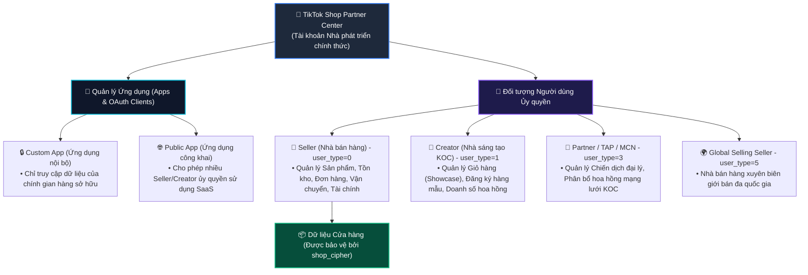
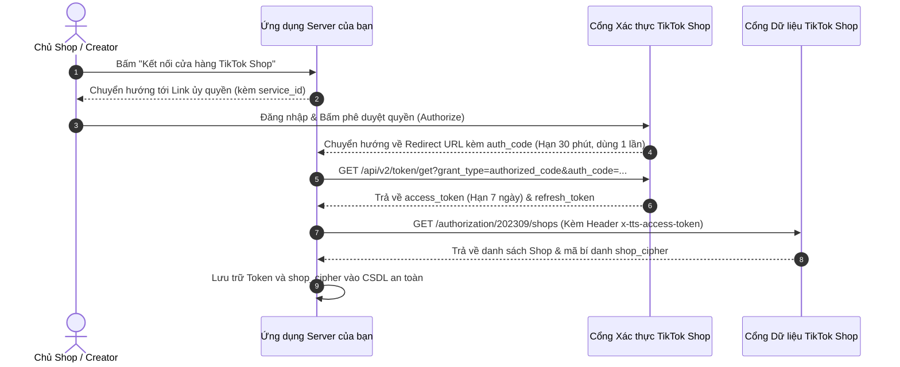
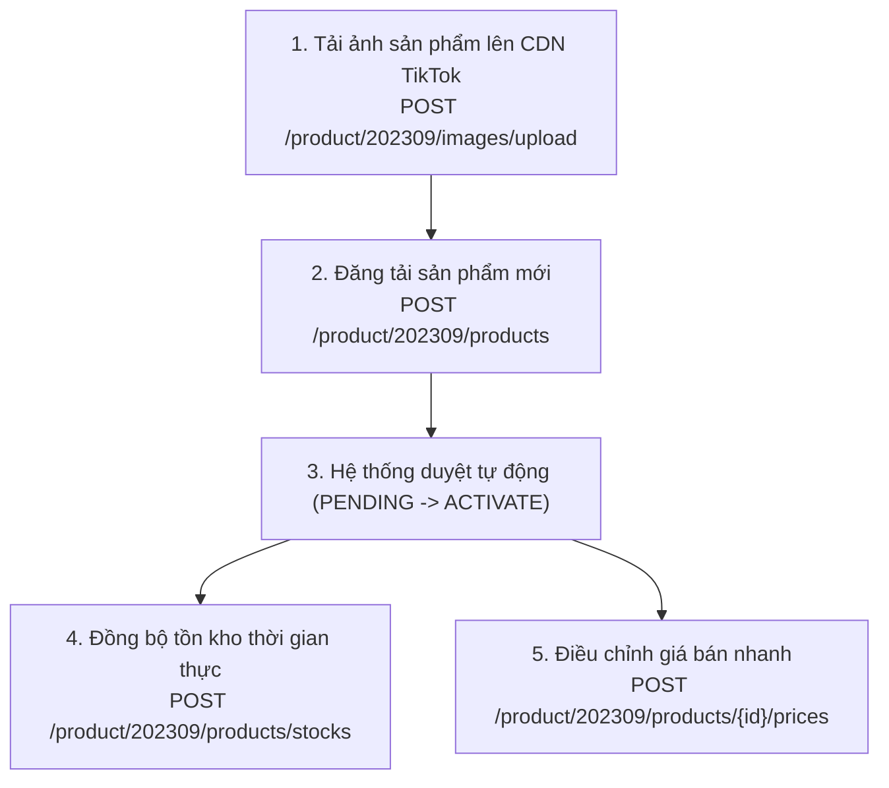
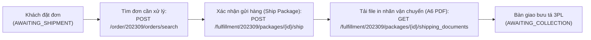

# Bộ Tài Liệu Tiếng Việt Chuẩn: TikTok Shop Partner API v2 (`tiktok-shop-api`)

Chào mừng bạn đến với bộ tài liệu tiếng Việt chi tiết và đầy đủ nhất dành cho **TikTok Shop Partner API (phiên bản v2)**. Bộ tài liệu này được biên soạn, chuẩn hóa và kiểm thử tự động, cấu trúc đồng bộ **khớp 1:1 với 19 phân hệ chức năng (344 API endpoints và 44 sự kiện Webhook thời gian thực)** trên cổng thông tin chính thức [TikTok Shop Partner Center Developer Guide](https://partner.tiktokshop.com/docv2/page/tts-developer-guide).

Toàn bộ các ví dụ và hướng dẫn gọi API trong bộ tài liệu được ưu tiên trình bày bằng **lệnh cURL hoàn chỉnh** (kèm URL endpoint, Header xác thực `x-tts-access-token`, `Content-Type: application/json` và JSON Body thực tế) cùng mã nguồn mẫu bằng Python, Node.js, Go để các kỹ sư backend, nhà phát triển phần mềm bán hàng đa kênh (Omnichannel/ERP) có thể thực thi ngay lập tức trong Terminal hoặc nhập thẳng vào Postman / Insomnia.

---

## 📌 Mục Lục Điều Hướng Nhanh

1. [Cấu Trúc Phân Cấp Tài Khoản & Vai Trò Nhà Phát Triển (Developer Hierarchy)](#1-cấu-trúc-phân-cấp-tài-khoản--vai-trò-nhà-phát-triển)
2. [Cây Hệ Sinh Thái API Toàn Diện (19 Phân Hệ Chuẩn)](#2-cây-hệ-sinh-thái-api-toàn-diện)
3. [Sơ Đồ Các Luồng Nghiệp Vụ Cốt Lõi & Hướng Dẫn Thực Thi](#3-sơ-đồ-các-luồng-nghiệp-vụ-cốt-lõi)
   - [3.1. Luồng Xác thực OAuth 2.0 & Quản lý Token](#31-luồng-xác-thực-oauth-20--quản-lý-token)
   - [3.2. Thuật toán Ký số HMAC-SHA256 & Quy chuẩn Request](#32-thuật-toán-ký-số-hmac-sha256--quy-chuẩn-request)
   - [3.3. Vòng đời Đăng bán Sản phẩm & Đồng bộ Tồn kho SKU](#33-vòng-đời-đăng-bán-sản-phẩm--đồng-bộ-tồn-kho-sku)
   - [3.4. Vòng đời Xử lý Đơn hàng, Đóng gói & In Tem Vận chuyển](#34-vòng-đời-xử-lý-đơn-hàng-đóng-gói--in-tem-vận-chuyển)
   - [3.5. Xử lý Hủy đơn, Trả hàng & Hoàn tiền (Reverse Logistics)](#35-xử-lý-hủy-đơn-trả-hàng--hoàn-tiền)
   - [3.6. Chu kỳ Quyết toán Tài chính, Bóc tách Phí sàn & Đối soát](#36-chu-kỳ-quyết-toán-tài-chính-bóc-tách-phí-sàn--đối-soát)
   - [3.7. Vận hành Kho TikTok FBT (Fulfilled by TikTok & MCF)](#37-vận-hành-kho-tiktok-fbt)
   - [3.8. Tiếp thị Liên kết Đa kênh (Affiliate Seller - Creator - TAP Partner)](#38-tiếp-thị-liên-kết-đa-kênh)
   - [3.9. Chăm sóc Khách hàng & Tích hợp Live Chat (Customer Service IM)](#39-chăm-sóc-khách-hàng--tích-hợp-live-chat)
   - [3.10. Báo cáo Hiệu suất Livestream & Chuyển đổi Video (Analytics)](#310-báo-cáo-hiệu-suất-livestream--chuyển-đổi-video)
   - [3.11. Cơ chế Push Webhook Thời Gian Thực (44 Sự Kiện Chuẩn)](#311-cơ-chế-push-webhook-thời-gian-thực)
4. [Mục Lục Toàn Bộ 19 Phân Hệ Tài Liệu Con Chi Tiết (`docs/`)](#4-mục-lục-toàn-bộ-19-phân-hệ-tài-liệu-con-chi-tiết)
5. [Từ Điển Mã Lỗi & Xử Lý Giới Hạn Tần Suất (Rate Limits)](#5-từ-điển-mã-lỗi--xử-lý-giới-hạn-tần-suất)
6. [Kế Hoạch Mở Rộng Hệ Thống API Đa Sàn (Shopee, TikTok, Lazada, Tiki, Meta, Amazon...)](#6-kế-hoạch-mở-rộng-hệ-thống-api-đa-sàn)

---

<a id="1-cấu-trúc-phân-cấp-tài-khoản--vai-trò-nhà-phát-triển"></a>
## 1. Cấu Trúc Phân Cấp Tài Khoản & Vai Trò Nhà Phát Triển

Hệ thống TikTok Shop Partner phân chia rõ ràng trách nhiệm theo vai trò pháp nhân và loại hình ứng dụng:



---

<a id="2-cây-hệ-sinh-thái-api-toàn-diện"></a>
## 2. Cây Hệ Sinh Thái API Toàn Diện (19 Phân Hệ Chuẩn)

TikTok Shop Partner API v2 bao gồm **19 phân hệ cốt lõi** với **344 API endpoints**:

```text
tiktok-shop-api/
├── 01. Authorization & Token (Xác thực OAuth 2.0, Cấp/Làm mới Access Token & Lấy shop_cipher)
├── 02. Seller & Shop Management (Danh sách Shop đang hoạt động, Nhóm cửa hàng, Quyền hạn khu vực)
├── 03. Products (74 APIs: Cây Danh mục, Thuộc tính, Đăng tải ảnh CDN, Tạo/Sửa SP, Tồn kho SKU, Giá bán, SP Toàn cầu)
├── 04. Orders (9 APIs: Tìm kiếm đơn hàng, Chi tiết đơn, Bóc tách thuế & voucher, Đồng bộ mã đơn ERP)
├── 05. Fulfillment (31 APIs: Tách đơn, Gộp đơn, Giao hàng đơn/hàng loạt, Lấy dịch vụ 3PL, In tem A6 PDF/ZPL)
├── 06. Logistics (10 APIs: Quản lý kho lấy hàng/kho trả hàng, Danh mục đơn vị vận chuyển 3PL, Tra cứu vận đơn)
├── 07. Return & Refund (22 APIs: Hủy đơn trước giao, Yêu cầu trả hàng - hoàn tiền, Duyệt/Từ chối khiếu nại, Trọng tài sàn)
├── 08. Finance & Settlement (9 APIs: Sao kê kỳ thanh toán, Đối soát chi tiết từng đơn hàng, Phí sàn, Lịch sử rút tiền)
├── 09. Fulfilled by TikTok - FBT (24 APIs: Nhập hàng tổng kho TikTok, Kiểm đếm tồn kho FBT, Đơn hàng đa kênh MCF)
├── 10. Promotion (12 APIs: Chiến dịch giảm giá trực tiếp, Flash Sale khung giờ vàng, Cài đặt giới hạn suất mua)
├── 11. Customer Service IM (15 APIs: Live Chat CSKH, Gửi tin nhắn tự động, Gửi thẻ sản phẩm/thẻ đơn hàng, Tỷ lệ phản hồi nhanh)
├── 12. Customer Engagement (7 APIs: Mẫu tin nhắn tiếp thị gửi hàng loạt, Voucher theo dõi shop, Chăm sóc khách cũ)
├── 13. Analytics & Reporting (32 APIs: Hiệu suất shop theo giờ, Báo cáo Livestream theo phút, Chuyển đổi Video ngắn)
├── 14. Affiliate Seller (45 APIs: Kế hoạch hoa hồng mở, Kế hoạch mục tiêu KOC VIP, Duyệt xuất hàng mẫu miễn phí)
├── 15. Affiliate Creator (27 APIs: Hồ sơ KOC, Thêm/Xóa sản phẩm giỏ hàng Showcase, Báo cáo hoa hồng tiếp thị)
├── 16. Affiliate Partner / TAP (16 APIs: Chiến dịch Agency kết nối KOC & Nhãn hàng, Quản lý hợp đồng phân bổ hoa hồng)
├── 17. Event & Webhooks (3 APIs quản lý cấu hình + 44 sự kiện push thời gian thực từ đơn hàng, sản phẩm đến kho vận)
├── 18. Supply Chain (API đồng bộ dữ liệu giao hàng chuỗi cung ứng ERP tự vận chuyển)
└── 19. Developer Tools & Sandbox (API Explorer, Môi trường Sandbox 2.0, Tài khoản test, Sinh dữ liệu giả lập)
```

---

<a id="3-sơ-đồ-các-luồng-nghiệp-vụ-cốt-lõi"></a>
## 3. Sơ Đồ Các Luồng Nghiệp Vụ Cốt Lõi & Hướng Dẫn Thực Thi

---

<a id="31-luồng-xác-thực-oauth-20--quản-lý-token"></a>
### 3.1. Luồng Xác thực OAuth 2.0 & Quản lý Token



#### Bảng Đường Dẫn Ủy Quyền Theo Thị Trường

| Thị trường | Đường dẫn ủy quyền Nhà bán hàng (Seller) |
| :--- | :--- |
| **Việt Nam, Đông Nam Á & Toàn cầu (ROW)** | `https://services.tiktokshop.com/open/authorize?service_id={service_id}` |
| **Hoa Kỳ (US)** | `https://services.us.tiktokshop.com/open/authorize?service_id={service_id}` |

#### cURL Lấy Access Token Bằng `auth_code`

```bash
curl -X GET \
  'https://auth.tiktok-shops.com/api/v2/token/get?app_key=YOUR_APP_KEY&app_secret=YOUR_APP_SECRET&auth_code=TTP_AUTH_CODE_RECEIVED&grant_type=authorized_code'
```

> ⚠️ **LƯU Ý CỐT LÕI**: Tham số `grant_type` bắt buộc phải là **`authorized_code`** (có chữ **d**). Không được sửa thành `authorization_code`.

#### cURL Làm Mới Token Khi Gần Hết Hạn (Refresh Token)

```bash
curl -X GET \
  'https://auth.tiktok-shops.com/api/v2/token/refresh?app_key=YOUR_APP_KEY&app_secret=YOUR_APP_SECRET&refresh_token=YOUR_REFRESH_TOKEN&grant_type=refresh_token'
```

#### cURL Lấy Danh Sách Cửa Hàng & Trích Xuất `shop_cipher` (Bắt Buộc)

```bash
curl -X GET \
  'https://open-api.tiktokglobalshop.com/authorization/202309/shops?app_key=YOUR_APP_KEY&timestamp=1792827493&sign=CALCULATED_SIGN' \
  -H 'x-tts-access-token: YOUR_ACCESS_TOKEN' \
  -H 'Content-Type: application/json'
```

*Trong phản hồi JSON, trích xuất trường `cipher` (ví dụ `VN_xkMbgAAAeVAQra0eZWebFQq5aIKabc123`). Giá trị này chính là `shop_cipher` bắt buộc phải truyền trong mọi API cấp độ Shop.*

---

<a id="32-thuật-toán-ký-số-hmac-sha256--quy-chuẩn-request"></a>
### 3.2. Thuật toán Ký số HMAC-SHA256 & Quy chuẩn Request

Mọi cuộc gọi API gửi tới `https://open-api.tiktokglobalshop.com` đều bắt buộc phải có chữ ký số `sign` trong query parameters.

#### 6 Bước Tính Toán Chữ Ký Chuẩn:
1. Lấy tất cả query parameters, **loại bỏ** `sign` và `access_token`.
2. Sắp xếp danh sách tên tham số theo thứ tự bảng chữ cái (A-Z).
3. Nối các tham số theo định dạng liền kề: `{key}{value}`.
4. Nối đường dẫn API vào phía trước: `{path}{params}` (ví dụ: `/authorization/202309/shopsapp_key29a39dtimestamp1623812664`).
5. Nếu yêu cầu có Body JSON (và Content-Type không phải là `multipart/form-data`), nối nguyên vẹn raw JSON bytes vào cuối: `{path}{params}{body}`.
6. Bao bọc bằng `app_secret` ở cả 2 đầu: `{app_secret}{path}{params}{body}{app_secret}`. Băm bằng thuật toán **HMAC-SHA256** với salt là `app_secret` -> Chuyển thành chuỗi Hex viết thường.

#### Script Ký Số Python Sẵn Dùng (Kiểm Thử Khớp 100% Tài Liệu TikTok Shop)

Trong thư mục `_scripts/sign_request.py`, script đã được tích hợp sẵn:

```bash
python3 tiktok-shop-api/_scripts/sign_request.py
```

*Kết quả kiểm thử với dữ liệu mẫu chính thức của TikTok Shop: Chữ ký sinh ra `b596b73e0cc6de07ac26f036364178ab16b0a907af13d43f0a0cd2345f582dc8` khớp hoàn toàn.*

---

<a id="33-vòng-đời-đăng-bán-sản-phẩm--đồng-bộ-tồn-kho-sku"></a>
### 3.3. Vòng đời Đăng bán Sản phẩm & Đồng bộ Tồn kho SKU



#### cURL Cập Nhật Tồn Kho Hàng Loạt (Batch Update Stock)

Dùng khi hệ thống kho nội bộ hoặc các sàn khác (Shopee, Lazada) có biến động số lượng để cập nhật ngay lập tức sang TikTok Shop tránh bán quá tồn kho:

```bash
curl -X POST \
  'https://open-api.tiktokglobalshop.com/product/202309/products/stocks?app_key=YOUR_APP_KEY&timestamp=1792827493&shop_cipher=YOUR_SHOP_CIPHER&sign=CALCULATED_SIGN' \
  -H 'x-tts-access-token: YOUR_ACCESS_TOKEN' \
  -H 'Content-Type: application/json' \
  -d '{
    "skus": [
      {
        "id": "1729482910482910",
        "seller_sku": "TSHIRT-BLK-L",
        "available_stock": 150
      },
      {
        "id": "1729482910482911",
        "seller_sku": "TSHIRT-WHT-XL",
        "available_stock": 80
      }
    ]
  }'
```

---

<a id="34-vòng-đời-xử-lý-đơn-hàng-đóng-gói--in-tem-vận-chuyển"></a>
### 3.4. Vòng đời Xử lý Đơn hàng, Đóng gói & In Tem Vận chuyển



#### cURL Lấy Danh Sách Đơn Hàng Cần Đóng Gói

```bash
curl -X POST \
  'https://open-api.tiktokglobalshop.com/order/202309/orders/search?app_key=YOUR_APP_KEY&timestamp=1792827493&shop_cipher=YOUR_SHOP_CIPHER&page_size=20&sign=CALCULATED_SIGN' \
  -H 'x-tts-access-token: YOUR_ACCESS_TOKEN' \
  -H 'Content-Type: application/json' \
  -d '{
    "order_status": "AWAITING_SHIPMENT"
  }'
```

#### cURL Tải Nhãn In Vận Chuyển A6 PDF Gửi Thẳng Máy In Nhiệt

```bash
curl -X GET \
  'https://open-api.tiktokglobalshop.com/fulfillment/202309/packages/PKG_7482910482910/shipping_documents?app_key=YOUR_APP_KEY&timestamp=1792827493&shop_cipher=YOUR_SHOP_CIPHER&document_type=SHIPPING_LABEL&document_size=A6&format=PDF&sign=CALCULATED_SIGN' \
  -H 'x-tts-access-token: YOUR_ACCESS_TOKEN' \
  -H 'Content-Type: application/json'
```

---

<a id="35-xử-lý-hủy-đơn-trả-hàng--hoàn-tiền"></a>
### 3.5. Xử lý Hủy đơn, Trả hàng & Hoàn tiền (Reverse Logistics)

Khi khách hàng yêu cầu trả hàng, hệ thống phát sinh yêu cầu và người bán có **48 giờ** để phản hồi:
- **Duyệt nhận hàng trả**: `POST /return_refund/202309/returns/{return_id}/approve`
- **Duyệt hoàn tiền trực tiếp**: `POST /return_refund/202309/refunds/{return_id}/approve`
- **Từ chối yêu cầu (kèm bằng chứng ảnh)**: `POST /return_refund/202309/returns/{return_id}/reject`
- **Xác nhận kho đã nhận được kiện hàng hoàn**: `POST /return_refund/202309/returns/{return_id}/confirm_received`

---

<a id="36-chu-kỳ-quyết-toán-tài-chính-bóc-tách-phí-sàn--đối-soát"></a>
### 3.6. Chu kỳ Quyết toán Tài chính, Bóc tách Phí sàn & Đối soát

Đối soát chính xác doanh thu thực nhận về tài khoản ngân hàng:
- **Lấy danh sách bảng sao kê quyết toán**: `GET /finance/202309/statements`
- **Bóc tách chi tiết từng khoản trừ trên 1 đơn hàng**: `GET /finance/202501/orders/{order_id}/statement_transactions`

```text
Doanh thu thực nhận = Tiền hàng (Subtotal) 
                     - Phí hoa hồng sàn (Platform Commission) 
                     - Phí thanh toán thẻ (Transaction Fee) 
                     - Phí hoa hồng KOC (Affiliate Commission) 
                     - Cước vận chuyển nhà bán chịu (Shipping Fee)
```

---

<a id="37-vận-hành-kho-tiktok-fbt"></a>
### 3.7. Vận hành Kho TikTok FBT (Fulfilled by TikTok & MCF)

Dịch vụ gửi hàng lưu tại tổng kho của TikTok:
- **Tạo kế hoạch nhập hàng vào kho TikTok**: `POST /fbt/202408/inbound_plans`
- **Tra cứu tồn kho thực tế khả dụng tại FBT**: `POST /fbt/202408/inventory/search`
- **Dùng hàng trong kho TikTok xử lý đơn từ sàn khác (Multi-channel Fulfillment)**: `POST /fbt/202409/multi_channel_fulfillment/orders`

---

<a id="38-tiếp-thị-liên-kết-đa-kênh"></a>
### 3.8. Tiếp thị Liên kết Đa kênh (Affiliate Seller - Creator - TAP Partner)

Phân hệ Affiliate bao gồm 88 endpoints kết nối 3 bên:
1. **Phía Nhà bán hàng (Seller)**: Tạo chính sách hoa hồng mở (`open_collaboration_settings`), tạo lời mời độc quyền KOC VIP (`targeted_collaborations`), duyệt gửi hàng mẫu trải nghiệm.
2. **Phía KOC / Creator**: Quản lý giỏ hàng Showcase cá nhân (`/affiliate_creator/202405/showcases/products/add`), theo dõi hoa hồng nhận được.
3. **Phía Đối tác MCN / Agency (TAP)**: Khởi tạo chiến dịch đại lý (`/affiliate_partner/202405/campaigns`), chia sẻ hoa hồng mạng lưới KOC trực thuộc.

---

<a id="39-chăm-sóc-khách-hàng--tích-hợp-live-chat"></a>
### 3.9. Chăm sóc Khách hàng & Tích hợp Live Chat (Customer Service IM)

Tích hợp hộp thư hỗ trợ khách hàng đa kênh:
- Lắng nghe sự kiện khách nhắn tin mới qua Webhook `IM_NEW_MESSAGE`.
- Gửi tin nhắn trả lời: `POST /customer_service/202309/messages`. Hỗ trợ tin nhắn văn bản, hình ảnh, thẻ sản phẩm (Product Card) và thẻ trạng thái đơn hàng (Order Card).
- Đánh dấu đã đọc (`/read`) để đảm bảo chỉ số Tỷ lệ phản hồi nhanh (Fast Response Rate) của Shop luôn trên 95%.

---

<a id="310-báo-cáo-hiệu-suất-livestream--chuyển-đổi-video"></a>
### 3.10. Báo cáo Hiệu suất Livestream & Chuyển đổi Video (Analytics)

Cung cấp dữ liệu theo thời gian thực để tối ưu bán hàng:
- **Hiệu suất Livestream theo phút**: `GET /analytics/202510/shop_lives/{live_id}/performance_per_minutes` (Theo dõi mắt xem trực tiếp CCU, số lượt click giỏ hàng, số đơn hàng nổ theo từng phút khi Host live tung deal).
- **Hiệu suất Video ngắn gắn giỏ vàng**: `GET /analytics/202403/videos/performances` (Doanh thu GMV sinh ra từ từng video cụ thể).

---

<a id="311-cơ-chế-push-webhook-thời-gian-thực"></a>
### 3.11. Cơ chế Push Webhook Thời Gian Thực (44 Sự Kiện Chuẩn)

- Máy chủ của bạn nhận POST request tại địa chỉ Webhook URL đã đăng ký.
- Xác thực tính hợp lệ bằng mã băm HMAC-SHA256 của raw payload với `app_secret` đối chiếu với Header `x-tts-signature`.
- **Bắt buộc phản hồi HTTP 200 trong vòng 3 giây**: `{"code": 0, "message": "success"}`.
- Danh mục 44 sự kiện bao quát: `ORDER_STATUS_CHANGE`, `PRODUCT_STATUS_CHANGE`, `RETURN_STATUS_CHANGE`, `PACKAGE_UPDATE`, `IM_NEW_MESSAGE`, `FBT_INVENTORY_CHANGE`, `AFFILIATE_CREATOR_COLLABORATION_UPDATE`...

---

<a id="4-mục-lục-toàn-bộ-19-phân-hệ-tài-liệu-con-chi-tiết"></a>
## 4. Mục Lục Toàn Bộ 19 Phân Hệ Tài Liệu Con Chi Tiết (`docs/`)

Mỗi phân hệ đã được biên soạn riêng thành các file tài liệu độc lập có đầy đủ bảng tham số, mã lỗi và cURL thực thi trong thư mục [`docs/`](file:///Users/hattorimk/Desktop/api-docs/tiktok-shop-api/docs/):

1. [01. Tổng Quan & Khởi Tạo Dự Án](file:///Users/hattorimk/Desktop/api-docs/tiktok-shop-api/docs/01-tong-quan-va-khoi-tao/README.md)
2. [02. Cơ Chế Xác Thực OAuth 2.0 & Quản Lý Token](file:///Users/hattorimk/Desktop/api-docs/tiktok-shop-api/docs/02-xac-thuc-oauth-va-token/README.md)
3. [03. Cơ Chế Gọi API & Ký Số HMAC-SHA256](file:///Users/hattorimk/Desktop/api-docs/tiktok-shop-api/docs/03-co-che-goi-api-va-ky-so/README.md)
4. [04. Quản Lý Cửa Hàng & Người Bán (Seller & Shop)](file:///Users/hattorimk/Desktop/api-docs/tiktok-shop-api/docs/04-quan-ly-shop-va-nguoi-ban/README.md)
5. [05. Quản Lý Sản Phẩm (Products - 74 Endpoints)](file:///Users/hattorimk/Desktop/api-docs/tiktok-shop-api/docs/05-quan-ly-san-pham-products/README.md)
6. [06. Quản Lý Đơn Hàng (Orders - 9 Endpoints)](file:///Users/hattorimk/Desktop/api-docs/tiktok-shop-api/docs/06-quan-ly-don-hang-orders/README.md)
7. [07. Đóng Gói & Giao Hàng (Fulfillment - 31 Endpoints)](file:///Users/hattorimk/Desktop/api-docs/tiktok-shop-api/docs/07-dong-goi-va-giao-hang-fulfillment/README.md)
8. [08. Hậu Cần & Kho Bãi (Logistics - 10 Endpoints)](file:///Users/hattorimk/Desktop/api-docs/tiktok-shop-api/docs/08-hau-can-va-kho-bai-logistics/README.md)
9. [09. Trả Hàng & Hoàn Tiền (Return & Refund - 22 Endpoints)](file:///Users/hattorimk/Desktop/api-docs/tiktok-shop-api/docs/09-tra-hang-hoan-tien-reverse/README.md)
10. [10. Tài Chính & Đối Soát (Finance & Settlement - 9 Endpoints)](file:///Users/hattorimk/Desktop/api-docs/tiktok-shop-api/docs/10-tai-chinh-va-doi-soat-finance/README.md)
11. [11. Lưu Kho & Vận Hành Bởi TikTok (FBT - 24 Endpoints)](file:///Users/hattorimk/Desktop/api-docs/tiktok-shop-api/docs/11-kho-van-fbt-fulfilled-by-tiktok/README.md)
12. [12. Chiến Dịch & Khuyến Mại (Promotions - 12 Endpoints)](file:///Users/hattorimk/Desktop/api-docs/tiktok-shop-api/docs/12-khuyen-mai-promotions/README.md)
13. [13. Chăm Sóc Khách Hàng & Live Chat (Customer Service IM - 15 Endpoints)](file:///Users/hattorimk/Desktop/api-docs/tiktok-shop-api/docs/13-cham-soc-khach-hang-im-chat/README.md)
14. [14. Tiếp Thị Liên Kết (Affiliate - 88 Endpoints)](file:///Users/hattorimk/Desktop/api-docs/tiktok-shop-api/docs/14-tiep-thi-lien-ket-affiliate/README.md)
15. [15. Dữ Liệu & Báo Cáo Phân Tích (Analytics - 32 Endpoints)](file:///Users/hattorimk/Desktop/api-docs/tiktok-shop-api/docs/15-bao-cao-phan-tich-analytics/README.md)
16. [16. Webhook & Lắng Nghe Sự Kiện Thời Gian Thực (44 Sự Kiện)](file:///Users/hattorimk/Desktop/api-docs/tiktok-shop-api/docs/16-webhook-va-co-che-lang-nghe-su-kien/README.md)
17. [17. Môi Trường Sandbox 2.0 & Công Cụ Kiểm Thử](file:///Users/hattorimk/Desktop/api-docs/tiktok-shop-api/docs/17-moi-truong-sandbox-va-kiem-thu/README.md)
18. [18. Từ Điển Mã Lỗi & Xử Lý Sự Cố (Error Codes & Troubleshooting)](file:///Users/hattorimk/Desktop/api-docs/tiktok-shop-api/docs/18-tu-dien-ma-loi-va-xu-ly-su-co/README.md)
19. [19. Kế Hoạch Kiến Trúc & Mở Rộng Hệ Thống API Đa Sàn](file:///Users/hattorimk/Desktop/api-docs/tiktok-shop-api/docs/19-ke-hoach-mo-rong-he-thong-api-da-san/README.md)

---

<a id="5-từ-điển-mã-lỗi--xử-lý-giới-hạn-tần-suất"></a>
## 5. Từ Điển Mã Lỗi & Xử Lý Giới Hạn Tần Suất

- **`36000001` (Signature is invalid)**: Sai chữ ký số HMAC-SHA256. Kiểm tra lại `app_secret`, đảm bảo không đưa `sign` hay `access_token` vào chuỗi ký.
- **`36000002` (Access token is invalid or expired)**: Token đã hết hạn (sau 7 ngày) -> Gọi ngay API Refresh Token.
- **`36000005` (Scope unauthorized)**: App chưa được cấp quyền cho API này -> Vào Partner Center tick chọn thêm Scope và yêu cầu người dùng ủy quyền lại.
- **`36000006` (Shop cipher is invalid)**: Mã `shop_cipher` không chính xác hoặc đã bị đổi -> Gọi lại `/authorization/202309/shops`.
- **`105002` (Traffic limit exceeded)**: Bị nghẽn tần suất gọi (HTTP 429) -> Áp dụng thuật toán Exponential Backoff with Jitter (chờ từ 1-3 giây rồi thử lại).

---

<a id="6-kế-hoạch-mở-rộng-hệ-thống-api-đa-sàn"></a>
## 6. Kế Hoạch Mở Rộng Hệ Thống API Đa Sàn

Thư mục gốc `api-docs/` được định vị là **Trung tâm Tài liệu API Thương mại Điện tử Toàn diện**. Hiện tại bạn đã sở hữu:
1. `shoppe-api`: Tài liệu Shopee Open API v2.
2. `tiktok-business-api`: Tài liệu Quảng cáo TikTok Marketing API v1.3.
3. `tiktok-shop-api`: Tài liệu TikTok Shop Partner API v2 (bộ tài liệu này).

### Lộ Trình Triển Khai Các Sàn Tiếp Theo:
- **Giai đoạn tiếp theo**: `lazada-api` (Lazada Open Platform - Đông Nam Á) & `tiki-api` (Sàn Tiki - Việt Nam).
- **Giai đoạn nâng cao**: `meta-commerce-api` (Facebook Shop & Instagram Shopping) & `amazon-sp-api` (Amazon Selling Partner API - Toàn cầu).
- Tham khảo kiến trúc chuẩn hóa ma trận trạng thái đơn hàng và tồn kho đa sàn tại [Tài liệu Phân hệ 19](file:///Users/hattorimk/Desktop/api-docs/tiktok-shop-api/docs/19-ke-hoach-mo-rong-he-thong-api-da-san/README.md).

