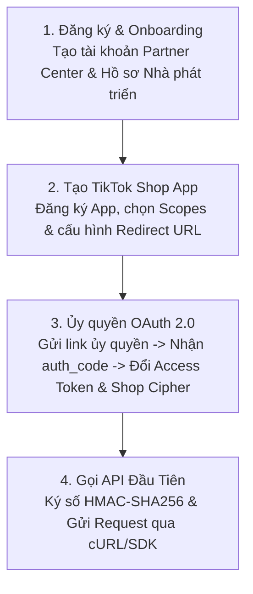

# 01. Tổng Quan & Khởi Tạo Dự Án TikTok Shop Partner API

Chào mừng bạn đến với tài liệu hướng dẫn khởi tạo và thiết lập dự án tích hợp với **TikTok Shop Partner API**. Hệ thống API này cung cấp quyền truy cập bằng mã nguồn (programmatic access) vào toàn bộ các phân hệ của sàn thương mại điện tử TikTok Shop: sản phẩm, đơn hàng, vận chuyển, kho bãi, tài chính, tiếp thị liên kết (affiliate) và dịch vụ khách hàng.

---

## 1. Xác Định Loại Hình Nhà Phát Triển (Developer Type)

Trước khi bắt đầu, bạn cần xác định mô hình tích hợp của mình. Loại nhà phát triển sẽ quyết định:
1. Loại ứng dụng cần tạo trên TikTok Shop Partner Center (**Custom App** hay **Public App**).
2. Dữ liệu mà bạn được phép truy cập.
3. Giá trị `user_type` trả về trong quá trình người dùng ủy quyền OAuth 2.0.

| Vai trò của bạn | Loại ứng dụng (Build Type) | Phạm vi dữ liệu truy cập | Giá trị `user_type` khi ủy quyền | Đối tượng áp dụng tiêu biểu |
| :--- | :--- | :--- | :--- | :--- |
| **Seller (In-house) Developer** | **Custom App** | Chỉ truy cập dữ liệu của chính cửa hàng sở hữu | `user_type = 0` (Seller) | Doanh nghiệp/Nhà bán hàng tự xây dựng phần mềm nội bộ kết nối kho/ERP của mình. |
| **App Developer / ISV / SI** | **Public App** | Truy cập dữ liệu của nhiều nhà bán hàng khác nhau (khi được họ ủy quyền) | `user_type = 0` (Đại diện cho Seller) | Công ty phần mềm SaaS (phần mềm quản lý bán hàng đa kênh, in hóa đơn, quản lý kho ERP bên ngoài). |
| **Creator / Affiliate Integrator** | **Public App** | Dữ liệu tiếp thị liên kết phía Nhà sáng tạo (Creator) | `user_type = 1` (Creator) | Nền tảng quản lý hoa hồng KOC/KOL, mạng lưới quản lý giỏ hàng sản phẩm. |
| **Partner (TAP / MCN / TSP)** | **Public App** | Dữ liệu đối tác đối chiếu (TikTok Shop Affiliate Partner - TAP) | `user_type = 3` (Partner) | Các Agency, MCN quản lý nhiều nhà sáng tạo hoặc nhà bán hàng ủy thác. |

---

## 2. Lộ Trình 4 Bước Bắt Đầu (The 4-Step Path)

### Bước 1: Onboard (Đăng ký tài khoản Partner Center)
- Truy cập cổng chính thức:
  - Thị trường Quốc tế / Đông Nam Á / Việt Nam / Anh: [https://partner.tiktokshop.com](https://partner.tiktokshop.com)
  - Thị trường Hoa Kỳ (US): [https://partner.us.tiktokshop.com](https://partner.us.tiktokshop.com)
- Hoàn thiện hồ sơ pháp nhân doanh nghiệp (Giấy phép kinh doanh, thông tin liên hệ).
- *Lưu ý*: Với thị trường US/UK, một số danh mục sẽ yêu cầu xét duyệt pháp lý và tuân thủ (Compliance & Legal Review) từ 2 đến 3 tuần.

### Bước 2: Tạo ứng dụng TikTok Shop (Create App)
- Vào mục **App & Service** > **Create App**.
- Điền các thông tin:
  - **App Name**: Tên ứng dụng hiển thị với nhà bán hàng khi họ ủy quyền.
  - **App Icon**: Logo kích thước vuông chuẩn 512x512.
  - **Redirect URL**: Địa chỉ máy chủ của bạn nhận mã `auth_code` sau khi người dùng đồng ý ủy quyền (Bắt buộc dùng `https://`).
  - **Webhook URL**: Địa chỉ máy chủ nhận các sự kiện thời gian thực (đơn hàng mới, hủy đơn, cập nhật tồn kho).
  - **API Scopes**: Chọn đúng các nhóm quyền cần thiết (ví dụ: `seller.order.read`, `seller.product.write`, v.v.).

### Bước 3: Ủy quyền và nhận Token
- Tạo liên kết ủy quyền gửi cho chủ gian hàng (Seller) hoặc người sáng tạo (Creator).
- Người dùng đăng nhập tài khoản TikTok Shop và bấm **Authorize**.
- Hệ thống TikTok chuyển hướng người dùng về `Redirect URL` kèm tham số `code` (`auth_code`).
- Máy chủ của bạn lập tức dùng `auth_code` để gọi API đổi lấy `access_token`, `refresh_token` và sau đó gọi `/authorization/202309/shops` để lấy `shop_cipher`.

### Bước 4: Thực hiện cuộc gọi API đầu tiên
- Sử dụng `app_key`, `app_secret`, `access_token`, `timestamp` và `shop_cipher` để tạo chữ ký số `sign` theo chuẩn HMAC-SHA256.
- Thực thi gọi endpoint dữ liệu (ví dụ: Lấy danh sách đơn hàng).

---

## 3. Kiến Trúc Cấu Trúc Khóa Xác Thực Cần Lưu Trữ

Để một hệ thống vận hành liên tục, bạn cần lưu trữ an toàn trong cơ sở dữ liệu các thông số sau:

| Tên biến | Nguồn gốc | Ý nghĩa | Lưu ý bảo mật |
| :--- | :--- | :--- | :--- |
| `app_key` | Partner Center | Định danh công khai của ứng dụng | Công khai trên URL gọi API |
| `app_secret` | Partner Center | Khóa bí mật dùng để băm chữ ký `sign` | **Tuyệt đối không để lộ** trên Client/Frontend |
| `service_id` | Partner Center | Mã định danh dịch vụ tạo link ủy quyền | Dùng để ghép link ủy quyền |
| `access_token` | Token API | Mã truy cập dữ liệu (mặc định có hạn 7 ngày) | Đính kèm vào Header `x-tts-access-token` |
| `refresh_token` | Token API | Khóa dùng để cấp mới `access_token` | Lưu trữ bảo mật, dùng trước khi token hết hạn |
| `shop_cipher` | Get Authorized Shops | Mã định danh mã hóa của từng Shop | **Bắt buộc** truyền trong Query cho hầu hết API |
| `open_id` | Token API | Mã định danh người dùng ủy quyền | Dùng quản lý tài khoản người dùng liên kết |

---

## 4. Tài Liệu Điều Hướng Chi Tiết

- [Chi tiết cơ chế xác thực OAuth 2.0 & Quản lý Token](../02-xac-thuc-oauth-va-token/README.md)
- [Thuật toán ký số HMAC-SHA256 & Quy chuẩn Request](../03-co-che-goi-api-va-ky-so/README.md)
- [Quản lý Shop & Trích xuất `shop_cipher`](../04-quan-ly-shop-va-nguoi-ban/README.md)

