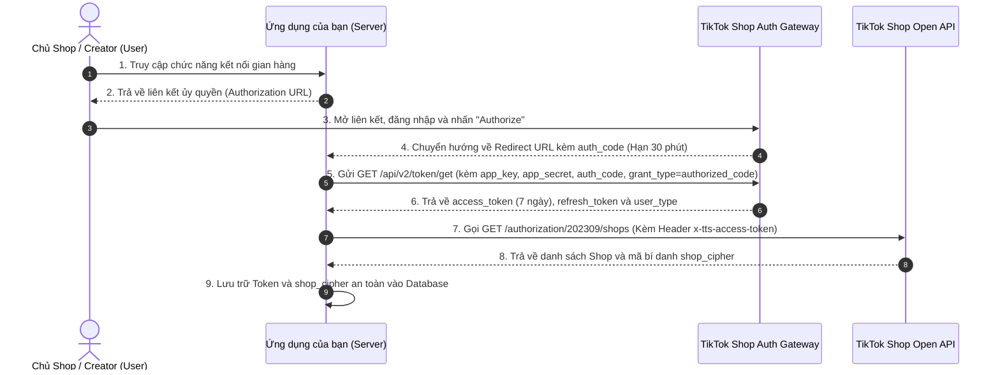

# 02. Cơ Chế Xác Thực OAuth 2.0 & Quản Lý Token

Tài liệu này giải thích chi tiết quy trình xác thực OAuth 2.0, cấp phát và làm mới Token, cũng như cách lấy `shop_cipher` của cửa hàng trong TikTok Shop Partner API v2.

---

## 1. Sơ Đồ Toàn Cảnh Luồng Xác Thực (OAuth 2.0 Sequence)



---

## 2. Đường Dẫn Ủy Quyền Theo Thị Trường (Authorization Domains)

Tùy thuộc vào thị trường của người dùng (Hoa Kỳ hay Quốc tế/Đông Nam Á/Việt Nam) và vai trò người dùng, bạn cần tạo đúng liên kết:

| Loại hình ủy quyền | Thị trường Hoa Kỳ (US) | Thị trường Toàn cầu / Việt Nam (ROW) |
| :--- | :--- | :--- |
| **Nhà bán hàng (Seller)** | `https://services.us.tiktokshop.com/open/authorize?service_id={service_id}` | `https://services.tiktokshop.com/open/authorize?service_id={service_id}` |
| **Đối tác Đại lý (Partner / TAP)** | `https://partner.us.tiktokshop.com/open/authorize?service_id={service_id}` | `https://partner.tiktokshop.com/open/authorize?service_id={service_id}` |
| **Nhà sáng tạo (Creator)** | `https://shop.tiktok.com/alliance/creator/auth?app_key={app_key}&state={state}` | `https://shop.tiktok.com/alliance/creator/auth?app_key={app_key}&state={state}` |
| **Endpoint Cấp / Đổi Token** | `https://auth.tiktok-shops.com/api/v2/token/get` | `https://auth.tiktok-shops.com/api/v2/token/get` (Chung toàn cầu) |

> 📌 **Lưu ý**: `service_id` lấy tại trang chi tiết ứng dụng trên Partner Center (**App & Service**).

---

## 3. Tiếp Nhận `auth_code` Tại Redirect URL

Khi người dùng nhấn đồng ý ủy quyền, trình duyệt sẽ tự động chuyển hướng về `Redirect URL` mà bạn đã đăng ký:

```http
GET https://your-server.com/callback?code=TTP_FeBoANmHP3yqdoUI9fZOCw&state=your_custom_state
```

- `code` (`auth_code`): Mã xác thực tạm thời.
  - **Thời hạn sử dụng**: **30 phút**.
  - **Số lần sử dụng**: **Chỉ 1 lần duy nhất**. Bạn phải thực hiện đổi sang `access_token` ngay lập tức.
- Nếu người dùng từ chối ủy quyền, tham số sẽ trả về: `code=null&error=auth_denied`.

---

## 4. API Lấy Access Token (Get Access Token API)

Gửi một yêu cầu `GET` đến máy chủ cấp token:
- **Endpoint**: `https://auth.tiktok-shops.com/api/v2/token/get`
- **Method**: `GET`

### Tham số yêu cầu (Query Parameters)

| Tham số | Kiểu | Bắt buộc | Mô tả | Giá trị mẫu |
| :--- | :--- | :--- | :--- | :--- |
| `app_key` | string | Có | App Key từ Partner Center | `68xu9ks5p4i8` |
| `app_secret` | string | Có | App Secret từ Partner Center | `e59af819cc...` |
| `auth_code` | string | Có | Mã nhận được từ Redirect URL | `TTP_FeBoANmHP...` |
| `grant_type` | string | Có | **Bắt buộc là `authorized_code`** | `authorized_code` |

> ⚠️ **ĐẶC BIỆT LƯU Ý**: Tham số `grant_type` của TikTok Shop phải là **`authorized_code`** (có chữ **d**), KHÔNG PHẢI là `authorization_code` theo chuẩn OAuth thông thường. Nếu bạn viết là `authorization_code`, hệ thống sẽ báo lỗi `Invalid grant_type`.

### Ví dụ lệnh cURL lấy Token

```bash
curl -X GET \
  'https://auth.tiktok-shops.com/api/v2/token/get?app_key=YOUR_APP_KEY&app_secret=YOUR_APP_SECRET&auth_code=TTP_AUTH_CODE_RECEIVED&grant_type=authorized_code'
```

### Phản hồi thành công (JSON Response)

```json
{
  "code": 0,
  "message": "success",
  "request_id": "2026102409462301024509910319695C45",
  "data": {
    "access_token": "TTP_Fw8rBwAAAAAkW03FYd09DG-9INtpw361hWthei8S3fHX8iPJ5AUv99fLSCYD9-UucaqxTgNRzKZxi5",
    "access_token_expire_in": 1793432264,
    "refresh_token": "TTP_NTUxZTNhYTQ2ZDk2YmRmZWNmYWY2YWY2YzkxNGYwNjQ3YjkzYTllYjA0YmNlMw",
    "refresh_token_expire_in": 1824368264,
    "open_id": "7010736057180325637",
    "seller_name": "Cong Ty TNHH Thuong Mai ABC",
    "seller_base_region": "VN",
    "user_type": 0,
    "granted_scopes": [
      "seller.order.read",
      "seller.order.write",
      "seller.product.read",
      "seller.product.write"
    ]
  }
}
```

### Ý nghĩa của trường `user_type`

| Giá trị | Loại người dùng | Ý nghĩa thực tế |
| :--- | :--- | :--- |
| `0` | **Seller** | Nhà bán hàng thông thường (Local Seller) |
| `1` | **Creator** | Nhà sáng tạo / KOC làm tiếp thị liên kết (Affiliate Creator) |
| `2` | **Partner** | Loại hình đối tác cũ (Legacy Partner) |
| `3` | **Partner** | Đối tác tiếp thị liên kết đại lý (Affiliate Partner / TAP) |
| `4` | **Global Seller** | Nhà bán hàng xuyên biên giới cũ |
| `5` | **Global Seller** | Nhà bán hàng bán hàng toàn cầu hiện tại (Cross-border / Global Selling) |

---

## 5. API Làm Mới Token (Refresh Access Token)

`access_token` mặc định có hạn là **7 ngày**. Bạn cần thiết lập Cron Job để tự động gia hạn token trước khi hết hạn (khuyên dùng định kỳ sau mỗi 3-5 ngày).

- **Endpoint**: `https://auth.tiktok-shops.com/api/v2/token/refresh`
- **Method**: `GET`

### Tham số yêu cầu (Query Parameters)

| Tham số | Kiểu | Bắt buộc | Mô tả | Giá trị mẫu |
| :--- | :--- | :--- | :--- | :--- |
| `app_key` | string | Có | App Key | `YOUR_APP_KEY` |
| `app_secret` | string | Có | App Secret | `YOUR_APP_SECRET` |
| `refresh_token` | string | Có | Refresh Token đã lưu trữ | `TTP_REFRESH_TOKEN` |
| `grant_type` | string | Có | **Bắt buộc là `refresh_token`** | `refresh_token` |

### Ví dụ lệnh cURL làm mới Token

```bash
curl -X GET \
  'https://auth.tiktok-shops.com/api/v2/token/refresh?app_key=YOUR_APP_KEY&app_secret=YOUR_APP_SECRET&refresh_token=YOUR_REFRESH_TOKEN&grant_type=refresh_token'
```

---

## 6. Lấy Danh Sách Cửa Hàng & `shop_cipher` (Bắt Buộc)

Sau khi có `access_token`, bạn phải gọi API `/authorization/202309/shops` để biết nhà bán hàng này có những shop nào và lấy mã `cipher` (`shop_cipher`). Mã này bắt buộc truyền trong tất cả các API quản lý đơn hàng, kho hàng, sản phẩm sau này.

### Lệnh cURL gọi Get Authorized Shops

```bash
curl -X GET \
  'https://open-api.tiktokglobalshop.com/authorization/202309/shops?app_key=YOUR_APP_KEY&timestamp=1792827493&sign=CALCULATED_HMAC_SIGNATURE' \
  -H 'x-tts-access-token: YOUR_ACCESS_TOKEN' \
  -H 'Content-Type: application/json'
```

### Dữ liệu phản hồi mẫu

```json
{
  "code": 0,
  "message": "success",
  "request_id": "2026102410112201024509910319695ABC",
  "data": {
    "shops": [
      {
        "id": "749583920194837281",
        "name": "Gian Hang Chinh Hang VN",
        "region": "VN",
        "seller_type": "CROSS_BORDER",
        "cipher": "VN_xkMbgAAAeVAQra0eZWebFQq5aIKabc123"
      }
    ]
  }
}
```

> 🎯 **Quy tắc quan trọng**: Hãy lưu trường `cipher` (ví dụ `VN_xkMbgAAAeVAQra0eZWebFQq5aIKabc123`) liên kết với từng cửa hàng trong cơ sở dữ liệu của bạn. Mỗi khi thực hiện gọi API dữ liệu cửa hàng, truyền tham số `shop_cipher={cipher}` trên thanh địa chỉ URL.

