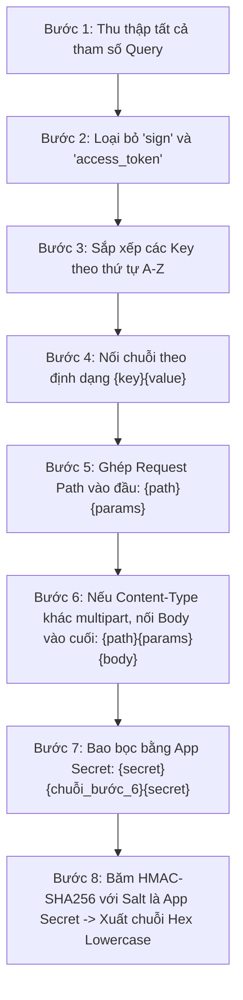

# 03. Cơ Chế Gọi API & Thuật Toán Ký Số HMAC-SHA256

Mọi yêu cầu gửi đến TikTok Shop Partner API đều bắt buộc phải có chữ ký số hợp lệ (`sign`) để xác thực tính toàn vẹn và nguồn gốc của dữ liệu. Nếu chữ ký không chính xác, máy chủ sẽ lập tức từ chối và phản hồi lỗi `36000001: Signature is invalid`.

---

## 1. Cấu Trúc Yêu Cầu Chuẩn (Standard Request Anatomy)

- **Domain Máy Chủ Cổng (API Gateway)**: `https://open-api.tiktokglobalshop.com`
- **Giao thức**: HTTPS (Bắt buộc TLS 1.2 trở lên)
- **Định dạng dữ liệu**: `application/json; charset=utf-8`

### Các Headers Bắt Buộc

| Tên Header | Bắt buộc | Mô tả |
| :--- | :--- | :--- |
| `x-tts-access-token` | Có (với API nghiệp vụ) | Chuỗi `access_token` cấp phát từ luồng OAuth 2.0 |
| `Content-Type` | Có | `application/json` (hoặc `multipart/form-data` với API upload ảnh) |

### Các Tham Số Bắt Buộc Trên Query String

| Tên tham số | Kiểu | Mô tả |
| :--- | :--- | :--- |
| `app_key` | string | App Key định danh ứng dụng của bạn |
| `timestamp` | string/int | Dấu thời gian Unix Epoch (10 chữ số, tính bằng giây). Sai lệch không quá ±5 phút so với giờ máy chủ |
| `sign` | string | Chữ ký số HMAC-SHA256 dạng hex chữ thường (lowercase) |
| `shop_cipher` | string | Mã bí danh của cửa hàng (Bắt buộc với toàn bộ API cấp độ Shop như Product, Order, Warehouse...) |

---

## 2. Quy Trình 6 Bước Tạo Chữ Ký Chuẩn (HMAC-SHA256)



### Chi Tiết Từng Bước Ký Số

#### Bước 1 & 2: Lọc các tham số Query
Trích xuất tất cả các tham số truyền trong Query String URL. **Loại bỏ hoàn toàn** hai khóa `sign` và `access_token` (nếu có).

#### Bước 3: Sắp xếp theo thứ tự từ điển (Alphabetical Order)
Sắp xếp danh sách tên tham số theo thứ tự A-Z tăng dần.

#### Bước 4: Nối tham số theo quy tắc `{key}{value}`
Duyệt qua từng khóa đã sắp xếp và ghép liền tên khóa với giá trị tương ứng (không có dấu `=`, `&` hay khoảng trắng).
*Ví dụ:* với `app_key=29a39d` và `timestamp=1623812664` -> chuỗi sinh ra là:
`app_key29a39dtimestamp1623812664`

#### Bước 5: Thêm Request Path vào đầu
Nối đường dẫn API (Request Path) vào phía trước chuỗi tại Bước 4:
`{path}{chuỗi_bước_4}`
*Ví dụ:* `/authorization/202309/shopsapp_key29a39dtimestamp1623812664`

#### Bước 6: Nối Request Body (Nếu có)
- **Nếu `Content-Type` là `multipart/form-data`** (khi tải tệp ảnh/tài liệu): **KHÔNG** nối body. Giữ nguyên chuỗi của Bước 5.
- **Với các yêu cầu POST/PUT `application/json`**: Nối nguyên vẹn chuỗi JSON Body thực tế vào đuôi.
  > ⚠️ **Chú ý sống còn**: Sử dụng chuỗi byte chính xác được gửi qua mạng (không chứa khoảng trắng thụt lề format thừa). Không được tự động encode lại gây lệch cấu trúc dấu cách!

#### Bước 7: Bao bọc chuỗi bằng `app_secret`
Thêm `app_secret` vào cả điểm đầu và điểm cuối của chuỗi sinh ra ở Bước 6:
`chuỗi_ký = app_secret + chuỗi_bước_6 + app_secret`

#### Bước 8: Tính toán mã băm HMAC-SHA256
Sử dụng thuật toán băm **HMAC với SHA-256**, trong đó:
- **Dữ liệu cần băm (Message)**: `chuỗi_ký` (tại Bước 7).
- **Khóa bí mật (Salt / Key)**: `app_secret`.
- **Kết quả đầu ra**: Chuỗi mã hóa Hex viết thường 64 ký tự.

---

## 3. Bộ Dữ Liệu Kiểm Thử Mẫu Chuẩn Từ TikTok Shop

Bạn có thể dùng bộ giá trị mẫu dưới đây để kiểm tra mã nguồn của mình:

- **App Key**: `29a39d`
- **App Secret**: `e59af819cc`
- **Path**: `/authorization/202309/shops`
- **Timestamp**: `1623812664`
- **Chuỗi sau khi bao bọc**:
  ```text
  e59af819cc/authorization/202309/shopsapp_key29a39dtimestamp1623812664e59af819cc
  ```
- **Chữ ký `sign` kỳ vọng**:
  ```text
  b596b73e0cc6de07ac26f036364178ab16b0a907af13d43f0a0cd2345f582dc8
  ```

---

## 4. Code Mẫu Ký Số Bằng Các Ngôn Ngữ Phổ Biến

### 4.1. Triển khai bằng Python 3

```python
import hmac
import hashlib
import json
import time
import urllib.parse

def generate_tiktok_shop_sign(app_key: str, app_secret: str, path: str, queries: dict, body_str: str = "") -> str:
    # 1. Lọc và sắp xếp tham số Query A-Z
    sorted_keys = sorted([k for k in queries.keys() if k not in ("sign", "access_token")])
    
    # 2. Ghép cặp {key}{value}
    param_str = "".join([f"{k}{queries[k]}" for k in sorted_keys])
    
    # 3. Nối {path} + {param_str} + {body_str}
    input_str = f"{path}{param_str}{body_str}"
    
    # 4. Bao bọc bằng app_secret
    wrapped_str = f"{app_secret}{input_str}{app_secret}"
    
    # 5. Ký số HMAC-SHA256
    signature = hmac.new(
        app_secret.encode("utf-8"),
        wrapped_str.encode("utf-8"),
        hashlib.sha256
    ).hexdigest()
    
    return signature
```

### 4.2. Triển khai bằng Node.js / JavaScript

```javascript
const crypto = require('crypto');

function generateSignature(appKey, appSecret, path, queries, bodyStr = '') {
  // Lọc và sắp xếp khóa
  const sortedKeys = Object.keys(queries)
    .filter(k => k !== 'sign' && k !== 'access_token')
    .sort();

  // Nối {key}{value}
  let paramStr = '';
  for (const key of sortedKeys) {
    paramStr += `${key}${queries[key]}`;
  }

  // Nối path + params + body
  const inputStr = `${path}${paramStr}${bodyStr}`;
  const wrappedStr = `${appSecret}${inputStr}${appSecret}`;

  // Ký HMAC-SHA256
  return crypto
    .createHmac('sha256', appSecret)
    .update(wrappedStr, 'utf8')
    .digest('hex');
}
```

### 4.3. Triển khai bằng Golang

```go
package main

import (
	"crypto/hmac"
	"crypto/sha256"
	"encoding/hex"
	"net/url"
	"sort"
)

func CalSign(path string, queries url.Values, bodyStr string, appSecret string) string {
	var keys []string
	for k := range queries {
		if k != "sign" && k != "access_token" {
			keys = append(keys, k)
		}
	}
	sort.Strings(keys)

	paramStr := ""
	for _, k := range keys {
		paramStr += k + queries.Get(k)
	}

	input := path + paramStr + bodyStr
	wrapped := appSecret + input + appSecret

	h := hmac.New(sha256.New, []byte(appSecret))
	h.Write([]byte(wrapped))
	return hex.EncodeToString(h.Sum(nil))
}
```

---

## 5. Những Lỗi Ký Số Thường Gặp & Cách Khắc Phục (Checklist)

1. **Lỗi đưa nhầm `access_token` vào chuỗi ký**:
   - Từ phiên bản API `202309` trở đi, token được gửi trong Header `x-tts-access-token`. Không đưa giá trị này vào chuỗi tính toán `sign`.
2. **Lỗi đưa khóa `sign` vào danh sách tham số**:
   - Chữ ký `sign` chỉ được sinh ra sau cùng và gán vào URL sau khi đã hoàn tất ký.
3. **Lỗi định dạng khoảng trắng của JSON Body**:
   - Khi nối body, phải sử dụng chuỗi raw JSON không chứa khoảng trắng dư thừa do hàm serialize sinh ra (trong Python dùng `json.dumps(data, separators=(',', ':'))`).
4. **Lỗi Timestamp quá hạn hoặc sai múi giờ**:
   - `timestamp` phải là Unix Epoch 10 chữ số (tính bằng giây, không phải milliseconds 13 số).
5. **Lỗi nhầm lẫn giữa SHA-256 thông thường và HMAC-SHA256**:
   - Thuật toán bắt buộc là HMAC với secret key là `app_secret`.

