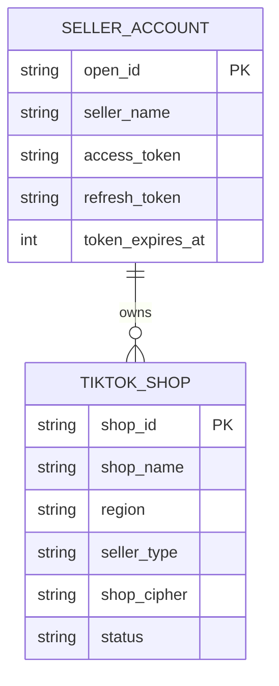

# 04. Quản Lý Cửa Hàng & Người Bán (Seller & Shop API)

Phân hệ Seller & Shop API cung cấp các chức năng truy vấn thông tin tài khoản người bán, danh sách các cửa hàng được ủy quyền, nhóm cửa hàng (Shop Groups) và quyền hạn sản phẩm toàn cầu.

---

## 1. Danh Mục Các Endpoint

| Tên chức năng | Phương thức | Endpoint Path | Mục đích sử dụng |
| :--- | :--- | :--- | :--- |
| **Get Authorized Shops** | `GET` | `/authorization/202309/shops` | Lấy danh sách shop được ủy quyền và trích xuất `shop_cipher` |
| **Get Active Shops** | `GET` | `/seller/202309/shops` | Lấy danh sách các cửa hàng đang ở trạng thái hoạt động (Active) |
| **Get Global Product Permission** | `GET` | `/seller/202309/permissions` | Kiểm tra quyền hạn xuất bản sản phẩm toàn cầu (Global Selling) |
| **Get Shop Group and Related Shops** | `GET` | `/seller/202601/shop_groups` | Lấy cây cấu trúc nhóm gian hàng và các shop trực thuộc |

---

## 2. Chi Tiết Các API Trọng Tâm

### 2.1. Lấy danh sách Shop được ủy quyền & Mã `shop_cipher`

- **Endpoint**: `/authorization/202309/shops`
- **Method**: `GET`
- **Mục đích**: Đây là API đầu tiên mà ứng dụng cần gọi ngay sau khi nhận được `access_token`. Kết quả trả về chứa mã `cipher` (`shop_cipher`), là tham số bắt buộc để gọi mọi API thao tác dữ liệu sau này.

#### Mẫu cURL

```bash
curl -X GET \
  'https://open-api.tiktokglobalshop.com/authorization/202309/shops?app_key=YOUR_APP_KEY&timestamp=1792827493&sign=CALCULATED_SIGN' \
  -H 'x-tts-access-token: YOUR_ACCESS_TOKEN' \
  -H 'Content-Type: application/json'
```

#### Dữ liệu trả về mẫu (Response Body)

```json
{
  "code": 0,
  "message": "success",
  "request_id": "2026102410300001024509910319695XYZ",
  "data": {
    "shops": [
      {
        "id": "749583920194837281",
        "name": "Cửa Hàng Mỹ Phẩm Chính Hãng",
        "region": "VN",
        "seller_type": "LOCAL",
        "cipher": "VN_xkMbgAAAeVAQra0eZWebFQq5aIKabc123"
      },
      {
        "id": "749583920194837282",
        "name": "Global Fashion Store",
        "region": "US",
        "seller_type": "CROSS_BORDER",
        "cipher": "US_zkPq1AAAfWEQra0eZWebFQq5aIKdef456"
      }
    ]
  }
}
```

#### Giải thích các trường dữ liệu
- `id`: Mã ID của cửa hàng trên TikTok Shop.
- `name`: Tên gian hàng hiển thị công khai.
- `region`: Mã quốc gia 2 ký tự ISO (`VN`, `US`, `GB`, `TH`, `MY`, `PH`, `SG`, `ID`).
- `seller_type`:
  - `LOCAL`: Nhà bán hàng nội địa.
  - `CROSS_BORDER`: Nhà bán hàng xuyên biên giới.
- `cipher`: **Mã bí danh cửa hàng (`shop_cipher`)**. Hãy lưu giá trị này vào cột `shop_cipher` trong database để tái sử dụng.

---

### 2.2. Lấy danh sách các cửa hàng đang hoạt động (Get Active Shops)

- **Endpoint**: `/seller/202309/shops`
- **Method**: `GET`
- **Mục đích**: Kiểm tra tình trạng vận hành thực tế của shop (đang mở cửa, tạm đóng, hay bị đình chỉ do vi phạm chính sách).

#### Mẫu cURL

```bash
curl -X GET \
  'https://open-api.tiktokglobalshop.com/seller/202309/shops?app_key=YOUR_APP_KEY&timestamp=1792827493&sign=CALCULATED_SIGN' \
  -H 'x-tts-access-token: YOUR_ACCESS_TOKEN' \
  -H 'Content-Type: application/json'
```

#### Dữ liệu trả về mẫu

```json
{
  "code": 0,
  "message": "success",
  "request_id": "2026102410320001024509910319695ABC",
  "data": {
    "shops": [
      {
        "id": "749583920194837281",
        "name": "Cửa Hàng Mỹ Phẩm Chính Hãng",
        "region": "VN",
        "status": "ACTIVE"
      }
    ]
  }
}
```

---

### 2.3. Kiểm tra quyền sản phẩm toàn cầu (Get Global Product Permission)

- **Endpoint**: `/seller/202309/permissions`
- **Method**: `GET`
- **Mục đích**: Dành riêng cho nhà bán hàng xuyên biên giới (Global Seller) để kiểm tra xem tài khoản có quyền tạo sản phẩm Global và phân phối xuống các thị trường địa phương hay không.

#### Mẫu cURL

```bash
curl -X GET \
  'https://open-api.tiktokglobalshop.com/seller/202309/permissions?app_key=YOUR_APP_KEY&timestamp=1792827493&sign=CALCULATED_SIGN' \
  -H 'x-tts-access-token: YOUR_ACCESS_TOKEN' \
  -H 'Content-Type: application/json'
```

---

## 3. Kiến Trúc Mapping Tài Khoản Đa Cửa Hàng (Multi-Shop Database Schema)

Khi một nhà bán hàng có nhiều shop hoặc bán hàng đa quốc gia, một cặp `access_token` có thể điều khiển nhiều `shop_cipher`. Do đó, bạn nên tổ chức bảng CSDL như sau:



