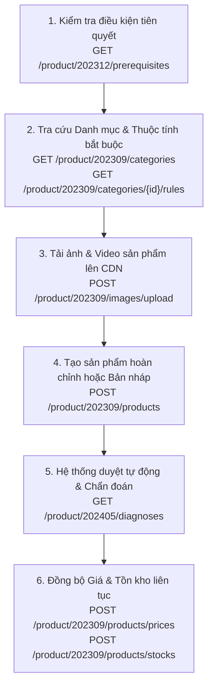

# 05. Quản Lý Sản Phẩm (Products API - 74 Endpoints)

Phân hệ Products API là một trong những phân hệ lớn nhất và quan trọng nhất của TikTok Shop Partner API với hơn 70 endpoints chuyên sâu, cho phép đồng bộ toàn diện vòng đời sản phẩm: từ danh mục, thương hiệu, tải ảnh, niêm yết mới, cập nhật tồn kho theo thời gian thực đến chẩn đoán chất lượng bài đăng.

---

## 1. Bản Đồ Quy Trình Đăng Bán Sản Phẩm (Product Listing Lifecycle)



---

## 2. Danh Mục Các Nhóm Endpoints Chính

| Nhóm chức năng | Số lượng API | Các Endpoint tiêu biểu |
| :--- | :--- | :--- |
| **Danh mục & Thuộc tính** | 8 APIs | `/product/202309/categories`, `/product/202309/categories/{id}/attributes`, `/product/202309/categories/{id}/rules`, `/product/202309/categories/recommend` |
| **Thương hiệu (Brands)** | 4 APIs | `/product/202309/brands`, `/product/202309/brands (POST)` |
| **Tải tài nguyên Media** | 3 APIs | `/product/202309/images/upload`, `/product/202309/files/upload` |
| **Tạo & Chỉnh sửa SP** | 12 APIs | `/product/202309/products (POST)`, `/product/202309/products/{id} (PUT)`, `/product/202309/draft_products` |
| **Giá bán & Tồn kho SKU** | 10 APIs | `/product/202309/products/{id}/prices`, `/product/202309/products/stocks`, `/product/202406/inventory_locks` |
| **Trạng thái & Quản trị** | 8 APIs | `/product/202309/products/{id}/activate`, `/product/202309/products/{id}/deactivate`, `/product/202309/products (DELETE)` |
| **Sản phẩm Toàn cầu (Global)** | 14 APIs | `/product/202309/global_products`, `/product/202309/global_products/{id}/publish` |
| **Chẩn đoán & Tối ưu hóa** | 7 APIs | `/product/202405/diagnoses`, `/product/202409/listing_quality_scores` |

---

## 3. Chi Tiết Các Thao Tác Trọng Tâm

### 3.1. Tải ảnh sản phẩm lên CDN TikTok Shop (Upload Image)

Trước khi tạo sản phẩm, toàn bộ ảnh (ảnh bìa, ảnh mô tả, ảnh biến thể SKU) phải được tải lên CDN của TikTok để lấy `uri` và `url`.

- **Endpoint**: `/product/202309/images/upload`
- **Method**: `POST`
- **Content-Type**: `multipart/form-data`
- **Lưu ý ký số**: Với `multipart/form-data`, **không nối body** vào chuỗi tính chữ ký HMAC-SHA256.

#### Mẫu cURL

```bash
curl -X POST \
  'https://open-api.tiktokglobalshop.com/product/202309/images/upload?app_key=YOUR_APP_KEY&timestamp=1792827493&shop_cipher=YOUR_SHOP_CIPHER&sign=CALCULATED_SIGN' \
  -H 'x-tts-access-token: YOUR_ACCESS_TOKEN' \
  -F 'data=@/path/to/product_image.jpg' \
  -F 'use_case=MAIN_IMAGE'
```

#### Kết quả trả về

```json
{
  "code": 0,
  "message": "success",
  "data": {
    "uri": "tos-alisg-i-k9wyc2ijk0-sg/9b71a2818c3941459a93e3d2319efabc",
    "url": "https://p16-oec-sg.ibyteimg.com/tos-alisg-i-k9wyc2ijk0-sg/9b71a2818c3941459a93e3d2319efabc~tplv-k9wyc2ijk0-image.image",
    "width": 1000,
    "height": 1000
  }
}
```

---

### 3.2. Tạo mới sản phẩm hoàn chỉnh (Create Product)

- **Endpoint**: `/product/202309/products`
- **Method**: `POST`
- **Content-Type**: `application/json`

#### Mẫu cURL tạo sản phẩm có nhiều biến thể (SKUs)

```bash
curl -X POST \
  'https://open-api.tiktokglobalshop.com/product/202309/products?app_key=YOUR_APP_KEY&timestamp=1792827493&shop_cipher=YOUR_SHOP_CIPHER&sign=CALCULATED_SIGN' \
  -H 'x-tts-access-token: YOUR_ACCESS_TOKEN' \
  -H 'Content-Type: application/json' \
  -d '{
    "title": "Áo Thun Nam Cổ Tròn Cotton 100% Co Giãn Cao Cấp",
    "description": "<p>Áo thun nam thời trang hè, chất vải cotton thoáng mát, thấm hút mồ hôi cực tốt.</p>",
    "category_id": "600001",
    "brand_id": "7092837194829102",
    "main_images": [
      {
        "uri": "tos-alisg-i-k9wyc2ijk0-sg/9b71a2818c3941459a93e3d2319efabc"
      }
    ],
    "package_dimensions": {
      "length": "25",
      "width": "20",
      "height": "3",
      "unit": "CENTIMETER"
    },
    "package_weight": {
      "value": "0.25",
      "unit": "KILOGRAM"
    },
    "skus": [
      {
        "seller_sku": "TSHIRT-BLK-L",
        "price": {
          "amount": "149000",
          "currency": "VND"
        },
        "inventory": [
          {
            "quantity": 100
          }
        ],
        "sales_attributes": [
          {
            "attribute_id": "100001",
            "custom_value": "Đen"
          },
          {
            "attribute_id": "100002",
            "custom_value": "L"
          }
        ]
      },
      {
        "seller_sku": "TSHIRT-WHT-XL",
        "price": {
          "amount": "149000",
          "currency": "VND"
        },
        "inventory": [
          {
            "quantity": 80
          }
        ],
        "sales_attributes": [
          {
            "attribute_id": "100001",
            "custom_value": "Trắng"
          },
          {
            "attribute_id": "100002",
            "custom_value": "XL"
          }
        ]
      }
    ]
  }'
```

---

### 3.3. Cập nhật tồn kho hàng loạt theo thời gian thực (Batch Update Stock)

Khi hệ thống kho nội bộ hoặc các sàn khác (Shopee, Lazada) có biến động số lượng, bạn cần cập nhật ngay sang TikTok Shop để tránh overselling (bán quá tồn kho thực).

- **Endpoint**: `/product/202309/products/stocks`
- **Method**: `POST`

#### Mẫu Body cập nhật tồn kho

```json
{
  "skus": [
    {
      "id": "1729482910482910",
      "seller_sku": "TSHIRT-BLK-L",
      "available_stock": 95
    },
    {
      "id": "1729482910482911",
      "seller_sku": "TSHIRT-WHT-XL",
      "available_stock": 78
    }
  ]
}
```

---

### 3.4. Cập nhật giá bán nhanh (Update Product Prices)

- **Endpoint**: `/product/202309/products/{product_id}/prices`
- **Method**: `POST`

#### Mẫu Body cập nhật giá

```json
{
  "skus": [
    {
      "id": "1729482910482910",
      "price": {
        "amount": "139000",
        "currency": "VND"
      }
    }
  ]
}
```

---

## 4. Các Trạng Thái Vòng Đời Của Sản Phẩm (Product Status Enum)

- `DRAFT`: Bản nháp chưa gửi duyệt.
- `PENDING`: Đang chờ đội ngũ kiểm duyệt nội dung & chính sách của TikTok Shop đánh giá.
- `FAILED`: Bị từ chối duyệt (vi phạm từ cấm, thiếu giấy tờ chứng nhận an toàn, ảnh vi phạm bản quyền).
- `ACTIVATE`: Sản phẩm đang hiển thị và mở bán trực tiếp cho người mua.
- `SELLER_DEACTIVATED`: Sản phẩm tạm thời bị người bán ẩn đi.
- `PLATFORM_DEACTIVATED`: Bị sàn TikTok Shop khóa do vi phạm hoặc hết hạn giấy phép.
- `FREEZE`: Bị đóng băng do tranh chấp pháp lý hoặc nghi vấn hàng giả.
- `DELETED`: Đã xóa vào thùng rác (có thể gọi API Recover trong 30 ngày).

