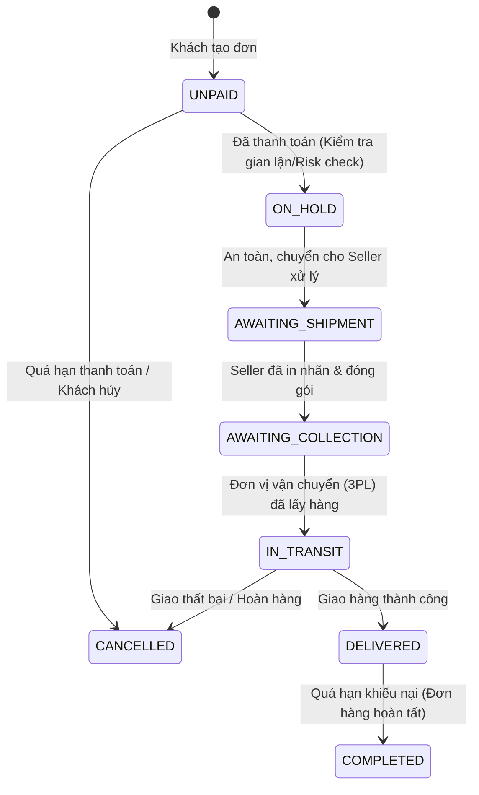

# 06. Quản Lý Đơn Hàng (Orders API)

Phân hệ Orders API chịu trách nhiệm quản lý toàn bộ quá trình bán hàng từ khi khách đặt đơn, thanh toán, đến xử lý dữ liệu để chuyển sang khâu đóng gói vận chuyển.

---

## 1. Vòng Đời Trạng Thái Đơn Hàng (Order Status Lifecycle)



### Bảng Mã Trạng Thái Đơn Hàng Chi Tiết

| Mã trạng thái (Status) | Tên tiếng Việt | Ý nghĩa & Hành động tương ứng |
| :--- | :--- | :--- |
| `UNPAID` | Chưa thanh toán | Khách đặt hàng nhưng chưa hoàn tất thanh toán. Chưa được chuẩn bị hàng. |
| `ON_HOLD` | Tạm giữ kiểm duyệt | Hệ thống TikTok quét chống gian lận (thường diễn ra trong 1-2 giờ). |
| `AWAITING_SHIPMENT` | **Chờ gửi hàng** | **Trạng thái cốt lõi**: Seller tiến hành in phiếu xuất kho, chuẩn bị hàng. |
| `AWAITING_COLLECTION` | Chờ bưu tá lấy | Hàng đã đóng gói xong, đang đợi shipper đến kho lấy hoặc seller mang ra bưu cục. |
| `IN_TRANSIT` | Đang vận chuyển | Hàng đang trên đường giao tới người mua. |
| `DELIVERED` | Đã giao hàng | Khách đã nhận được hàng. Đang trong thời gian bảo hành/đổi trả (7-14 ngày). |
| `COMPLETED` | Hoàn tất | Đơn hàng thành công trọn vẹn. Tiền được mở khóa để quyết toán (Settlement). |
| `CANCELLED` | Đã hủy | Đơn hàng bị hủy bởi người mua, sàn hoặc nhà bán. |

---

## 2. Danh Mục Các Endpoints Quản Lý Đơn Hàng

| Tên API | Phương thức | Endpoint Path | Chức năng |
| :--- | :--- | :--- | :--- |
| **Get Order List** | `POST` | `/order/202309/orders/search` | Tìm kiếm & phân trang danh sách đơn hàng |
| **Get Order Detail** | `GET` | `/order/202309/orders/{order_id}` | Xem chi tiết sản phẩm, địa chỉ người nhận của 1 đơn |
| **Get Order Price Details** | `GET` | `/order/202407/orders/{order_id}/price_detail` | Bóc tách chi tiết giá gốc, thuế, voucher sàn, voucher shop |
| **Add External Order References** | `POST` | `/order/202406/orders/external_orders` | Lưu mã đơn hàng ERP nội bộ vào đơn TikTok Shop |
| **Get External Order References** | `GET` | `/order/202406/orders/{order_id}/external_orders` | Tra cứu ngược mã đơn ERP theo đơn TikTok |

---

## 3. Hướng Dẫn Thực Thi API Chi Tiết

### 3.1. Tìm kiếm & Lấy danh sách đơn hàng (`/order/202309/orders/search`)

- **Method**: `POST`
- **Mục đích**: Kéo danh sách các đơn hàng cần đóng gói (`order_status=AWAITING_SHIPMENT`) hoặc đồng bộ định kỳ theo thời gian cập nhật.

#### Mẫu cURL

```bash
curl -X POST \
  'https://open-api.tiktokglobalshop.com/order/202309/orders/search?app_key=YOUR_APP_KEY&timestamp=1792827493&shop_cipher=YOUR_SHOP_CIPHER&page_size=20&sign=CALCULATED_SIGN' \
  -H 'x-tts-access-token: YOUR_ACCESS_TOKEN' \
  -H 'Content-Type: application/json' \
  -d '{
    "order_status": "AWAITING_SHIPMENT",
    "create_time_ge": 1729400000,
    "create_time_lt": 1729500000
  }'
```

#### Cấu trúc kết quả trả về tiêu biểu

```json
{
  "code": 0,
  "message": "success",
  "data": {
    "orders": [
      {
        "id": "576483920194827104",
        "status": "AWAITING_SHIPMENT",
        "create_time": 1729432000,
        "update_time": 1729432500,
        "buyer_email": "customer***@example.com",
        "payment": {
          "currency": "VND",
          "sub_total": "298000",
          "shipping_fee": "30000",
          "seller_discount": "20000",
          "platform_discount": "15000",
          "total_amount": "293000"
        },
        "recipient_address": {
          "name": "Nguyễn Văn A",
          "phone": "+84901234***",
          "full_address": "Số 123 Đường Nguyễn Huệ, Phường Bến Nghé, Quận 1, TP. Hồ Chí Minh",
          "postal_code": "700000",
          "region_code": "VN"
        },
        "line_items": [
          {
            "id": "674839201948291001",
            "product_id": "1729482910482910",
            "product_name": "Áo Thun Nam Cổ Tròn Cotton 100%",
            "sku_id": "1729482910482910",
            "seller_sku": "TSHIRT-BLK-L",
            "sku_name": "Đen, L",
            "quantity": 2,
            "sale_price": "149000",
            "sku_image": "https://p16-oec-sg.ibyteimg.com/..."
          }
        ]
      }
    ],
    "next_page_token": "eyJwYWdlIjoxfQ==",
    "total_count": 1
  }
}
```

---

### 3.2. Bóc tách chi tiết giá bán & chiết khấu (`price_detail`)

- **Method**: `GET`
- **Mục đích**: Kế toán dùng để đối soát doanh thu thực thu, tiền ship thực tế và giá trị voucher sàn hỗ trợ.

#### Mẫu cURL

```bash
curl -X GET \
  'https://open-api.tiktokglobalshop.com/order/202407/orders/576483920194827104/price_detail?app_key=YOUR_APP_KEY&timestamp=1792827493&shop_cipher=YOUR_SHOP_CIPHER&sign=CALCULATED_SIGN' \
  -H 'x-tts-access-token: YOUR_ACCESS_TOKEN' \
  -H 'Content-Type: application/json'
```

