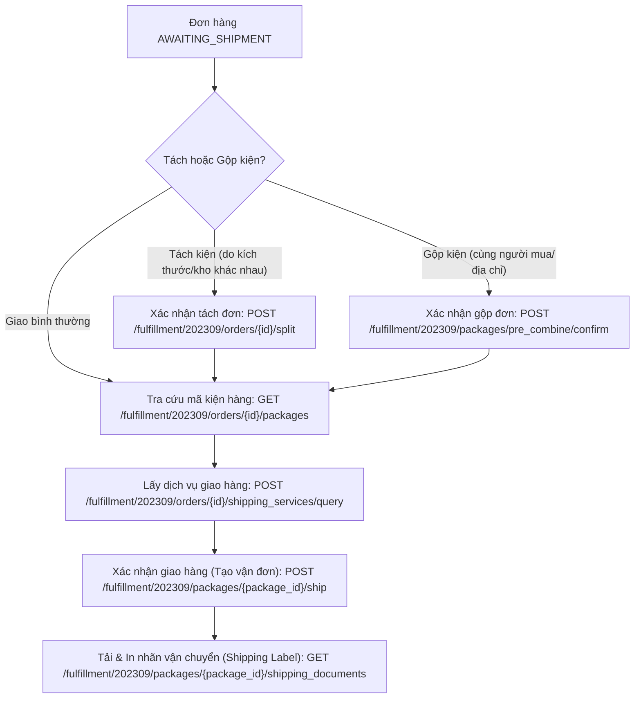

# 07. Đóng Gói & Giao Hàng (Fulfillment API - 31 Endpoints)

Phân hệ Fulfillment đảm nhiệm toàn bộ quy trình kho vận: từ chia tách kiện hàng (Order Split), gộp kiện (Combine Packages), đăng ký đơn vị vận chuyển, xác nhận giao hàng (Ship Package) cho đến tải tem nhãn vận chuyển (Shipping Label).

---

## 1. Quy Trình Vận Hành Kiện Hàng (Fulfillment Pipeline)



---

## 2. Danh Mục Các Endpoint Fulfillment Tiêu Biểu

| Tên chức năng | Method | Endpoint Path | Mô tả |
| :--- | :--- | :--- | :--- |
| **Get Eligible Shipping Services** | `POST` | `/fulfillment/202309/orders/{order_id}/shipping_services/query` | Lấy danh sách 3PL (J&T, NinjaVan, Shopee Xpress...) khả dụng |
| **Ship Package** | `POST` | `/fulfillment/202309/packages/{package_id}/ship` | Xác nhận gửi 1 kiện hàng và lấy Tracking ID |
| **Batch Ship Packages** | `POST` | `/fulfillment/202309/packages/ship` | Gửi hàng loạt tối đa 50 kiện cùng lúc |
| **Get Shipping Document** | `GET` | `/fulfillment/202309/packages/{package_id}/shipping_documents` | Tải file in nhãn vận chuyển (PDF, ZPL, PNG) |
| **Search Packages** | `POST` | `/fulfillment/202309/packages/search` | Tìm kiếm và lọc danh sách các kiện hàng |
| **Confirm Order Split** | `POST` | `/fulfillment/202309/orders/{order_id}/split` | Chia nhỏ 1 đơn hàng thành nhiều kiện hàng |
| **Confirm Pre-combine Package** | `POST` | `/fulfillment/202309/packages/pre_combine/confirm` | Gộp nhiều đơn hàng thành 1 kiện hàng tiết kiệm phí |

---

## 3. Hướng Dẫn Kỹ Thuật Chi Tiết

### 3.1. Xác nhận giao hàng (Ship Package)

Sau khi đóng hàng vào hộp, gọi API này để hệ thống TikTok kết nối với đơn vị vận chuyển (3PL), sinh mã vận đơn (Tracking Number).

- **Endpoint**: `/fulfillment/202309/packages/{package_id}/ship`
- **Method**: `POST`

#### Mẫu cURL

```bash
curl -X POST \
  'https://open-api.tiktokglobalshop.com/fulfillment/202309/packages/PKG_7482910482910/ship?app_key=YOUR_APP_KEY&timestamp=1792827493&shop_cipher=YOUR_SHOP_CIPHER&sign=CALCULATED_SIGN' \
  -H 'x-tts-access-token: YOUR_ACCESS_TOKEN' \
  -H 'Content-Type: application/json' \
  -d '{
    "pick_up_type": "PICKUP",
    "pick_up": {
      "pick_up_start_time": 1729485600,
      "pick_up_end_time": 1729492800
    }
  }'
```

- `pick_up_type`:
  - `PICKUP`: Đơn vị vận chuyển sẽ đến tận kho của seller để lấy hàng.
  - `DROP_OFF`: Seller tự mang kiện hàng ra bưu cục gửi.

---

### 3.2. Lấy & In nhãn vận chuyển (Shipping Label)

- **Endpoint**: `/fulfillment/202309/packages/{package_id}/shipping_documents`
- **Method**: `GET`
- **Định dạng file hỗ trợ**: `PDF`, `ZPL` (dành cho máy in nhiệt mã vạch zebra/xprinter).

#### Mẫu cURL

```bash
curl -X GET \
  'https://open-api.tiktokglobalshop.com/fulfillment/202309/packages/PKG_7482910482910/shipping_documents?app_key=YOUR_APP_KEY&timestamp=1792827493&shop_cipher=YOUR_SHOP_CIPHER&document_type=SHIPPING_LABEL&document_size=A6&format=PDF&sign=CALCULATED_SIGN' \
  -H 'x-tts-access-token: YOUR_ACCESS_TOKEN' \
  -H 'Content-Type: application/json'
```

#### Kết quả trả về

```json
{
  "code": 0,
  "message": "success",
  "data": {
    "doc_url": "https://oec-package-sg.ibyteimg.com/tos-alisg-i-k9wyc2ijk0-sg/shipping_label_PKG_7482910482910.pdf"
  }
}
```
*Bạn có thể tải trực tiếp file PDF từ `doc_url` để gửi thẳng tới máy in nhiệt A6 mà không cần qua trình duyệt.*

