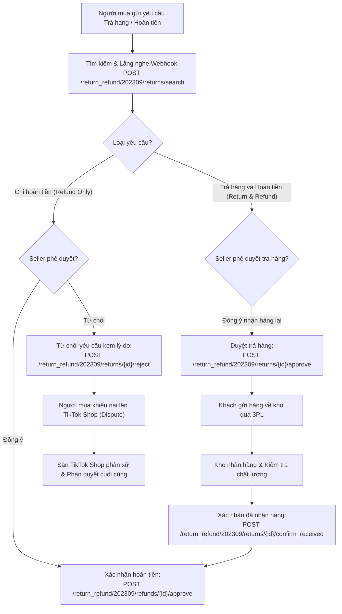

# 09. Trả Hàng & Hoàn Tiền (Return & Refund API - 22 Endpoints)

Phân hệ Return & Refund (còn gọi là Reverse Order API) xử lý toàn bộ các khiếu nại sau bán hàng: hủy đơn trước khi giao, khách trả hàng - hoàn tiền, khách chỉ nhận hoàn tiền (hàng hỏng/thiếu) và quy trình khiếu nại tranh chấp (Dispute / Arbitration).

---

## 1. Quy Trình Xử Lý Trả Hàng & Hoàn Tiền (Reverse Workflow)



---

## 2. Danh Mục Các Endpoint Tiêu Biểu

| Tên chức năng | Method | Endpoint Path | Mục đích |
| :--- | :--- | :--- | :--- |
| **Search Return Requests** | `POST` | `/return_refund/202309/returns/search` | Tìm kiếm danh sách các yêu cầu trả hàng/hoàn tiền |
| **Approve Return Request** | `POST` | `/return_refund/202309/returns/{return_id}/approve` | Đồng ý để người mua gửi trả hàng về kho |
| **Approve Refund** | `POST` | `/return_refund/202309/refunds/{return_id}/approve` | Chấp thuận hoàn tiền ngay cho người mua |
| **Reject Return/Refund Request** | `POST` | `/return_refund/202309/returns/{return_id}/reject` | Từ chối yêu cầu (kèm bằng chứng & lý do) |
| **Get Reject Reasons** | `GET` | `/return_refund/202309/reject_reasons` | Lấy danh mục mã lý do từ chối hợp lệ |
| **Confirm Received Return** | `POST` | `/return_refund/202309/returns/{return_id}/confirm_received` | Xác nhận kho đã nhận lại đúng kiện hàng hoàn |
| **Cancel Order** | `POST` | `/return_refund/202309/orders/{order_id}/cancel` | Nhà bán hàng chủ động hủy đơn trước khi giao |

---

## 3. Hướng Dẫn Kỹ Thuật Chi Tiết

### 3.1. Tìm kiếm yêu cầu trả hàng cần xử lý (`returns/search`)

- **Method**: `POST`
- **Mục đích**: Tìm các yêu cầu đang ở trạng thái chờ nhà bán phản hồi (`status=AWAITING_SELLER_APPROVAL`). Lưu ý: TikTok Shop quy định thời hạn 48 giờ để seller phản hồi, quá thời hạn hệ thống sẽ tự động đồng ý hoàn tiền.

#### Mẫu cURL

```bash
curl -X POST \
  'https://open-api.tiktokglobalshop.com/return_refund/202309/returns/search?app_key=YOUR_APP_KEY&timestamp=1792827493&shop_cipher=YOUR_SHOP_CIPHER&page_size=20&sign=CALCULATED_SIGN' \
  -H 'x-tts-access-token: YOUR_ACCESS_TOKEN' \
  -H 'Content-Type: application/json' \
  -d '{
    "return_status": "AWAITING_SELLER_APPROVAL"
  }'
```

---

### 3.2. Từ chối yêu cầu trả hàng / hoàn tiền (Reject Return)

Khi người mua yêu cầu vô lý hoặc làm hỏng sản phẩm, seller từ chối kèm hình ảnh làm bằng chứng.

- **Method**: `POST`
- **Endpoint**: `/return_refund/202309/returns/{return_id}/reject`

#### Mẫu Body từ chối

```json
{
  "reject_reason_key": "SELLER_REJECT_REASON_DAMAGED_BY_BUYER",
  "reject_comments": "Sản phẩm gửi đi nguyên seal, video unbox của khách cho thấy tự làm rách trong quá trình mở.",
  "evidence_images": [
    "tos-alisg-i-k9wyc2ijk0-sg/evidence_img_1.jpg",
    "tos-alisg-i-k9wyc2ijk0-sg/evidence_img_2.jpg"
  ]
}
```

