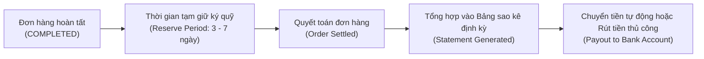

# 10. Tài Chính & Đối Soát (Finance & Settlement API)

Phân hệ Finance API hỗ trợ bộ phận kế toán và quản trị tài chính đối soát chính xác từng đồng doanh thu: chu kỳ thanh toán, các bảng sao kê quyết toán (Statements), chi tiết khấu trừ phí sàn, phí hoa hồng tiếp thị liên kết (Affiliate Fee), phí vận chuyển và lịch sử rút tiền về tài khoản ngân hàng.

---

## 1. Chu Kỳ Thanh Toán & Dòng Tiền (Settlement Cycle)



### Các Khoản Phí Khấu Trừ Tiêu Biểu Trong Một Đơn Hàng

| Tên khoản mục | Ý nghĩa kế toán |
| :--- | :--- |
| **Gross Merchandise Value (GMV)** | Tổng giá trị hàng hóa theo giá niêm yết của đơn hàng |
| **Seller Discount** | Khoản giảm giá do nhà bán hàng tự tài trợ |
| **Platform Discount** | Khoản giảm giá do TikTok Shop tài trợ (không trừ vào tiền seller nhận) |
| **Marketplace Commission Fee** | Phí hoa hồng sàn thương mại điện tử TikTok Shop (ví dụ 3% - 5%) |
| **Payment Transaction Fee** | Phí xử lý giao dịch thanh toán trực tuyến (thường 1.5% - 2.5%) |
| **Affiliate Commission** | Tiền hoa hồng trả cho Creator / KOC kéo đơn hàng |
| **Shipping Fee Subsidies / Cost** | Chênh lệch cước phí vận chuyển thực tế |
| **Net Settlement Amount** | **Số tiền thực nhận** chuyển về ví seller |

---

## 2. Danh Mục Các Endpoint Tài Chính

| Tên chức năng | Method | Endpoint Path | Mục đích |
| :--- | :--- | :--- | :--- |
| **Get Statements** | `GET` | `/finance/202309/statements` | Lấy danh sách các kỳ sao kê tài chính |
| **Get Transactions by Statement** | `GET` | `/finance/202501/statements/{statement_id}/statement_transactions` | Tra cứu chi tiết từng dòng đơn hàng trong 1 bảng sao kê |
| **Get Transactions by Order** | `GET` | `/finance/202501/orders/{order_id}/statement_transactions` | Tra cứu toàn bộ chi tiết dòng tiền quyết toán của 1 đơn hàng cụ thể |
| **Get Seller Financial Transactions** | `GET` | `/finance/202309/withdrawals` | Lấy lịch sử giao dịch chuyển khoản / rút tiền về tài khoản ngân hàng |

---

## 3. Hướng Dẫn Kỹ Thuật Chi Tiết

### 3.1. Tra cứu chi tiết quyết toán của một đơn hàng (`statement_transactions`)

- **Endpoint**: `/finance/202501/orders/{order_id}/statement_transactions`
- **Method**: `GET`
- **Mục đích**: Biết chính xác đơn hàng này thu được bao nhiêu tiền và bị trừ những khoản phí gì.

#### Mẫu cURL

```bash
curl -X GET \
  'https://open-api.tiktokglobalshop.com/finance/202501/orders/576483920194827104/statement_transactions?app_key=YOUR_APP_KEY&timestamp=1792827493&shop_cipher=YOUR_SHOP_CIPHER&sign=CALCULATED_SIGN' \
  -H 'x-tts-access-token: YOUR_ACCESS_TOKEN' \
  -H 'Content-Type: application/json'
```

#### Dữ liệu phản hồi mẫu

```json
{
  "code": 0,
  "message": "success",
  "data": {
    "statement_transactions": [
      {
        "order_id": "576483920194827104",
        "statement_id": "ST_20261024_001",
        "settlement_time": 1729482910,
        "currency": "VND",
        "subtotal": "298000",
        "shipping_fee_seller_paid": "0",
        "platform_commission_fee": "-11920",
        "transaction_fee": "-5960",
        "affiliate_commission_fee": "-29800",
        "seller_net_amount": "250320"
      }
    ]
  }
}
```
*Giải thích: Đơn hàng bán 298.000 đ, trừ 11.920 đ phí sàn, trừ 5.960 đ phí thanh toán, trừ 29.800 đ hoa hồng cho KOC -> Seller thực nhận chuyển về tài khoản là 250.320 đ.*

