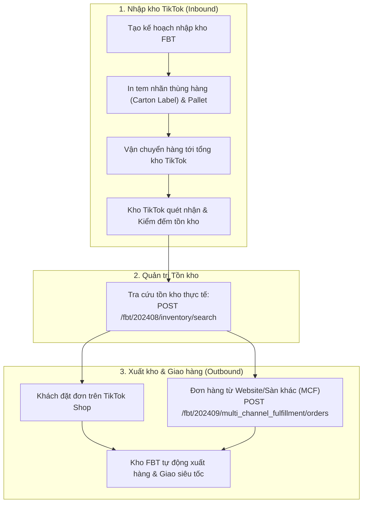

# 11. Lưu Kho & Vận Hành Bởi TikTok (FBT - Fulfilled by TikTok - 24 Endpoints)

**FBT (Fulfilled by TikTok)** là dịch vụ hoàn tất đơn hàng trọn gói của TikTok Shop (tương tự như Fulfillment by Amazon - FBA). Seller gửi hàng lưu tại tổng kho của TikTok, khi có đơn hàng phát sinh, hệ thống TikTok tự động lấy hàng, đóng hộp và bàn giao cho đơn vị vận chuyển giao tới khách trong thời gian nhanh nhất.

---

## 1. Quy Trình Vận Hành Kho FBT (Inbound & Outbound Workflow)



---

## 2. Danh Mục Các Endpoint FBT Tiêu Biểu

| Tên chức năng | Method | Endpoint Path | Mục đích |
| :--- | :--- | :--- | :--- |
| **Get FBT Onboarded Regions** | `GET` | `/fbt/202409/merchants/onboarded_regions` | Kiểm tra tài khoản đã đăng ký FBT tại quốc gia nào |
| **Get FBT Warehouse List** | `GET` | `/fbt/202408/warehouses` | Lấy danh sách địa chỉ các tổng kho FBT của TikTok |
| **Search FBT Inventory** | `POST` | `/fbt/202408/inventory/search` | Tra cứu số lượng tồn kho khả dụng và tồn kho đang khóa tại FBT |
| **Search FBT Inventory Record** | `POST` | `/fbt/202410/inventory_records/search` | Xem lịch sử xuất nhập tồn chi tiết của từng SKU tại kho FBT |
| **Create Inbound Shipment Plan** | `POST` | `/fbt/202408/inbound_plans` | Khởi tạo kế hoạch nhập một lô hàng mới vào kho FBT |
| **Create Multi-channel Order** | `POST` | `/fbt/202409/multi_channel_fulfillment/orders` | Dùng kho FBT xử lý đơn hàng bán từ Website riêng hoặc sàn khác |

---

## 3. Tra Cứu Tồn Kho FBT Thực Tế (Search FBT Inventory)

- **Endpoint**: `/fbt/202408/inventory/search`
- **Method**: `POST`

#### Mẫu cURL

```bash
curl -X POST \
  'https://open-api.tiktokglobalshop.com/fbt/202408/inventory/search?app_key=YOUR_APP_KEY&timestamp=1792827493&shop_cipher=YOUR_SHOP_CIPHER&sign=CALCULATED_SIGN' \
  -H 'x-tts-access-token: YOUR_ACCESS_TOKEN' \
  -H 'Content-Type: application/json' \
  -d '{
    "warehouse_id": "FBT_WH_VN_01",
    "seller_sku_list": ["TSHIRT-BLK-L", "TSHIRT-WHT-XL"]
  }'
```

#### Dữ liệu trả về mẫu

```json
{
  "code": 0,
  "message": "success",
  "data": {
    "inventories": [
      {
        "seller_sku": "TSHIRT-BLK-L",
        "warehouse_id": "FBT_WH_VN_01",
        "available_quantity": 450,
        "reserved_quantity": 12,
        "damaged_quantity": 0
      }
    ]
  }
}
```
- `available_quantity`: Tồn kho sẵn sàng bán.
- `reserved_quantity`: Tồn kho đang được giữ cho các đơn hàng khách vừa đặt chờ đóng gói.
- `damaged_quantity`: Hàng lỗi/hỏng trong kho đang cách ly chờ thanh lý.

