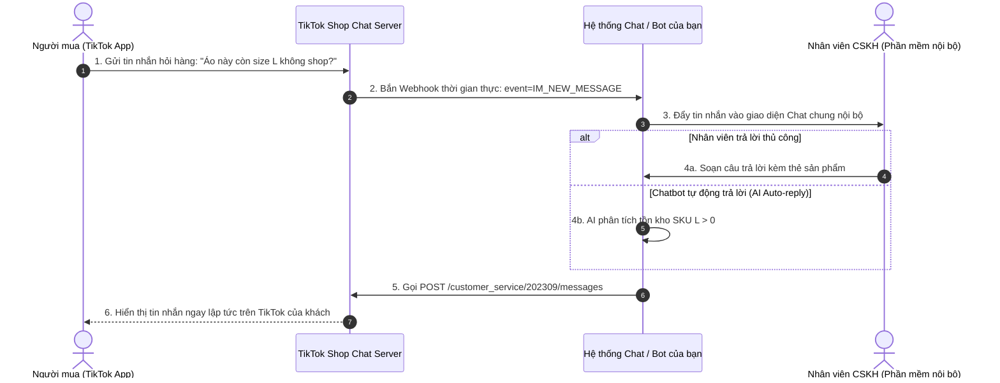

# 13. Chăm Sóc Khách Hàng & Live Chat (Customer Service IM API - 15 Endpoints)

Phân hệ Customer Service API cho phép các phần mềm quản lý chat đa kênh (Pancake, Haravan, Smax, Chotdon, Nhanh.vn...) tích hợp liền mạch với hộp thư trò chuyện (Live Chat) của TikTok Shop, tự động hóa trả lời tin nhắn, gửi thẻ sản phẩm, thẻ đơn hàng và duy trì tỷ lệ phản hồi nhanh (Fast Response Rate - FRR).

---

## 1. Kiến Trúc Luồng Tin Nhắn Hai Chiều (Bidirectional Chat Architecture)



---

## 2. Danh Mục Các Endpoint CSKH Tiêu Biểu

| Tên chức năng | Method | Endpoint Path | Mục đích |
| :--- | :--- | :--- | :--- |
| **Get Conversations** | `GET` | `/customer_service/202309/conversations` | Lấy danh sách các cuộc hội thoại với người mua |
| **Get Messages** | `GET` | `/customer_service/202309/conversations/{id}/messages` | Tải lịch sử trao đổi tin nhắn trong 1 cuộc hội thoại |
| **Send Message** | `POST` | `/customer_service/202309/messages` | Gửi tin nhắn văn bản, ảnh, thẻ sản phẩm, thẻ đơn hàng |
| **Mark Conversation as Read** | `POST` | `/customer_service/202309/conversations/{id}/read` | Đánh dấu đã đọc để hệ thống ghi nhận tỷ lệ phản hồi |

---

## 3. Các Loại Tin Nhắn Được Hỗ Trợ (Message Types)

1. **TEXT (Văn bản thuần túy)**: Tin nhắn trao đổi hỏi đáp bình thường.
2. **IMAGE (Hình ảnh)**: Ảnh thực tế sản phẩm (phải upload ảnh lên CDN trước để lấy URI).
3. **PRODUCT_CARD (Thẻ sản phẩm)**: Hiển thị hình ảnh, tiêu đề, giá bán và nút "Mua ngay" tiện lợi.
4. **ORDER_CARD (Thẻ đơn hàng)**: Hiển thị tóm tắt tình trạng vận chuyển của đơn hàng người mua đang hỏi.

---

## 4. Mẫu cURL Gửi Tin Nhắn Phản Hồi Khách Hàng

- **Endpoint**: `/customer_service/202309/messages`
- **Method**: `POST`

#### Mẫu gửi tin nhắn văn bản

```bash
curl -X POST \
  'https://open-api.tiktokglobalshop.com/customer_service/202309/messages?app_key=YOUR_APP_KEY&timestamp=1792827493&shop_cipher=YOUR_SHOP_CIPHER&sign=CALCULATED_SIGN' \
  -H 'x-tts-access-token: YOUR_ACCESS_TOKEN' \
  -H 'Content-Type: application/json' \
  -d '{
    "conversation_id": "CONV_7482910482910",
    "type": "TEXT",
    "content": "Chào bạn! Áo thun nam màu đen size L bên shop hiện vẫn còn sẵn hàng ạ. Bạn đặt ngay để shop đóng gói kịp chuyến giao hôm nay nhé!"
  }'
```

#### Mẫu gửi kèm Thẻ Sản Phẩm (Product Card)

```json
{
  "conversation_id": "CONV_7482910482910",
  "type": "PRODUCT_CARD",
  "content": "{\"product_id\":\"1729482910482910\"}"
}
```

