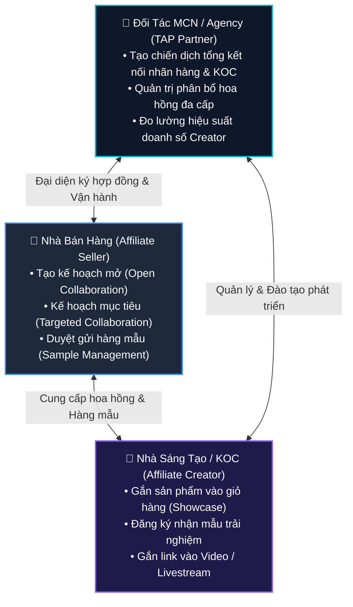

# 14. Tiếp Thị Liên Kết (Affiliate API - 88 Endpoints)

Hệ sinh thái tiếp thị liên kết (Affiliate) là động lực tăng trưởng doanh số vượt trội nhất của TikTok Shop. Hệ thống API Affiliate chia làm 3 phân hệ tương ứng với 3 chủ thể: **Nhà bán hàng (Seller)**, **Nhà sáng tạo nội dung (Creator)** và **Đại lý đối tác MCN/Agency (Affiliate Partner / TAP)**.

---

## 1. Tam Giác Tương Tác Hệ Sinh Thái Affiliate



---

## 2. Chi Tiết 3 Phân Hệ Affiliate

### 2.1. Phân hệ Dành Cho Nhà Bán Hàng (Affiliate Seller - 45 Endpoints)

Nhà bán hàng sử dụng API này để tự động hóa chính sách hoa hồng:
1. **Kế hoạch hợp tác mở (Open Collaboration)**: Bất kỳ Creator nào cũng có thể tự do ghim sản phẩm của bạn vào video của họ với mức hoa hồng sàn quy định (ví dụ 10%).
   - Tra cứu cài đặt: `GET /affiliate_seller/202409/open_collaboration_settings`
   - Chỉnh sửa quy tắc: `POST /affiliate_seller/202405/open_collaboration_settings`
2. **Kế hoạch mục tiêu (Targeted Collaboration)**: Dành riêng cho các Top KOC với mức hoa hồng đặc biệt (ví dụ 18% - 25%).
   - Tạo kế hoạch: `POST /affiliate_seller/202406/targeted_collaborations`
3. **Quản lý Hàng mẫu miễn phí (Sample Management)**: KOC xin mẫu để làm video review -> Seller kiểm duyệt kênh đạt chỉ tiêu trước khi bấm gửi hàng mẫu.
   - Lấy danh sách yêu cầu mẫu: `POST /affiliate_seller/202410/sample_applications/search`
   - Duyệt gửi hàng mẫu: `POST /affiliate_seller/202410/sample_applications/{id}/approve`

#### Mẫu cURL thiết lập hoa hồng mở cho sản phẩm

```bash
curl -X POST \
  'https://open-api.tiktokglobalshop.com/affiliate_seller/202405/open_collaboration_settings?app_key=YOUR_APP_KEY&timestamp=1792827493&shop_cipher=YOUR_SHOP_CIPHER&sign=CALCULATED_SIGN' \
  -H 'x-tts-access-token: YOUR_ACCESS_TOKEN' \
  -H 'Content-Type: application/json' \
  -d '{
    "product_id": "1729482910482910",
    "commission_rate": 12,
    "status": "ENABLE"
  }'
```

---

### 2.2. Phân hệ Dành Cho Nhà Sáng Tạo (Affiliate Creator - 27 Endpoints)

Dành cho các ứng dụng hỗ trợ KOC tự động quản lý gian hàng trưng bày (Showcase) và hoa hồng.
- **Ủy quyền**: Bắt buộc người dùng ủy quyền qua luồng Creator (`user_type = 1`).
- **Thêm sản phẩm vào Showcase (Giỏ hàng TikTok cá nhân)**:
  - `POST /affiliate_creator/202405/showcases/products/add`
- **Xóa sản phẩm khỏi Showcase**:
  - `DELETE /affiliate_creator/202409/showcases/products`
- **Tra cứu hồ sơ và doanh thu KOC**:
  - `GET /affiliate_creator/202508/profiles`

#### Mẫu cURL thêm sản phẩm vào giỏ hàng Creator

```bash
curl -X POST \
  'https://open-api.tiktokglobalshop.com/affiliate_creator/202405/showcases/products/add?app_key=YOUR_APP_KEY&timestamp=1792827493&sign=CALCULATED_SIGN' \
  -H 'x-tts-access-token: CREATOR_ACCESS_TOKEN' \
  -H 'Content-Type: application/json' \
  -d '{
    "product_id": "1729482910482910"
  }'
```

---

### 2.3. Phân hệ Dành Cho Đối Tác Đại Lý (Affiliate Partner / TAP - 16 Endpoints)

Dành cho TikTok Shop Affiliate Partners (TAP) và các mạng lưới đa kênh (MCN):
- **Ủy quyền**: Người dùng ủy quyền qua luồng Partner (`user_type = 3`).
- **Tạo chiến dịch đại lý (Campaigns)**:
  - `POST /affiliate_partner/202405/campaigns`
- **Duyệt sản phẩm của nhà bán tham gia chiến dịch**:
  - `POST /affiliate_partner/202405/campaigns/{id}/products/{product_id}/review`
- **Liên kết Creator vào mạng lưới quản trị**:
  - Quản lý tỷ lệ chia sẻ hoa hồng giữa Agency và Creator.

