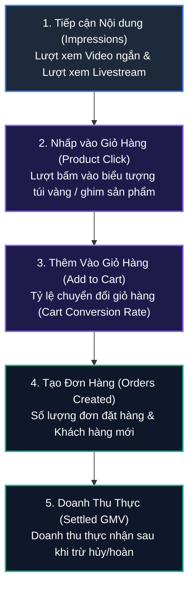

# 15. Dữ Liệu & Báo Cáo Phân Tích (Analytics API - 32 Endpoints)

Phân hệ Analytics API cung cấp các chỉ số kinh doanh chuyên sâu theo thời gian thực (real-time metrics) của TikTok Shop: từ doanh thu tổng của cửa hàng theo từng giờ, hiệu quả từng phút trong các phiên Livestream bán hàng, mức độ chuyển đổi của video ngắn, cho đến chi tiết hiệu suất của từng mã sản phẩm SKU.

---

## 1. Bản Đồ Phễu Dữ Liệu Thương Mại Nội Dung (Content E-commerce Funnel)



---

## 2. Danh Mục Các Endpoint Phân Tích Trọng Tâm

| Nhóm dữ liệu | Endpoint Path | Chu kỳ phân tích | Mục đích sử dụng |
| :--- | :--- | :--- | :--- |
| **Hiệu suất Shop theo giờ** | `/analytics/202510/shop/performance/{date}/performance_per_hour` | Từng giờ trong ngày | Theo dõi biến động doanh thu từng khung giờ |
| **Hiệu suất Livestream theo phút** | `/analytics/202510/shop_lives/{live_id}/performance_per_minutes` | Từng phút phiên live | Đánh giá mắt xem (CCU), số đơn nổ khi ghim deal sốc |
| **Sản phẩm bán trong Livestream** | `/analytics/202512/shop/{live_id}/products_performance` | Theo phiên Live | Xem mặt hàng nào bán chạy nhất trong buổi Live |
| **Hiệu suất Video gắn giỏ hàng** | `/analytics/202403/videos/performances` | Theo ngày/video | Đo lường GMV và số lượt click mua từ từng Video ngắn |
| **Chi tiết sản phẩm** | `/analytics/202509/shop_products/{product_id}/performance` | Theo ngày/tuần/tháng | Tỷ lệ chuyển đổi, lượt xem trang sản phẩm |

---

## 3. Mẫu cURL Truy Vấn Dữ Liệu Thực Tế

### 3.1. Lấy hiệu suất Livestream theo phút (LIVE Minute Performance)

- **Endpoint**: `/analytics/202510/shop_lives/{live_id}/performance_per_minutes`
- **Method**: `GET`

```bash
curl -X GET \
  'https://open-api.tiktokglobalshop.com/analytics/202510/shop_lives/LIVE_7492819482910/performance_per_minutes?app_key=YOUR_APP_KEY&timestamp=1792827493&shop_cipher=YOUR_SHOP_CIPHER&sign=CALCULATED_SIGN' \
  -H 'x-tts-access-token: YOUR_ACCESS_TOKEN' \
  -H 'Content-Type: application/json'
```

#### Dữ liệu phản hồi mẫu

```json
{
  "code": 0,
  "message": "success",
  "data": {
    "live_performance_minutes": [
      {
        "timestamp": 1729515660,
        "concurrent_users": 1540,
        "cumulative_views": 8500,
        "product_clicks": 320,
        "order_count": 48,
        "gmv": {
          "amount": "7152000",
          "currency": "VND"
        }
      }
    ]
  }
}
```
*Dữ liệu trên cho thấy: Tại phút 1729515660, phiên live đang có 1.540 mắt xem trực tiếp, người xem bấm vào giỏ hàng 320 lần và chốt được 48 đơn hàng trị giá hơn 7.1 triệu đồng.*

