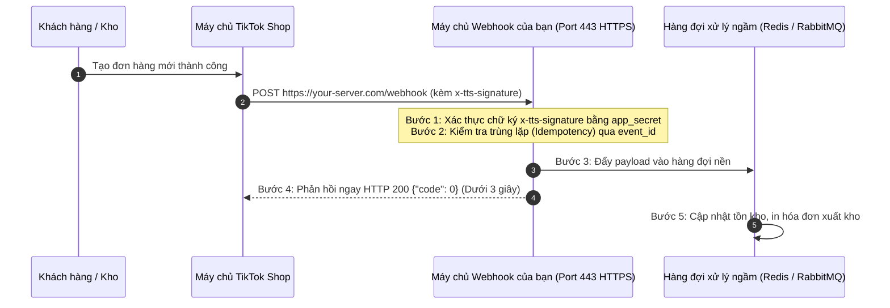

# 16. Cơ Chế Webhook & Lắng Nghe Sự Kiện Thời Gian Thực (44 Sự Kiện)

Thay vì phải gọi API thăm dò (polling) liên tục gây tốn tài nguyên và dễ bị chặn giới hạn tần suất (Rate Limit), TikTok Shop cung cấp cơ chế **Webhook Push**: ngay khi có sự kiện phát sinh (khách đặt đơn, hủy đơn, hàng giao thành công, thay đổi tồn kho, tin nhắn mới...), máy chủ TikTok sẽ tự động đẩy ngay một HTTP POST request chứa dữ liệu sự kiện tới máy chủ của bạn.

---

## 1. Kiến Trúc Hoạt Động & Yêu Cầu Vận Hành Webhook



### Các Quy Tắc Sống Còn Khi Xử Lý Webhook

1. **Giao thức HTTPS**: Địa chỉ Webhook URL bắt buộc sử dụng HTTPS với chứng chỉ SSL hợp lệ.
2. **Thời gian phản hồi (Timeout SLA)**: Máy chủ của bạn **phải phản hồi HTTP 200 trong vòng 3 giây**. Nếu quá 3 giây, TikTok coi là gửi thất bại và sẽ kích hoạt cơ chế gửi lại (Retry). Do đó, hãy đẩy ngay payload vào Queue (Redis/Bull/Celery) rồi phản hồi ngay lập tức, không xử lý logic nặng đồng bộ.
3. **Cơ chế gửi lại (Retry Policy)**: Nếu máy chủ của bạn phản hồi mã lỗi (5xx, 4xx) hoặc bị timeout, hệ thống sẽ tự động thử lại nhiều lần theo thuật toán lũy thừa giảm dần trong vòng **48 giờ**.
4. **Tính lũy biến (Idempotency)**: Do cơ chế retry qua mạng, bạn có thể nhận cùng 1 sự kiện nhiều hơn 1 lần. Hãy luôn lưu `event_id` hoặc kiểm tra trạng thái đơn hàng hiện tại trong database để tránh trừ kho 2 lần.

---

## 2. Xác Thực Chữ Ký Webhook (Signature Verification)

Để đảm bảo yêu cầu HTTP POST thực sự xuất phát từ TikTok Shop chứ không phải kẻ xấu giả mạo, TikTok đính kèm chữ ký trong Header `x-tts-signature`.

### Thuật toán xác minh:
1. Lấy toàn bộ chuỗi ký tự raw JSON Body của request.
2. Tính toán mã băm HMAC-SHA256 của chuỗi raw body với khóa bí mật là `app_secret`.
3. So sánh chuỗi hex tính toán được với giá trị trong Header `x-tts-signature`. Nếu khớp -> Tin cậy và tiếp tục xử lý.

#### Code mẫu xác minh bằng Python

```python
import hmac
import hashlib

def verify_webhook_signature(raw_body_bytes: bytes, signature_header: str, app_secret: str) -> bool:
    computed = hmac.new(
        app_secret.encode("utf-8"),
        raw_body_bytes,
        hashlib.sha256
    ).hexdigest()
    return hmac.compare_digest(computed, signature_header)
```

---

## 3. Từ Điển 44 Sự Kiện Webhook Chuẩn Khớp 11 Phân Hệ

| Phân hệ | Tên sự kiện (Event Type) | Ý nghĩa sự kiện |
| :--- | :--- | :--- |
| **Đơn hàng (Order)** | `ORDER_STATUS_CHANGE` | Trạng thái đơn hàng thay đổi (ví dụ chuyển sang AWAITING_SHIPMENT) |
| | `RECIPIENT_ADDRESS_UPDATE` | Khách thay đổi địa chỉ nhận hàng trước khi đóng gói |
| **Sản phẩm (Product)** | `PRODUCT_STATUS_CHANGE` | Sản phẩm được duyệt mở bán (ACTIVATE) hoặc bị từ chối (FAILED) |
| | `PRODUCT_AUDIT_RESULT` | Kết quả kiểm duyệt sản phẩm từ đội ngũ kiểm định TikTok |
| | `PRODUCT_PRICE_CHANGE` | Giá bán sản phẩm bị thay đổi |
| | `PRODUCT_OUT_OF_STOCK` | Sản phẩm bị hết hàng trong kho |
| **Trả hàng (Return & Refund)** | `RETURN_STATUS_CHANGE` | Người mua gửi yêu cầu hoàn hàng mới hoặc trạng thái hoàn tiền thay đổi |
| | `PACKAGE_RETURNED_TO_SELLER` | Bưu tá giao kiện hàng hoàn trả về tận kho seller |
| **Vận chuyển & Kiện hàng** | `PACKAGE_UPDATE` | Kiện hàng đã được xuất kho hoặc cập nhật hành trình |
| | `LOGISTICS_TRACKING_UPDATE` | Trạng thái theo dõi đơn vị vận chuyển thay đổi (Đang giao, Giao thất bại) |
| **Lưu kho TikTok (FBT)** | `FBT_INBOUND_SHIPMENT_STATUS_CHANGE` | Lô hàng nhập vào kho TikTok FBT đã được quét đếm |
| | `FBT_INVENTORY_CHANGE` | Biến động số lượng tồn kho thực tế tại kho FBT |
| **Chăm sóc KH (IM Chat)** | `IM_NEW_MESSAGE` | Khách hàng nhắn tin mới đến gian hàng |
| **Khuyến mại (Promotion)** | `PROMOTION_STATUS_CHANGE` | Chiến dịch khuyến mại bắt đầu kích hoạt hoặc kết thúc |
| **Cửa hàng (Seller)** | `UPCOMING_AUTHORIZATION_EXPIRATION` | Cảnh báo ủy quyền của shop sắp hết hạn cần gia hạn |
| | `SELLER_DEAUTHORIZATION` | Shop vừa thu hồi quyền truy cập của ứng dụng |
| **Tiếp thị (Affiliate)** | `AFFILIATE_CREATOR_COLLABORATION_UPDATE` | Creator chấp nhận hoặc từ chối lời mời hợp tác bán hàng |
| | `AFFILIATE_SAMPLE_STATUS_UPDATE` | Trạng thái đơn gửi hàng mẫu cho KOC thay đổi |

