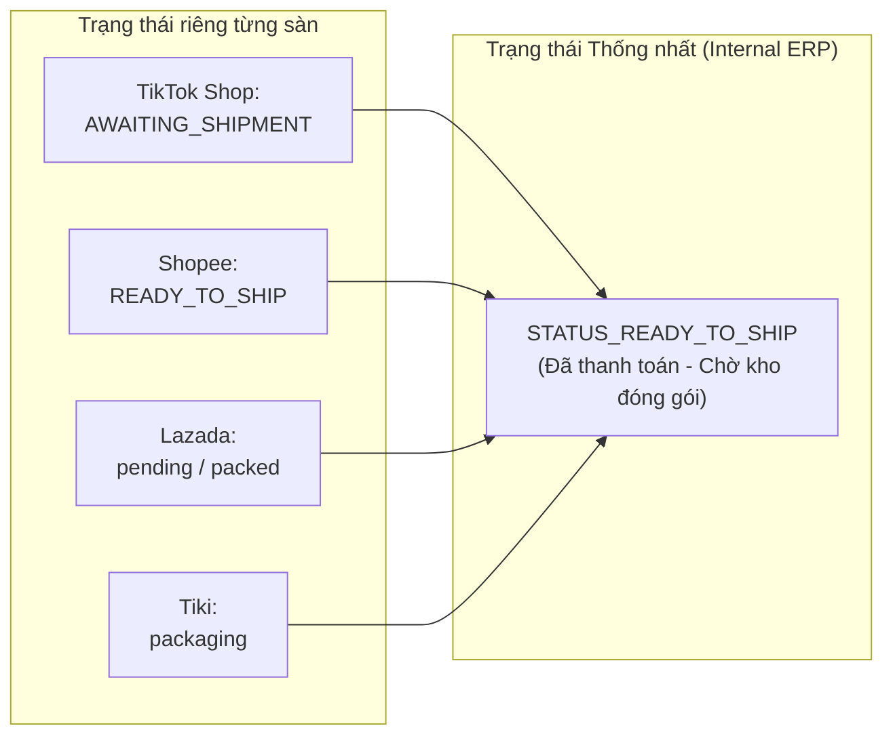
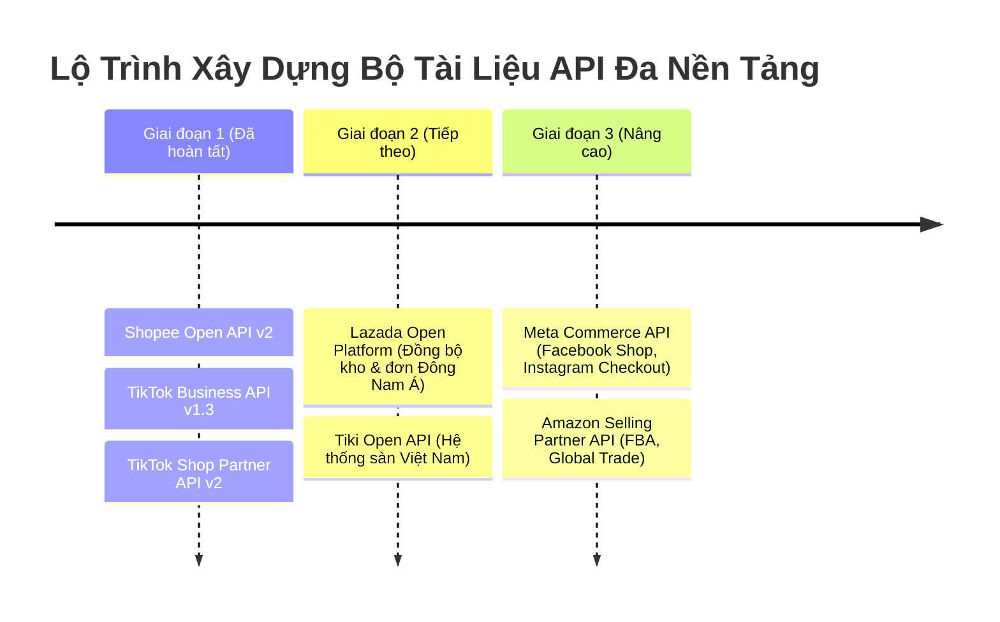

# 19. Kế Hoạch Kiến Trúc & Mở Rộng Hệ Thống API Đa Sàn (Multi-Platform E-commerce API Framework)

Tài liệu này đóng vai trò là **Bản quy hoạch kiến trúc tổng thể (Master Architectural Blueprint)** cho toàn bộ thư mục gốc `api-docs/`, thiết lập quy chuẩn cấu trúc tài liệu, đồng bộ mô hình dữ liệu và lộ trình tích hợp cho các sàn thương mại điện tử kế tiếp (Lazada, Tiki, Meta/Facebook Shop, Amazon SP-API...).

---

## 1. Cấu Trúc Chuẩn Hóa Của Từng Nền Tảng Trong Thư Mục `api-docs/`

Để mọi kỹ sư và hệ sinh thái bot/AI có thể dễ dàng khai thác, toàn bộ các dự án tài liệu API trong `api-docs/` được chuẩn hóa theo quy tắc **4 tầng thống nhất**:

```text
api-docs/
├── shoppe-api/                  # Sàn Shopee (Shopee Open Platform v2)
│   ├── README.md                # Tài liệu tổng quan & Hướng dẫn sử dụng tiếng Việt
│   ├── docs/                    # Các phân hệ chi tiết
│   └── scripts/                 # Công cụ tải & kiểm thử
│
├── tiktok-business-api/         # Quảng cáo & Tiếp thị TikTok (TikTok Ads & Marketing v1.3)
│   ├── README.md                # Tài liệu tiếng Việt chuẩn 16 phân hệ
│   ├── docs/                    # Chi tiết 16 phân hệ khớp 1:1 cổng Web
│   ├── _raw/                    # Dữ liệu nguồn thô (tree.json, index.json, docs/)
│   └── _scripts/                # Bộ script tải, trích xuất & làm sạch
│
├── tiktok-shop-api/             # Sàn TikTok Shop (TikTok Shop Partner API v2)
│   ├── README.md                # Tài liệu tiếng Việt tổng thể 19 phân hệ
│   ├── docs/                    # Chi tiết 19 phân hệ chuyên sâu
│   ├── _raw/                    # Toàn bộ 882 tài liệu thô từ cổng Partner
│   └── _scripts/                # Script fetch_docs.py, sign_request.py...
│
├── lazada-api/                  # [KẾ HOẠCH BƯỚC TIẾP THEO] Lazada Open Platform
├── tiki-api/                    # [KẾ HOẠCH BƯỚC TIẾP THEO] Tiki Open API
├── meta-commerce-api/           # [KẾ HOẠCH BƯỚC TIẾP THEO] Meta / Facebook & Instagram Shopping
└── amazon-sp-api/               # [KẾ HOẠCH BƯỚC TIẾP THEO] Amazon Selling Partner API (SP-API)
```

---

## 2. Ma Trận Chuẩn Hóa Trạng Thái Đơn Hàng Đa Sàn (Order Status Unified Matrix)

Khi xây dựng phần mềm quản lý bán hàng đa kênh (Omnichannel), điểm then chốt là quy đổi mã trạng thái đơn hàng của các sàn khác nhau về một **Trạng thái Thống nhất (Unified Status)**:



### Bảng Ma Trận Quy Đổi Trạng Thái Đơn Hàng

| Trạng thái thống nhất (Unified) | TikTok Shop | Shopee Open API v2 | Lazada Open Platform | Tiki Open API | Amazon SP-API |
| :--- | :--- | :--- | :--- | :--- | :--- |
| `ORDER_UNPAID` | `UNPAID` | `UNPAID` | `pending_payment` | `hold` | `Pending` |
| `ORDER_FRAUD_CHECK` | `ON_HOLD` | - | - | - | - |
| `ORDER_READY_TO_SHIP` | `AWAITING_SHIPMENT` | `READY_TO_SHIP` | `pending` / `packed` | `packaging` | `Unshipped` |
| `ORDER_SHIPPED_PICKUP` | `AWAITING_COLLECTION` | `PROCESSED` | `ready_to_ship` | `packaged` | - |
| `ORDER_IN_TRANSIT` | `IN_TRANSIT` | `SHIPPED` | `shipped` | `shipping` | `PartiallyShipped` |
| `ORDER_DELIVERED` | `DELIVERED` | `TO_CONFIRM_RECEIVE` | `delivered` | `delivered` | - |
| `ORDER_COMPLETED` | `COMPLETED` | `COMPLETED` | `confirmed` | `successful_delivery`| `Shipped` |
| `ORDER_CANCELLED` | `CANCELLED` | `CANCELLED` | `canceled` | `canceled` | `Canceled` |
| `ORDER_RETURN_REFUND` | `IN_REVERSE` | `IN_CANCEL` | `returned` | `returned` | - |

---

## 3. Lộ Trình Triển Khai Bộ Tài Liệu Kế Tiếp

Dưới đây là kế hoạch chi tiết cho các nền tảng thương mại điện tử tiếp theo được người bán Việt Nam và Quốc tế sử dụng phổ biến nhất:



### 3.1. Dự Án Kế Tiếp 1: `lazada-api` (Lazada Open Platform)
- **Cổng thông tin**: `https://open.lazada.com/`
- **Cơ chế xác thực**: OAuth 2.0 (Access Token hạn 30 ngày, Refresh Token hạn 180 ngày).
- **Cơ chế ký số**: HMAC-SHA256 hoặc MD5 với `app_secret`.
- **Điểm trọng tâm**: Hệ thống kho đa quốc gia tại Singapore, Malaysia, Thái Lan, Philippines, Indonesia, Việt Nam.

### 3.2. Dự Án Kế Tiếp 2: `tiki-api` (Tiki Open API)
- **Cổng thông tin**: `https://open.tiki.vn/`
- **Cơ chế xác thực**: OAuth 2.0 Client Credentials và Authorization Code.
- **Điểm trọng tâm**: Mô hình TikiNOW giao siêu tốc 2 giờ, hệ thống Tikifast và Tiki FBT (Tiki Fulfillment).

### 3.3. Dự Án Kế Tiếp 3: `meta-commerce-api` (Meta / Facebook Shop)
- **Cổng thông tin**: `https://developers.facebook.com/docs/commerce-platform`
- **Cơ chế xác thực**: Meta Graph API User Access Token & System User Token.
- **Điểm trọng tâm**: Đồng bộ Product Catalog lên Facebook Page, Instagram Shopping Tagging và tin nhắn chốt đơn Messenger / Instagram Direct.

### 3.4. Dự Án Kế Tiếp 4: `amazon-sp-api` (Amazon Selling Partner API)
- **Cổng thông tin**: `https://developer-docs.amazon.com/sp-api/`
- **Cơ chế xác thực**: LWA (Login with Amazon) + AWS Signature Version 4 (SigV4) với AWS IAM Role.
- **Điểm trọng tâm**: Hệ thống FBA (Fulfillment by Amazon), quản lý đa vùng NA (North America), EU, FE (Far East).

---

## 4. Hướng Dẫn Kích Hoạt Tự Động Hóa Tạo Tài Liệu Cho Sàn Mới

Khi bạn cần tạo tài liệu cho sàn tiếp theo, chỉ cần gửi URL tài liệu của sàn đó (ví dụ: `https://open.lazada.com/doc/doc.htm`), hệ thống sẽ tự động kích hoạt pipeline:
1. Tạo thư mục nền tảng mới: `<ten-san>-api/`.
2. Tạo script crawler thô vào `<ten-san>-api/_scripts/fetch_docs.py` tải toàn bộ tài liệu về `_raw/`.
3. Biên soạn bộ tài liệu tiếng Việt có đầy đủ sơ đồ Mermaid, cURL mẫu và từ điển lỗi khớp 100% tài liệu gốc.
4. Cập nhật bảng ma trận trạng thái đơn hàng và tồn kho đa sàn trong `19-ke-hoach-mo-rong-he-thong-api-da-san/README.md`.

